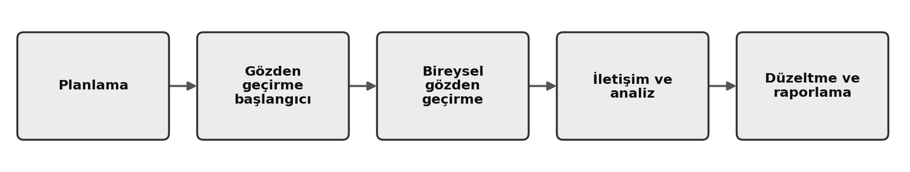
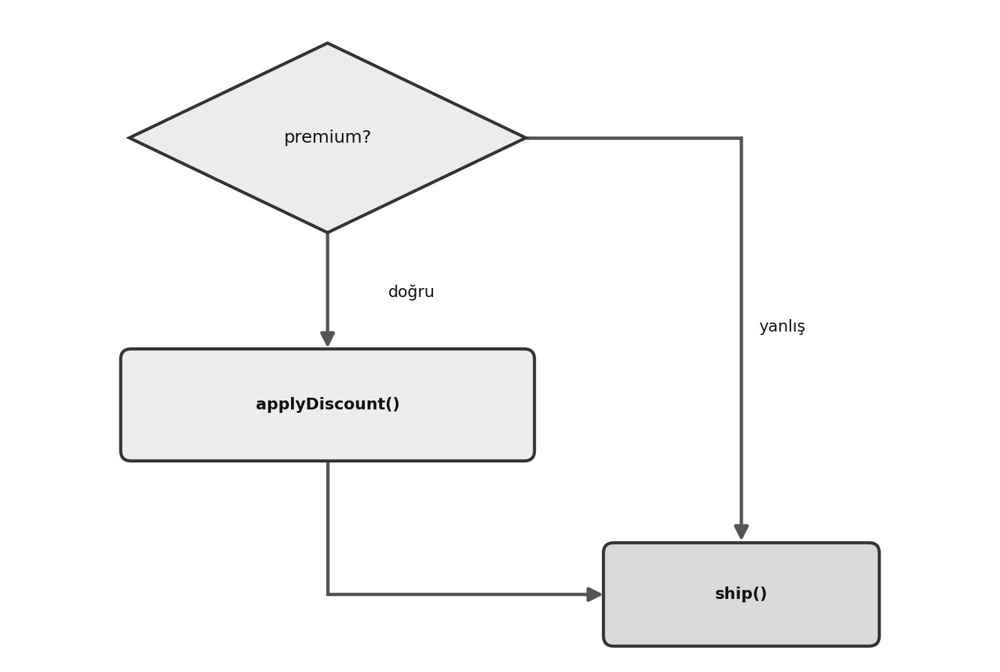

# ISTQB® CTFL® v4.0 Sınav Rehberi: Sıfırdan Sınava Hazır Seviyeye {#istqb-ctfl-v4.0-exam-guide-from-fundamentals-to-exam-ready}

*Bağımsız · Gayriresmî çalışma rehberi — ISTQB® ya da Turkish Testing Board (TTB) ile bağlantılı değildir, onlar tarafından onaylanmamıştır*

### ISTQB® Sertifikalı Test Uzmanı Temel Seviye Ders Programı v4.0'ın 64 öğrenme hedefinin tamamını kapsar (teknik temel: v4.0.1 düzeltmeleri) — her K3 hedefi için çözümlü örneklerle

Sınavın gerçekte neyi ölçtüğü üzerine kuruldu. Hiç başlamamış biri için okunabilir, deneyimli bir test uzmanı için doğru.

**Kadir Çamoğlu**

---

| | |
| --- | --- |
| Baskı | Birinci baskı (herkese açık taslak) |
| Kapsanan sınav | ISTQB® Sertifikalı Test Uzmanı Temel Seviye (CTFL®) |
| Ders programı | CTFL® Ders Programı v4.0 (Nisan 2023); **teknik temel v4.0.1** (düzeltme sürümü; ÖH ifadeleri ve terimler buna göre). Türkçe ifadeler: TTB Türkçe ders programı v4.0.1 |
| Sınav yapısı kaynağı | ISTQB® Exam Structure Tables v1.18 · Exam Structures and Rules v1.2 |
| Kapsanan biçim | 40 soru · 60 dakika · geçme notu 26/40 (%65) · TTB sınavında soru kitapçığı Türkçe ve İngilizce (ayrıntı: *CTFL® Sınavı Nasıl İşler*) |

\newpage

# Telif Hakkı ve Marka Bildirimi {#copyright-trademark-notice}

© 2026 Kadir Çamoğlu.

**Lisans.** Aksi belirtilmedikçe bu eser Creative Commons Atıf-GayriTicari 4.0 Uluslararası lisansı (CC BY-NC 4.0) ile lisanslanmıştır: <https://creativecommons.org/licenses/by-nc/4.0/deed.tr>. Eseri ticari olmayan amaçlarla kopyalayabilir, paylaşabilir ve uyarlayabilirsiniz; bunun için uygun biçimde kaynak göstermeniz, lisansa bağlantı vermeniz ve yaptığınız değişiklikleri belirtmeniz gerekir. ISTQB® belgelerinden ve bu belgelerin TTB Türkçe çevirilerinden alıntılanan malzeme (öğrenme hedeflerinin ifadeleri dahil) ve bütün markalar bu lisansın kapsamı dışındadır.

**Bağımsız, gayriresmî çalışma rehberi.** Bu kitap **bağımsız, gayriresmî bir çalışma rehberidir**. ISTQB® (International Software Testing Qualifications Board), üye kurulları, Türkiye'deki üye kurul Turkish Testing Board (TTB, Yazılım Test ve Kalite Derneği) ya da herhangi bir sınav sağlayıcı ile bağlantılı **değildir**; onlar tarafından yazılmamış, onaylanmamış, desteklenmemiş, lisanslanmamış ya da akredite edilmemiştir. Kitap resmî ders programının metnini yeniden üretmez: açıklamalar yazarın kendi ifadesidir. Ders programından kaynak gösterilerek alıntılanan kısım öğrenme hedeflerinin kimlikleri ve ifadeleri, yedi test prensibinin adları ve anahtar kelime listeleriyle sınırlıdır. Terimler TTB Türkçe ders programını izler; TTB *Yazılım Testi Terimler Sözlüğü*'ndeki karşılık farklıysa sözlükte ikincil olarak verilir. Bu kitaptaki sözlük maddeleri yazarın kendi ifadesiyle yazılmıştır. Kitaptaki hiçbir ifade resmî ya da akredite bir statü ima ediyormuş gibi okunmamalıdır.

**Markalar.** ISTQB®, International Software Testing Qualifications Board'un tescilli markasıdır. "Certified Tester Foundation Level", Türkçesi "Sertifikalı Test Uzmanı Temel Seviye" ve kısaltması "CTFL®" yalnızca bu rehberin kapsadığı sertifikayı ve ders programını tanımlamak için kullanılır. Diğer bütün markalar sahiplerine aittir. Bu kitapta ISTQB® ya da TTB logosu veya akreditasyon rozeti kullanılmaz.

**Kaynak bildirimi.** Bu rehber teknik ve yapısal temel olarak *ISTQB® Certified Tester Foundation Level Syllabus v4.0.1*'i kullanır. v4.0.1 ders programının yazarları—Renzo Cerquozzi, Wim Decoutere, Jean-François Riverin, Arnika Hryszko, Martin Klonk, Meile Posthuma, Eric Riou du Cosquer (başkan), Adam Roman, Lucjan Stapp, Stephanie Ulrich (başkan yardımcısı) ve Eshraka Zakaria—, v4.0 ders programının yazarları—Renzo Cerquozzi, Wim Decoutere, Klaudia Dussa-Zieger, Jean-François Riverin, Arnika Hryszko, Martin Klonk, Michaël Pilaeten, Meile Posthuma, Stuart Reid, Eric Riou du Cosquer (başkan), Adam Roman, Lucjan Stapp, Stephanie Ulrich (başkan yardımcısı) ve Eshraka Zakaria— ve ISTQB® bu ders programının kaynağı ve telif hakkı sahibi olarak belirtilir. Sınav biçimiyle uyum için kullanılan *ISTQB® Exam Structure Tables v1.18* ve *Exam Structures and Rules v1.2* belgelerinin kaynağı ve telif hakkı sahibi olarak da ISTQB® Sınav Çalışma Grubu ve ISTQB® belirtilir. 

**Türkçe çeviriler.** Öğrenme hedeflerinin Türkçe ifadeleri, yedi prensibin adları ve terimler şu kaynaktan alınmıştır: *ISTQB® Sertifikalı Test Uzmanı Temel Seviye Ders Programı v4.0.1*, Türkçe çeviri: Yazılım Test ve Kalite Derneği (Turkish Testing Board), <https://www.turkishtestingboard.org>. Bu çevirinin telif hakkı da ISTQB®'ye aittir. Terimlerin ikincil kaynağı aynı derneğin yayımladığı *ISTQB® Yazılım Testi Terimler Sözlüğü v2.0*'dır. Alıntılar ticari olmayan amaçla ve kaynak gösterilerek yapılmıştır. 

**Öğrenme hedefleri.** Temel Seviye'nin 64 öğrenme hedefine resmî kimlikleri (FL-x.y.z) ve TTB Türkçe ders programındaki resmî ifadeleriyle atıf yapılır. Atıf, çalışmayı ders programıyla hizalamak içindir; yetkili kaynak resmî ders programıdır.

**Özgün içerik.** Bu kitaptaki bütün açıklamalar, örnekler, şekiller, alıştırmalar ve deneme soruları özgündür. Gerçek ISTQB® sınavlarından ya da resmî ISTQB® veya TTB örnek sınavlarından alınmamıştır. Deneme sınavındaki İngilizce soru metinleri de yazarındır; bu kitabın İngilizce sürümünden aynen aktarılmıştır.

**Doğruluk.** Sınav biçimi, süresi ve içeriği değişebilir. Sınava girmeden önce sınav koşullarının güncel halini resmî sayfadan mutlaka kontrol edin; koşullar değişmiş olabilir: TTB CTFL® sayfası, <https://www.turkishtestingboard.org/en/foundation-level/>. Sınava başka bir kurul ya da sınav sağlayıcı üzerinden giriyorsanız onun sayfasına bakın.

**Garanti yok.** Herhangi bir sertifika sınavını geçmek adaya bağlıdır. Bu rehber hazırlamayı amaçlar, başarıyı garanti etmez.

**Geri bildirim.** Hatalar, anlaşılmayan yerler ve önerileriniz için: kadir.camoglu@gmail.com.

Birinci baskı (herkese açık taslak) · 2026.

\newpage

# Otomatik İçindekiler

- [ISTQB® CTFL® v4.0 Sınav Rehberi: Sıfırdan Sınava Hazır Seviyeye](#istqb-ctfl-v4.0-exam-guide-from-fundamentals-to-exam-ready)
- [Telif Hakkı ve Marka Bildirimi](#copyright-trademark-notice)
- [Giriş — Bu Kitap Hakkında](#introduction-about-this-book)
  - [Bu kitap nedir](#what-this-book-is)
  - [Bu kitap kimin için](#who-this-book-is-for)
  - [Kitaptaki sorular üzerine bir not](#a-note-on-the-books-questions)
  - [Terminoloji üzerine bir not (v4.0 ve 2018)](#a-note-on-terminology-v4.0-vs-2018)
  - [Sınav neye dayanır](#what-the-exam-is-built-on)
- [Bu Kitap Nasıl Kullanılır](#how-to-use-this-book)
  - [Öğrenme hedefleri ve K seviyeleri](#learning-objectives-and-k-levels)
  - [Üç ses](#the-three-voices)
  - [Her bölüm nasıl kurulmuştur](#how-each-chapter-is-structured)
  - [K3 kesimleri nasıl işler](#how-the-k3-sections-work)
  - [Çalışma yolları](#study-tracks)
  - [Kutular, şekiller ve tablolar](#callouts-figures-and-tables-you-will-see)
  - [Kitabın sonunda neler var](#what-you-will-find-at-the-back)
- [CTFL® Sınavı Nasıl İşler](#how-the-ctfl-exam-works)
  - [Bir bakışta sınav (resmî bilgiler)](#the-exam-at-a-glance-official-facts)
  - [Bölümlere göre soru dağılımı (40 soru)](#question-distribution-by-chapter-40-questions)
  - [Bilişsel seviyeye göre soru dağılımı (40 soru)](#question-distribution-by-cognitive-level-40-questions)
  - [CTFL® soruları nasıl kurulur](#how-ctfl-questions-are-built)
  - [İki adımlı yanıtlama stratejisi](#a-two-step-answering-strategy)
  - [60 dakikanızı yönetmek](#managing-your-60-minutes)
- [Hedef Haritası](#objective-map)
  - [Öğrenme hedeflerinin tam tablosu](#full-learning-objective-table)
  - [Kapsam ve ağırlık özeti](#coverage-weight-summary)
  - [Sekiz K3 hedefi (çözümlü örnek + bağımsız alıştırma + çözüm)](#the-eight-k3-objectives-worked-example-independent-exercise-solution)
- [Çalışma Yol Haritası](#study-roadmap)
  - [Çalışmanızı sınav planına göre ağırlıklandırın](#weight-your-study-by-the-exam-blueprint)
  - [Üç yol](#three-tracks)
  - [Dört haftalık plan (günde yaklaşık 1–1,5 saat)](#the-four-week-plan-about-1-to-1.5-hours-a-day)
  - [Üç haftalık plan (günde yaklaşık 1–1,5 saat, biraz deneyimi olan adaylar için)](#the-three-week-plan-about-1-to-1.5-hours-a-day-for-candidates-with-some-background)
  - [İki haftalık plan (günde yaklaşık 1–1,5 saat, deneyimli adaylar için)](#the-two-week-plan-about-1-to-1.5-hours-a-day-for-experienced-candidates)
  - [K3 iş yükü](#k3-workload)
- [Bölüm 1 — Yazılım Testinin Temelleri](#chapter-1-fundamentals-of-testing)
  - [1.1 Yazılım Testi Nedir?](#what-is-testing)
  - [1.2 Yazılım Testi Neden Gereklidir?](#why-is-testing-necessary)
  - [1.3 Test Prensipleri (FL-1.3.1 — K2)](#the-seven-testing-principles-fl-1.3.1-k2)
  - [1.4 Test Aktiviteleri, Test Çalışma Ürünleri ve Test Rolleri](#test-activities-testware-and-test-roles)
  - [1.5 Test Etme Sürecinde Gerekli Beceriler ve İyi Uygulamalar](#essential-skills-and-good-practices-in-testing)
  - [Bölüm 1 özeti](#chapter-1-summary)
  - [Bölüm alıştırmaları](#chapter-exercises)
- [Bölüm 2 — Yazılım Geliştirme Yaşam Döngüsü Boyunca Test](#chapter-2-testing-throughout-the-software-development-lifecycle)
  - [2.1 Yazılım Geliştirme Yaşam Döngüsü Bağlamında Test](#testing-in-the-context-of-a-software-development-lifecycle)
  - [2.2 Test Seviyeleri ve Test Çeşitleri](#test-levels-and-test-types)
  - [2.3 Bakım Testleri (FL-2.3.1 — K2)](#maintenance-testing-fl-2.3.1-k2)
  - [Bölüm 2 özeti](#chapter-2-summary)
  - [Birikimli hatırlama](#cumulative-retrieval)
  - [Bölüm alıştırmaları](#chapter-exercises-1)
- [Bölüm 3 — Statik Testler](#chapter-3-static-testing)
  - [3.1 Statik Testin Temelleri](#static-testing-basics)
  - [3.2 Geri Bildirim ve Gözden Geçirme Süreci](#feedback-and-the-review-process)
  - [Bölüm 3 özeti](#chapter-3-summary)
  - [Birikimli hatırlama](#cumulative-retrieval-1)
  - [Bölüm alıştırmaları](#chapter-exercises-2)
- [Bölüm 4 — Test Analizi ve Tasarımı](#chapter-4-test-analysis-and-design)
  - [4.1 Test Tekniklerine Genel Bakış (FL-4.1.1 — K2)](#overview-of-test-techniques-fl-4.1.1-k2)
  - [4.2 Kara Kutu Test Teknikleri](#black-box-test-techniques)
  - [4.3 Beyaz Kutu Test Teknikleri](#white-box-test-techniques)
  - [4.4 Tecrübeye Dayalı Test Teknikleri](#experience-based-test-techniques)
  - [4.5 İş Birliğine Dayalı Test Yaklaşımları](#collaboration-based-test-approaches)
  - [Bölüm 4 özeti](#chapter-4-summary)
  - [Birikimli hatırlama](#cumulative-retrieval-2)
  - [Bölüm alıştırmaları](#chapter-exercises-3)
  - [Bağımsız alıştırma çözümleri](#independent-exercise-solutions)
- [Bölüm 5 — Test Aktivitelerini Yönetme](#chapter-5-managing-the-test-activities)
  - [5.1 Test Planlama](#test-planning)
  - [5.2 Risk Yönetimi](#risk-management)
  - [5.3 Test Gözetimi, Test Kontrol ve Test Tamamlama](#test-monitoring-test-control-and-test-completion)
  - [5.4 Yapılandırma Yönetimi (FL-5.4.1 — K2)](#configuration-management-fl-5.4.1-k2)
  - [5.5 Hata Yönetimi](#defect-management)
  - [Bölüm 5 özeti](#chapter-5-summary)
  - [Birikimli hatırlama](#cumulative-retrieval-3)
  - [Bölüm alıştırmaları](#chapter-exercises-4)
  - [Bağımsız alıştırma çözümleri](#independent-exercise-solutions-1)
- [Bölüm 6 — Test Araçları](#chapter-6-test-tools)
  - [6.1 Yazılım Testleri için Araç Desteği](#tool-support-for-testing)
  - [6.2 Test Otomasyonunun Faydaları ve Riskleri](#benefits-and-risks-of-test-automation)
  - [Bölüm 6 özeti](#chapter-6-summary)
  - [Birikimli hatırlama](#cumulative-retrieval-4)
  - [Bölüm alıştırmaları](#chapter-exercises-5)
- [Cevaplar ve Gerekçeler](#answers-rationale)
  - [Bölüm 1 — Yazılım Testinin Temelleri](#chapter-1-fundamentals-of-testing-1)
  - [Bölüm 2 — Yazılım Geliştirme Yaşam Döngüsü Boyunca Test](#chapter-2-testing-throughout-the-sdlc)
  - [Bölüm 3 — Statik Testler](#chapter-3-static-testing-1)
  - [Bölüm 4 — Test Analizi ve Tasarımı](#chapter-4-test-analysis-and-design-1)
  - [Bölüm 5 — Test Aktivitelerini Yönetme](#chapter-5-managing-the-test-activities-1)
  - [Bölüm 6 — Test Araçları](#chapter-6-test-tools-1)
  - [Birikimli hatırlama — örnek cevaplar](#cumulative-retrieval-model-answers)
- [Sözlük](#glossary)
- [Sık Karıştırılan Kavramlar — Ana Liste](#commonly-confused-pairs-master-list)
- [Son Tekrar Planı](#final-revision-plan)
  - [Neleri yeniden okumalı](#what-to-re-read)
  - [Hangi K3 teknikleri yeniden çalışılmalı](#which-k3-techniques-to-re-drill)
  - [Yeniden kontrol edilecek karışıklıklar](#common-confusions-to-re-check)
  - [Zamanlama ve sınavdan önceki gün](#timing-and-the-day-before)
- [Deneme Sınavı 1 — 40 Soru, Gerekçeleriyle](#mock-exam-1-40-questions-with-rationale)
  - [Kısım 1 — Sorular](#part-1-questions)
  - [Kısım 2 — Cevap Anahtarı ve Puan Yorumu](#part-2-answer-key-and-score-interpretation)
  - [Kısım 3 — Cevaplar, Açıklamalar ve Kaynaklar](#part-3-answers-explanations-and-references)
- [İleri Kaynaklar](#further-resources)

\newpage

# Giriş — Bu Kitap Hakkında {#introduction-about-this-book}

## Bu kitap nedir {#what-this-book-is}

Bu kitap, ders programını kuru biçimde yeniden anlatan bir metin değil; CTFL® sınavına hazırlığınızda kapsamlı bir yol arkadaşıdır. Resmî ders programı sınavda sorulabilecek kapsamı tanımlar ve yetkili teknik temeli verir. Bu kitap onu pratik örneklerle, yönlendirmeli alıştırmalarla ve komşu fikirler arasında açıkça kurulan bağlantılarla tamamlar.

Her sayfada iki ilke işler. Birincisi, resmî kapsama sıkı sıkıya bağlılıktır. Gereksiz, ileri düzey ayrıntılara zaman kaybetmezsiniz. Sınav, altı bölüme dağılmış 64 **öğrenme hedefi (ÖH; learning objective, LO)** ve ders programının anahtar kelimeleri üzerine kuruludur. Bu kitapta her bölüm doğrudan bir ders programı bölümüne karşılık gelir ve temel terimler öğretildikleri yerde tanımlanır. Örnekler bağlam katar, ama sınavda sorulabilecek iddialar v4.0 kapsamının içinde kalır. İkinci ilke v4.0 terimlerine bağlılıktır. 2023 ders programı, eski 2018 sürümüne (v3.1) göre bazı adları, listeleri ve vurguları değiştirdi; bu kitap güncel terimleri olduğu gibi izler. Örneğin beşinci test prensibinin resmî adı artık "testler yıpranır" (tests wear out). Bu prensip eskiden "pestisit paradoksu" (pesticide paradox) olarak biliniyordu; TTB ders programı ise ona "antibiyotik direnci" adını verir.  Böylece burada çalıştığınız terim, sınavda karşılaşacağınız terimle aynı olur. Kitap boyunca kritik terimler ilk geçtikleri yerde vurgulanır ve özet tablolarda pekiştirilir.

Bu kitap kendi başına yeten bir hazırlık kaynağıdır. Bir bölümü okuyabilir, ardından gelen soruları çözebilir ve yanlış yaptığınız bir sorunun nedenini başka bir belgeye başvurmadan doğrudan öğrenebilirsiniz.

## Bu kitap kimin için {#who-this-book-is-for}

CTFL® sınavının ön koşulu yoktur, bu kitabın da yoktur. Kitap şu okurlar için yazıldı: temel kavramları baştan öğrenmek isteyen yazılım testine yeni başlayanlar; uluslararası tanınan bir sertifikayı hedefleyen ve sınav kapsamını net görmek isteyen yazılımcılar, iş analistleri ve proje yöneticileri; uygulamada edindikleri bilgiyi kuramsal bir çerçeveye oturtmak ve terimlerini v4.0'a güncellemek isteyen test uzmanları; ve belirli eksikleri ÖH haritası ile soru ağırlığı tablolarıyla hızla kapatmak isteyen, sınava yeniden girecek adaylar. Terimler ilk geçtikleri yerde açıklanır ve her kavram gerçekçi bir iş yeri örneğine bağlanır; yine de içerik yüzeysel anlatımdan uzak tutulur. Bütün tanımlar, kavramlar ve ayrımlar sınavda karşılaşacağınız resmî standartlarla tam uyumludur.

Kitabın bütününde bir fikir öne çıkıyor ve bunu en başta söylemeye değer: CTFL®, pratik bir çekirdeği olan bir kelime dağarcığı ve ayrımlar sınavıdır. Kırk sorunun otuz ikisi resmî kavramları hatırlama ve birbirinden ayırma becerinizi ölçer (K1 ve K2). Kalan sekizi, adı konmuş sekiz tekniği küçük problemlere uygulama becerinizi ölçer (K3). İyi kurulmuş yanlış şıklar genellikle rastgele değildir; hedefe çok yakın düşen komşu kavramdır. Ayrımları bilinçli olarak öğrenmenin, bu kitabın üzerine kurulduğu hazırlık stratejisi olmasının nedeni budur.

## Kitaptaki sorular üzerine bir not {#a-note-on-the-books-questions}

Bu kitaptaki her soru özgündür; resmî örnek sınav sorularından hiçbirini kullanmaz. Her bölümü nasıl çalışacağınız (çalışma yolları, üç ses, K3 biçimi) için hemen ardından gelen "Bu Kitap Nasıl Kullanılır" bölümüne bakın. Deneme sınavındaki sorular, bu kitabın İngilizce sürümündeki deneme sınavıyla aynıdır; her soru önce İngilizce, hemen altında Türkçe verilir.

## Terminoloji üzerine bir not (v4.0 ve 2018) {#a-note-on-terminology-v4.0-vs-2018}

Bu kitap güncel resmî adları olduğu gibi kullanır, çünkü 2023 ders programı bunların birkaçını yeniden adlandırdı. En açık örnek beşinci prensiptir: artık kullanılmayan "pestisit paradoksu" yerine "testler yıpranır".  Yedinci prensibin adı da değişti ve bu kitap yalnızca güncel adını öğretir: "hatasızlık yanılgısı" (absence-of-defects fallacy). Bir terim değiştiğinde kitap güncel adı öğretir; eski adı yalnızca kısa bir tarihsel uyarı olarak anar, böylece onu eski çalışma kaynaklarında görünce tanıyabilirsiniz. Sınav güncel adları kullanır.

Türkçede bir katman daha var. Terimler TTB Türkçe ders programı v4.0.1'den alınır. Birkaç yerde kitap, TTB adının yanında daha kısa ya da daha açık bir ad kullanır (örneğin iki prensip için); bu yerler ilgili bölümde bir terim notuyla gösterilir ve TTB adı da verilir. Her bölümde bir terim ilk geçtiğinde İngilizcesi parantez içinde yazılır; TTB sınavında soru kitapçığı İngilizce de olduğu için iki adı birlikte tanımak işinizi kolaylaştırır.

## Sınav neye dayanır {#what-the-exam-is-built-on}

Ders programı, Temel Seviye sertifikası alan bir kişiden beklenen 14 **iş çıktısı (business outcome)** ile çerçevelenir ve altı bölüme dağılmış 64 öğrenme hedefi üzerine kurulur. İş çıktıları doğrudan sınanmaz, ama konuların neden önemli olduğunu açıklar; kitabın kapsamını 64 ÖH ve ders programının anahtar kelimeleri belirler. Bölüm numaraları üzerine bir not: bu kitap konulara ders programı bölüm numarasıyla değil adıyla atıf yapar (örneğin "sınır değer analizi", "gözden geçirme süreci"). Sınav soruları bölüm numaralarını değil öğrenme hedeflerini hedefler, bu yüzden numaralandırmayı ezberlemeniz gerekmez.

\newpage

# Bu Kitap Nasıl Kullanılır {#how-to-use-this-book}

Bölüm 1'e başlamadan önce bu kısa kesim kitabın nasıl işlediğini anlatıyor; böylece yapı sizi şaşırtmaz, işinize yarar.

## Öğrenme hedefleri ve K seviyeleri {#learning-objectives-and-k-levels}

Sınav 64 **öğrenme hedefi (ÖH; learning objective, LO)** üzerine kuruludur. Her ÖH'nin bir kimliği (örneğin FL-4.2.1) ve sınavın o hedefle sizden ne yapmanızı beklediğini söyleyen bir bilişsel seviyesi vardır. K1 (hatırlama) bir bilgiyi ya da terimi hatırlamanızı ister. K2 (anlama) kavramları açıklamanızı, karşılaştırmanızı ya da sınıflandırmanızı ister. K3 (uygulama) küçük bir problemi çözmek için bir teknik kullanmanızı ister. Temel Seviye'de K4 yoktur. Sınavın 40 sorusundan 8'i K1, 24'ü K2 ve 8'i K3'tür. Yani sınavın büyük kısmı kavramları anlamaya ve birbirinden ayırmaya dayanır; beşte biri (sekiz K3 sorusu) ise adı konmuş teknikleri uygulamaya.

## Üç ses {#the-three-voices}

Kitapta üç tür metin vardır. **Resmî terim**, sınav onu aynen kullandığı için olduğu gibi ezberlenecek bir şeydir; terimleri her bölümün Anahtar kelimeler satırından ve kitabın sonundaki Sözlük'ten öğrenin (kalın yazı etiketler ve tablo başlıkları için de kullanılır, bu yüzden tek başına terimi işaretlemez). Resmî ÖH ifadesi, bir hedefin ders programındaki kendi ifadesidir; soru köklerinde tanıyabilmeniz için Hedef Haritası'nda TTB Türkçe ders programından alıntılanır. Yazarın açıklaması ise öğreten, örnekleyen ve fikirleri birbirine bağlayan düz metindir; öğrenme orada olur, ama ezberleyeceğiniz şey o değildir.

## Her bölüm nasıl kurulmuştur {#how-each-chapter-is-structured}

Her bölüm, öğrenme hedeflerinin sayısı, K seviyesi dağılımı ve sınav soru sayısıyla açılır. Ardından tek bir **Anahtar kelimeler** satırı gelir; bölümün öğrettiği ders programı anahtar kelimelerini sıralar. Bu satırdaki her anahtar kelime sınavda sorulabilir ve her birinin kitabın sonundaki Sözlük'te bir maddesi vardır.

Bölüm sonra her hedefi sade bir dille ve gerçek hayattan örneklerle öğretir. Her hedefin öğretim metninden sonra, soru kalıbını ve içinde saklanan tuzağı adlandıran bir *Sınav odağı* notu gelir. Onu, cevapları hemen altında duran birkaç *Hemen Pekiştir* sorusu izler; böylece öğrendiğinizi hemen sınarsınız. Kitapta altı bölüme dağılmış 177 kısa pekiştirme sorusu vardır.

Her bölüm tek cümlelik bir özet tablosuyla, bir "sık karıştırılan kritik kavram çiftleri" kutusuyla, bir "sınav ipuçları ve yaygın tuzaklar" kesimiyle ve karma bölüm alıştırmalarıyla biter. Toplam 61 bölüm alıştırması vardır. Tam cevapları ve gerekçeleri kitabın sonundaki Cevaplar ve Gerekçeler kısmındadır; her cevap kendi ÖH'sini ve K seviyesini belirtir.

## K3 kesimleri nasıl işler {#how-the-k3-sections-work}

Her K3 hedefi önce bir çözümlü örnekle, sonra bir bağımsız alıştırmayla, sonra da (bölüm sonunda verilen) çözümüyle öğretilir. Çözümlü örneği kâğıt ve kalemle yapın, sonra çözüme bakmadan alıştırmayı kendi başınıza deneyin. Yalnızca okuduğunuz bir çözümlü örnek alıştırma sayılmaz; sekiz K3 sorusu, kendi elinizle gerçekten uyguladığınız tekniği ödüllendirir.

## Çalışma yolları {#study-tracks}

Ardından gelen Çalışma Yol Haritası, başlangıç noktanıza göre üç yol sunar: daha önce test deneyimi olan adaylar için hızlı yol, standart yol ve sıfırdan başlayanlar için başlangıç yolu. Her biri bir zaman bütçesi ve gün gün ya da hafta hafta bir plan verir. Çalışmanızı hedef sayısına göre değil sınav planına göre ağırlıklandırın: Bölüm 4 ve 5, 40 sorunun 20'sini ve sekiz K3 sorusunun hepsini taşır.

## Kutular, şekiller ve tablolar {#callouts-figures-and-tables-you-will-see}

Bir bölümde yolunuzu bulmanıza tekrar eden birkaç öğe yardım eder:

- **K seviyesi etiketleri** her hedef başlığında yer alır; böylece sınavın hatırlama mı, anlama mı, uygulama mı beklediğini her zaman bilirsiniz. Her alıştırmanın ÖH'si ve K seviyesi, Cevaplar ve Gerekçeler kısmında cevabıyla birlikte verilir.
- ***Sınav odağı*** notları her hedefin öğretim metninden sonra gelir; soru kalıbını ve dikkat edilecek bir tuzağı adlandırır.
- ***Uygulamada*** öyküleri bir kavramı gerçekçi bir iş yeri durumunda gösterir.
- **Numaralı şekiller** (toplam 32; örneğin Şekil 1.1) bir süreci, bir modeli ya da bir tekniği bir bakışta görebileceğiniz biçimde çizer. Her şeklin onu sözcüklerle anlatan bir alt yazısı vardır.
- **Numaralı öğretim tabloları** (toplam 20; örneğin Tablo 1.4) yeni okuduğunuz bir kesimi özetler; yedi prensip ya da dört gözden geçirme çeşidi gibi. Düz metnin yerini tutmazlar; tekrar için derli toplu bir görünüm verirler.
- **Sık karıştırılan kritik kavram çiftleri** kutuları her bölümün sonunda, sınavın birbirinin yerine koymayı sevdiği iki kavramı karşılaştırır.
- **Terim notları** 2018 ders programından (v3.1) bu yana değişen başlıca adları (örneğin *testler yıpranır*) ve TTB'nin farklı adlarını gösterir; böylece güncel terimi öğrenir, eskisini yalnızca geçmişten tanırsınız.

## Kitabın sonunda neler var {#what-you-will-find-at-the-back}

Arka bölüm alıştırma ve son tekrar için kuruldu. **Cevaplar ve Gerekçeler** kısmı her bölüm alıştırmasını şık şık açıklar. **Sözlük**, bölümlerin öğrettiği her ders programı anahtar kelimesini tanımlar. **Sık Karıştırılan Kavramlar — Ana Liste**, altı bölümdeki kavram çiftlerini tek bir listede toplar (her bölüm için bir tablo); böylece bütün "çok yakın ama yanlış" ayrımları tek oturuşta tekrar edebilirsiniz. **Son Tekrar Planı**, son haftanız için kısa bir kontrol listesidir. **Deneme Sınavı 1**, resmî biçimdeki "Select TWO" (iki şık seçin) soruları da içeren 40 soruluk tam bir deneme sınavıdır. Soruları TTB sınavındaki gibi iki dillidir: önce İngilizce, hemen altında Türkçe. Her gerekçe, hedefi öğreten kesime götüren bir "Bu kitapta tekrar edin" bağlantısıyla biter. Son olarak **İleri Kaynaklar**, bu kitabın dayandığı resmî ISTQB® ve TTB belgelerini ve standartları sıralar.

\newpage

# CTFL® Sınavı Nasıl İşler {#how-the-ctfl-exam-works}

> **Sınava girmeden önce.** Sınava girmeden önce sınav koşullarının güncel halini resmî sayfadan mutlaka kontrol edin. Koşullar değişmiş olabilir. Türkiye'de sınavı TTB düzenler: <https://www.turkishtestingboard.org/en/foundation-level/>. Bu sayfadaki bilgiler aşağıdaki tabloda adı geçen resmî ISTQB® belgelerinden ve TTB'nin CTFL® sayfasından alındı (son kontrol: 16 Ekim 2026). Ama süre, sınavın yapılış biçimi, sınav dilleri ve başvuru kuralları kitap yayımlandıktan sonra güncellenebilir. Sınava başka bir kurul ya da sınav sağlayıcı üzerinden giriyorsanız, sınavın sizin girdiğiniz yerde nasıl yapılacağına onlar karar verdiği için onların sayfasını da kontrol edin.

## Bir bakışta sınav (resmî bilgiler) {#the-exam-at-a-glance-official-facts}

| Konu | Değer | Kaynak |
| -------- | ---------------------------------- | ------------------- |
| Sorular | 40 çoktan seçmeli soru (çoğu "1 seçenek seçin"; bir kısmı beş şıklı "2 seçenek seçin") | Sayı: Exam Structure Tables v1.18; iki seçenekli biçim: resmî örnek sınavlar A–D |
| Süre | 60 dakika | Exam Structure Tables v1.18; TTB CTFL® sayfası |
| Ek süre | Ana dili Türkçe olan aday için TTB sınavında ek süre yok. Sınav ana dilinde olmayan adaya +%25 (75 dakika) tanınabilir; uygulanıp uygulanmayacağı sınav sağlayıcıya göre değişir (aşağıda "Ek süre") | Exam Structures and Rules v1.2 |
| Soru kitapçığı | TTB sınavında Türkçe ve İngilizce; her soruyu iki dilde de okuyabilirsiniz | TTB CTFL® sayfası |
| Yapılış biçimi | TTB sınavı uzaktan çevrim içi | TTB CTFL® sayfası |
| Toplam puan | 40 (her soru 1 puan) | Exam Structure Tables v1.18 |
| Geçme notu | 26 / 40 (%65) | Exam Structure Tables v1.18; TTB CTFL® sayfası |
| Bilişsel seviyeler | K1, K2, K3 (Temel Seviye'de K4 yok) | Ders programı v4.0.1 |

> Teknik temel: bu kitap **İngilizce CTFL® ders programı v4.0.1**'i (düzeltme sürümü), Türkçe ifade ve terimler için **TTB Türkçe ders programı v4.0.1**'i ve yukarıda adı geçen sınav yapısı tablolarını izler.

**Ek süre.** ISTQB® kuralları, sınav adayın ana dilinde değilse %25 ek süreye izin verir; bunun nasıl uygulanacağı sınav sağlayıcıya ve üye kurula göre değişir. 60 dakikalık CTFL® sınavında bu ek süre 75 dakika eder. Ana dili Türkçe olan bir aday TTB sınavına girdiğinde soru kitapçığı zaten Türkçe olduğu için bu kural ona uygulanmaz; doğru süre 60 dakikadır. Ana diliniz Türkçe değilse ek süreyi kendiliğinden varsaymayın. Başvurunuz için geçerli olup olmadığını sınav sağlayıcınıza sorun ve o onaylayana kadar temponuzu 60 dakikaya göre planlayın.

## Bölümlere göre soru dağılımı (40 soru) {#question-distribution-by-chapter-40-questions}

| Bölüm | Soru |
| --- | ---: |
| 1 — Yazılım Testinin Temelleri | 8 |
| 2 — Yazılım Geliştirme Yaşam Döngüsü Boyunca Test | 6 |
| 3 — Statik Testler | 4 |
| 4 — Test Analizi ve Tasarımı | 11 |
| 5 — Test Aktivitelerini Yönetme | 9 |
| 6 — Test Araçları | 2 |
| **Toplam** | **40** |

## Bilişsel seviyeye göre soru dağılımı (40 soru) {#question-distribution-by-cognitive-level-40-questions}

| K seviyesi | Soru | Her biri |
| --- | ---: | ---: |
| K1 | 8 | 1 puan |
| K2 | 24 | 1 puan |
| K3 | 8 | 1 puan (K3 soruları her biri ~3 dakika alır) |
| **Toplam** | **40** | |

Üç bilişsel seviye hem neyin sorulduğunu hem de cevabın ne kadar süreceğini belirler. K1 (hatırlama) soruları bir bilgiyi hatırlamanızı ya da bir terimi tanımanızı ister ve genellikle en hızlı cevaplananlardır. K2 (anlama) soruları açıklamanızı, karşılaştırmanızı ya da sınıflandırmanızı ister: malzemeyi yalnızca tanımanız değil, onun üzerine akıl yürütmeniz gerekir. Sınavın en büyük payı bu sorulardadır. K3 (uygulama) soruları bir tekniği somut bir sonuca kadar işletmenizi ister; örneğin denklik paylarına ayırma ya da sınır değer analiziyle test senaryoları türetmek, üç noktalı tahminlemeyle bir tahmin hesaplamak ya da bir grup test senaryosunu önceliklendirmek. Her biri bir hatırlama sorusundan belirgin biçimde uzun sürer.

## CTFL® soruları nasıl kurulur {#how-ctfl-questions-are-built}

Sınavdaki her soru çoktan seçmelidir ve her soru bir puandır. Bu çerçevede iki cevap biçimiyle karşılaşırsınız. Soruların çoğu dört şıklı ve yalnızca bir şıkkı doğru olan "1 seçenek seçin" sorularıdır. Daha az sayıda soru ise genellikle beş şık sunan "2 seçenek seçin" sorularıdır. TTB'nin Türkçe örnek sınavlarında bu sorular "Aşağıdakilerden HANGİ İKİSİ …?" kalıbıyla sorulur; İngilizce kitapçıkta karşılığı "Select TWO options" ifadesidir. İki seçenekli bir soruda puanı ancak iki seçiminiz de doğruysa almayı bekleyin; iki doğrudan birini bulmak yetmez.

Soru kökü, yani şıkların üstündeki kısım, genellikle üç biçimden birini alır:

- **Hatırlama soruları (genellikle K1)** doğrudan ders programındaki listeleri ve tanımları sorar. "Aşağıdakilerden hangisi tipik bir test hedefidir?" gibi bir soruda şıklardan biri resmî listeden gelir, diğer üçü o listeye ait değildir.
- **Senaryo soruları (K2 sorularının çoğu)** birkaç cümlelik kısa bir iş yeri durumu anlatır ve sizden net bir ayrım yapmanızı ister. Bu onaylama testi mi, regresyon testi mi? Bu bir proje riski mi, ürün riski mi? Bu bir giriş kriteri mi, çıkış kriteri mi?
- **Uygulama ve hesaplama soruları (bütün K3 soruları)** size küçük bir spesifikasyon, tablo ya da diyagram ve yapılacak bir iş verir. %100 kapsam için kaç test senaryosu gerekir? Üç noktalı tahminlemenin sonucu nedir? Önce hangi test senaryosu koşulmalıdır?

Resmî sınav kuralları bir sorunun ders programının birden fazla bölümündeki malzemeye dayanmasına da izin verir ve ders programındaki her anahtar kelime tanımıyla sorulabilir. Pratikte bu, Bölüm 5'teki bir senaryonun yine de Bölüm 1'deki bir terime dayanabileceği anlamına gelir; bu yüzden sözlük ve kavram çiftleri bütün sınav boyunca önemlidir.

### Bir çeldiricinin anatomisi

İyi kurulmuş bir yanlış şık nadiren rastgeledir: genellikle doğru cevabın hemen yanında durur. Bu kitabın gerekçeleri her deneme sınavı sorusunda en güçlü çeldiriciyi adlandırır ve onu dört kaynaktan birine göre sınıflandırır:

- **Kardeş kavram.** Şık, hedef kavramın komşusunu adlandırır; örneğin senaryo onaylama testini anlatırken regresyon testi.
- **Doğru fikir, yanlış yer.** Şık doğrudur, ama başka bir yere aittir; örneğin test uyarlamanın çıktılarının test tasarımının çıktıları olarak sunulması.
- **Abartılmış ya da ters çevrilmiş iddia.** Şık doğru bir ifadeyi fazla uzatır ya da tersine çevirir; örneğin "test, hiç hata kalmadığını kanıtlar".
- **Hesap hatası.** Değer makul görünür ama teknikte sık yapılan bir kaymadan gelir; örneğin pay gerçekte 18'de başlarken 17 ya da formülün en olası değere ağırlık verdiği yerde düz bir ortalama.

Kitabın ayrımları bu kadar bilinçli öğretmesinin nedeni budur. Çeldiricilerin nereden geldiğini bildiğinizde, bir şıkkın yanlış olduğunu yalnızca sezmekle kalmaz, çoğu zaman nedenini de söyleyebilirsiniz. Bir şık için yalnızca "doğru gibi geliyor mu?" diye sormayın. "Bu kavram, bu aktivite ve bu senaryo için doğru mu?" diye sorun.

## İki adımlı yanıtlama stratejisi {#a-two-step-answering-strategy}

Bu kitaptaki her çözümlü örnek aynı iki adımlı yöntemi izler. Bunu bir alışkanlığa çevirmeye değer, çünkü neredeyse her K1 ve K2 sorusunda işe yarar.

1. **Açıkça yanlış şıkları eleyin.** Çoğu zaman iki şıkkı hızla eleyebilirsiniz. Bu şıklar başka bir bölümün kavramına aittir, temel bir tanımla çelişir ya da senaryonun mantığına uymaz.
2. **Kalan şıkları tek bir belirleyici ölçüte indirin.** Kendinize "Bu iki şık arasındaki tek fark nedir?" diye sorun. Sonra soru köküne dönün ve bu farkı belirleyen kelimeyi arayın. Örneğin "düzeltmeden sonra" onaylama testine, değişikliğin yan etkileriyle ilgili bir kaygı regresyon testine, "test başlayabilmeden önce" ise giriş kriterlerine işaret eder. Soru kökü bu ipucunu genellikle içinde taşır.

K3 sorularında ikinci adım farklıdır. Problemi önce kâğıt üzerinde çözün; şıklara ancak kendi cevabınız olduğunda bakın. Sonucu şıklardan bağımsız türetmek, her şıkkı senaryoya tek tek denemekten daha güvenli ve genellikle daha hızlıdır. Sizi sık yapılan kaymalar üzerine kurulmuş çeldiricilerden de korur; örneğin soru 3 değerli sınır değer analizi isterken sunulan 2 değerli bir sınır kümesi. Bir K3 sorusunda şıkları önce okumayın. Cevabı bulun, sonra listede onu arayın.

İki seçenekli bir soruda ilk adımı her şıkka ayrı ayrı uygulayın. Her şıkkı senaryo hakkında ayrı bir doğru-yanlış ifadesi gibi ele alın ve elemeden sağ çıkan ikisini tutun.

Bu stratejinin iyi yanı, ek bilgi gerektirmemesidir. Yalnızca bildiklerinizi sabit bir sırayla kullanmanızı sağlar ve bölüm sorularıyla pratik yaptıkça genellikle sınav gününden çok önce kendiliğinden işler hale gelir.

## 60 dakikanızı yönetmek {#managing-your-60-minutes}

Kırk soru için altmış dakika, soru başına yaklaşık doksan saniye eder; ama süre eşit dağılmaz. Resmî Exam Structures and Rules belgesi bir K1 sorusu için yaklaşık 1 dakika, bir K2 sorusu için 1–2 dakika ve bir K3 sorusu için 3 dakika önerir. Sekiz K1 ve sekiz K3 sorusu zaten yaklaşık 32 dakika kullanır; bu da 24 K2 sorusunun her birine ortalama 70 saniye kadar bırakır. Zamanınızı bilinçli olarak bütçeleyin. Bu kitap bunun için **iki turlu yaklaşımı** önerir. İlk turda K1 ve K2 sorularında hızlı ilerleyin, emin olduklarınızı yukarıdaki iki adımlı stratejiyle cevaplayın ve emin olmadıklarınızı işaretleyin. İkinci turda sürenizin ikinci yarısını K3 çalışmasına ve işaretlediğiniz sorulara ayırın. Her soru bir puandır ve yanlış cevaplar doğruları götürmez; cevapsız bir soru yanlış bir soruyla tam olarak aynı bedeli öder. Bu yüzden hiçbir soruyu boş bırakmayın. Ana diliniz Türkçe değilse ve sınav sağlayıcınız %25 ek süre tanırsa (yukarıda "Ek süre") 75 dakikanız olur; bu baskıyı hafifletir, ama K3 sorularının temposunu planlama ihtiyacını ortadan kaldırmaz. TTB sınavında soruları iki dilde okuyabilmeniz de zaman ister: bir terimden emin olamadığınızda İngilizcesine bakmak yararlıdır, ama her soruyu iki dilde baştan sona okumak süreyi tüketebilir.

\newpage

# Hedef Haritası {#objective-map}

Bu kitap ISTQB® CTFL® Ders Programı v4.0'ın **64 öğrenme hedefinin** tamamını kapsar. Her hedefin resmî kimliği (FL-x.y.z), resmî ifadesi ve K seviyesi aşağıdaki tam tabloda verilir; her bölümün açılışı da kendi ÖH sayısını, K seviyesi dağılımını ve soru sayısını gösterir. Bu sayfa kitabın bunlara nasıl karşılık geldiğini gösteriyor. Resmî ifadeler TTB Türkçe ders programı v4.0.1'den olduğu gibi alıntılanmıştır.

## Öğrenme hedeflerinin tam tablosu {#full-learning-objective-table}


| Bölüm | ÖH | Seviye | Resmî ifade (TTB) |
| ------- | ------- | ------ | ---------------------------------------- |
| 1 | FL-1.1.1 | K1 | Genel test hedeflerini tanımlamak |
| 1 | FL-1.1.2 | K2 | Test ile hata ayıklamanın farklarını belirtmek |
| 1 | FL-1.2.1 | K2 | Örnekler vererek yazılım testinin neden gerekli olduğunu açıklamak |
| 1 | FL-1.2.2 | K1 | Yazılım testi ve kalite güvence arasındaki ilişkiyi anımsamak |
| 1 | FL-1.2.3 | K2 | Kök neden, insan hatası, hata ve arıza arasındaki farkı ayırt etmek |
| 1 | FL-1.3.1 | K2 | Yedi test prensibini açıklamak |
| 1 | FL-1.4.1 | K2 | Farklı test aktivitelerini ve ilgili görevleri açıklamak |
| 1 | FL-1.4.2 | K2 | Proje bağlamının test süreci üzerindeki etkisini açıklamak |
| 1 | FL-1.4.3 | K2 | Test aktivitelerini destekleyen test çalışma ürünlerini ayırt etmek |
| 1 | FL-1.4.4 | K2 | İzlenebilirliğin sağlanmasının önemini açıklamak |
| 1 | FL-1.4.5 | K2 | Test etme sürecindeki farklı rolleri karşılaştırmak |
| 1 | FL-1.5.1 | K2 | Test etme sürecinde gerekli genel becerilere örnekler vermek |
| 1 | FL-1.5.2 | K1 | Tüm ekip yaklaşımının avantajlarını hatırlamak |
| 1 | FL-1.5.3 | K2 | Testin bağımsızlığının yararlarını ve sakıncalarını açıklamak |
| 2 | FL-2.1.1 | K2 | Seçilen yazılım geliştirme yaşam döngüsünün test üzerindeki etkisini açıklamak |
| 2 | FL-2.1.2 | K1 | Tüm yazılım geliştirme yaşam döngüsü için geçerli olan iyi test uygulamalarını hatırlamak |
| 2 | FL-2.1.3 | K1 | Geliştirmeye yönelik önce-test-et yaklaşımlarının örneklerini hatırlamak |
| 2 | FL-2.1.4 | K2 | DevOps'un test üzerinde nasıl bir etkisi olabileceğini özetlemek |
| 2 | FL-2.1.5 | K2 | Shift-left’i açıklamak |
| 2 | FL-2.1.6 | K2 | Geçmişe dönük verilerin süreç iyileştirmesi için nasıl bir mekanizma olarak kullanılabileceğini açıklamak |
| 2 | FL-2.2.1 | K2 | Farklı test seviyelerini ayırt etmek |
| 2 | FL-2.2.2 | K2 | Farklı test çeşitlerini ayırt etmek |
| 2 | FL-2.2.3 | K2 | Onaylama testleri ve regresyon testlerini birbirinden ayırmak |
| 2 | FL-2.3.1 | K2 | Bakım testleri ve tetikleyicilerini özetlemek |
| 3 | FL-3.1.1 | K1 | Statik test ile incelenebilecek iş ürünü çeşitlerini ayırt etmek |
| 3 | FL-3.1.2 | K2 | Statik testin önemini açıklamak |
| 3 | FL-3.1.3 | K2 | Statik testler ve dinamik testler arasındaki farklılıkları karşılaştırıp kıyaslayabilmek |
| 3 | FL-3.2.1 | K1 | Erken ve sık paydaş geri bildiriminin faydalarını tanımlamak |
| 3 | FL-3.2.2 | K2 | Gözden geçirme süreci faaliyetlerini özetlemek |
| 3 | FL-3.2.3 | K1 | Gözden geçirme yapılırken ana rollere atanan sorumlulukları hatırlamak |
| 3 | FL-3.2.4 | K2 | Farklı gözden geçirme çeşitlerini karşılaştırmak ve ayırt etmek |
| 3 | FL-3.2.5 | K1 | Başarılı bir gözden geçirmeye katkıda bulunan faktörleri hatırlamak |
| 4 | FL-4.1.1 | K2 | Kara kutu test teknikleri, beyaz kutu test teknikleri ve tecrübeye dayalı test teknikleri arasındaki farkı ayırt etmek |
| 4 | FL-4.2.1 | K3 | Test senaryoları elde etmek için denklik paylarına ayırma test tekniğini kullanmak |
| 4 | FL-4.2.2 | K3 | Test senaryoları elde etmek için sınır değer analizi test tekniğini kullanmak |
| 4 | FL-4.2.3 | K3 | Test senaryoları elde etmek için karar tablosu test tekniğini kullanmak |
| 4 | FL-4.2.4 | K3 | Test senaryoları elde etmek için durum geçişi test tekniğini kullanmak |
| 4 | FL-4.3.1 | K2 | Komut test tekniğini açıklamak |
| 4 | FL-4.3.2 | K2 | Dal test tekniğini açıklamak |
| 4 | FL-4.3.3 | K2 | Beyaz kutu testinin önemini açıklamak |
| 4 | FL-4.4.1 | K2 | Hata tahminlemeyi açıklamak |
| 4 | FL-4.4.2 | K2 | Keşif testini açıklamak |
| 4 | FL-4.4.3 | K2 | Kontrol listesine dayalı test tekniğini açıklamak |
| 4 | FL-4.5.1 | K2 | Geliştiriciler ve iş birimleri ile iş birliği içinde nasıl kullanıcı hikayeleri yazılacağını açıklamak |
| 4 | FL-4.5.2 | K2 | Kabul kriteri yazımı için farklı seçenekleri sınıflandırmak |
| 4 | FL-4.5.3 | K3 | Test senaryoları elde etmek için kabul testi güdümlü geliştirmeyi (ATDD) kullanmak |
| 5 | FL-5.1.1 | K2 | Bir test planının amacına ve içeriğine ilişkin örnekler vermek |
| 5 | FL-5.1.2 | K1 | Bir test uzmanının döngü ve sürüm planlamasına nasıl değer kattığını anlamak |
| 5 | FL-5.1.3 | K2 | Giriş kriterleri ve çıkış kriterlerini karşılaştırıp kıyaslamak |
| 5 | FL-5.1.4 | K3 | Gerekli test eforunu hesaplamak için tahminleme teknikleri kullanmak |
| 5 | FL-5.1.5 | K3 | Test senaryosularını önceliklendirmek |
| 5 | FL-5.1.6 | K1 | Test piramidinin konseptlerini hatırlamak |
| 5 | FL-5.1.7 | K2 | Test çeyreklerini ve bunların test seviyeleri ve test çeşitleri ile olan ilişkilerini özetlemek |
| 5 | FL-5.2.1 | K1 | Risk olasılığı ve risk etkisini kullanarak risk seviyesini belirlemek |
| 5 | FL-5.2.2 | K2 | Proje risklerinin ve ürün risklerinin farklarını belirtmek |
| 5 | FL-5.2.3 | K2 | Ürün riski analizinin testlerin bütünlüğünü ve test kapsamını nasıl etkileyebileceğini açıklamak |
| 5 | FL-5.2.4 | K2 | Analiz edilen ürün risklerine karşı alınacak önlemleri açıklamak |
| 5 | FL-5.3.1 | K1 | Testlerde kullanılan metrikleri anımsamak |
| 5 | FL-5.3.2 | K2 | Test raporlarının amaçlarını, içeriklerini ve hedef kitlelerini özetlemek |
| 5 | FL-5.3.3 | K2 | Testin durumunun nasıl iletileceğine örnekler vermek |
| 5 | FL-5.4.1 | K2 | Yapılandırma yönetiminin testleri nasıl desteklediğini özetlemek |
| 5 | FL-5.5.1 | K3 | Bir hata raporu hazırlamak |
| 6 | FL-6.1.1 | K2 | Farklı test araçlarının test sürecini nasıl desteklediğini açıklamak |
| 6 | FL-6.2.1 | K1 | Test otomasyonunun faydalarını ve risklerini hatırlamak |


Bilerek ayrı tutulan iki harita var: **ÖH kapsam haritası** (kitabın neyi öğrettiği) ve **sınav planı** (soruların nasıl ağırlıklandırıldığı). ÖH sayısını sınavdaki ağırlık olarak okumayın.

## Kapsam ve ağırlık özeti {#coverage-weight-summary}

Son sütun kaba bir çalışma önceliği işaretidir (sınav sorusu sayısı bölü ÖH sayısı). Resmî bir ağırlık değil, bir pratik kuraldır. ISTQB® soru sayılarını öğrenme hedefi grupları için yayımlar. Bir grupta tek ÖH varsa sayı o ÖH'ye aittir. Sorular bir bölümün ÖH'lerine eşit dağılmaz. Asıl ağırlık olarak mutlak sınav sorusu sayısını ("Sınav sorusu" sütunu) okuyun: Bölüm 6'nın 1,00 oranı yalnızca 2 sorudan gelir, Bölüm 5'in daha düşük oranı ise yine de 9 soru taşır. Bölüm 5 en çok ÖH'ye (16) sahiptir ama 9 soru verir; Bölüm 4 ise 14 ÖH'den 11 soru verir. Hiçbir bölüm atlanamaz: bütün içerik K1 seviyesinde sorulabilir.

| Bölüm | ÖH | K1 | K2 | K3 | Sınav sorusu | ÖH başına soru (çalışma verimi) |
| --- | ---: | ---: | ---: | ---: | ---: | ---: |
| 1 — Yazılım Testinin Temelleri | 14 | 3 | 11 | 0 | 8 | 0,57 |
| 2 — Yazılım Geliştirme Yaşam Döngüsü Boyunca Test | 10 | 2 | 8 | 0 | 6 | 0,60 |
| 3 — Statik Testler | 8 | 4 | 4 | 0 | 4 | 0,50 |
| 4 — Test Analizi ve Tasarımı | 14 | 0 | 9 | 5 | 11 | 0,79 (en yüksek) |
| 5 — Test Aktivitelerini Yönetme | 16 | 4 | 9 | 3 | 9 | 0,56 |
| 6 — Test Araçları | 2 | 1 | 1 | 0 | 2 | 1,00 (küçük bölüm) |
| **Toplam** | **64** | **14** | **42** | **8** | **40** | — |

## Sekiz K3 hedefi (çözümlü örnek + bağımsız alıştırma + çözüm) {#the-eight-k3-objectives-worked-example-independent-exercise-solution}

Her K3 ÖH'si hem eksiksiz bir çözümlü örnek **hem de** çözümüyle birlikte, kolay olmayan bir bağımsız alıştırma alır (tek başına bir çözümlü örnek alıştırma sayılmaz).


- FL-4.2.1 (K3) Test senaryoları elde etmek için denklik paylarına ayırma test tekniğini kullanmak
- FL-4.2.2 (K3) Test senaryoları elde etmek için sınır değer analizi test tekniğini kullanmak
- FL-4.2.3 (K3) Test senaryoları elde etmek için karar tablosu test tekniğini kullanmak
- FL-4.2.4 (K3) Test senaryoları elde etmek için durum geçişi test tekniğini kullanmak
- FL-4.5.3 (K3) Test senaryoları elde etmek için kabul testi güdümlü geliştirmeyi (ATDD) kullanmak
- FL-5.1.4 (K3) Gerekli test eforunu hesaplamak için tahminleme teknikleri kullanmak
- FL-5.1.5 (K3) Test senaryosularını önceliklendirmek
- FL-5.5.1 (K3) Bir hata raporu hazırlamak

\newpage

# Çalışma Yol Haritası {#study-roadmap}

Bu, Bölüm 1'den önce okunacak plandır. Aşağıdaki bütün planlar her bölüm için aynı döngüyü izler: bölümü okuyun, alıştırmalarını kitaba bakmadan çözün, sonra doğru cevapladıklarınız dahil her sorunun gerekçesini çalışın. K3 bölümleri, yani Bölüm 4 ve Bölüm 5, iki kat uzun sürer. Çözümlü örnekleri ve kısa alıştırmaları yalnızca okumayın, kâğıt üzerinde yapın; çünkü sınav sizden payları, sınırları, tablo sütunlarını, geçişleri, tahminleri, öncelikleri ve bir hata raporunun içeriğini hesaplamanızı isteyecek.

## Çalışmanızı sınav planına göre ağırlıklandırın {#weight-your-study-by-the-exam-blueprint}

Zamanınızı hedeflere eşit dağıtmayın. Bölüm 4 ve 5, 40 sorunun 20'sini ve sekiz K3 sorusunun hepsini taşır; bu yüzden en çok zamanı onlar hak eder. Bölüm 6 yalnızca 2 soru taşır. Bütün içerik K1 seviyesinde sorulabildiği için hiçbir bölüm atlanamaz, ama harcadığınız saatlerin getirisi en çok Bölüm 4 ve 5'tedir.

## Üç yol {#three-tracks}

Yolunuzu başlangıç noktanıza göre seçin. **Başlangıç yolu** (sıfırdan; günde yaklaşık 1–1,5 saat, toplam 28–42 saat) aşağıdaki dört haftalık planı eksiksiz kullanır. **Standart yol** (biraz test deneyimi olanlar için; üç hafta boyunca günde yaklaşık 1–1,5 saat, toplam 21–32 saat) daha hafif bölümleri birleştirerek bu planı sıkıştırır. **Hızlı yol**, daha önce test deneyimi olan adaylar içindir (iki hafta boyunca günde yaklaşık 1–1,5 saat, toplam 14–21 saat) ve iki haftalık planı kullanır. Test işini zaten meslek olarak yapıyorsanız, her öğretim kesimini baştan sona okumak yerine her bölümün açılışındaki ÖH listesine ve Hemen Pekiştir sorularına göz atarak zayıf noktalarınızı bulabilir ve kendinizi hızlı yola yerleştirebilirsiniz.

## Dört haftalık plan (günde yaklaşık 1–1,5 saat) {#the-four-week-plan-about-1-to-1.5-hours-a-day}

| Hafta | Gün | Çalışma |
| ------ | ------ | ---------------------------------------------- |
| 1 | 1–2 | Ön bölüm: sınavın nasıl işlediği, sınav planı, hedef haritası. İlk genel bakış için bütün bölüm özetlerine göz atın. |
| 1 | 3–5 | Bölüm 1 (8 soru): okuma, alıştırmalar, gerekçeler. Yedi prensibi ve yedi aktiviteyi ezbere yazabilene kadar çalışın. |
| 1 | 6–7 | Bölüm 2 (6 soru): okuma, alıştırmalar, gerekçeler. Kendi 5 seviye × 4 çeşit tablonuzu ezbere yeniden kurun. |
| 2 | 8–9 | Bölüm 3 (4 soru): okuma, alıştırmalar, gerekçeler. Gözden geçirme rollerini ve dört gözden geçirme çeşidini çalışın. |
| 2 | 10–14 | Bölüm 4, 1. kısım (11 soru, en ağır bölüm): denklik paylarına ayırma, SDA, karar tabloları. Her kısa alıştırmayı kâğıt üzerinde yapın. |
| 3 | 15–17 | Bölüm 4, 2. kısım: durum geçişi, beyaz kutu kapsamı, tecrübeye dayalı ve iş birliğine dayalı yaklaşımlar. Bölüm alıştırmaları + gerekçeler. |
| 3 | 18–21 | Bölüm 5, 1. kısım (9 soru): planlama, kriterler, tahminleme, önceliklendirme. Her çözümlü örneği kendiniz yeniden hesaplayın. |
| 4 | 22–23 | Bölüm 5, 2. kısım: riskler, gözetim ve metrikler, yapılandırma yönetimi ve hata yönetimi. Alıştırmalar + gerekçeler. |
| 4 | 24 | Bölüm 6 (2 soru): tek oturum; araç çeşitleri, otomasyonun faydaları ve riskleri. |
| 4 | 25–26 | En zayıf ÖH'lerinizi yeniden çalışın (bölüm sorularındaki yanlışlarınız bunların nerede olduğunu söyler). Sık Karıştırılan Kavramlar — Ana Liste'deki kritik kavram çiftlerini yeniden okuyun. |
| 4 | 27–28 | Deneme Sınavı 1'i karışık sırayla ve süre tutarak çözün. Her yanlış cevabı, gerekçesinde adı geçen bölüm kesimine dönerek inceleyin. |

## Üç haftalık plan (günde yaklaşık 1–1,5 saat, biraz deneyimi olan adaylar için) {#the-three-week-plan-about-1-to-1.5-hours-a-day-for-candidates-with-some-background}

| Hafta | Gün | Çalışma |
| ------ | ------ | ---------------------------------------------- |
| 1 | 1 | Ön bölüm: sınavın nasıl işlediği, sınav planı, hedef haritası. |
| 1 | 2–3 | Bölüm 1 (8 soru): okuma, alıştırmalar, gerekçeler. |
| 1 | 4 | Bölüm 2 (6 soru) ve Bölüm 3 (4 soru): önce bölüm özetlerini ve Sınav odağı notlarını, sonra size yabancı gelen kesimleri okuyun; alıştırmalar + gerekçeler. |
| 1 | 5–7 | Bölüm 4, 1. kısım (11 soru): denklik paylarına ayırma, SDA, karar tabloları. Her kısa alıştırmayı kâğıt üzerinde yapın. |
| 2 | 8–10 | Bölüm 4, 2. kısım: durum geçişi, beyaz kutu kapsamı, tecrübeye dayalı ve iş birliğine dayalı yaklaşımlar. Bölüm alıştırmaları + gerekçeler. |
| 2 | 11–14 | Bölüm 5 (9 soru): planlama, kriterler, tahminleme, önceliklendirme, riskler, gözetim, yapılandırma yönetimi ve hata yönetimi. Her çözümlü örneği kendiniz yeniden hesaplayın. |
| 2 | 15 | Bölüm 6 (2 soru) tek oturumda. |
| 3 | 16–17 | En zayıf ÖH'lerinizi yeniden çalışın (bölüm sorularındaki yanlışlarınız bunların nerede olduğunu söyler). Sık Karıştırılan Kavramlar — Ana Liste'yi baştan sona geçin. |
| 3 | 18–19 | Deneme Sınavı 1'i karışık sırayla ve süre tutarak çözün. Her yanlış cevabı, gerekçesinde adı geçen bölüm kesimine dönerek inceleyin. |
| 3 | 20–21 | Zayıf ÖH'ler ve K3 teknikleri üzerinden ikinci geçiş; sınavdan önceki gün kavram çiftlerinden son bir geçiş. |

## İki haftalık plan (günde yaklaşık 1–1,5 saat, deneyimli adaylar için) {#the-two-week-plan-about-1-to-1.5-hours-a-day-for-experienced-candidates}

| Gün | Çalışma |
| ----- | ------------------------------------------- |
| 1 | Ön bölüm + Bölüm 1'i okuma |
| 2 | Bölüm 1 alıştırmaları + gerekçeler; Bölüm 2'yi okuma |
| 3 | Bölüm 2 alıştırmaları + gerekçeler; Bölüm 3'ün tamamı (okuma + alıştırmalar + gerekçeler) |
| 4–6 | Bölüm 4, her gün bir teknik çifti, her kısa alıştırma kâğıt üzerinde: (denklik paylarına ayırma + SDA) · (karar tabloları + durum geçişi) · (kapsam + tecrübe ve iş birliği); ardından bölüm alıştırmaları + gerekçeler |
| 7–9 | Bölüm 5: (planlama + tahminleme + önceliklendirme) · (risk + gözetim) · (hata raporu + bölüm alıştırmaları + gerekçeler) |
| 10 | Bölüm 6'nın tamamı; Sık Karıştırılan Kavramlar — Ana Liste'den tam bir geçiş |
| 11–12 | Önce en zayıf ÖH'ler: bu kitabın sorularını yeniden çalışın; yanlış cevapları gerekçeleriyle inceleyin |
| 13–14 | Deneme Sınavı 1'i karışık sırayla ve süre tutarak çözün; inceleyin, sonra sınavdan önceki gün kavram çiftlerinden son bir geçiş |

## K3 iş yükü {#k3-workload}

40 sorunun sekizi K3'tür ve sınavın bu beşte biri genellikle en zorlayıcı bulunan kısımdır. Sınav sizden denklik paylarına ayırma, sınır değer analizi, karar tabloları, durum geçişi testi ya da ATDD ile test senaryoları türetmenizi; bir test tahmini hesaplamanızı; bağımlılıklara uyarak test senaryolarını önceliklendirmenizi ya da bir hata raporu hazırlamanızı isteyebilir. Bunlar için çözümlü örnekleri yeniden okumayı değil, tekrar tekrar problem çözmeyi planlayın. Deneme sınavının ne zaman çözüleceği yukarıdaki bütün planlara yerleştirildi; sınavı ÖH'ye, anahtar kelimeye ve K seviyesine göre tutulan bir hata kaydıyla inceleyin. Kısa bir **Son Tekrar Planı** (son hafta kontrol listesi) arka bölümde, deneme sınavının yakınında duruyor.

\newpage

# Bölüm 1 — Yazılım Testinin Temelleri {#chapter-1-fundamentals-of-testing}

**Öğrenme hedefleri:** 14  ·  K1 3 / K2 11 / K3 0  ·  **Bu bölümden sınav sorusu:** 8

**Anahtar kelimeler:** kapsam (coverage), hata ayıklama (debugging), hata (defect), insan hatası (error), arıza (failure), kalite (quality), kalite güvence (quality assurance), kök neden (root cause), test analizi (test analysis), test esası (test basis), test senaryosu (test case), test tamamlama (test completion), test koşulu (test condition), test kontrolü (test control), test verisi (test data), test tasarımı (test design), test koşumu (test execution), test uyarlama (test implementation), test gözetimi (test monitoring), test nesnesi (test object), test hedefi (test objective), test planlama (test planning), test prosedürü (test procedure), test süreci (test process), test sonucu (test result), test etme (testing), test çalışma ürünleri (testware), izlenebilirlik (traceability), sağlama (validation), doğrulama (verification)

Bu bölüm kitabın omurgasıdır. Sonraki bütün bölümler burada kurduğunuz kelime dağarcığının üzerine oturur. Bu yüzden amaç problem çözmek değil, terimlere ve resmî listelerin ardındaki mantığa sağlam biçimde hâkim olmaktır. Bu bölümde K3 (uygulama seviyesi) öğrenme hedefi yok. Sınavın kırk sorusundan sekizi bu konulardan gelir. Bu sorular genellikle tanımları, iki resmî listeyi (yedi prensip ve yedi aktivite) ve birbirine komşu fikirler arasındaki ince çizgiyi yoklar; insan hatası, hata ve arıza arasındaki fark buna bir örnektir. Terimler zihninizde netleştiğinde bu sorular hızlanır. Birçoğu soru kökündeki tek bir kelimeye bağlıdır.

## 1.1 Yazılım Testi Nedir? {#what-is-testing}

### Test, yazılımı çalıştırmaktan ibaret değildir

"Test" kelimesini ilk duyduklarında insanlar çoğu zaman yazılımı çalıştırıp ne olduğunu izleyen birini düşünür. Gerçek test bundan çok daha geniştir. İşi planlamayı, neyin test edileceğini analiz etmeyi, testleri tasarlamayı, hazırlamayı, sonuçları raporlamayı ve test nesnesinin kalitesini değerlendirmeyi kapsar. (Test edilen iş ürünü (work product) **test nesnesi (test object)** olarak adlandırılır.) Başka bir deyişle test süreci ortada tek satır kod yokken başlar ve koşum bittikten sonra da sürer.

Yazılımı çalıştırarak yaptığınız kısma **dinamik test (dynamic testing)** denir. Yazılımı çalıştırmadan yaptığınız iş, örneğin bir gereksinim belgesini gözden geçirmek, **statik test (static testing)** kapsamındadır; Bölüm 3 bu konuyu ayrıntılı ele alır. Akılda tutulacak nokta şudur: test bir aktiviteler zinciridir ve yazılımı koşmak bu zincirin yalnızca bir halkasıdır. Şekil 1.1 bu aktivite zincirini ve statik testin zincirde nereye oturduğunu gösteriyor. Statik test, bu zincirin herhangi bir noktasındaki iş ürünlerine uygulanabilir.


En başta sabitlenmeye değer bir terim çifti var, çünkü kitabın geri kalanı ona sürekli dayanır. **Doğrulama (verification)** "Ürünü doğru mu geliştiriyoruz?" diye sorar. Yazılımın belirtilmiş gereksinimleri karşılayıp karşılamadığını kontrol eder. **Sağlama (validation)** "Doğru ürünü mü geliştiriyoruz?" diye sorar. Yazılımın kullanıcıların ve paydaşların gerçek iş ihtiyaçlarını karşılayıp karşılamadığını kontrol eder. Test süreci ikisini de kapsar. Bir ürün bütün doğrulama adımlarından geçip yine de sağlamada başarısız olabilir. Örneğin bir bordro sistemi her tutarı tam da spesifikasyonun söylediği gibi hesaplayabilir. Ama spesifikasyon, çalışanların üçte birinin tabi olduğu yarı zamanlı sözleşmeleri hiç kapsamıyorsa, bütün testler geçerken sistem onu kullanan insanları yine de yarı yolda bırakır.

### Tipik test hedefleri (FL-1.1.1 — K1) {#fl-1-1-1}

Ders programı (syllabus), test aktivitelerinin ardındaki dokuz gerekçeyi sıralar. Sınavda bunların her birini meşru bir **test hedefi (test objective)** olarak tanımanız gerekir:

- iş ürünlerini (gereksinimler, kullanıcı hikayeleri (user stories), tasarımlar, kod) değerlendirmek;
- arızaları tetiklemek, hataları bulup ortaya koymak;
- test nesnesinin gerekli kapsama ulaşmasını sağlamak;
- yazılım kalitesinin yetersiz kalması riskini düşürmek;
- belirtilmiş gereksinimlerin karşılanıp karşılanmadığını doğrulamak;
- test nesnesinin sözleşmeden, yasalardan ve düzenlemelerden doğan yükümlülükleri karşıladığını doğrulamak;
- paydaşlara bilinçli karar verebilmeleri için açık bilgi sağlamak;
- test nesnesinin kalitesine güven oluşturmak;
- test nesnesinin eksiksiz olduğunu ve paydaşların beklediği gibi davrandığını teyit etmek.

Test hedefleri bağlama göre değişebilir: test edilen iş ürünü, test seviyesi, riskler, yazılım geliştirme yaşam döngüsü (YGYD; software development lifecycle, SDLC) ve pazara çıkış süresi gibi iş etkenleri bu bağlamın parçalarıdır. Yukarıda tanıtılan iki terime dikkat edin: beşinci ve altıncı hedefler doğrulama hedefleridir, dokuzuncu hedef ise bir sağlama hedefidir.

Dokuz maddelik bir listeyi akılda tutmayı kolaylaştırmak için hedefleri dört temada toplayabilirsiniz. *Değerlendirme ve keşif*, iş ürünlerini değerlendirmeyi ve arızaları tetiklemeyi kapsar. *Uygunluk ve beklentiler*, belirtilmiş gereksinimleri doğrulamayı, yasal ve düzenleyici uygunluğu doğrulamayı ve paydaş beklentilerini karşılamayı kapsar. *Kapsam ve risk yönetimi*, gerekli **kapsamı (coverage)** sağlamayı ve riski azaltmayı kapsar. *Bilgi ve güven*, kararlar için bilgi sağlamayı ve kaliteye güven oluşturmayı kapsar.

*Uygulamada.* Bir sürüm kararının hemen öncesinde ürün sahibi test ekibine tek bir soru sorar: "Bu ürüne ne kadar güveniyoruz?" Ekip, güncel kapsam rakamları ve kalan risklerin analiziyle cevap verir. O anda, son test aktiviteleri yeni bir hata bulmamış olsa bile, test yedinci ve sekizinci hedefleri karşılıyordur: bilgi sağlıyor ve güven oluşturuyordur. Testin değeri yalnızca hata bulmaya bağlı değildir.

*Sınav odağı.* Yaygın bir kalıp size birbirine benzeyen birkaç şık verir ve gerçek bir test hedefi olanı seçmenizi ister. Başka bir disiplinin aktivitesini adlandıran şıklara dikkat edin: hataları düzeltmek hata ayıklamadır (bir geliştirme aktivitesi), süreci iyileştirerek hataları önlemek ise kalite güvencedir. Hiç hata kalmadığını ispatlamak ise, birinci prensibin göstereceği gibi, mantıken imkansızdır. Bir şıkkı seçmeden önce onun bir geliştirme ya da kalite güvence aktivitesi olmadığından emin olun.

**Hemen Pekiştir**

*HP 1.1.1-a.* Aşağıdaki hedeflerden hangisi doğrulamayla değil sağlamayla ilgilidir?

- (a) Belirtilmiş gereksinimlerin karşılanıp karşılanmadığını kontrol etmek
- (b) Test nesnesinin sözleşmeden doğan ve yasal gereksinimlere uygun olup olmadığını kontrol etmek
- (c) Test nesnesinin eksiksiz olduğunu ve paydaşların beklediği gibi çalıştığını kontrol etmek
- (d) Test nesnesinde gerekli kapsama ulaşılıp ulaşılmadığını kontrol etmek

> Cevap: (c). "Doğru ürünü mü geliştiriyoruz?" sorusu sağlamadır. (a) ve (b) şıkları gereksinimlere uygunluğu kontrol eder, bu doğrulamadır; (d) bir kapsam hedefidir.

*HP 1.1.1-b.* Aşağıdakilerden hangisi meşru bir test hedefi DEĞİLDİR?

- (a) Test nesnesinin kalitesine güven oluşturmak
- (b) Paydaşlara kararları için bilgi sağlamak
- (c) Hatalara yol açan geliştirme sürecini iyileştirmek
- (d) Yazılım kalitesinin yetersiz kalması riskini azaltmak

> Cevap: (c). Hataları önlemek için süreci iyileştirmek bir test hedefi değil, kalite güvencedir. Diğer üçü resmî listede yer alır.

*HP 1.1.1-c.* Bir ekip, sürümden önce onaylanmış spesifikasyondaki her fonksiyonel gereksinimi teslim edilen yapıya (build) karşı kontrol ediyor. Ekip hangi tür test hedefinin peşindedir?

- (a) Bir doğrulama hedefi, çünkü belirtilmiş gereksinimlere uygunluğu kontrol ediyor
- (b) Bir sağlama hedefi, çünkü kullanıcıların gerçek ihtiyaçlarını kontrol ediyor
- (c) Bir kalite güvence hedefi, çünkü geliştirme sürecini iyileştiriyor
- (d) Bir hata ayıklama hedefi, çünkü bulunan hataları gideriyor

> Cevap: (a). Ürünü belirtilmiş olana karşı kontrol etmek "Ürünü doğru mu geliştiriyoruz?" sorusunu yanıtlar; bu doğrulamadır. Sağlama, ürünün paydaşların gerçek ihtiyaçlarını karşılayıp karşılamadığını sorardı; (c) ve (d) ise hiç test hedefi değildir.

### Test etme ve hata ayıklama (FL-1.1.2 — K2) {#fl-1-1-2}

**Test etme (testing)** ve **hata ayıklama (debugging)**, iş bölümü net olan iki farklı aktivitedir. Test etme, yazılımı çalıştırarak arızaları tetikler (dinamik test) ya da bir iş ürünündeki hataları doğrudan bulur (statik test). Hata ayıklama ise bir geliştirme aktivitesidir: amacı bir arızanın nedenini bulmak, analiz etmek ve ortadan kaldırmaktır.

İşin iyi yanı, amaçlarını ayırdığınızda bu ayrımı akılda tutmak kolaylaşır. Test etme, arızaların oluştuğunu gösterir ya da hataları doğrudan bulur. Hata ayıklama, bir arızanın nedenini bulur ve giderir. Birincisini test uzmanları (ve bütün ekip), ikincisini geliştiriciler yapar. Düzeltmeden sonra, düzeltmenin işe yarayıp yaramadığını görmek için asıl test yeniden koşulur; bu takip koşumu **onaylama testi (confirmation testing)** olarak adlandırılır ve Bölüm 2'de ele alınır. Tercihen ilk testi koşan kişi tarafından yapılır. Şekil 1.2, ilk başarısız testten onaylayan yeniden koşuma kadar bu döngüyü gösteriyor.


Dinamik test bir arıza ortaya çıkardığında hata ayıklama genellikle üç adım izler: arızayı yeniden oluşturmak, onu teşhis etmek (arızaya yol açan hatayı bulmak) ve hatayı gidermek. Statik testte süreç daha basittir. Çalışan bir yazılım olmadığı için yeniden oluşturulacak bir arıza da yoktur; hata zaten belgede ya da kodda görünürdür, dolayısıyla buradaki hata ayıklama hatayı doğrudan düzeltmekten ibarettir.

**Tablo 1.1 — Test etme ve hata ayıklama**

| Boyut | Test etme | Hata ayıklama |
| -------- | ---------------------- | ---------------------- |
| Aktivitenin türü | Bir test aktivitesi | Bir geliştirme aktivitesi |
| Ana amaç | Arızaları tetiklemek (dinamik test) ya da hataları doğrudan bulmak (statik test) | Bir arızanın nedenini bulmak, analiz etmek ve ortadan kaldırmak |
| Tipik adımlar | Testleri koşmak, arızaları gözlemlemek ve raporlamak | Arızayı yeniden oluşturmak, hatayı teşhis etmek ve gidermek; statik testten sonra yalnızca hatayı ortadan kaldırmak |
| Genellikle kim yapar | Test uzmanları ve bütün ekip | Geliştiriciler |

*Uygulamada.* Eve geliyorsunuz ve banyo tavanından su damladığını fark ediyorsunuz. Sızıntıyı görüp apartman yöneticisine bildirmek test etmedir: işi yalnızca sorunu görünür kılmak ve olanı kayda geçirmektir. Üst kattaki komşunuzun bir tesisatçı çağırması, tesisatçının tavanı inceleyip suyun nereden geldiğini bulması, patlak bir boru teşhis edip boruyu değiştirmesi hata ayıklamadır. Ardından, boruyu basınç altına sokmak için üst kattaki bütün muslukları bilerek açıp tavanınızın hâlâ damlayıp damlamadığına bakmak onaylama testidir.

*Sınav odağı.* Bir senaryo sorusu size bir olaylar dizisi verip aktiviteleri sırasıyla adlandırmanızı isteyebilir. Standart doğru akış şudur: test etme, sonra hata ayıklama, sonra onaylama testi. Cazip bir yanlış şık onaylama testinin yerine **regresyon testi (regression testing)** koyar. Bu fark önemlidir ve Bölüm 2 konuya geri döner; şimdilik şu ipucunu aklınızda tutun: onaylama testi asıl hatanın düzeltilip düzeltilmediğini kontrol eder, regresyon testi ise bir değişikliğin sistemin herhangi bir yerinde olumsuz sonuçlara yol açıp açmadığını kontrol eder.

**Hemen Pekiştir**

*HP 1.1.2-a.* Bir geliştirici raporlanan bir arızayı yeniden oluşturuyor, koddaki hatayı teşhis ediyor ve düzeltiyor. Bu hangi aktivitedir?

- (a) Test etme
- (b) Statik test
- (c) Hata ayıklama
- (d) Onaylama testi

> Cevap: (c). Bir arızanın nedenini bulmak ve ortadan kaldırmak, bir geliştirme aktivitesi olan hata ayıklamadır. Test etme yalnızca arızayı görünür kılar; düzeltmeyi kontrol etmek onaylama testidir.

*HP 1.1.2-b.* Test etme ile hata ayıklama arasındaki temel ayrım nedir?

- (a) Test etme nedeni bulur; hata ayıklama arızayı gösterir
- (b) Test etme arızayı tetikler ya da gösterir; hata ayıklama nedeni bulur ve ortadan kaldırır
- (c) İkisi de yalnızca geliştiricinin sorumluluğudur
- (d) İkisi de yalnızca dinamik testte gerçekleşir

> Cevap: (b). Test etme arızaları ortaya çıkarır (ya da hataları doğrudan bulur); hata ayıklama, nedeni bulan ve ortadan kaldıran geliştirme aktivitesidir.

*HP 1.1.2-c.* Bir gereksinim spesifikasyonunun gözden geçirmesi sırasında Tolga iki iş kuralı arasında bir çelişki buluyor. Bu durumda hata ayıklama neyi kapsar?

- (a) Arızayı teşhis etmeden önce bir test ortamında yeniden oluşturmayı
- (b) Hata ortadan kaldırılmadan önce onaylama testi koşmayı
- (c) Hatayı doğrudan ortadan kaldırmayı, çünkü yeniden oluşturulacak ya da teşhis edilecek bir arıza yoktur
- (d) Hiçbir şeyi, çünkü statik testle bulunan hataların düzeltilmesi gerekmez

> Cevap: (c). Statik test hataları doğrudan bulur ve arızaya yol açamaz; bu yüzden hata ayıklama yalnızca hatayı ortadan kaldırmaktır. Yeniden oluşturma ve teşhis, dinamik testle bulunan arızalara aittir.

## 1.2 Yazılım Testi Neden Gereklidir? {#why-is-testing-necessary}

### Test etme başarıya nasıl katkı sağlar (FL-1.2.1 — K2) {#fl-1-2-1}

Test etme, bir projenin başarısına birkaç somut yoldan katkı sağlar. Her birini belirsiz bir fayda olarak değil, ölçülebilir bir değer olarak görmek işe yarar. Hataları erken bulmak bunun en açık örneğidir: bir sorunu gereksinim belgesi henüz gözden geçirilirken yakalamak birkaç dakikalık bir düzeltmeye mal olur; aynı yanlış anlama üretimde ortaya çıkarsa kesintilere, acil düzeltmelere ve memnuniyetsiz kullanıcılara yol açabilir. Test etme kaliteyi de doğrudan değerlendirir. Yazılım geliştirme yaşam döngüsünün bütün iş ürünleri hakkında yönetime gerçek veri sağlar; böylece sürüm kararları kanıta dayanır. Test etmenin bulduğu hatalar daha sonra hata ayıklamayla ortadan kaldırılır; hata ayıklama bir test aktivitesi değildir, dolayısıyla test etme daha yüksek kaliteye dolaylı olarak katkı sağlar. Test etme yalnızca test uzmanlarının işi de değildir: herhangi bir paydaş, test becerilerini kullanarak projenin başarısına yardım edebilir. Test etme, son kullanıcının bakış açısını geliştirme boyunca masada tutar; bu da teslim edilen ürünün gerçek ihtiyaçları karşılama olasılığını artırır. Test kanıtının istendiği yerlerde de kuruluşun sözleşmeden, yasalardan ve düzenlemelerden doğan standartları karşılamasına yardım eder.

*Uygulamada.* Bir hastane randevu sistemi geliştirilirken gereksinimler, tek satır kod yazılmadan önce gözden geçirilir. Bir test uzmanı sorar: "Bir hasta aynı saat dilimi için iki farklı doktordan randevu almaya çalışırsa ne olur?" Bu durumun kuralı analiz belgesinde hiç yer almamıştır. Boşluğu kâğıt üzerinde yakalamak on dakikalık bir toplantıya mal olur; binlerce hastanın bunu üretimde keşfetmesine izin vermek ise operasyonel bir krize dönüşür.

*Sınav odağı.* Bu hedef, senaryo eşleştirme sorularıyla sınanabilir: size bir olay verilir ve bunun test etmenin gerçek bir katkısı olup olmadığı sorulur. Dikkat edilecek tuzak, test etmenin hataları kendisinin onardığı ya da kaliteyi doğrudan eklediği bir şıktır. Test etme kaliteye dolaylı katkı sağlar: hata ayıklamanın daha sonra ortadan kaldıracağı hataları bulur. Bir cevabı işaretlemeden önce, şıkkın bir kodlama ya da onarım görevini değil, test etmenin sağladığı bilgiyi, analizi ya da değerlendirmeyi anlattığından emin olun.

**Hemen Pekiştir**

*HP 1.2.1-a.* Bir gereksinim belgesindeki muğlak bir kural, tek satır kod yazılmadan önce bir gözden geçirmede yakalanıp düzeltiliyor. Bu, test etmenin hangi katkısıdır?

- (a) Hataları erken bulmak
- (b) Yasal ve sözleşmesel uygunluğu sağlamak
- (c) Son kullanıcının bakış açısını temsil etmek
- (d) Ürüne doğrudan kalite eklemek

> Cevap: (a). Hata en ucuz aşamada, kodlamadan önce yakalandı. (d) yanlıştır, çünkü test etme kaliteyi doğrudan eklemez; daha sonra ortadan kaldırılan hataları bularak dolaylı katkı sağlar.

*HP 1.2.1-b.* Aşağıdakilerden hangisi test etmenin gerçek bir katkısı DEĞİLDİR?

- (a) Hataları erken ve ucuza bulmak
- (b) İş ürünlerinin kalitesini doğrudan değerlendirmek
- (c) Bulunan hataları onarmak
- (d) Düzenleyici uygunluk için kanıt sağlamak

> Cevap: (c). Hataları onarmak, bir geliştirme aktivitesi olan hata ayıklamadır. Test etmenin sağladığı şey bilgi ve değerlendirmedir.

*HP 1.2.1-c.* Bir düzenleyici kurum, yeni bir kredi sistemi canlıya alınmadan önce bir bankadan belgelenmiş test kanıtı istiyor ve ekip test raporlarını sunuyor. Bu, test etmenin hangi katkısını gösterir?

- (a) Hataları erken, ortadan kaldırılmaları daha ucuzken bulmak
- (b) Kullanıcıları projede dolaylı olarak temsil etmek
- (c) Ürünün daha yüksek kaliteye ulaşması için hataları ortadan kaldırmak
- (d) Sözleşmeden, yasalardan ya da düzenlemelerden doğan gereksinimleri karşılamak

> Cevap: (d). Sözleşmeler, yasalar ve düzenleyici kurumlar test isteyebilir; bunları karşılayan, ortaya çıkan test kanıtıdır. (c) şıkkı test etmeyi değil hata ayıklamayı anlatır.

### Test etme ve kalite güvence (FL-1.2.2 — K1) {#fl-1-2-2}

Günlük kullanımda "test" ile **kalite güvence (quality assurance, QA)** çoğu zaman aynı şeymiş gibi ele alınır. Yakından ilişkilidirler ama aynı şey değildirler. Test etme bir **kalite kontrol (quality control)** biçimidir: ürüne odaklıdır ve düzelticidir; var olan iş ürünlerindeki ya da koddaki hataları ortaya çıkarmaya çalışır. Kalite güvence ise sürece odaklıdır ve önleyicidir; daha baştan daha az hata çıkmasını sağlayacak standartları, süreçleri ve iyi uygulamaları kurar. Kalite güvence hem geliştirme hem test süreçlerine uygulanır ve projedeki herkesin sorumluluğudur. İyi bir sürecin doğru izlendiğinde iyi bir ürün ortaya çıkaracağı varsayımıyla çalışır.

Başka bir deyişle test etme üretilmiş ürünü inceler, kalite güvence ise ürünün üretilme biçimini iyileştirir. İkisi birlikte çalışır ve birbirini besler. Örneğin test ekibinin bulduğu hatalarda tekrar eden bir örüntü, kalite güvencenin geliştirme sürecindeki zayıf bir noktayı görüp iyileştirmek için kullanabileceği değerli bir girdidir.

**Tablo 1.2 — Test etme ve kalite güvence**

| Boyut | Test etme (bir kalite kontrol biçimi) | Kalite güvence (QA) |
| -------- | ---------------------- | ---------------------- |
| Odak | Ürün | Süreç |
| Nitelik | Düzeltici: var olan iş ürünlerindeki hataları ortaya çıkarır | Önleyici: daha az hata çıkması için süreçleri kurar ve iyileştirir |
| Temel soru | "Bu üründe hata var mı?" | "İyi bir ürün ortaya çıkaran bir süreci mi izliyoruz?" |
| Test sonuçlarının kullanımı | Hataları düzeltmek için | Geliştirme ve test süreçlerinin ne kadar iyi işlediğine dair geri bildirim olarak |

*Sınav odağı.* Bu hedefteki sorular "ürün ve düzeltici" ile "süreç ve önleyici" ayrımına dayanır. Yanlış bir şık, süreç seviyesinde hata önlemeye yönelik bir aktiviteyi anlatıp ona test diyebilir ya da test aktivitesinin kendisinin gidip hataları onardığını iddia edebilir. Odağın ürün mü süreç mi olduğunu sorarak sınıflandırın.

**Hemen Pekiştir**

*HP 1.2.2-a.* Üç projeden sonra bir ekip, geliştirme sürecinin hangi adımında hataların çoğunun ortaya çıktığını analiz ediyor ve o adımı değiştiriyor. Bu hangi aktivitedir?

- (a) Test etme (bir kalite kontrol biçimi)
- (b) Kalite güvence (QA)
- (c) Onaylama testi
- (d) Hata ayıklama

> Cevap: (b). Sürece odaklı, önleyici bir aktivite kalite güvencedir. Test etme ürüne odaklı ve düzelticidir.

*HP 1.2.2-b.* Bir ekip, gelecekte daha az hata çıkması için kod gözden geçirme standartları ve süreç kontrol listeleri tanımlıyor. Bu hangi aktivitedir?

- (a) Test etme (kalite kontrol)
- (b) Onaylama testi
- (c) Regresyon testi
- (d) Kalite güvence (QA)

> Cevap: (d). Bu önleyici, süreç seviyesinde bir iştir; dolayısıyla kalite güvencedir.

*HP 1.2.2-c.* Aşağıdaki ifadelerden hangisi kalite güvenceden ayrı olarak test etmeyi tanımlar?

- (a) Sürece yönelik, önleyici bir yaklaşımdır
- (b) İyi bir sürecin doğru izlendiğinde iyi bir ürün ortaya çıkaracağı fikriyle çalışır
- (c) Ürüne yönelik, düzeltici bir yaklaşımdır
- (d) Başlıca projeler genelinde geliştirme standartlarını iyileştirerek çalışır

> Cevap: (c). Test etme ürünü inceler ve hatalarını, düzeltilebilmeleri için ortaya çıkarır. (a), (b) ve (d) şıklarının hepsi kalite güvenceyi anlatır.

### İnsan hataları, hatalar, arızalar ve kök nedenler (FL-1.2.3 — K2) {#fl-1-2-3}

Bu, ders programındaki merkezî kavram zincirlerinden biridir ve sınavdan önce netleşmiş olması gerekir. Süreç doğrusal bir neden-sonuç ilişkisi izler. **İnsan hatası (error; mistake olarak da bilinir)**, bir kişinin yaptığı yanlış eylemdir; çoğu zaman zaman baskısı, karmaşıklık, yorgunluk ya da eğitim eksikliği altında ortaya çıkar. **Hata (defect; fault ya da bug olarak da bilinir)**, o insan hatasının bir iş ürünündeki somut sonucudur: bir gereksinim belgesinde, bir tasarımda, bir kod satırında ya da bir yapılandırma dosyasında kalan kusurdur. **Arıza (failure)**, koddaki bir hata çalıştırıldığında yazılımın gösterdiği yanlış davranıştır; hatanın dışarıdan görünür hale gelmesidir. Şekil 1.3, zinciri başlatan ve bu kesimin ilerisinde açıklanan kök neden de dahil olmak üzere zincirin tamamını gösteriyor.


Zincir her zaman baştan sona temiz biçimde ilerlemez. Bilinmeye değer iki istisnası vardır.

Birincisi, her hata bir arızaya yol açmaz. Bazı hatalar seyrek çalışan ya da hiç çalışmayan kodda durur (bunlara bazen *uykudaki hata* denir). Yalnızca 29 Şubat'ta çalışan hatalı bir hesaplama içeren bir rezervasyon sistemi düşünün. Bu hata, üretimde onu tetikleyecek bir artık gün yaşanmadığı için, tek bir arızaya yol açmadan kodda üç yıl bekleyebilir. Hata gerçektir; yalnızca henüz bir arıza üretmemiştir.

İkincisi, arızaların tek nedeni insan hataları ve hatalar değildir. Bir sistem bazen çevresi yüzünden arızalanabilir. Ders programı fiziksel bir örnek verir: radyasyon ya da elektromanyetik alanlar donanım yazılımında (firmware) hatalara neden olabilir ve arızalara yol açabilir. Kaynak, koddaki bir insan hatası değil, çevre koşullarıdır. (Bununla ilişkili ama ayrı bir durum, ortama eski veri yüklendiği için bir arıza raporlayan testtir. Kesin konuşmak gerekirse bu bir **yanlış pozitif sonuçtur (false-positive result)**: gerçek bir arıza değil, yanlış bir test sonucudur.)

Bu zincirin en başında **kök neden (root cause)** durur: insan hatasına yol açan temel neden. Kök neden analizi, tipik olarak bir arıza meydana geldiğinde ya da bir hata bulunduğunda kök nedeni belirler. Kök nedeni ele almak, örneğin onu ortadan kaldırmak, tek bir hatayı düzeltmekten fazlasını yapar; benzer arızaların ya da hataların önlenmesi, en azından sıklıklarının azalması beklenir. Örneğin bir faturalama sisteminde kök neden, vergi kuralı değişikliklerinin ekiplere hiçbir gözden geçirme olmadan gayri resmî e-postalarla iletilmesi olabilir; insan hatası, geliştiricinin yuvarlama kuralını yanlış okumasıdır; hata, koda yazılan yanlış yuvarlama kuralıdır; arıza da müşterilerden her ay yanlış tutarın tahsil edilmesidir. Kodu düzeltmek o tek faturalama sorununu çözer. Kök nedeni ele almak ise, vergi kuralları için resmî ve gözden geçirilen bir değişiklik süreci kurarak, geliştiricinin bir sonraki kuralı da yanlış okuma olasılığını çok daha düşük hale getirir.

**Tablo 1.3 — Bir faturalama sisteminde kök neden zinciri**

| Zincirdeki adım | Nedir | Faturalama sistemi örneği |
| -------- | ---------------------- | ------------------------------ |
| Kök neden | İnsan hatasının yaşanmasının altında yatan neden | Vergi kuralı değişiklikleri ekiplere gözden geçirilmeden, gayri resmî e-postalarla ulaşıyor |
| İnsan hatası | Bir kişinin yanlış eylemi | Geliştirici e-postadaki yuvarlama kuralını yanlış okuyor |
| Hata | Bir iş ürününde kalan kusur | Kod, vergi tutarını yarımı yukarı yuvarlamak yerine her zaman aşağı yuvarlıyor |
| Arıza | Çalışma anında görülen yanlış davranış | Müşterilerden her ay yanlış tutar tahsil ediliyor |

*Sınav odağı.* Senaryo soruları bir olaylar dizisi anlatıp hangi adımın insan hatası, hata, arıza ya da kök neden olduğunu sorabilir. Çapalarınızı keskin tutun: bir kişinin eylemi insan hatasıdır; bir belgede ya da kodda duran statik kusur hatadır; ekranda ya da çıktıda gözlemlediğiniz sistem sapması arızadır; insan hatasına yol açan temel neden (örneğin zaman baskısı, eksik eğitim ya da eksik bir gözden geçirme adımı) kök nedendir. Bunları, ortada bir hata olmadığı halde testin bir arıza raporladığı yanlış pozitif sonuçla karıştırmayın; Bölüm 5 hata yönetimi başlığı altında bu konuya döner.

**Hemen Pekiştir**

*HP 1.2.3-a.* Bir geliştirici bir fiyat listesinden indirim oranını kopyalarken bir rakamı yanlış yazıyor ve böylece koda yanlış bir indirim oranı giriyor. Kod üretimde çalıştığında müşterilere hatalı tutarlar gösteriliyor. Bu zincirde müşterilere gösterilen hatalı tutarlar nedir?

- (a) İnsan hatası
- (b) Hata
- (c) Arıza
- (d) Kök neden

> Cevap: (c). Hatanın çalıştırılıp dışarıdan görünür hale gelmesi arızadır. Yazım kayması insan hatası, koddaki yanlış oran ise hatadır.

*HP 1.2.3-b.* Hatalı bir hesaplama yalnızca 29 Şubat'ta çalışıyor ve üretimde artık gün yaşanmadığı için üç yıldır hiçbir arızaya yol açmamış. Bu hangi gerçeği gösterir?

- (a) Her arıza bir hatadan kaynaklanır
- (b) Bir hata her zaman bir arızaya yol açmaz
- (c) Hatalar belli alanlarda yoğunlaşır
- (d) Test etme hataların yokluğunu ispatlar

> Cevap: (b). Hiç çalıştırılmayan bir hata gerçektir ama tetiklenene kadar arıza üretmez.

*HP 1.2.3-c.* Doğru yazılmış bir donanım yazılımı, güçlü bir elektromanyetik alan belleğini bozduğu için yanlış davranıyor. Bu hangi gerçeği gösterir?

- (a) Arızalara yalnızca insan hataları ve hatalar değil, çevre koşulları da yol açabilir
- (b) Her hata bir arızaya yol açmak zorundadır
- (c) Kök neden her zaman bir kişidir
- (d) Statik test bu arızayı önlerdi

> Cevap: (a). Arıza bir insan hatasından değil, bir çevre koşulundan başlıyor: kod doğru yazılmış olsa bile alan, donanım yazılımının belleğini bozuyor.

*HP 1.2.3-d.* İşi çabuk bitirme baskısı altındaki bir ürün sahibi, azami kredi vadesini yanlış yazdığı bir kullanıcı hikayesi oluşturuyor. Geliştirici hikayeyi tam yazıldığı gibi gerçekleştiriyor. Üretimde bir başvuru sahibi, kredi verenin izin vermediği bir vadeyle kredi teklifi alıyor. Aşağıdakilerden hangisi bu zincirdeki hatadır?

- (a) Ürün sahibi üzerindeki zaman baskısı
- (b) Ürün sahibinin vadeyi yazarken yaptığı kayma
- (c) Kullanıcı hikayesine yazılan yanlış azami vade
- (d) İzin verilmeyen bir vadeyle yapılan kredi teklifi

> Cevap: (c). Hata bir iş ürünündeki kusurdur ve kullanıcı hikayesi bir iş ürünüdür. Kayma insan hatası, kredi teklifi arıza, zaman baskısı ise olası bir kök nedendir.

## 1.3 Test Prensipleri (FL-1.3.1 — K2) {#the-seven-testing-principles-fl-1.3.1-k2}

[]{#fl-1-3-1}Yedi test prensibi, bütün test aktivitelerinde geçerli olan genel yol göstericilerdir. Sınavda kısa bir iş senaryosunu okuyup hangi prensibe işaret ettiğini tanımanız beklenir. Aşağıda her prensibi, sade bir yeniden anlatımla ve onu ele veren senaryo türüyle birlikte bulacaksınız. Prensiplerin adları TTB ders programındaki adlardır (beşinci ve yedinci prensip hariç; aşağıdaki terim notuna bakın).

Birinci prensip: **Testin amacı, yazılımda hataların olduğunu göstermektir; yazılımda hata kalmadığını ispatlamak değildir (testing shows the presence, not the absence, of defects).**
Test etme hataların var olduğunu kanıtlayabilir, ama hiç hata kalmadığını hiçbir zaman kanıtlayamaz. Senaryodaki işaret, "2.000 testimizin hepsi geçti, demek ki yazılımımızda hata yok" gibi bir iddiadır; bu iddia mantıken geçersizdir.

İkinci prensip: **Yazılımı %100 test etmek imkansızdır (exhaustive testing is impossible).** Önemsiz durumlar dışında olası her girdiyi denemek erişilemez bir hedeftir; bu yüzden eforu test teknikleri, test senaryosu önceliklendirme ve **risk bazlı test (risk-based testing)** odaklar. İşaret, hepsi denenemeyecek milyonlarca olası girdi kombinasyonundan söz eden bir senaryodur.

Üçüncü prensip: **Erken test, zaman ve para tasarrufu sağlar (early testing saves time and money).** Bir hata ne kadar erken yakalanıp düzeltilirse projeye maliyeti o kadar düşük olur. Hataları erken bulmak için hem statik test hem dinamik test mümkün olduğunca erken başlamalıdır. İşaret, gereksinimler gözden geçirilirken (statik test) yakalanan ve sonradan yaşanacak bir krizi önleyen mantık hatasıdır.

Dördüncü prensip: **Hatalar yazılımın belli alanlarında yoğunlaşır (defects cluster together).** Az sayıda bileşen genellikle bulunan hataların çoğunu barındırır ya da arızaların çoğundan sorumludur (bu, **Pareto prensibinin (Pareto principle)** bir örneğidir). İşaret, "geçen çeyrekteki kritik kesintilerin yüzde 80'i yalnızca ödeme modülünden geldi" gibi bir istatistiktir.

Beşinci prensip: **Testler yıpranır (tests wear out).**
Bu prensibin TTB ders programındaki adı "antibiyotik direnci"; ISTQB® v3.1'deki eski adı "pestisit paradoksu (pesticide paradox)". 
Aynı testler hiç değiştirilmeden tekrar tekrar koşulursa yeni hataları bulmada giderek etkisizleşir; bu yüzden **test gruplarının (test suite)** gözden geçirilmesi ve güncellenmesi gerekir. Yine de bazı durumlarda aynı testleri tekrarlamanın faydalı bir sonucu olabilir; otomatik regresyon testinde olduğu gibi. v3.1'deki eski adı değil, güncel adı kullanın. İşaret, "regresyon test grubumuz altı aydır yeni bir hata bulmadı; onu tazelememiz gerekiyor" gibi bir senaryodur.

Altıncı prensip: **Yazılım testi, projenin bağlamına, koşullarına göre değişiklik gösterir (testing is context dependent).** Her proje aynı biçimde test edilmez; bir tıbbi cihaz için yaklaşım, titizlik ve strateji bir mobil oyundakinden farklıdır. İşaret, aynı derinlikte test edilemeyecek kadar farklı iki sistemi karşılaştıran bir senaryodur.

Yedinci prensip: **Hatasızlık yanılgısı (absence-of-defects fallacy).**
Bu prensibin TTB ders programındaki adı "Yeni hata bulamıyoruz başarılı bir yazılım elde ettik yanılgısı"; ISTQB® v3.1'deki eski adı "absence-of-errors fallacy". 
Belirtilmiş bütün gereksinimleri test etmek ve bulunan bütün hataları düzeltmek, sistemin başarılı olacağını garanti etmez. Sistem yine de kullanıcıların ihtiyaçlarını ve beklentilerini karşılamayabilir, müşterinin iş hedeflerine ulaşmasına yardım etmeyebilir ya da rakip sistemlerin gerisinde kalabilir. İşaret, "analiz belgesindeki her kural doğrulandı ve sistem kusursuz çalışıyor, ama kullanıcılar kafa karıştırıcı arayüz yüzünden sistemi bırakıyor" gibi bir senaryodur.

Yedinci prensip biraz daha dikkati hak ediyor, çünkü daha önce çizilen doğrulama–sağlama çizgisine doğrudan bağlanır. Bir geliştirme ekibi, yazılı spesifikasyona göre teknik olarak kusursuz bir ürün üretebilir. Ama spesifikasyonun kendisi kullanıcının gerçek ihtiyacını en baştan kaçırmışsa, teslim edilen ürün işe yaramaz. Teknik doğrulama başarılı olmuş, sağlama başarısız olmuştur.

> **Terim notu: v3.1 → v4.0 ve TTB adları.** İki prensibin adı ISTQB® v4.0 ile değişti; TTB ders programı ise bu iki prensibe kendi adlarını verir. Bu kitap aşağıdaki sağ sütundaki adları kullanır. Eski ya da farklı adlarla karşılaşırsanız (eski kaynaklarda, v3.1 örnek sorularında) aynı prensibi tanıyın:
>
> - "pestisit paradoksu (pesticide paradox)", v3.1 · TTB: "antibiyotik direnci" → **testler yıpranır (tests wear out)** 
> - "absence-of-errors fallacy", v3.1 · TTB: "Yeni hata bulamıyoruz başarılı bir yazılım elde ettik yanılgısı" → **hatasızlık yanılgısı (absence-of-defects fallacy)** 

**Tablo 1.4 — Yedi test prensibi bir bakışta**

| Resmî ad | Sade anlamı | Sınav senaryolarında nasıl görünür |
| ---------------- | ---------------------- | ---------------------- |
| Testin amacı, yazılımda hataların olduğunu göstermektir; yazılımda hata kalmadığını ispatlamak değildir | Hataların var olduğu gösterilebilir, ama geçen bir koşum hiç hata kalmadığını kanıtlayamaz | Biri, bütün testler geçtiği için yazılımda hata olmadığını iddia eder |
| Yazılımı %100 test etmek imkansızdır | Önemsiz durumlar dışında tam kapsam erişilemezdir; bu yüzden efor tekniklerle, önceliklendirmeyle ve riskle odaklanır | Hepsini denemek için fazlasıyla çok girdi kombinasyonu vardır |
| Erken test, zaman ve para tasarrufu sağlar | Erken giderilen hatalar sonraki iş ürünlerinde yeni hatalara yol açmaz | Bir gereksinim gözden geçirmesi, tek satır kod yazılmadan bir mantık hatasını yakalar |
| Hatalar yazılımın belli alanlarında yoğunlaşır | Birkaç bileşen genellikle hataların çoğunu barındırır ya da arızaların çoğuna yol açar | Arızaların çoğunun izi bir ya da iki modüle çıkar |
| Testler yıpranır | Aynı testleri tekrarlamak, onları yeni hata bulmada daha az etkili kılar | Değişmeyen bir regresyon test grubu aylardır yeni bir şey bulmamıştır |
| Yazılım testi, projenin bağlamına, koşullarına göre değişiklik gösterir | Her bağlama uyan tek bir test yaklaşımı yoktur | Çok farklı iki sistem aynı biçimde test edilemez |
| Hatasızlık yanılgısı | Doğrulama tek başına bir sistemi başarılı kılmaz; sağlama da gerekir | Her gereksinim doğrulanmıştır, ama kullanıcılar ürünü reddeder |

*Uygulamada.* Dördüncü prensip, yani hataların yoğunlaşması, doğrudan stratejik değer taşır. Ekibin geçmiş hata istatistikleri arızaların çoğunun tek bir modülden (örneğin kargo entegrasyonundan) geldiğini gösteriyorsa, test yöneticisi riske dayalı bir test stratejisi (Bölüm 5) getirir ve o kümeye test eforundan daha büyük bir pay ayırır. Bu prensip yalnızca kuramsal bir gözlem değildir; bütçe ve kaynak yönetimi için bir girdidir.

*Sınav odağı.* Bu hedefteki soruların neredeyse hepsi size kısa bir iş senaryosu verip onu hangi prensibin açıkladığını sorar. Birinci ve yedinci prensip kolayca karıştırılır. Birincisi, testin neyi kanıtlayabileceğinin mantıksal ve matematiksel sınırıyla ilgilidir (hiç hata kalmadığını iddia edemezsiniz). Yedincisi ise iyice doğrulanmış, bulunan hataları düzeltilmiş ama kullanıcının dünyasında yine de başarısız olan bir sistemle ilgilidir (yanlış ürün üretilmiştir). Senaryo "her şey doğrulandı ve bütün hatalar temizlendi, ama kullanıcılar sistemi kullanamıyor ya da kullanmak istemiyor" diyorsa, yedinci prensibe işaret eder.

**Hemen Pekiştir**

*HP 1.3.1-a.* "Regresyon test grubumuz altı aydır yeni bir hata bulmadı; adımlarını tazelememiz gerekiyor." Bu ifade hangi prensibe işaret eder?

- (a) Testler yıpranır
- (b) Yazılımı %100 test etmek imkansızdır
- (c) Hatasızlık yanılgısı
- (d) Testin amacı, yazılımda hataların olduğunu göstermektir; yazılımda hata kalmadığını ispatlamak değildir

> Cevap: (a). Aynı testler tekrarlandıkça yeni hata bulma güçlerini yitirir; bu yüzden test gruplarının gözden geçirilip yenilenmesi gerekir.

*HP 1.3.1-b.* "Bir kalp pilinin yazılımını bir mobil oyunla aynı derinlikte, titizlikte ve kurallarla test edemeyiz." Bu ifade hangi prensibe dayanır?

- (a) Yazılımı %100 test etmek imkansızdır
- (b) Testler yıpranır
- (c) Hatasızlık yanılgısı
- (d) Yazılım testi, projenin bağlamına, koşullarına göre değişiklik gösterir

> Cevap: (d). Test etmenin tek bir evrensel yolu yoktur; yaklaşım projenin bağlamıyla değişir.

*HP 1.3.1-c.* "Yazılımımızın milyonlarca olası girdi kombinasyonu var, hepsini deneyemeyiz; onun yerine riske göre önceliklendireceğiz." Bu ifade hangi prensibi yansıtır?

- (a) Yazılımı %100 test etmek imkansızdır
- (b) Hatalar yazılımın belli alanlarında yoğunlaşır
- (c) Testler yıpranır
- (d) Erken test, zaman ve para tasarrufu sağlar

> Cevap: (a). Önemsiz durumlar dışında her şeyi test etmek mümkün değildir; bu yüzden onun yerine riske dayalı önceliklendirme kullanılır.

*HP 1.3.1-d.* Son üç sürümün hata verileri, üretimdeki arızaların çoğunun sistemin kırk bileşeninden ikisinden geldiğini gösteriyor. Test yöneticisi bu iki bileşen için ek test eforu planlıyor. Bu kararı hangi prensip destekler?

- (a) Testler yıpranır
- (b) Yazılımı %100 test etmek imkansızdır
- (c) Erken test, zaman ve para tasarrufu sağlar
- (d) Hatalar yazılımın belli alanlarında yoğunlaşır

> Cevap: (d). Az sayıda bileşen genellikle hataların çoğunu barındırır ve gözlemlenen kümeler risk bazlı test için bir girdidir. (b) şıkkı eforun neden odaklanması gerektiğini açıklar, ama neden bu iki bileşene gittiğini açıklamaz.

## 1.4 Test Aktiviteleri, Test Çalışma Ürünleri ve Test Rolleri {#test-activities-testware-and-test-roles}

### Test aktiviteleri (FL-1.4.1 — K2) {#fl-1-4-1}

Bir **test süreci (test process)** genellikle yedi ana aktivite grubundan oluşur. Bu aktiviteler katı, doğrusal bir sıra izlemez; bir proje boyunca örtüşür, tekrarlanır, paralel yürür ve projenin bağlamına uyarlanır. Dört merkezî aktiviteyi birbirinden ayırmanın kolay bir yolu, her birinin yanıtladığı soruya bakmaktır: test analizi "Ne test edilecek?", test tasarımı "Nasıl test edilecek?", test uyarlama "Testleri koşmaya hazır mıyız?", test koşumu ise "Yazılım beklendiği gibi davranıyor mu?" sorusunu yanıtlar. (İlk iki soru doğrudan ders programından gelir.) Şekil 1.4 yedi aktivitenin hepsini birlikte gösteriyor: altısı olağan mantıksal sıralarıyla, test gözetimi ve test kontrolü de onların yanı sıra yürüyerek.


- **Test planlama (test planning)**, test hedeflerini tanımlar ve projenin zaman, bütçe ve kaynak kısıtları içinde bu hedeflere ulaşmak için genel yaklaşımı belirler. Bölüm 5 bu konuyu derinlemesine ele alır.
- **Test gözetimi (test monitoring) ve test kontrolü (test control)** proje boyunca sürekli yürür. Gözetim bütün test aktivitelerini sürekli izler ve gerçekleşen ilerlemeyi planla karşılaştırır; kontrol ise süreç hedeflerinden saptığında onu yeniden rayına oturtmak için gereken düzeltici aksiyonları alır.
- **Test analizi (test analysis)** "Ne test edilecek?" sorusunu yanıtlar. Burada test esası analiz edilir. (**Test esası (test basis)**, bir testin dayandığı bütün bilgilerdir: gereksinimler, kullanıcı hikayeleri, mimari tasarımlar ya da kod gibi.) Test analizi test edilebilir özellikleri belirler, **test koşullarını (test condition)** (testlerin kapsaması gereken test edilebilir yönleri) türetir ve bunları ilgili risklere göre önceliklendirir. Ayrıca test esasını ve test nesnesini, içerebilecekleri belirsizlik, boşluk ve çelişki gibi hataları bulmak ve test edilebilirliklerini değerlendirmek için de inceler. Test analizini çoğu zaman test teknikleri (Bölüm 4) destekler.
- **Test tasarımı (test design)** "Nasıl test edilecek?" sorusunu yanıtlar. Test koşullarını **test senaryolarına (test case)** ve test başlatma belgeleri (test charter) gibi diğer test çalışma ürünlerine dönüştürür; bunu yaparken çoğu zaman test tekniklerinin yardımıyla kapsam öğelerini (coverage item) belirler. Ayrıca **test verisi (test data)** gereksinimlerini tanımlar, **test ortamını (test environment)** tasarlar ve gerekecek altyapıyla araçları belirler.
- **Test uyarlama (test implementation)**, testleri koşmak için teknik olarak gereken her şeyi kurar: adımlarıyla birlikte **test prosedürlerini (test procedure)** yazmak, otomasyon betiklerini kodlamak, test senaryolarını test gruplarında toplamak, gerçek test verisini üretmek, test koşumu çizelgesini oluşturmak ve test ortamını kurup hazır olduğunu doğrulamak.
- **Test koşumu (test execution)**, hazırlanan testleri çizelgeye ve önceliğe göre koşar. Gerçekleşen sonuçları tasarımdan gelen beklenen sonuçlarla karşılaştırır, çıktıları kayıtlara geçirir ve her anomaliyi (anomaly) analiz eder. Anomaliler, olası nedenlerini belirlemek için analiz edilir ve ardından gözlemlenen arızalara dayanarak raporlanır. Raporlanan bir anomalinin gerçek bir hata mı, yanlış pozitif bir sonuç mu, yoksa bir değişiklik talebi (change request) mi olduğuna daha sonra hata yönetiminde (Bölüm 5) karar verilir.
- **Test tamamlama (test completion)**, proje kilometre taşlarında gerçekleşir (örneğin bir sürüm, bir döngünün sonu ya da bir test seviyesinin tamamlanması). Açık hatalar ürün iş listesi öğelerine ya da değişiklik taleplerine dönüşür; değerli test çalışma ürünleri arşivlenir ya da devredilir; test ortamı üzerinde anlaşılmış bir duruma getirilerek kapatılır; gelecekteki iyileştirmeler için alınan dersler (lessons learned) toplanır; bir test tamamlama raporu oluşturulup paydaşlara iletilir.

*Sınav odağı.* Bu konudan iki yaygın soru kalıbı çıkar. Birincisi size belirli bir görev verir ve hangi aktiviteye ait olduğunu sorar. Test tasarımı ile test uyarlama kolayca karıştırılır: test tasarımı yalnızca ne tür veriye ihtiyaç olduğuna "karar verir" ve ortamı "tasarlar"; o veriyi "üretmek" ya da ortamı "kurmak" ise test uyarlamadır. İkinci kalıp, aktivitelerin sabit bir sıra izlemediğini, projeye göre döngüsel ve esnek biçimde yürüdüğünü bildiğinizi yoklar.

**Hemen Pekiştir**

*HP 1.4.1-a.* Bir test uzmanı testleri çizelgeye göre koşuyor, gerçekleşen sonuçları beklenen sonuçlarla karşılaştırıyor ve çıktıları kaydediyor. Bu hangi aktivitedir?

- (a) Test analizi
- (b) Test tasarımı
- (c) Test koşumu
- (d) Test planlama

> Cevap: (c). Testleri koşmak, sonuçları karşılaştırmak ve çıktıları kaydetmek test koşumudur.

*HP 1.4.1-b.* Test gözetimi ve test kontrolü ne zaman yapılır?

- (a) Yalnızca test koşumu sırasında
- (b) Yalnızca bir kez, projenin sonunda
- (c) Sürekli olarak, bütün aktivitelerle birlikte
- (d) Yalnızca planlama tamamlandıktan sonra

> Cevap: (c). Gözetim ilerlemeyi planla karşılaştırır, kontrol düzeltici aksiyon alır; ikisi de süreç boyunca yürür.

*HP 1.4.1-c.* Melis yeni bir özelliğin kullanıcı hikayelerini inceliyor, hangi özelliklerin test edilebileceğini belirliyor ve bunlar için test koşullarını tanımlayıp önceliklendiriyor. Melis hangi test aktivitesini yürütüyor?

- (a) Test planlama
- (b) Test analizi
- (c) Test tasarımı
- (d) Test uyarlama

> Cevap: (b). Test edilebilir özellikleri belirlemek ve test koşullarını tanımlayıp önceliklendirmek için test esasını analiz etmek test analizidir. Test tasarımı bu koşulları test senaryolarına dönüştürürdü.

### Bağlam faktörleri (FL-1.4.2 — K2) {#fl-1-4-2}

Test süreci her projeye uyan tek bedenlik bir kalıp değildir. Projenin ve kuruluşun bağlamı onu biçimlendirir; sınav da bu faktörlerin süreci doğrudan nasıl etkilediğini açıklayabilmenizi bekler. Ders programı bağlam faktörlerini kategorilerde toplar: paydaşlar, ekip üyeleri, iş alanı, teknik faktörler, proje kısıtları, organizasyonel faktörler, kullanılan yazılım geliştirme yaşam döngüsü ve mevcut araçlar. Bunlar test stratejisi, kullanılan teknikler, otomasyon derecesi, kapsam seviyesi, test çalışma ürünlerinin ayrıntı düzeyi ve testin nasıl raporlanacağı gibi kararları biçimlendirir.

Aşağıdaki senaryolar aynı fikri iş başında gösteriyor. Emniyet (safety) açısından kritik ya da düzenlemeye tabi alanlar çok daha fazla dokümantasyon, sıkı izlenebilirlik, yüksek test bağımsızlığı ve çok daha katı kapsam gereksinimleri ister. Kısa döngülerle çalışan çevik bir yaşam döngüsü daha hafif dokümantasyona, sürekli regresyon testine ve otomasyona çok daha fazla dayanmaya yol açar. Sıkışık bir takvim ya da sınırlı bir bütçe, riske dayalı önceliklendirmeyi ağırlaştırır, kapsamı daraltır ve açık risklerle sürüme çıkma kararlarını zorunlu kılar. Değişen ya da belirsiz gereksinimler daha sık gözden geçirme, sürekli yeniden planlama ve test senaryolarının düzenli bakımını getirir. Ekibin becerileri ve araçların varlığı ise sürecin ne kadarının otomatikleştirilebileceğini ve hangi seviyelerin ve tekniklerin uygulanabilir olduğunu doğrudan belirler.

**Tablo 1.5 — Bağlam faktörleri testi nasıl etkiler**

| Bağlam faktörü | Örnek durum | Teste tipik etkisi |
| ---------------- | ---------------------- | ------------------------------ |
| İş alanı | Emniyet açısından kritik ya da düzenlemeye tabi bir ürün | Daha fazla dokümantasyon, sıkı izlenebilirlik, daha yüksek bağımsızlık ve daha katı kapsam |
| Yazılım geliştirme yaşam döngüsü | Kısa döngülerle çalışan çevik bir ekip | Daha hafif dokümantasyon, sürekli regresyon testi ve daha fazla otomasyon |
| Proje kısıtları | Sıkışık bir takvim ya da sınırlı bir bütçe | Daha ağır riske dayalı önceliklendirme, daha dar kapsam ve açık risklerle verilen sürüm kararları |
| Paydaşlar | Değişen ya da belirsiz gereksinimler | Daha sık gözden geçirme, yeniden planlama ve test senaryolarının düzenli bakımı |
| Ekip üyeleri ve araçlar | Mevcut beceriler ve araçlar | Ne kadarının otomatikleştirilebileceği ve hangi test seviyelerinin ve tekniklerinin uygulanabilir olduğu |

*Uygulamada.* Aynı şirkette iki ekip yan yana oturuyor olabilir. Birincisi şirketin iç raporlama panosunu hafif ve esnek keşif oturumlarıyla test ederken, yandaki masadaki ekip düzenlemeye tabi bir ödeme altyapısını, her düzenlemeden her test adımına kadar uzanan resmî izlenebilirlik kurallarıyla test eder. İki ekipten biri diğerinden daha iyi ya da daha kötü test etmiyor; her biri kendi bağlamı için doğru cevabı üretiyor. Altıncı prensip, yani yazılım testinin projenin bağlamına göre değişiklik göstermesi, iş başında budur.

*Sınav odağı.* Bir soru size belirli bir bağlam verip (örneğin emniyet açısından kritik bir tıbbi cihaz projesi ya da çok sıkışık bir teslim takvimi) test sürecinin buna nasıl yanıt vermesi gerektiğini sorabilir. Temel fikir açıktır: bağlam süreci doğrudan biçimlendirir. Daha fazla düzenleme daha fazla dokümantasyon ve izlenebilirlik getirir; daha az zaman riske dayalı önceliklendirmeyi zorunlu kılar. Olağan tuzak, tek ve sabit bir süreci her proje için evrensel olarak doğru sayan şıktır, çünkü bu altıncı prensiple çelişir. Önce senaryodaki ana bağlam faktörünü teşhis edin, sonra doğrudan ondan doğan etkiyi arayın.

**Hemen Pekiştir**

*HP 1.4.2-a.* Kısa döngülerle çalışan çevik bir ekipte test süreci üzerindeki en olası etki nedir?

- (a) Daha ağır dokümantasyon ve daha az otomasyon
- (b) Her proje için aynı tek süreç
- (c) İzlenebilirliğin tamamen kaldırılması
- (d) Sürekli regresyon testi ve otomasyona daha fazla dayanma

> Cevap: (d). Kısa döngüler daha hafif dokümantasyon, sürekli regresyon ve daha yoğun otomasyon getirir. (b) şıkkı altıncı prensiple çelişir.

*HP 1.4.2-b.* Gereksinimlerin sık değiştiği bir projede teste tipik etki nedir?

- (a) Testleri bir kez yazıp dondurmak
- (b) Daha sık gözden geçirme, yeniden planlama ve test bakımı
- (c) İzlenebilirliği kaldırmak
- (d) Otomasyondan tamamen vazgeçmek

> Cevap: (b). Değişen gereksinimler daha sık gözden geçirme, yeniden planlama ve süregelen test bakımı gerektirir.

*HP 1.4.2-c.* Bir projenin kayamayacak bir çıkış tarihi ve azaltılmış bir test bütçesi var. Test süreci üzerindeki en olası etki nedir?

- (a) Daha güçlü riske dayalı önceliklendirme ve daha dar bir test kapsamı
- (b) Kısa süreyi telafi etmek için her girdi kombinasyonunu test etmek
- (c) Her test senaryosu için daha resmî dokümantasyon
- (d) Aynı kapsamı korumak ve yalnızca daha hızlı çalışmak

> Cevap: (a). Zaman ve bütçe proje kısıtlarıdır; sıkı kısıtlar ekibi önce en yüksek riskleri test etmeye ve kapsamı daraltmaya iter. (b) şıkkı yazılımı %100 test etmenin imkansız olduğu prensibiyle çelişir.

### Test çalışma ürünleri (FL-1.4.3 — K2) {#fl-1-4-3}

Her test aktivitesi kendi çıktılarını üretir; bunlara **test çalışma ürünleri (testware)** denir. (Test çalışma ürünleri, test sürecinin kendisinin ürettiği bütün belgeler, veriler, betikler, kayıtlar ve raporlama bileşenleridir.) Bir soru, bir çıktıyı onu üreten aktiviteyle eşleştirmenizi isteyebilir; bu yüzden eşlemeyi öğrenmeye değer.

Test planlama; **test planını (test plan)**, çizelgeleri, bir **risk kaydını (risk register)**, **giriş kriterlerini (entry criteria)** ve **çıkış kriterlerini (exit criteria)** üretir. Test gözetimi ve test kontrolü; **test ilerleme raporlarını (test progress report)**, belgelenmiş kontrol direktiflerini (control directives) ve risklere ilişkin bilgileri üretir. Test analizi; önceliklendirilmiş test koşullarını ve test esasında bulunan boşluklara ilişkin **hata raporlarını (defect report)** üretir. Test tasarımı; test senaryolarını ve test başlatma belgelerini, bunların hedeflediği kapsam öğelerini, test verisi ve test ortamı gereksinimlerini verir. Test uyarlama bunları koşmaya hazır malzemeye dönüştürür: prosedürler, otomasyon betikleri, gruplanmış test grupları, gerçek veri, koşum çizelgesi ve taklit uygulamalar (stub), sürücüler (driver), simülatörler (simulator) ve servis sanallaştırmaları (service virtualization) gibi ortam bileşenleri. Test koşumu; **test kayıtlarını (test log)**, geçti/kaldı sonuçlarını ve anomalilerden türetilen hata raporlarını üretir. Test tamamlama; **test tamamlama raporunu (test completion report)**, çözülmemiş hatalar için değişiklik taleplerini ya da ürün iş listesi öğelerini, arşivlenmiş test çalışma ürünlerini ve alınan dersleri üretir.

**Tablo 1.6 — Test aktiviteleri, yanıtladıkları sorular ve tipik test çalışma ürünleri**

| Test aktivitesi | Yanıtladığı soru | Tipik test çalışma ürünleri |
| ---------------- | ---------------------- | ------------------------------ |
| Test planlama | Nasıl, neyle ve ne zaman test edeceğiz? | Test planı, test zaman çizelgesi, risk kaydı, giriş kriterleri ve çıkış kriterleri |
| Test gözetimi ve test kontrolü | Plana göre yolunda mıyız? | Test ilerleme raporları, belgelenmiş kontrol direktifleri, risklere ilişkin bilgiler |
| Test analizi | Ne test edilecek? | Önceliklendirilmiş test koşulları; test esasına ilişkin hata raporları |
| Test tasarımı | Nasıl test edilecek? | Test senaryoları (önceliklendirilmiş), kapsam öğeleri, test başlatma belgeleri, test ortamı ve test verisi gereksinimleri |
| Test uyarlama | Testleri koşmaya hazır mıyız? | Test prosedürleri, manuel ve otomatik betikler, test grupları, veriler, koşum çizelgesi ve ortam bileşenleri (taklit uygulamalar, sürücüler, simülatörler, servis sanallaştırmaları) |
| Test koşumu | Yazılım beklendiği gibi davranıyor mu? | Test kayıtları, hata raporları |
| Test tamamlama | İşi düzgün kapatabilir miyiz? | Test tamamlama raporu, iyileştirme için aksiyon öğeleri, belgelenmiş alınan dersler, değişiklik talepleri ya da ürün iş listesi öğeleri |

Bu eşlemedeki kilit ayrıntı, yaygın bir karışıklığı çözer: test tasarımı test verisi gereksinimlerini tanımlar, test uyarlama ise o veriyi veritabanında ya da sistemde oluşturur. Aynısı ortam için de geçerlidir: ortam test tasarımında tasarlanır, test uyarlamada kurulur ve doğrulanır.

*Sınav odağı.* Bu hedef doğrudan bir eşleştirme sorusu olarak çıkabilir: size belirli bir iş ürünü (örneğin bir otomasyon betiği ya da bir test ilerleme raporu) verilir ve onu hangi aktivitenin ürettiği sorulur. Her aktivite kendi çıktısının sahibidir; öğrenilecek eşleme Tablo 1.6'dır. Tasarım–uyarlama ayrımını yakından izleyin (tasarım veriyi belirler, uyarlama onu üretir). Seçmeden önce, çıktının "Ne test edilecek?", "Nasıl test edilecek?" ya da "Testleri koşmaya hazır mıyız?" sorularından hangisini yanıtladığını kendinize sorun.

**Hemen Pekiştir**

*HP 1.4.3-a.* Otomasyon betikleri ve gerçek test verisi hangi aktivitenin tipik çıktılarıdır?

- (a) Test tasarımı
- (b) Test uyarlama
- (c) Test analizi
- (d) Test planlama

> Cevap: (b). Betikleri yazmak ve veriyi oluşturmak test uyarlamadır; test tasarımı yalnızca test verisi gereksinimlerini tanımlar.

*HP 1.4.3-b.* Test ortamı için hangi ayrım doğrudur?

- (a) Ortam test tasarımında tasarlanır, test uyarlamada kurulur ve doğrulanır
- (b) Ortamı tasarlamak da kurmak da test uyarlamaya aittir
- (c) Ortam test planlamada tasarlanır, test koşumunda kurulur
- (d) Ortamı tasarlamak da kurmak da test tasarımına aittir

> Cevap: (a). Test tasarımı ortamı tasarlar; test uyarlama onu kurar ve doğrular. Aynı ayrım test verisi için de geçerlidir.

*HP 1.4.3-c.* Testlerin koşulabilmesi için hazırlanan taklit uygulamalar (stub), sürücüler (driver) ve servis sanallaştırmaları hangi aktivitenin tipik iş ürünleridir?

- (a) Test tasarımı
- (b) Test analizi
- (c) Test koşumu
- (d) Test uyarlama

> Cevap: (d). Bunlar test ortamı öğeleridir ve test uyarlama her şeyi koşuma hazırlarken onları üretir. Test tasarımı yalnızca test ortamı gereksinimlerini tanımlar; test koşumu ise ortamı kurmaz, kullanır.

### İzlenebilirliğin değeri (FL-1.4.4 — K2) {#fl-1-4-4}

**İzlenebilirlik (traceability)**, test esası öğeleri, onlara bağlı test çalışma ürünleri (test koşulları, riskler ve test senaryoları gibi), test sonuçları ve hatalar arasındaki ilişkileri sürdürmek demektir. Ders programı onu önce test gözetimi ve test kontrolüne bağlar: bu bağlantılar olmadan ilerleme test esasına göre ölçülemez.

Değeri pratiktir. Kapsam değerlendirmesini destekler; örneğin test senaryolarını gereksinimlere izlemek, hangi gereksinimlerin kapsandığını, hangilerinin kapsanmadığını gösterir. **Test sonuçlarını (test result)** risklere izlemek, test nesnesindeki kalan riskin seviyesini gösterir. Değişikliklerin etkisini belirlemeyi mümkün kılar, denetimleri kolaylaştırır ve BT yönetişim kriterlerini karşılamaya yardım eder. Her test esası öğesinin durumunu içerdiği için test ilerleme raporlarını ve test tamamlama raporlarını daha anlaşılır hale getirir. Böylece paydaşlar ürün kalitesini, süreç yeterliliğini ve projenin iş hedeflerine ne kadar yaklaştığını değerlendirebilir.

*Uygulamada.* Bir iş analisti tek bir kuralı değiştiriyor: asgari parola uzunluğu 8 karakterden 12 karaktere çıkıyor. İzlenebilirlik sürdürüldüğü için test uzmanı bütün projeyi elle taramaz. İzlenebilirlik bilgisi üzerinde yapılan bir sorgu, o gereksinime bağlı tam üç test senaryosunu ve bir otomasyon betiğini döndürür; yalnızca bunlar güncellenir. İzlenebilirlik olmasaydı aynı değişiklik yavaş ve belirsiz bir aramayı başlatırdı ve genellikle bir şey gözden kaçardı.

*Sınav odağı.* Olağan soru bir durum anlatır ve izlenebilirliğin hangi faydasını gösterdiğini sorar ya da bir listeden gerçek bir faydayı seçmenizi ister. Kilit fikir şudur: izlenebilirlik gereksinimleri, test koşullarını, test senaryolarını, sonuçları ve hataları birbirine bağlar; bu bağlantı da kapsam değerlendirmesini, kalan risk değerlendirmesini, etki analizini, denetimleri ve anlaşılır raporlamayı mümkün kılar. İzlenebilirliğin yapamayacağı bir şeyi vaat eden şıkka dikkat edin; gereksinim değişikliklerini önlemek ya da hataların yokluğunu kanıtlamak gibi. Şıkkın iş ürünleri arasındaki bir ilişkiyi bulmayı ya da göstermeyi anlattığından emin olun, çünkü izlenebilirliğin sağladığı şey budur.

**Hemen Pekiştir**

*HP 1.4.4-a.* Bir gereksinim değiştiğinde etkilenen test senaryolarını anında bulabilmek, izlenebilirliğin hangi faydasına örnektir?

- (a) Kapsam değerlendirmesi
- (b) Etki analizi
- (c) Gereksinim değişikliklerini önlemek
- (d) Hataların yokluğunu kanıtlamak

> Cevap: (b). Bir değişiklikten etkilenen testleri hızla bulmak etki analizidir. (c) ve (d) izlenebilirliğin yapamayacağı şeylerdir.

*HP 1.4.4-b.* Aşağıdakilerden hangisi izlenebilirliğin SAĞLAYAMAYACAĞI bir şeydir?

- (a) Kapsam değerlendirmesi
- (b) Etki analizi
- (c) Kalan risk seviyesini değerlendirmek
- (d) Gereksinim değişikliklerini önlemek

> Cevap: (d). İzlenebilirlik ilişkileri gösterir; değişiklikleri önlemez ya da hataların yokluğunu kanıtlamaz.

*HP 1.4.4-c.* Bir çıkış gözden geçirmesinden önce test yöneticisi, hangi gereksinimlere henüz hiçbir test senaryosunun bağlanmadığını soruyor. İzlenebilirlik sürdürüldüğü için ekip hemen cevap veriyor. Bu, izlenebilirliğin hangi faydasını gösterir?

- (a) Kapsam değerlendirmesi
- (b) Değişikliklerin etki analizi
- (c) Daha hızlı test koşumu
- (d) Hiç hata kalmadığının kanıtı

> Cevap: (a). Test senaryolarını gereksinimlere izlemek, hangi gereksinimlerin kapsandığını ve hangilerinin kapsanmadığını gösterir. Etki analizi (b) bir değişiklikten yola çıkar; bu senaryo bir değişiklikten söz etmiyor.

### Test etmede roller (FL-1.4.5 — K2) {#fl-1-4-5}

Ders programı test aktiviteleri için iki temel rol tanımlar. Bunlar iş unvanı değil, üstlenilen sorumlulukları ifade eden rollerdir; dolayısıyla bir kişi bir projede iki rolü aynı anda üstlenebilir. Her rolün hangi aktiviteleri üstleneceği; projenin ve ürünün bağlamına, kişilerin becerilerine ve kuruluşa bağlıdır. Örneğin çevik yazılım geliştirmede bazı test yönetimi görevlerini çevik ekibin kendisi üstlenebilirken, birkaç ekibe ya da bütün kuruluşa yayılan görevler geliştirme ekibi dışındaki test yöneticileri tarafından yürütülebilir. Test yönetimi rolünü başkalarının yanı sıra bir ekip lideri, bir **test yöneticisi (test manager)** ya da bir geliştirme yöneticisi üstlenebilir. **Test yönetimi rolü (test management role)** test sürecine baştan sona liderlik etmeye, onu planlamaya ve yönlendirmeye odaklanır; test planlamayı, test gözetimi ve test kontrolünü ve test tamamlamayı kapsar. **Test etme rolü (testing role)** ise doğrudan teknik ve mühendislik işine odaklanır; test analizini, test tasarımını, test uyarlamayı ve test koşumunu kapsar.

**Tablo 1.7 — Test etmede iki rol**

| Boyut | Test yönetimi rolü | Test etme rolü |
| ---------------- | ---------------------- | ---------------------- |
| Genel sorumluluk | Test süreci, test ekibi ve test aktivitelerinin liderliği | Test etmenin mühendislik (teknik) yanı |
| Ana aktiviteler | Test planlama, test gözetimi ve test kontrolü, test tamamlama | Test analizi, test tasarımı, test uyarlama, test koşumu |
| Çıktı örnekleri | Test planı, test ilerleme raporları, test tamamlama raporu | Test koşulları, test senaryoları, test prosedürleri, test kayıtları, hata raporları |

*Sınav odağı.* Soru kalıbı, belirli bir test görevini bu iki rolden biriyle eşleştirmenizi ister. Akılda tutulacak ayrım şudur: stratejik kararlar veren, bütçe yöneten ya da süreci yönlendiren üst düzey aktiviteler (planlama, gözetim ve kontrol, tamamlama) test yönetimi rolüne aittir; analitik, senaryo yazan, uygulamalı mühendislik aktiviteleri ise test etme rolüne aittir.

**Hemen Pekiştir**

*HP 1.4.5-a.* Bir kişi test planını hazırlıyor, ilerlemeyi bu plana göre gözetiyor ve kontrol ediyor, test tamamlama raporunu yazıyor. Bu kişi hangi rolü üstleniyor?

- (a) Test etme rolü
- (b) Geliştirici rolü
- (c) Kalite güvence rolü
- (d) Test yönetimi rolü

> Cevap: (d). Süreci yönlendiren aktiviteler (planlama, gözetim ve kontrol, tamamlama) test yönetimi rolüne aittir.

*HP 1.4.5-b.* ISTQB®'ye göre test rolleriyle ilgili hangi ifade doğrudur?

- (a) Bir kişi iki rolü aynı anda üstlenemez
- (b) Roller sabit iş unvanlarıdır
- (c) Bir kişi iki rolü de üstlenebilir ve çevik ekiplerde bazı test yönetimi görevlerini ekibin kendisi üstlenebilir
- (d) Test etme rolü süreci yönetir, test yönetimi rolü kod yazar

> Cevap: (c). Bunlar unvan değil roldür; bir kişi ikisini de üstlenebilir ve çevik yazılım geliştirmede bazı test yönetimi görevlerini ekip üstlenebilir.

*HP 1.4.5-c.* Küçük bir projede Deniz haftanın başında test planını yazıyor. Aynı haftanın ilerleyen günlerinde test senaryoları tasarlıyor ve onları koşuyor. Hangi ifade doğrudur?

- (a) Planı yazdığı için yalnızca test yönetimi rolünü üstleniyor
- (b) Planlarken test yönetimi rolünü, test tasarlayıp koşarken test etme rolünü üstleniyor
- (c) Test senaryolarını tasarlamak ve koşmak test yönetimi rolüne aittir
- (d) Bir kişinin aynı projede iki rolü üstlenmesine izin verilmez

> Cevap: (b). Roller kişiyi değil yapılan işi izler. Planlama test yönetimi rolüne, test tasarımı ve test koşumu ise test etme rolüne aittir; bir kişi ikisini de üstlenebilir.

## 1.5 Test Etme Sürecinde Gerekli Beceriler ve İyi Uygulamalar {#essential-skills-and-good-practices-in-testing}

### Test etme için gereken genel beceriler (FL-1.5.1 — K2) {#fl-1-5-1}

Başarılı bir test uzmanı (tester), hem teknik hem insani güçlü yanları kapsayan dengeli bir beceri setine ihtiyaç duyar. Test bilgisi, yani test tekniklerine, yöntemlerine ve standartlarına hâkimiyet, test etmenin etkinliğini artırır. Titizlik, dikkat, merak, ayrıntıya özen ve yöntemli çalışma; bir test uzmanının kolayca gözden kaçan küçük tutarsızlıkları ya da kayıt ayrıntılarını fark etmesini sağlar; bunlar büyük bir sistem sorununun erken işareti olabilir. İyi iletişim becerileri, etkin dinleme ve ekip oyuncusu olmak; kritik hataları, geliştirme ekibinin savunmaya geçmeden duyabileceği yapıcı ve profesyonel bir biçimde raporlamayı mümkün kılar. Analitik düşünme, eleştirel düşünme ve yaratıcılık; bir test uzmanının karmaşık iş kurallarını küçük parçalara ayırmasına, varsayımları sorgulamasına ve bir kullanıcının karşılaşabileceği alışılmadık arıza biçimlerini hayal etmesine yardım eder. Teknik bilgi; otomasyon araçlarının, veritabanı sorgularının, entegrasyon altyapısının ve test ortamlarının verimli kullanılmasını destekler. Alan bilgisi ise bir test uzmanının kullanıcıların gerçek iş ihtiyaçlarını anlamasını sağlar; örneğin bir bankacılık projesindeki test uzmanı, bir sistem çıktısına bir bakışta "yanlış" diyebilecek kadar faiz hesaplamalarını, kredi limitlerini ya da havale kurallarını bilmelidir.

Bu işin psikolojik bir yanı da vardır. Test uzmanları çoğu zaman kötü haberi getiren kişilerdir, çünkü hataları ve arızaları raporlamak işlerinin görünür bir parçasıdır. Sonuçları raporlamak, ürünün yazarına kendi çalışmasının eleştirisi gibi gelebilir; **doğrulama yanlılığı (confirmation bias)** da insanların mevcut inançlarına uymayan bilgiyi kabul etmesini zorlaştırabilir. Bu yüzden hatalar ve arızalar, kişilere değil iş ürününe odaklanarak, yapıcı biçimde raporlanmalıdır. Test uzmanları kendi testlerini değerlendirirken aynı yanlılıktan muaf değildir.

*Uygulamada.* Aynı sistem çökmesi için açılmış iki hata raporunu karşılaştırın. Birinci test uzmanı yalnızca "kod yine çöktü" yazıyor. Bu ton geliştirici tarafında savunmacı bir tepkiyi tetikler ve iş birliğine zarar verir. İkinci test uzmanı ise "4.2 yapısı, ödeme akışının 3. adımında 500 sunucu hatası döndürüyor; yeniden oluşturma adımları ve kayıtlar ekte" yazıyor. Bu rapor, suçu bir kişiye yüklemek yerine odağı iş ürününe çeker. Asıl kazancı da ekipler arasındaki profesyonel güveni koruması ve herkesin aynı soruna sürtüşme olmadan birlikte bakabilmesini sağlamasıdır.

*Sınav odağı.* Bu hedef, bir test uzmanının davranışını verip hangi beceriyi gösterdiğini soran eşleştirme sorularıyla sınanır. Doğrulama yanlılığı da karşınıza çıkabilir; ders programı onu insanların kötü haberi nasıl karşıladığıyla ilişkilendirir, iletişim becerilerinin önemli olmasının nedeni de budur. Bir şıkkı seçmeden önce test uzmanının teknik bilgisini (ne bildiğini) iletişiminden ve davranışından (nasıl hareket ettiğinden) kesin biçimde ayırın.

**Hemen Pekiştir**

*HP 1.5.1-a.* Bir geliştirici, kodunun doğru olduğundan emin olduğu için iyi belgelenmiş bir hata raporunu reddediyor. Ders programında adı geçen hangi faktör bu tepkiyi en iyi açıklar?

- (a) Alan bilgisi eksikliği
- (b) Doğrulama yanlılığı
- (c) Hatasızlık yanılgısı
- (d) Yetersiz test bağımsızlığı

> Cevap: (b). Doğrulama yanlılığı, kişinin zaten inandığı şeye uymayan bilgiyi kabul etmesini zorlaştırır. Ders programının iletişim becerilerini vurgulamasının nedeni de budur: test sonuçları yazara eleştiri gibi gelebilir. (a) ve (d) şıkları tepkiyi açıklamaz; (c) ise kullanıcıların ihtiyaçlarını karşılamakla ilgili bir test prensibidir.

*HP 1.5.1-b.* Bir bankacılık projesindeki test uzmanı, bir faiz hesaplamasının sonucunun yanlış olduğunu bir bakışta görüyor. Bu hangi beceriyi gösterir?

- (a) Alan bilgisi
- (b) İletişim becerileri
- (c) Teknik bilgi
- (d) Titizlik

> Cevap: (a). Kullanıcının gerçek ihtiyaçlarını ve iş kurallarını bilmek alan bilgisidir.

*HP 1.5.1-c.* Pınar "kodun yine bozuldu" yazmak yerine bir hatayı yapı numarası, yeniden oluşturma adımları ve ilgili kayıtlarla raporluyor. Raporu geliştiriciyi değil iş ürününü anlatıyor. Pınar hangi beceriyi gösteriyor?

- (a) Alan bilgisi
- (b) Teknik bilgi
- (c) Titizlik ve merak
- (d) İyi iletişim becerileri

> Cevap: (d). Hataları, iş ürününe odaklanan yapıcı ve olgusal bir biçimde raporlamak bir iletişim becerisidir. Geliştiricinin savunmaya geçmesini önler ve raporun anlaşılmasına yardım eder.

### Tüm ekip yaklaşımı (FL-1.5.2 — K1) {#fl-1-5-2}

Ekstrem programlamadan (extreme programming) gelen **tüm ekip yaklaşımı (whole team approach)**, kalitenin yalnızca test uzmanlarının işi değil, projedeki herkesin ortak sorumluluğu olduğunu savunur. Doğru bilgi ve beceriye sahip her ekip üyesi her görevi üstlenebilir. Ekip üyeleri fiziksel ya da sanal aynı çalışma alanını paylaşır, çünkü aynı yerde bulunmak iletişimi ve etkileşimi kolaylaştırır. Test uzmanları, hedeflenen kalite seviyelerine ulaşabilmek için ekibin diğer üyeleriyle yakından çalışır. Örneğin iş temsilcilerinin uygun kabul testleri oluşturmasına yardım eder, geliştiricilerle de test stratejisi ve test otomasyonu yaklaşımları üzerinde uzlaşırlar. Böylece test uzmanları test bilgisini ekibin geri kalanına aktarır ve ürünün nasıl geliştirildiğini etkiler. Başlıca faydaları; ekip dinamiklerini iyileştirmesi, ekip içi iletişimi ve iş birliğini güçlendirmesi, analist, geliştirici ve tasarımcı gibi rollerin güçlü yanlarını proje için gerçek bir sinerjide birleştirmesidir. Ancak yaklaşım her zaman uygun değildir: örneğin emniyet açısından kritik bir bağlamda bunun yerine yüksek bir test bağımsızlığı gerekebilir.

Gündelik bir karşılaştırma bunu iyi özetler. İyi bir restoranda hijyen ve gıda güvenliği, tabağı masaya ulaşmadan hemen önce kontrol eden tek bir müfettişin işi olamaz. Şef, aşçılar, garsonlar ve bulaşıkçılar bu hijyen zincirini mutfakta birlikte korumak zorundadır, çünkü herhangi bir aşamada bulaşan bir bakteri son tabağın kalitesini bozar. Yazılım da böyledir: ekibin geri kalanının en baştan ürüne katmadığı bir kaliteyi, bir test uzmanı en sonda ve yalnızca ürünü inceleyerek ekleyemez.

*Sınav odağı.* Bu hedef doğrudan bir hatırlama sorusudur. Tüm ekip yaklaşımının tanımını ya da getirdiği faydaları seçmenizi ister. Temel odak, kalitenin kolektif bir sorumluluk olması ve ekipteki disiplinlerin sinerjisinin önem taşımasıdır. Dikkat edilecek tuzak, kalite sorumluluğunu "yalnızca bağımsız bir test ekibine" ya da "ayrı bir kalite güvence departmanına" veren şıktır; bu tanım gereği tüm ekip felsefesiyle çelişir. Kaliteyi tek bir role kilitleyen her şıkkı eleyin.

**Hemen Pekiştir**

*HP 1.5.2-a.* Aşağıdakilerden hangisi tüm ekip yaklaşımının bir faydasıdır?

- (a) Kalite sorumluluğunu yalnızca bağımsız test ekibine verir
- (b) Geliştiricileri bütün test aktivitelerinden muaf tutar
- (c) Ayrı bir kalite güvence departmanı gerektirir
- (d) İletişimi ve iş birliğini güçlendirir ve sinerji yaratır

> Cevap: (d). Yaklaşım ekip dinamiklerini, iletişimi ve farklı becerilerin sinerjisini güçlendirir. Diğerleri yaklaşımla çelişir.

*HP 1.5.2-b.* Tüm ekip yaklaşımında kalite kimin sorumluluğudur?

- (a) Yalnızca test uzmanlarının
- (b) Yalnızca ayrı bir kalite güvence departmanının
- (c) Bütün ekibin
- (d) Yalnızca ürün sahibinin

> Cevap: (c). Kalite, doğru bilgi ve beceriye sahip her üyenin paylaştığı, bütün ekibin sorumluluğudur.

*HP 1.5.2-c.* Aşağıdakilerden hangisi tüm ekip yaklaşımıyla çelişir?

- (a) Kalite her döngünün sonunda yalnızca test uzmanları tarafından kontrol edilir
- (b) Doğru bilgi ve becerilere sahip üyeler, iş unvanları ne olursa olsun her görevi üstlenebilir
- (c) Test uzmanları, iyi kabul testleri yazabilmeleri için iş temsilcileriyle birlikte çalışır
- (d) Ekip üyeleri fiziksel ya da sanal aynı çalışma alanını paylaşır

> Cevap: (a). Tüm ekip yaklaşımında herkes kaliteden sorumludur; kaliteyi en sonda test uzmanlarına bırakmak bu fikirle çelişir. (b), (c) ve (d) şıklarının hepsi yaklaşımın parçasıdır.

### Testin bağımsızlığı (FL-1.5.3 — K2) {#fl-1-5-3}

Testte bağımsızlık, ya hep ya hiç türünden ikili bir fikir değildir. Projenin ve kuruluşun yapısına göre en düşükten en yükseğe uzanan bir yelpazedir. En düşük seviyede, bağımsızlık yokken, yazar kendi işini test eder. Bunun üstünde, biraz bağımsızlıkla, yazarın aynı ekipteki meslektaşları test eder. Daha yukarıda, yüksek bağımsızlıkla, yazarın ekibi dışından ama kuruluşun içinden test uzmanları test eder. En üstte, çok yüksek bağımsızlıkla, testi kuruluşun dışından test uzmanları yürütür. Şekil 1.5 bu dört seviyeyi tek bir ölçek üzerine yerleştiriyor.


**Testin bağımsızlığını (independence of testing)** artırmak bir projeye gerçek bir güç katabilir. Bağımsız test uzmanları, projenin geçmişteki baskılarından ve kodlama varsayımlarından uzak oldukları için geliştiricilerin gözünden kaçan arıza türlerini yakalar; paydaşların ya da analistlerin spesifikasyon ve gerçekleştirme sırasında sorgulamadan kabul ettiği iş mantığı varsayımlarını sorgulayabilirler. Yine de bağımsızlık, tanışıklığın yerini tutmaz: geliştiriciler kendi kodlarındaki birçok hatayı verimli biçimde bulabilir.

Daha yüksek bağımsızlık yönetimsel sakıncalar da getirir. Bağımsız bir test ekibi gerçek geliştirme ekibinden fazla yalıtılabilir; bu da zayıf iş birliğine, iletişim kopukluklarına ya da geliştiricilerle hasmane bir ilişkiye yol açabilir. Arkalarında güçlü bir bağımsız test ekibi olduğunu bilen geliştiriciler "test ekibi nasılsa her şeyi yakalar" rahatlığına kapılıp kalitenin kendi sorumlulukları olduğu duygusunu yitirebilir. Bağımsız bir test ekibi ayrıca projenin sonunda bir darboğaz gibi görülebilir ve geciken sürümlerin günah keçisi yapılabilir.

**Tablo 1.8 — Testin bağımsızlığının faydaları ve sakıncaları**

| Daha fazla bağımsızlığın faydaları | Daha fazla bağımsızlığın sakıncaları |
| --- | --- |
| Bağımsız test uzmanlarının geçmişleri, teknik bakış açıları ve yanlılıkları geliştiricilerinkinden farklı olduğu için farklı türde arızaları ve hataları fark etmeleri olasıdır | Bağımsız test uzmanları geliştirme ekibinden yalıtılabilir; bu da zayıf iş birliğine, iletişim sorunlarına ya da hasmane bir ilişkiye yol açabilir |
| Bağımsız test uzmanları, paydaşların spesifikasyon ve gerçekleştirme sırasında yaptığı varsayımları doğrulayabilir, sorgulayabilir ya da çürütebilir | Geliştiriciler kaliteye ilişkin sorumluluk duygularını yitirebilir |
| (ders programı yalnızca iki fayda sayar) | Bağımsız test uzmanları bir darboğaz olarak görülebilir ve geciken sürümler için suçlanabilir |

Çoğu proje için genellikle en iyisi birkaç bağımsızlık seviyesini birleştirmektir: örneğin bileşen testini (component testing) ve bileşen entegrasyon testini (component integration testing) geliştiriciler, sistem testini (system testing) ve sistem entegrasyon testini (system integration testing) bir test ekibi, kabul testini (acceptance testing) ise iş temsilcileri yapar.

*Sınav odağı.* Bir soru, bir kuruluşun test yapısındaki bağımsızlık seviyesini değiştirdiğini belirtip (örneğin testi dışarıdaki bir şirkete vermek ya da test uzmanını çevik ekibin içine yerleştirmek) bu değişikliğin proje için faydasını ya da sakıncasını seçmenizi isteyebilir. Soru kökünü kelime kelime okuyun, çünkü soru bir sakınca sorarken yanlış bir şık doğru bir "fayda" cümlesini şıklar arasına koyabilir. Bir ifade teknik olarak doğru olsa bile, sorunun istediği yönle (avantaj mı, dezavantaj mı) örtüştüğünden emin olun.

**Hemen Pekiştir**

*HP 1.5.3-a.* Bağımsızlık yelpazesinde en yüksek bağımsızlık seviyesi hangisidir?

- (a) Yazarların kendi işlerini test etmesi
- (b) Geliştirme ekibi içindeki meslektaşların test etmesi
- (c) Aynı kuruluş içindeki bağımsız bir test ekibinin test etmesi
- (d) Kuruluş dışından test uzmanlarının test etmesi

> Cevap: (d). Bağımsızlık, yazarların kendi işlerini test etmesinden (en düşük) kuruluş dışındaki test uzmanlarına (en yüksek) doğru artar.

*HP 1.5.3-b.* Aşağıdakilerden hangisi test bağımsızlığını artırmanın bir faydasıdır?

- (a) Taze bir geçmiş ve daha az varsayımla farklı türde arızaları görmek
- (b) Geliştirme ekibinden yalıtılmak ve iletişim boşlukları
- (c) Sürüm gecikmelerinin günah keçisi yapılmak
- (d) Geliştiricilerin kaliteye ilişkin sorumluluk duygusunu yitirmesi

> Cevap: (a). Bağımsız bir bakış açısı farklı arızaları görmeye ve varsayımları sorgulamaya yardım eder; (b), (c) ve (d) sakıncalardır.

*HP 1.5.3-c.* Testin bağımsızlığıyla ilgili hangi ifade doğrudur?

- (a) Bağımsızlık tanışıklığın yerini tutar, bu yüzden geliştiriciler kendi kodlarını test etmemelidir
- (b) Çoğu proje için genellikle en iyisi birkaç bağımsızlık seviyesini birleştirmektir
- (c) Kuruluş dışından test uzmanları her zaman geliştiricilerden daha fazla hata bulur
- (d) Bağımsızlık ikilidir: test ya bağımsızdır ya değildir

> Cevap: (b). Tipik bir karışımda bileşenleri geliştiriciler, sistemi bir test ekibi test eder, kabul testini de iş temsilcileri yürütür. (a) yanlıştır, çünkü geliştiriciler kendi kodlarındaki birçok hatayı verimli biçimde bulabilir.

## Bölüm 1 özeti {#chapter-1-summary}

| Öğrenme hedefi | Tek cümlelik özet |
| -------- | ---------------------------------------- |
| 1.1.1 (K1) | Ders programı bağlama göre değişen dokuz tipik test hedefi sayar; doğrulama ve sağlama bunların arasındadır. |
| 1.1.2 (K2) | Dinamik test arızaları tetikler, statik test hataları doğrudan bulur; hata ayıklama hataları bulup giderir; onaylama testi düzeltmeyi kontrol eder. |
| 1.2.1 (K2) | Test etme; erken hata tespiti, kalite değerlendirmesi, son kullanıcıyı temsil etme ve yasal uygunluk kanıtı yoluyla katkı sağlar. |
| 1.2.2 (K1) | Test etme ürüne odaklı ve düzelticidir; kalite güvence sürece odaklı ve önleyicidir. |
| 1.2.3 (K2) | Zincir kök nedenden insan hatasına, hatadan arızaya ilerler; ama her hata arızaya yol açmaz ve arızalara çevre koşulları da yol açabilir. |
| 1.3.1 (K2) | Yedi prensip bütün test etme için genel yol göstericilerdir; birincisi (hataların varlığı, yokluğu değil) ile yedincisi (hatasızlık yanılgısı) kolayca karıştırılır. |
| 1.4.1 (K2) | Test sürecinde esnek ve döngüsel yedi aktivite vardır: planlama, gözetim ve kontrol, analiz, tasarım, uyarlama, koşum ve tamamlama. |
| 1.4.2 (K2) | Bağlam faktörleri (düzenleme, bütçe, yöntem, ekip becerisi) test sürecini doğrudan biçimlendirir. |
| 1.4.3 (K2) | Her aktivite kendi test çalışma ürünlerini üretir; tasarım veri gereksinimini belirler, uyarlama veriyi üretir. |
| 1.4.4 (K2) | İzlenebilirlik; test gözetimi ve test kontrolünü, kapsam değerlendirmesini, kalan risk değerlendirmesini, etki analizini, denetimleri ve anlaşılır raporlamayı destekler. |
| 1.4.5 (K2) | Test yönetimi rolü stratejiyi ve süreci yönlendirir; test etme rolü analiz, tasarım, uyarlama ve koşum mühendisliğini yapar. |
| 1.5.1 (K2) | Bir test uzmanının genel becerileri; teknik bilgi ve alan bilgisini merak, titizlik, eleştirel düşünme ve güçlü iletişimle birleştirir. |
| 1.5.2 (K1) | Tüm ekip yaklaşımında kalite bütün ekibin ortak sorumluluğudur; bu da güçlü iletişim ve sinerji getirir. |
| 1.5.3 (K2) | Test bağımsızlığı esnek, dört seviyeli bir yelpazedir; taze bakış açısı gibi gerçek faydaları ve yalıtılma gibi sakıncaları vardır. |

### Sık karıştırılan kritik kavram çiftleri

| Bu kavram | şudur | şu kavram değildir | o da şudur |
| ---------- | ------------------------- | ---------- | ------------------------- |
| Test etme | arızaları tetiklemek (dinamik test) ya da hataları doğrudan bulmak (statik test) | Hata ayıklama | bir arızaya yol açan hataları bulan, analiz eden ve ortadan kaldıran geliştirme aktivitesi |
| Test etme / kalite kontrol | ürüne odaklı ve düzeltici: hataları, düzeltilebilmeleri için ortaya çıkarır | Kalite güvence (QA) | sürece odaklı ve önleyici: daha az hata çıkması için süreçleri iyileştirir |
| İnsan hatası | bir kişinin yanlış eylemi | Hata | o eylemin bir belgede ya da kodda bıraktığı statik kusur |
| Hata | kodda bekleyen statik bir kusur | Arıza | hata çalıştırıldığında sistemin gösterdiği yanlış davranış |
| Doğrulama | ürünü doğru geliştirmek, spesifikasyona göre | Sağlama | doğru ürünü geliştirmek, kullanıcının gerçek ihtiyaçlarına göre |
| Test analizi | test esasından test koşulları türetmek (ne test edilecek) | Test tasarımı | koşulları somut test senaryolarına dönüştürmek (nasıl test edilecek) |
| Test tasarımı | test verisi gereksinimlerini tanımlamak ve ortamı tasarlamak | Test uyarlama | o veriyi üretmek, ortamı kurmak ve doğrulamak |
| Test gözetimi | ilerlemeyi planla karşılaştırarak izlemek ve metrik toplamak | Test kontrolü | ilerleme plandan saptığında düzeltici aksiyon almak |

### Sınav ipuçları ve yaygın tuzaklar — Bölüm 1

Bölüm 1 sorularından biri soru kökündeki tek bir anahtar kelimeye bağlı olabilir; bu yüzden yavaşlayın ve o kelimeleri yakalayın. Kök "düzeltmeden sonra aynı test adımı aynı girdiyle yeniden koşuluyor" diyorsa hedef onaylama testidir. "İnsan hatasına yol açan temel neden" soruluyorsa kök nedeni arıyorsunuz demektir.

Senaryo akışı sorularında, şıklara bakmadan önce olayları kendiniz etiketleyin: bir kişinin eyleminin yanına "insan hatası", kodda kalan statik kusurun yanına "hata", sistemin gösterdiği sapmanın yanına "arıza" yazın. Etiketledikten sonra çeldiricileri elemek kolaylaşır. Prensip sorularında senaryonun özünü tek bir prensiple eşleştirin.

İki tuzağı bilmeye değer. Birincisi, test etmenin yaptığı işi abartan şıklardır. Test etme hataları kendisi onarmaz, bir projeye tek başına kalite enjekte edemez ve hiç hata kalmadığını hiçbir zaman kanıtlayamaz. Bir şık test etmeye "onaran" ya da "hatasızlığın kesin kanıtı" rolü veriyorsa yanlıştır. İkincisi, komşu aktivitelerin çıktılarını yer değiştiren şıklardır. Test senaryosu test tasarımının çıktısıdır; o senaryoları otomasyon koduna dönüştürmek ya da verilerini üretmek test uyarlamadır. Karar vermeden önce çıktının bir şeyin ne ya da nasıl yapılacağını mı anlattığını, yoksa sistemi koşuma tamamen hazır mı hale getirdiğini kendinize sorun.

Zaman yönetimi için *CTFL® Sınavı Nasıl İşler* bölümündeki tempoyu izleyin: bir hatırlama sorusu için yaklaşık bir dakika. Dikkatli okumaya rağmen iki şık arasında kalırsanız, önce mantıken imkansız olan iki şıkkı eleyin, sonra son ikisini ayıran tek kelimelik nüansa odaklanın.

## Bölüm alıştırmaları {#chapter-exercises}

Cevaplar, gerekçeler ve öğrenme hedefi kaynakları kitabın sonundaki "Cevaplar ve Gerekçeler" bölümündedir.

*PB-C1-001.* Bir sürüm kararından önce bir yönlendirme kurulu, test ekibinden test etmenin sağlayabileceği meşru bir sonucu belirtmesini istiyor. Ekip hangi sonucu söylemelidir?

- (a) Test koşumu sırasında bulunan hataları onarmak
- (b) Test nesnesinde hiç hata olmadığını kanıtlamak
- (c) Test nesnesinin kalitesine güven oluşturmak
- (d) Hatalara yol açan yazılım geliştirme sürecini iyileştirmek

*PB-C1-002.* Bir test uzmanı bir test koşuyor ve uygulama ekranında yanlış bir para birimi simgesi gözlemliyor. Ardından bir geliştirici arızayı kendi ortamında yeniden oluşturuyor, biçimlendirme fonksiyonunda yanlış bir yerel ayar (locale) parametresi buluyor ve düzeltiyor. Test uzmanı asıl testi yeniden koştuğunda test artık geçiyor. Hangi aktiviteler sırasıyla anlatılmıştır?

- (a) Test etme, sonra hata ayıklama, sonra onaylama testi
- (b) Hata ayıklama, sonra test etme, sonra regresyon testi
- (c) Test etme, sonra kök neden analizi, sonra sağlama
- (d) Statik test, sonra hata ayıklama, sonra dinamik test

*PB-C1-003.* Yeni bir sürüm hazırlanan 1.200 test senaryosunun hepsinden geçti, belirtilmiş her teknik gereksinim doğrulandı ve bilinen bütün hatalar düzeltildi. Yayından kısa süre sonra kullanıcılar, iş akışının gerçek çalışma pratikleriyle örtüşmediğini söyleyerek ürünü kullanmayı bıraktı. Bunu en iyi hangi prensip açıklar?

- (a) Testler yıpranır
- (b) Hatasızlık yanılgısı
- (c) Hatalar yazılımın belli alanlarında yoğunlaşır
- (d) Testin amacı, yazılımda hataların olduğunu göstermektir; yazılımda hata kalmadığını ispatlamak değildir

*PB-C1-004.* Aşağıdaki iş ürünlerinden hangisi test uyarlamanın tipik bir çıktısıdır?

- (a) Önceliklendirilmiş test koşulları
- (b) Test senaryoları
- (c) Otomasyon betikleri
- (d) Test tamamlama raporu

*PB-C1-005.* Bir yazılım şirketi sistem testini geliştirme ekiplerinden alıp kuruluş içinde tamamen bağımsız bir test departmanına taşıyor. Aşağıdakilerden hangisi bu değişikliğin olası bir sakıncasıdır?

- (a) Test uzmanlarının, geliştiricilerin gözünden kaçan farklı türde arızaları fark edememesi
- (b) Geliştiricilerin yazılım kalitesine ilişkin kişisel sorumluluk duygularını yitirmesi
- (c) Analizdeki iş mantığı varsayımlarının artık sorgulanamaması
- (d) Birim testlerinin artık geliştiriciler tarafından koşulmaması

*PB-C1-006.* Bir kuruluşta şu aktiviteler yürütülüyor: (1) bir sürüm adayına karşı hazırlanan test senaryolarını koşmak; (2) taslak gereksinim belgelerini gözden geçirmek; (3) sistem testi sırasında bulunan hataları kaydetmek; (4) tanımlı geliştirme süreçlerinin projeler genelinde doğru izlenip izlenmediğini kontrol etmek. Hangi aktivite kalite kontrole (test etme) değil kalite güvenceye (QA) aittir?

- (a) Aktivite 1
- (b) Aktivite 2
- (c) Aktivite 3
- (d) Aktivite 4

*PB-C1-007.* Bir faturalama krizini analiz eden bir ekip şu zinciri buluyor: bir iş analisti yeni bir vergi düzenlemesini yanlış anlamış ve analiz belgesine yanlış bir kural yazmış; geliştirici kuralı yazıldığı gibi koda uygulamış; sistem yanlış bir vergi oranı hesaplamış; üretimdeki birçok müşteriden fazla tahsilat yapılmış. Bu zincirdeki hangi öğe insan hatasıdır?

- (a) Analistin vergi düzenlemesini yanlış anlaması
- (b) Analiz belgesine yazılan yanlış kural
- (c) Koddaki yanlış vergi oranı
- (d) Fazla tahsilat yapılan müşteri faturaları

*PB-C1-008.* Resmî bir sözleşmeyi imzalamadan hemen önce bir proje sponsoru, test yöneticisinden "sistemde kesinlikle hiç hata kalmadığını kanıtlayacak" kadar kapsamlı bir test yapılmasını istiyor. Bu isteğin neden mantıksal ve matematiksel olarak karşılanamayacağını hangi prensip açıklar?

- (a) Hatalar yazılımın belli alanlarında yoğunlaşır
- (b) Testler yıpranır
- (c) Hatasızlık yanılgısı
- (d) Testin amacı, yazılımda hataların olduğunu göstermektir; yazılımda hata kalmadığını ispatlamak değildir

*PB-C1-009.* Bir ekip, sıkı tıbbi cihaz düzenlemelerine tabi, yazılımla kontrol edilen bir infüzyon pompasını test etmek üzere. Önceki projeleri hafif bir iç pazarlama panosuydu. Bu bağlam değişikliği göz önüne alındığında test sürecindeki hangi değişiklik en olasıdır?

- (a) Çok daha ayrıntılı test dokümantasyonu ve gereksinimlere sıkı izlenebilirlik üretmek
- (b) İletişimi hızlandırmak için test bağımsızlığını en aza indirmek
- (c) İşte daha hızlı ilerlemek için gözden geçirme sayısını azaltmak
- (d) Test sürecini önceki projedeki haliyle aynen korumak

*PB-C1-010.* Bir sürümün sonunda bir test yöneticisi, yeniden kullanılabilecek test çalışma ürünlerini arşivliyor ve test ortamını üzerinde anlaşılmış bir duruma getirerek kapatıyor. Aşağıdaki iş ürünlerinden hangisi onun yürüttüğü aktivitenin tipik bir çıktısıdır?

- (a) Test kayıtları
- (b) Test prosedürleri
- (c) Önceliklendirilmiş test koşulları
- (d) Açık kalan hatalar için değişiklik talepleri ya da ürün iş listesi öğeleri

*PB-C1-011.* Melis bir sonraki sürüm için test kapsamını, çizelgeyi ve çıkış kriterlerini tanımlıyor. Deniz iş gereksinimlerinden test koşulları türetiyor ve onları kapsayacak test senaryoları tasarlıyor. ISTQB® ders programında anlatılan test etme rolleri dikkate alındığında, hangi şık her kişiyi doğru rolle eşleştirir?

- (a) Melis test etme rolünü, Deniz test yönetimi rolünü üstleniyor
- (b) Melis test yönetimi rolünü, Deniz test etme rolünü üstleniyor
- (c) İkisi de test yönetimi rolünü üstleniyor, çünkü planlama da tasarım da test koşumundan önce gerçekleşir
- (d) İkisi de test etme rolünü üstleniyor, çünkü hiçbiri test koşmuyor

*PB-C1-012.* Pınar bir finansal raporu kontrol ederken bir sütun toplamının satırların toplamından bir kuruş farklı olduğunu fark ediyor. Farkı hangi hesaplama adımının ürettiğini tam olarak gösterebilene kadar kayıtları ve verileri incelemeyi sürdürüyor, sonra durumu raporluyor. Bu davranış en iyi hangi genel beceriyi gösterir?

- (a) Alan bilgisi
- (b) İletişim becerileri
- (c) Titizlik, dikkat ve ayrıntıya özen
- (d) Teknik bilgi

\newpage

# Bölüm 2 — Yazılım Geliştirme Yaşam Döngüsü Boyunca Test {#chapter-2-testing-throughout-the-software-development-lifecycle}

**Öğrenme hedefleri:** 10  ·  K1 2 / K2 8 / K3 0  ·  **Bu bölümden sınav sorusu:** 6

**Anahtar kelimeler:** kabul testi (acceptance testing), kara kutu testi (black-box testing), bileşen entegrasyon testi (component integration testing), bileşen testi (component testing), onaylama testi (confirmation testing), fonksiyonel test (functional testing), entegrasyon testi (integration testing), bakım testi (maintenance testing), fonksiyonel olmayan test (non-functional testing), regresyon testi (regression testing), sola alma (shift left; TTB ders programında: shift-left), sistem entegrasyon testi (system integration testing), sistem testi (system testing), test seviyesi (test level), test nesnesi (test object), test çeşidi (test type), beyaz kutu testi (white-box testing) 

Bu bölüm testi yazılım geliştirmenin merkezine yerleştirir. Buradan gelen altı sınav sorusu genellikle temiz sınıflandırmalara dayanır: bu senaryo hangi test seviyesine ait, hangi test çeşidi uygulanıyor, bu onaylama testi mi regresyon testi mi, hangi bakım tetikleyicisi devrede? Bu bölümdeki ayrımlar netleştiğinde bu soruların çoğu kısa sınıflandırma alıştırmalarına dönüşür.

## 2.1 Yazılım Geliştirme Yaşam Döngüsü Bağlamında Test {#testing-in-the-context-of-a-software-development-lifecycle}

### Yaşam döngüsü test sürecini nasıl biçimlendirir (FL-2.1.1 — K2) {#fl-2-1-1}

Bir **yazılım geliştirme yaşam döngüsü (YGYD; software development lifecycle, SDLC)** modeli, bir projedeki geliştirme aktivitelerinin birbiriyle nasıl ilişkilendiğini ve her birinin nerede durduğunu tanımlar. Model projenin yol haritasıdır: gereksinimlerin ne zaman netleşeceğini, kodun ne zaman yazılacağını ve testin hangi aşamada devreye gireceğini belirler.

İki geniş model ailesi vardır. **Sıralı yazılım geliştirme modelleri (sequential development model)**, örneğin **şelale modeli (waterfall model)** ve **V modeli (V model)**, geliştirmeyi birbirini izleyen doğrusal aşamalara böler. **Döngüsel geliştirme modelleri (iterative development model)** (örneğin **spiral model** ve **prototipleme (prototyping)**) ile **artımlı geliştirme modelleri (incremental development model)** (örneğin **Birleşik Süreç (Unified Process)**) ürünü tekrar eden döngülerle ve art arda gelen artımlarla teslim eder; bu işi düzenlemek için **Scrum** gibi çevik (Agile) uygulamalar yaygın olarak kullanılır. Seçilen model test sürecinin zamanlamasını, kapsamını ve işleyişini doğrudan değiştirir. Ders programı, bu seçimin etkilediği beş alanı adlandırır: test aktivitelerinin kapsamı ve zamanlaması, test belgelerinin ne kadar ayrıntılı olacağı, hangi test tekniklerinin ve hangi test yaklaşımının seçileceği, test otomasyonunun ne ölçüde kullanılacağı ve test uzmanının rolü ve sorumlulukları.

Sıralı modellerde dinamik test görece geç başlar, çünkü önce çalıştırılabilir bir yapının (build) var olması gerekir; ama statik test ve gözden geçirmeler çok daha erken başlayabilir. Dokümantasyon daha resmî ve ayrıntılıdır. Regresyon yükü, sona yakın entegrasyon aşamalarına doğru giderek büyür. Test otomasyonu faydalıdır ama kesin bir bağımlılık değildir; test uzmanları çoğu zaman geliştirme işi devrettikten sonra ayrı test aşamalarında çalışır. Döngüsel ve çevik yaklaşımlarda ise dinamik test çok erken başlar ve her döngüde tekrarlanarak sürekli yürür. Dokümantasyon daha hafiftir ve yalnızca gerektikçe üretilir. Regresyon yükü her döngüyle keskin biçimde artar, çünkü her yeni artım çalışan eski sistemin üzerine eklenir; bu da otomasyonu isteğe bağlı olmaktan çıkarıp kritik hale getirir, zira kısa döngüler regresyonu elle koşmaya yer bırakmaz. Manuel testlerin çoğu, önceden az test analizi ve tasarımı gerektiren tecrübeye dayalı test tekniklerini kullanma eğilimindedir. Test uzmanı, sürecin sürekli bir parçası olarak geliştirme ekibinin içine yerleşmiştir.

**Tablo 2.1 — Sıralı modeller ile döngüsel ve artımlı modeller: teste etkisi**

| Boyut | Sıralı (şelale, V modeli) | Döngüsel ve artımlı (ör. spiral, Birleşik Süreç) |
| ------------ | ------------------------------- | ------------------------------- |
| Dinamik test | Görece geç, çalıştırılabilir kod ortaya çıkınca başlar; statik test erken başlayabilir | Erken başlar ve her döngüde tekrarlanır |
| Test dokümantasyonu | Daha resmî ve ayrıntılı | Daha hafif, gerektikçe üretilir |
| Test teknikleri ve yaklaşımı | Test uzmanları test analizini ve tasarımını erken aşamalarda, koşumdan çok önce yapar | Manuel testlerin çoğu, önceden az test analizi ve tasarımı gerektiren tecrübeye dayalı teknikleri kullanma eğilimindedir |
| Regresyon yükü | Sonraki entegrasyon aşamalarına doğru birikir | Her yeni artımla büyür |
| Test otomasyonu | Faydalı, ama kesin bir bağımlılık değil | Kritik, çünkü kısa döngüler manuel regresyona zaman bırakmaz |
| Test uzmanının rolü | Çoğu zaman geliştirme işi devrettikten sonra ayrı test aşamalarında çalışır | Baştan sona ekibin içindedir |

En bilinen sıralı örnek olan V modeli, sol kolundaki her geliştirme aşamasını sağ kolundaki bir test seviyesiyle doğrudan eşler. Döngüsel ve artımlı yaklaşımlar farklı çalışır: her döngü çalışan bir artım teslim ettiği için, o döngü içinde her test seviyesinde hem statik hem dinamik test yapılabilir. Çevik ekiplerde bir döngü çoğu zaman birkaç haftalık bir sprinttir. Şekil 2.1 iki biçimi de gösteriyor: V'nin eşlenmiş kollarını ve döngüsel bir ekibin bir artımı planlayıp geliştirdiği, test ettiği, teslim ettiği ve sonra yeniden başladığı kısa döngüyü.


*Uygulamada.* Yılda bir sürüm çıkaran geleneksel bir şelale projesinden iki haftalık sprintlerle çalışan çevik bir ekibe geçen bir ekip düşünün. Üçüncü ayda ekip, eski testlerin hepsini elle koşmanın bütün bir sprinti yediğini fark eder. Bu bir süreç hatası değildir; döngüsel modelin doğasıdır. Regresyon riski her artımla birikir; çevik ekiplerin ilk sprintlerden itibaren test otomasyonuna yatırım yapmak zorunda olmasının nedeni budur.

*Sınav odağı.* Bir soru size bir yaşam döngüsü modeli verip teste doğrudan etkisini sorabilir. Strateji, iki aileyi karşılaştırmaktır: sıralı modellerde dinamik test geç başlar (koda bağlıdır) ve dokümantasyon ağırdır; çevik yaklaşımlarda test sürekli tekrarlanır ve otomasyona dayanır. Cazip bir yanlış şık, sıralı modellerde statik testin de kod yazılana kadar beklemesi gerektiğini iddia eder. Belge gözden geçirmeleri (statik test), yazılım modeli ne olursa olsun taslaklar ortaya çıkar çıkmaz, en erken aşamada başlayabilir.

**Hemen Pekiştir**

*HP 2.1.1-a.* Sıralı bir modelde (örneğin V modelinde) dinamik test aktiviteleri tipik olarak ne zaman başlar?

- (a) İş gereksinimleri yazılmaya başlar başlamaz
- (b) Görece geç, çalıştırılabilir bir yapı ortaya çıkınca
- (c) Yalnızca kullanıcı kabul aşamasına gelindiğinde
- (d) Hiçbir zaman; sıralı modeller dinamik test içermez

> Cevap: (b). Dinamik test sistemin çalıştırılmasını gerektirir, bu yüzden sıralı bir modelde görece geç başlar. Belgelerin statik testi çok daha erken başlayabilir.

*HP 2.1.1-b.* Döngüsel ve çevik yaklaşımlarda regresyon yükü neden her yeni döngüyle büyür?

- (a) Her yeni artım, çalışmaya devam etmesi gereken mevcut davranışın üzerine eklenir
- (b) Dokümantasyon hacmi her döngüde katlanır
- (c) Test seviyeleri ve ortamları her sprintte tamamen değişir
- (d) Otomasyon regresyon testini tamamen gereksiz kılar

> Cevap: (a). Her sprint eskilerin üzerine yeni özellikler ekler; bu yüzden eski davranışın hâlâ çalıştığını kontrol etme ihtiyacı sürekli büyür.

*HP 2.1.1-c.* Çevik bir ekip her iki haftada bir çalışan bir artım teslim ediyor ve gereksinimlerin proje boyunca değişmesini bekliyor. Ekibin manuel testleriyle ilgili hangi ifadenin doğru olması en olasıdır?

- (a) Her özellik için ayrıntılı test prosedürleri, tek satır kod yazılmadan aylar önce yazılır
- (b) Manuel test, projenin sonundaki tek bir sistem testi aşamasına ertelenir
- (c) Manuel test durur, çünkü artık her test teslimat hattında otomatikleştirilmiştir
- (d) Manuel testlerin çoğu, önceden az test analizi ve tasarımı gerektiren tecrübeye dayalı teknikleri kullanır

> Cevap: (d). Ders programı, çevik projelerin hafif dokümantasyonu ve kapsamlı regresyon otomasyonunu tercih ettiğini, manuel testlerin çoğunun da tecrübeye dayalı teknikleri (Bölüm 4) kullanma eğiliminde olduğunu belirtir. (a) şıkkı önden yapılan ağır tasarımı, (b) şıkkı sıralı bir kalıbı anlatır; (c) şıkkı ise manuel teste hâlâ ihtiyaç olduğunu göz ardı eder.

### Her yaşam döngüsü için iyi test etme uygulamaları (FL-2.1.2 — K1) {#fl-2-1-2}

Hangi geliştirme modeli seçilirse seçilsin, kaliteyi korumak için dört evrensel iyi uygulamanın yerinde olması gerekir. Her yazılım geliştirme aktivitesinin karşılık gelen bir test aktivitesi vardır; böylece hiçbir geliştirme adımı kalite kontrolün dışında kalmaz. Her test seviyesinin kendine özgü ve ayrı test hedefleri vardır; bu ayrım, sürecin işi tekrarlamasını önler ve kapsamı verimli tutar. Belirli bir test seviyesinin test analizi ve tasarımı, karşılık gelen geliştirme aşaması sırasında başlar; bu da "erken test" prensibini doğrudan uygulamaya geçirir. Test uzmanları da iş ürünlerinin gözden geçirilmesine taslak belgeler ortaya çıkar çıkmaz katılır; bu, hataları kodlama başlamadan yakalar ve **sola alma (shift left)** yaklaşımını destekler.
Bu yaklaşımın TTB ders programındaki adı İngilizce kalır: "shift-left". Neden "sol" ve neden "alma" olduğu aşağıda, FL-2.1.5'te açıklanıyor. 

*Sınav odağı.* Bu hedef doğrudan bir liste hatırlama sorusudur. Göreviniz şıklar arasında bu dört evrensel kuralı tanımaktır. Yanlış şıklar mantıklı görünebilir ama evrensel kurallardan biri değildir (örneğin "her projede test senaryolarının yüzde 100'ünü otomatikleştirin"). Her şıkkı resmî dörtlüyle karşılaştırın.

**Hemen Pekiştir**

*HP 2.1.2-a.* Aşağıdakilerden hangisi, seçilen modelden bağımsız olarak geçerli olan dört evrensel iyi test etme uygulamasından biridir?

- (a) Projedeki her test senaryosunu istisnasız otomatikleştirmek
- (b) Her geliştirme aktivitesinin karşısına ona karşılık gelen, ayrı bir test aktivitesi koymak
- (c) Zaman kazanmak için test sürecini yalnızca kullanıcı kabul aşamasında yürütmek
- (d) İşleri hızlandırmak için test dokümantasyonunu tamamen kaldırmak

> Cevap: (b). Her geliştirme aktivitesi için karşılık gelen bir test aktivitesi, dört iyi uygulamanın ilkidir.

*HP 2.1.2-b.* İyi bir uygulama olarak, belirli bir test seviyesinin test analizi ve tasarımı ne zaman başlamalıdır?

- (a) Karşılık gelen geliştirme aşaması başlar başlamaz
- (b) Ancak projedeki bütün kodlama yüzde 100 tamamlandıktan sonra
- (c) Sürüm kararından önceki son birkaç günde
- (d) Ancak üretimde kritik bir arıza raporlandığında

> Cevap: (a). Analizi ve tasarımı karşılık gelen geliştirme aşamasıyla birlikte başlatmak, hataları erken yakalamanın etkili bir yoludur.

*HP 2.1.2-c.* Test yöneticisi Deniz, hangi yaşam döngüsünü izlerse izlesin her projede geçerli olması gereken test etme uygulamalarından oluşan bir kontrol listesi taslağı hazırlıyor. Hangi madde bu kontrol listesine AİT DEĞİLDİR?

- (a) Test uzmanları, kullanıcı hikayeleri ve spesifikasyonlar henüz taslakken onların gözden geçirmelerine katılır
- (b) Bileşen testine ve sistem testine birbirini tekrarlamayan amaçlar verilir
- (c) Kuruluştaki her projeye, bağlamı ne olursa olsun aynı sabit test süreci dayatılır
- (d) Mimari tasarım gibi her geliştirme aktivitesi bir test aktivitesiyle eşleştirilir

> Cevap: (c). Dört iyi uygulama şunlardır: her geliştirme aktivitesi için karşılık gelen bir test aktivitesi, her test seviyesi için ayrı hedefler, erken test analizi ve tasarımı, test uzmanlarının gözden geçirmelere erken katılımı. Tek bir sabit süreci her yere dayatmak listede yoktur ve yazılım testinin bağlama göre değişiklik gösterdiği prensibiyle çelişir.

### Önce test yaklaşımları: TDD, ATDD ve BDD (FL-2.1.3 — K1) {#fl-2-1-3}

Üç önce-test yaklaşımı, test senaryolarını geliştirmeyi yönlendiren ve kaliteyi en baştan güvenceye alan bir kılavuz olarak kullanır. Ortak felsefeleri şudur: önce test tanımlanır, kod yalnızca o testi geçirmek için yazılır.

**Test güdümlü yazılım geliştirme (test-driven development, TDD)**, geliştiricinin bileşen ya da kod seviyesinde yazdığı teknik test senaryolarıyla yönlendirilir. İş akışı şöyledir: önce başarısız olan bir birim testi yazılır, onu geçiren en basit kod yazılır, testler ve kod yeniden düzenlenir (refactoring) ve döngü tekrarlanır. **Kabul testi güdümlü yazılım geliştirme (acceptance test-driven development, ATDD)**, kabul ya da hikaye seviyesinde, kullanıcı hikayelerinin resmî **kabul kriterleriyle (acceptance criteria)** yönlendirilir. Test senaryoları kodlama başlamadan önce doğrudan kabul kriterlerinden türetilir ve geliştirme onları karşılayacak biçimde şekillenir. **Davranış güdümlü yazılım geliştirme (behavior-driven development, BDD)**, kabul ya da hikaye seviyesinde, sistemin göstermesi gereken ve doğal dille ifade edilen davranışlarla yönlendirilir. Senaryoları genellikle **Given/When/Then** biçimini kullanır; analistler, geliştiriciler, test uzmanları ve iş temsilcileri bu biçimi birlikte okuyup üzerinde uzlaşabilir. Senaryolar daha sonra otomatik olarak çalıştırılabilir testlere dönüştürülmelidir. Üç yaklaşımın hepsinde, gerçekleştirmeden önce oluşturulan testler özellik tamamlandıktan sonra otomatik test grubunda kalabilir; orada sonraki regresyon testlerini destekler ve beklenen davranışı belgeler. Üçü de erken test etme prensibini uygular, sola almayı izler ve döngüsel bir geliştirme modelini destekler.

**Tablo 2.2 — Bir bakışta TDD, ATDD ve BDD**

| Yaklaşım | Neyle yönlendirilir | Tipik seviye | Soru kökünde nasıl tanınır |
| -------- | -------------------- | -------------------- | ------------------------------------------ |
| TDD | Geliştiricinin yazdığı teknik test senaryoları | Bileşen (kod) | Önce başarısız bir birim testi yazılır, sonra onu geçirecek kadar kod, sonra yeniden düzenleme |
| ATDD | Kullanıcı hikayelerinin kabul kriterleri | Kabul (hikaye) | Testler, özellik kodlanmadan önce kabul kriterlerinden türetilir |
| BDD | Doğal dille ifade edilen istenen davranış | Genellikle hikaye (işe dönük) seviyesi | Bütün paydaşların okuyup üzerinde uzlaşabileceği Given/When/Then senaryoları |

BDD'nin kalbindeki Given/When/Then yapısı somut bir örnekle daha kolay kavranır. *Given* (diyelim ki) kullanıcı oturum açmış ve sepet sayfasına ulaşmıştır, *When* (eğer) sepetteki bir ürünün yanındaki "adedi artır" düğmesine basarsa, *Then* (o zaman) sepet toplamı ve ürün sayısı hemen güncellenmelidir. Biçim hep aynıdır: ön koşul (Given), eylem (When), beklenen sonuç (Then).

*Sınav odağı.* Size kısa bir iş akışı ya da bir geliştiricinin davranışı verilir ve hangi önce-test yaklaşımı olduğu sorulur. İpuçları açıktır: önce yazılan, başarısız olan geliştirici birim testleri TDD'ye; bir hikayenin kabul kriterlerinden türetilen test senaryoları ATDD'ye; "Given/When/Then" ya da "bütün paydaşların anlayabileceği doğal dil" ifadeleri ise doğrudan BDD'ye işaret eder.

**Hemen Pekiştir**

*HP 2.1.3-a.* Bir geliştirici önce başarısız olan küçük bir birim testi kuruyor, sonra onu geçirecek en basit kodu yazıyor ve yapıyı iyileştiriyor. Bu hangi yöntemdir?

- (a) Test güdümlü yazılım geliştirme (TDD)
- (b) Kabul testi güdümlü yazılım geliştirme (ATDD)
- (c) Davranış güdümlü yazılım geliştirme (BDD)
- (d) Keşif testi

> Cevap: (a). Kod yazılmadan önce birim testleri üzerinden ilerleyen geliştirici seviyesindeki bir döngü, TDD'nin klasik tanımıdır.

*HP 2.1.3-b.* Teknik olmayan paydaşların da üzerinde tam olarak uzlaşabileceği, "Given/When/Then" kalıbıyla yazılmış doğal dilli senaryolar hangi yaklaşımın ana özelliğidir?

- (a) TDD
- (b) ATDD
- (c) BDD
- (d) Keşif testi

> Cevap: (c). Davranışa dayalı senaryoları ortak bir dilde Given/When/Then yapısıyla ifade etmek, BDD'nin ayırt edici özelliğidir.

*HP 2.1.3-c.* TDD ile ATDD arasındaki farkı en iyi hangi ifade anlatır?

- (a) TDD testlerini kabul kriterlerinden, ATDD ise geliştiricinin birim testlerinden türetir
- (b) TDD yalnızca sürümden sonra, ATDD yalnızca kodlama başlamadan önce kullanılır
- (c) TDD'de testler kod geçince atılır, ATDD'de ise otomatik test olarak saklanır
- (d) TDD kodlamayı bileşen seviyesinde geliştiricinin yazdığı testlerle yönlendirir, ATDD ise testleri kullanıcı hikayelerinin kabul kriterlerinden türetir

> Cevap: (d). TDD kod seviyesinde, geliştiricinin koddan önce yazdığı testlerle çalışır. ATDD kabul kriterlerinden yola çıkar; bu da onu işe dönük, hikaye seviyesinde bir yaklaşım yapar. (a) şıkkı ikisinin yerini değiştirir; iki yaklaşımda da testler otomatik test olarak kalabilir.

### DevOps ve test süreci (FL-2.1.4 — K2) {#fl-2-1-4}

**DevOps** kültürü, yazılım geliştirmeyi (Dev) ve sistem operasyonlarını (Ops) ortak, sürekli bir teslimat hattı etrafında bir araya getirir. **Sürekli entegrasyona (continuous integration, CI)**, otomatik derlemelere, otomatik test koşumlarına ve **sürekli teslimata (continuous delivery, CD)** dayanır. DevOps test için faydalar getirir; zorluklar da getirir.

Şekil 2.2 böyle bir hattı, her kod değişikliğinde çalışan ve ekibe hızlı geri bildirimle biten bir döngü olarak gösteriyor.


Test açısından ders programı altı fayda sayar. Ekip, kod kalitesi hakkında ve bir değişikliğin mevcut kodu olumsuz etkileyip etkilemediği hakkında hızlı geri bildirim alır. CI sola almayı teşvik eder, çünkü geliştiricileri yüksek kaliteli kodu bileşen testleri ve statik analizle birlikte göndermeye yöneltir. Otomatik CI/CD süreçleri kararlı test ortamları kurmayı kolaylaştırır. Performans verimliliği ve güvenilirlik gibi fonksiyonel olmayan kalite karakteristikleri daha görünür hale gelir. Teslimat hattı boyunca otomasyon, tekrarlayan manuel test ihtiyacını azaltır. Son olarak, otomatik regresyon testlerinin ölçeği ve yelpazesi regresyon riskini en aza indirir. DevOps zorluklar da getirir: biri teslimat hattını tasarlayıp kurmalı, CI/CD araçlarını benimseyip güncel tutmalı ve test otomasyonunun gerektirdiği ek kaynakları bulmalıdır; bunları kurmak ve sürdürmek zor olabilir. Ders programı listesinde yer almayan bir tuzak daha vardır: otomasyonun insan eliyle test ihtiyacını ortadan kaldırdığı inancı.

Test otomasyonu insan eliyle testi gereksiz kılmaz. Keşif testi, kullanılabilirlik testi ve kullanıcı kabul testi değerlerini ve kritik önemlerini korur, çünkü "bu arayüz mantıklı mı?" ya da "sistem akıcı hissettiriyor mu?" gibi soruları yalnızca bir insan yanıtlayabilir; otomatik kontroller bu soruları sormaz. Bir DevOps hattındaki otomasyon, test uzmanlarını rutin işlerden kurtarır ve onlara tam da bu derin teste odaklanmaları için değerli zaman kazandırır.

*Sınav odağı.* Bir soru, bir ifadeyi DevOps'un test için faydası ya da riski/maliyeti olarak sınıflandırmanızı isteyebilir. Hızlı otomatik geri bildirim ve kararlı ortamlar faydadır; hattı, CI/CD araçlarını ve test otomasyonunu kurmak ve sürdürmek zorluktur. DevOps'un manuel testi eskittiğini ya da otomasyon grubunun kaliteyi garanti ettiğini iddia eden şıklar yanlıştır; bu tür mutlak ifadeleri eleyin.

**Hemen Pekiştir**

*HP 2.1.4-a.* Aşağıdakilerden hangisi, sürekli entegrasyon hattıyla bir DevOps kültürünü benimsemenin bir riski ya da maliyetidir?

- (a) Her kod değişikliğinden sonra sistemden anında geri bildirim almak
- (b) Dağıtım hattını ve test otomasyonu mimarisini kurmak ve sürdürmek için gereken yüksek mühendislik eforu
- (c) Test ortamlarının çok daha kararlı, yalıtılmış ve yeniden üretilebilir hale gelmesi
- (d) Büyük regresyon otomasyon gruplarının insan eforu olmadan sürekli koşması

> Cevap: (b). Otomasyon altyapısını ve CI/CD hattını kurmak, güncellemek ve sürdürmek gerçek bir operasyonel maliyet ve efordur. Diğerleri faydadır.

*HP 2.1.4-b.* DevOps'u başarıyla uygulayan çevik bir ekipte test aktiviteleriyle ilgili hangi ifade doğrudur?

- (a) Otomasyonun varlığı keşif, tasarım ve kullanılabilirlik testlerini tamamen gereksiz kılar
- (b) Otomasyon raporunda bütün testlerin yeşil görünmesi, üründe hiç hata kalmadığını garanti eder
- (c) İnsan analizi gerektiren keşif, kullanılabilirlik ve kabul testleri kritik değerlerini korur
- (d) Süreci hızlandırmak için bütün manuel test bakış açıları kaldırılmalıdır

> Cevap: (c). Otomasyon güçlü bir hızlandırıcıdır ama sezgisel ve tecrübeye dayalı testin yerini hiçbir zaman tutmaz; iki yaklaşım birbirini tamamlar.

*HP 2.1.4-c.* Bir ekip, her commit'i derleyip test eden bir CI hattı kurdu. Aşağıdakilerden hangisi test için gerçekçi bir faydadır?

- (a) DevOps teslimat hattının tanımlanması ve kurulması gerekir
- (b) CI/CD araçlarının tanıtılması ve ardından bakımının yapılması gerekir
- (c) Geliştiriciler, bir değişikliğin mevcut kodu olumsuz etkileyip etkilemediği konusunda hızlı geri bildirim alır
- (d) Test otomasyonu ek kaynak gerektirir; kurulması ve sürdürülmesi zor olabilir

> Cevap: (c). Kod kalitesi hakkında, bir değişikliğin mevcut kodu olumsuz etkileyip etkilemediği de dahil, hızlı geri bildirim almak ders programının DevOps için saydığı bir faydadır. (a), (b) ve (d) şıkları ders programının saydığı üç zorluktur; dolayısıyla fayda değil maliyettir.

### Sola alma (FL-2.1.5 — K2) {#fl-2-1-5}

Sola alma, testi YGYD içinde daha erken yapmak demektir; örneğin kod yazılmadan ya da bileşenler entegre edilmeden önce. Yaşam döngüsü genellikle soldan sağa doğru bir zaman çizelgesi olarak çizilir; aktiviteyi bu çizelgenin daha erken olan sol tarafına almak, yaklaşıma adını verir. Ders programı, Bölüm 1'deki erken test etme prensibinin bazen sola alma olarak adlandırıldığını belirtir.

Sınav için sola almanın ne demek olmadığını net bilmek önemlidir. Projenin geç aşamalarında yapılan sistem ya da kabul testlerinin ihmal edilmesi ya da kaldırılması demek değildir. Geç aşama testleri aynı titizlikle yapılmaya devam eder; yalnızca kaliteye bir test uzmanının gözüyle ilk bakılan an artık projenin sonu değildir.

Ders programı beş iyi uygulama verir: spesifikasyonları test uzmanının bakış açısıyla gözden geçirmek; test senaryolarını koddan önce yazmak ve gerçekleştirme sırasında kodu bir **test kuluçkasında (test harness)** çalıştırmak (TDD ve ATDD'de olduğu gibi); her gönderimle birlikte otomatik bileşen testleri ve hızlı geri bildirim gelsin diye CI'yi, daha da iyisi CD'yi kullanmak; kaynak kodun statik analizini dinamik testten önce ya da otomatik bir sürecin parçası olarak tamamlamak; ve mümkün olduğunda, performans verimliliği testi gibi fonksiyonel olmayan testleri bileşen testi seviyesinden itibaren yapmak. Şekil 2.3 bu uygulamaları yaşam döngüsü zaman çizelgesine yerleştiriyor ve sonraki test seviyelerinin hâlâ yerinde olduğunu gösteriyor.


Sola alma, sürecin başında ek eğitim, efor ya da maliyet gerektirebilir; ama sonrasında efor ve maliyet tasarrufu sağlaması beklenir. İşe yaraması için paydaşların bu kavrama ikna olması ve onu sahiplenmesi gerekir.

*Sınav odağı.* Senaryo soruları bir ekibin davranışını anlatıp bunun sola almaya örnek olup olmadığını sorabilir. Temel test basittir: aktivite kaliteyi olağan kronolojik akıştan daha erken bir aşamada inceliyorsa (analist kuralı yazarken onu sorgulayan bir test uzmanı, dinamik testten önce koşulan statik analiz) bu sola almadır. Dikkat edilecek tuzak, sola alma uygulanan projelerde geç aşamadaki sistem ya da kabul testlerinin gereksiz diye iptal edildiğini söyleyen şıktır. Sola alma testleri kaldırmaz; sürece erken aşama test aktiviteleri ekler.

**Hemen Pekiştir**

*HP 2.1.5-a.* Aşağıdaki proje uygulamalarından hangisi sola almanın doğrudan bir örneğidir?

- (a) Geliştiricilerin gönderdiği her kod paketinde otomatik olarak tetiklenen statik analiz araçları
- (b) Zaman kısıtları nedeniyle bütün test aktivitelerini yalnızca yazılım canlıya alındıktan sonra yürütmek
- (c) Belge gözden geçirme toplantılarını en sondaki test tamamlama aşamasına ertelemek
- (d) Test uzmanlarını ancak kullanıcı kabul testi aşamasına gelindiğinde sürece dahil etmek

> Cevap: (a). Her commit'te erkenden devreye giren statik analiz, kaliteyi henüz kodlama aşamasındayken inceler; açık bir sola alma örneğidir.

*HP 2.1.5-b.* Sola almanın bir projeye getirdiği en açık ve en dürüst ödünleşim nedir?

- (a) Ek efor ya da planlama gerektirmeyen, tamamen bedava bir kalite artışı
- (b) Proje sonundaki sistem testlerini tamamen kaldırmak ve toplam proje süresini yarıya indirmek
- (c) Yalnızca yüzde 100 test otomasyonuna sahip projelere uygulanabilen bir lüks
- (d) Başta ek efor, eğitim ya da maliyet; bunun sonrasında efor ve maliyet tasarrufu sağlaması beklenir

> Cevap: (d). Ders programı, sola almanın sürecin başında ek eğitim, efor ya da maliyet gerektirebileceğini, ama sonrasında efor ve maliyet tasarrufu sağlamasının beklendiğini belirtir. (a) şıkkı bu erken maliyeti göz ardı eder, (b) şıkkı sonraki testleri yanlış biçimde kaldırır, (c) şıkkı ise bir ön koşul uydurur.

*HP 2.1.5-c.* Çevik bir ekip sola almayı benimsemeye karar veriyor. Ekibin testiyle ilgili hangi ifade doğrudur?

- (a) Hatalar artık daha erken bulunduğu için sistem testi ve kabul testi bırakılır
- (b) Sola alma esas olarak test dokümantasyonunun miktarını azaltmanın bir yoludur
- (c) Yaşam döngüsünün başına test aktiviteleri eklenir; sistem ve kabul testi gibi sonraki test seviyeleri de yine yapılır
- (d) Sola alma, erken test etme prensibiyle çelişir

> Cevap: (c). Sola alma testi öne çeker; örneğin spesifikasyonların gözden geçirilmesi ve koddan önce yazılan testlerle. Ama yaşam döngüsünün sonraki aşamalarındaki testin ihmal edilmesi anlamına gelmez. (d) şıkkı ilişkiyi tersine çevirir, çünkü ders programı erken test etme prensibinin bazen sola alma olarak adlandırıldığını belirtir.

### Geçmişe dönük öğeler ve süreç iyileştirme (FL-2.1.6 — K2) {#fl-2-1-6}

**Geçmişe dönük öğeler (retrospective)** genellikle bir döngünün ya da projenin sonunda, bir sürüm kilometre taşında ya da gerektiğinde ele alınır; zamanlaması ve düzenlenişi YGYD modeline bağlıdır. Yalnızca test uzmanları değil, örneğin geliştiriciler, mimarlar, ürün sahibi ve iş analistleri de olan katılımcılar bu toplantıda üç soruyu tartışır: hangi uygulamalar işe yaradı ve korunmalı, hangileri yaramadı ve daha iyi olabilir, iyileştirmeler nasıl hayata geçirilir ve başarılar nasıl sürdürülür. Sonuçlar kayda geçirilmelidir ve normalde test tamamlama raporunun (Bölüm 5) bir parçasıdır. Değeri, bir şikâyet listesi üretmekten daha geniştir. Geçmişe dönük öğeler test etkinliğini ve verimliliğini artırır, test çalışma ürünlerinin kalitesini güçlendirir, ekip içi öğrenmeyi ve iş birliğini destekler; ekiplerin test esasını ve geliştirme ve test etme uygulamalarını iyileştirmesine yardım eder.

Test mühendisliği için geçmişe dönük öğeler **sürekli iyileştirmenin (continuous improvement)** ve kalitenin ana motorudur, çünkü orada dile getirilen soyut şikâyetler bir sonraki sprintte somut test iyileştirme aksiyonlarına dönüşür. Hata raporlarında geliştiricilerin ihtiyaç duyduğu ekran görüntüsü ya da kayıt gibi ayrıntılar sürekli eksik kalıyorsa, ekip bir hata raporlama kontrol listesi benimser. Manuel regresyon testi çok uzun sürüp sprint teslimlerini geciktiriyorsa, test senaryoları risk analizinden geçirilir; en kritik olanları önceliklendirilip hızla otomasyona taşınır. Gereksinim belgeleri test sırasında kural çatışmalarına yol açan belirsizliklerle doluysa, test uzmanları iş listesi olgunlaştırma toplantılarına en baştan katılmaya başlar (sola alma uygulamaya geçer). Testleri koşmak için gereken test verisini hazırlamak her sprintte ilerlemeyi tıkıyorsa, merkezî, hazır, sürümlenmiş ve yeniden kullanılabilir test verisi havuzları oluşturulur.

*Sınav odağı.* Bir soru geçmişe dönük öğelerin ana amacını sorabilir ya da toplantıda dile getirilen bir sorunu en mantıklı test iyileştirme aksiyonuyla eşleştirmenizi isteyebilir. Geçmişe dönük öğelerin özü, süreçten çıkarılan dersleri somut, ölçülebilir bir değişikliğe dönüştürmektir. Bu toplantıyı suçlu bulma, insanları yargılama ya da geç bulunan hatalar için bireysel performans puanlama toplantısı olarak sunan şıklara dikkat edin. Amaç insanları değil süreci iyileştirmektir.

**Hemen Pekiştir**

*HP 2.1.6-a.* Çevik bir ekipte yapılan geçmişe dönük öğeler toplantısının ana ve birincil amacı nedir?

- (a) Geç bulunan kritik hatalardan sorumlu kişileri ve geliştiricileri belirlemek
- (b) Ekibi ve çalışma biçimini sürekli iyileştirmek için neyin iyi gittiğini ve neyin gitmediğini analiz etmek
- (c) Ekip üyelerinin bireysel performansını puanlayıp insan kaynaklarına raporlamak
- (d) Müşteriden gelen yeni iş gereksinimlerinin teknik kod mimarisini resmî olarak onaylamak

> Cevap: (b). Geçmişe dönük öğeler toplantısı ekibi suçlamanın ya da performans ölçmenin yeri değildir; ekibin sürecini incelediği ve daha etkili çalışmanın yollarını aradığı bir iyileştirme aracıdır.

*HP 2.1.6-b.* Bir geçmişe dönük öğeler toplantısında ortak şikâyet şu: "Regresyon testlerimizi elle koşmak çok uzun sürüyor ve sürümleri tıkıyor." Bu bulgu için en uygun somut test iyileştirmesi nedir?

- (a) Mevcut test senaryolarını risk seviyesine göre süzüp önceliklendirmek ve kritik olanları hızla otomatikleştirmek
- (b) Konuyu sonraki projelerde yeniden tartışmak üzere süresiz olarak gündemden çıkarmak
- (c) Test ekibine, her sprintte bütün regresyon grubunu elle koşması için fazla mesai yaptırmak
- (d) Takvim gecikmelerinin bütün suçunu doğrudan test uzmanlarına yüklemek

> Cevap: (a). Süreçteki bir darboğaz (uzun süren testler), riske dayalı önceliklendirme ve otomasyon gibi somut, mantıklı bir süreç değişikliğiyle çözülmelidir.

*HP 2.1.6-c.* Hangi sonuç, bir geçmişe dönük öğeler toplantısının gerçek bir süreç iyileştirmesine yol açtığını en açık biçimde gösterir?

- (a) Toplantının ayrıntılı tutanağı imzalanıp proje arşivinde saklanır
- (b) Ekip, geç bulunan hatalardan hangi kişinin sorumlu olduğu konusunda uzlaşır
- (c) Gelecekteki bütün projeler için tek bir sabit test süreci ilan edilir
- (d) Üzerinde anlaşılan bir iyileştirme takip edilir ve ekibin bir sonraki döngüde test etme biçimini değiştirir

> Cevap: (d). Ders programı, önerilen iyileştirmelerin takip edilmesi gerektiğini vurgular; dolayısıyla bir geçmişe dönük öğeler toplantısı, bir ders çalışma biçiminde somut bir değişikliğe dönüştüğünde değer katar. Sonuçları kayda geçirmek beklenir, ama tutanak tek başına hiçbir şeyi değiştirmez; kişileri suçlamak ya da katı bir süreç dayatmak da amaç değildir.

## 2.2 Test Seviyeleri ve Test Çeşitleri {#test-levels-and-test-types}

### Beş test seviyesi (FL-2.2.1 — K2) {#fl-2-2-1}

Bir **test seviyesi (test level)**, birlikte düzenlenip yönetilen ve yazılım geliştirme yaşam döngüsünün belirli bir aşamasına bağlı olan bir test aktiviteleri grubudur. Ders programı seviyeleri, test aktiviteleri örtüşmesin diye, kapsamlı olmayan bir özellikler listesiyle birbirinden ayırır; seviyeler ise zaman içinde örtüşebilir. Bir seviyeyi diğerinden ayırmak için beş özelliğe bakın: her seviyenin kendi test nesnesi (ne test edilir), kendi test hedefleri (amaç), dayandığı test esası (hangi belgelerden yazıldığı), beklenen tipik hatalar ve arızalar, yaklaşım ve ekip sorumlulukları (kimin yürüttüğü).

**Bileşen testi (component testing; birim testi olarak da bilinir)**, nesne olarak tek bir kod modülünü, fonksiyonu ya da birimi alır; odağı, o kod parçasının dış dünyadan tamamen yalıtılmış halde doğru çalışıp çalışmadığıdır. Genellikle geliştiriciler kendi geliştirme ortamlarında, çoğu zaman bir test kuluçkası ya da **birim testi çerçevesiyle (unit test framework)** yürütür. **Bileşen entegrasyon testi (component integration testing)**, bileşenler arasındaki iç arayüzleri ve bağlantıları nesne olarak alır; odağı, sistemin içindeki modüllerin doğru veriyi paylaşıp birbiriyle doğru konuşup konuşmadığıdır. Geliştiriciler ya da test uzmanları yürütür. **Sistem testi (system testing)**, entegre edilmiş ürünün tamamını nesne olarak alır; odağı, ürünün uçtan uca iş akışlarının, fonksiyonel kurallarının ve performans sınırlarının hedefleri karşılayıp karşılamadığıdır. Bağımsız bir test ekibi tarafından yürütülebilir; alt sistemlerin simülasyonları kullanılabilir. **Sistem entegrasyon testi (system integration testing)**, test edilen sistemi diğer sistemlere ve harici hizmetlere bağlayan arayüzleri, sahipleri kim olursa olsun, nesne olarak alır; odağı, bu arayüzlerden geçen verinin (örneğin bir ödeme altyapısıyla ya da ayrı bir kurum içi sistemle) hatasız çalışıp çalışmadığıdır. Uygun bir test ortamı gerektirir; bu ortamın tercihen operasyonel ortama benzemesi gerekir. **Kabul testi (acceptance testing)**, sistemin tamamını kullanıcının ya da müşterinin bakış açısından nesne olarak alır; odağı, ürünün iş ihtiyaçlarını karşılayıp karşılamadığı, canlıya alınmaya ve işletilmeye hazır olup olmadığıdır. İdeal olarak hedeflenen kullanıcılar yürütür.

Bileşen entegrasyon testinde pratik sıralama büyük ölçüde entegrasyon stratejisine bağlıdır. Aşağıdan yukarıya (bottom-up) entegrasyon alt seviyedeki bileşenlerle başlar ve onları çağıran bileşenleri üstlerine ekler; yukarıdan aşağıya (top-down) entegrasyon üst seviyedeki bileşenlerle başlar ve tamamlanmamış alt bileşenlerin yerine taklit uygulamalar (stub) koyar; big-bang entegrasyon birçok bileşeni aynı anda bağlar. İlk iki strateji arayüz arızalarının yerini adım adım daraltır; big-bang entegrasyon ise bir arızanın kaynağını yalıtmayı zorlaştırabilir. **Entegrasyon testi (integration testing)** şemsiye terimdir; Şekil 2.1'deki klasik V modeli onu tek bir seviye olarak gösterir, bu ders programı ise onu bileşen entegrasyon testi ve sistem entegrasyon testi olarak ikiye ayırır.

**Tablo 2.3 — Beş test seviyesi**

| Test seviyesi | Test nesnesi | Odak | Genellikle kim yapar |
| ------------ | -------------------- | ---------------------- | -------------------- |
| Bileşen testi | Yalıtılmış tek bir bileşen (birim) | Bileşen tek başına doğru çalışıyor mu? | Geliştiriciler, kendi geliştirme ortamlarında, çoğu zaman bir test kuluçkası ya da birim testi çerçevesiyle |
| Bileşen entegrasyon testi | Bileşenler arasındaki arayüzler ve etkileşimler | İç bileşenler doğru veri alışverişi yapıyor mu? | Geliştiriciler ya da test uzmanları |
| Sistem testi | Entegre edilmiş sistemin tamamı | Uçtan uca davranış ve fonksiyonel olmayan kalite karakteristikleri | Çoğu zaman bağımsız bir test ekibi |
| Sistem entegrasyon testi | Diğer sistemlere ve harici hizmetlere giden arayüzler | Diğer sistemler ve hizmetlerle veri alışverişi çalışıyor mu? | Test uzmanları, tercihen operasyonel ortama benzeyen bir ortamda |
| Kabul testi | Kullanıcının ya da müşterinin gözünden sistemin tamamı | İş ihtiyaçlarını karşılıyor mu, devreye almaya hazır mı? | İdeal olarak hedeflenen kullanıcılar; ayrıca müşteriler ve operatörler |

Şekil 2.4 aynı beş seviyeyi ders programının sunduğu sırayla listeliyor; bu bir büyüklük sıralaması değil, sunuş sırasıdır.


Kabul testiyle ilgili sık gözden kaçan bir nokta: birincil vurgusu mümkün olduğunca çok yeni hata avlamak değildir. Bu seviyenin ana amacı, sistemin iş ihtiyaçlarını karşıladığını göstermek (sağlama) ve yönetime devreye almaya hazır olduğuna dair güven vermektir. Burada da hata bulunabilir, ama birincil hedef hata avlamak değildir. Kabul testinin kendisi de çeşitli biçimlere ayrılır: **kullanıcı kabul testi (user acceptance testing, KKT)**, **operasyonel kabul testi (operational acceptance testing)** (sistem yönetimi ve yedekleme testleri), **sözleşmesel (contractual)** ve **düzenleyici kabul testi (regulatory acceptance testing)**, **alfa testi (alpha testing)** ve **beta testi (beta testing)**.

*Uygulamada.* Bir yemek siparişi mobil uygulamasını ele alın. Yüzde 10'luk kurye bahşişini hesaplayan matematiksel kod fonksiyonunun doğru olduğunu kontrol etmek bileşen testidir. Kullanıcının sepetindeki ürünlerin (sepet modülü) ödeme sayfasına (ödeme modülü) tutarları bozulmadan taşındığını doğrulamak bileşen entegrasyon testidir. Uygulamayı açmaktan bir yemek aramaya, onu sepete eklemeye, adres seçmeye ve siparişi tamamlamaya kadar bütün akışı denemek sistem testidir. Ödeme adımında uygulamanın parayı tahsil etmek için harici bir ödeme altyapısına bağlandığını ya da siparişi bir API aracılığıyla restoranın kendi sipariş sistemine gönderdiğini doğrulamak sistem entegrasyon testidir. Uygulama mağazalarda herkese açılmadan hemen önce, gerçek kuryelerden ve sınırlı sayıda müşteriden oluşan 500 kişilik bir pilot grubun onu bir hafta boyunca gerçek hayat senaryolarıyla kullanıp geri bildirim vermesi ise kabul testidir (beta testi).

*Sınav odağı.* Bileşen entegrasyon testi ile sistem entegrasyon testi kolayca karıştırılır. Tek bir soru tuzaktan kaçınmanızı sağlar: test edilen arayüz test edilen sistemin içinde mi kalıyor, yoksa o sistemi başka bir sisteme mi bağlıyor? Arayüz sistemin kendi bileşenleri arasındaysa cevap bileşen entegrasyonudur; sistemi başka bir sisteme ya da harici bir hizmete bağlıyorsa, iki sistem de aynı kuruluşa ait olsa bile, cevap sistem entegrasyonudur.

**Hemen Pekiştir**

*HP 2.2.1-a.* Bir bordro sisteminin geliştiricileri, yeni vergi hesaplama bileşenini mevcut maaş bordrosu bileşenine bağlıyor ve aralarında geçen veriyi test ediyor; en üst seviyedeki denetleyiciden başlıyor ve henüz bitmemiş alt seviye bileşenler için taklit uygulamalar kullanıyorlar. Bu hangi test seviyesidir?

- (a) Bileşen testi
- (b) Sistem entegrasyon testi
- (c) Kabul testi
- (d) Bileşen entegrasyon testi

> Cevap: (d). Testler aynı sistemin iki bileşeni arasındaki arayüzü hedefliyor; bu bileşen entegrasyon testidir. Taklit uygulamalarla yukarıdan aşağıya ilerleyen sıra, bu testin dayandığı entegrasyon stratejilerinden biridir. Bileşen testi tek bir bileşeni yalıtılmış halde test ederdi; sistem entegrasyon testi ise başka bir sisteme giden bir arayüzü test ederdi.

*HP 2.2.1-b.* Kullanıcı kabul testinin, genel olarak da kabul testinin birincil vurgusu nedir?

- (a) Sistem mimarisinin derinliklerindeki gizli kod hatalarını agresif biçimde avlamak
- (b) Paydaşlara ürünün iş ihtiyaçlarını karşıladığını, canlıya alınmaya ve devreye alınmaya hazır olduğunu göstermek
- (c) Yazılmış kod satırlarının iç döngü yapılarını teknik olarak kontrol etmek
- (d) Geliştiricilerin fonksiyon modüllerini dış dünyadan yalıtılmış halde tek başına denemek

> Cevap: (b). Kabul testi hata bulmaktan çok, sistemin iş dünyasına hazır olduğunu gösteren bir sağlama ve güven oluşturma aşamasıdır.

*HP 2.2.1-c.* Bir perakendecinin yeni çevrim içi mağaza sistemi her siparişi, başka bir kurum içi ekibin ayrıca geliştirip işlettiği şirketin kendi depo yönetim sistemine gönderiyor. Test uzmanları iki sistem arasında alınıp verilen sipariş verisini kontrol ediyor. Bu hangi test seviyesidir?

- (a) Sistem entegrasyon testi
- (b) Bileşen entegrasyon testi
- (c) Bileşen testi
- (d) Sistem testi

> Cevap: (a). Arayüz, test edilen sistemi başka bir sisteme bağlıyor; iki sistem de aynı kuruluşa ait olsa bile bu sistem entegrasyon testidir. Bileşen entegrasyon testi, çevrim içi mağaza sisteminin kendi içindeki bileşenler arasındaki arayüzleri kapsardı.

*HP 2.2.1-d.* Ders programı bir test seviyesini diğerinden ayırmak için hangi özellikler kümesini kullanır?

- (a) Kullanılan test aracı, test ekibinin büyüklüğü ve test koşumunun süresi
- (b) Test çeşidi, test tekniği ve ulaşılan kapsam
- (c) Test nesnesi, test hedefleri, test esası, tipik hatalar ve arızalar, yaklaşım ve sorumluluklar
- (d) Yaşam döngüsü modeli, sürüm tarihi ve test senaryosu sayısı

> Cevap: (c). Bu beş özellik test seviyelerinin örtüşmesini önler, çünkü her seviyenin kendi nesnesi, hedefleri, esası, tipik hataları ve arızaları, yaklaşımı ve sorumlulukları vardır. (b) şıkkındaki test çeşitleri ve teknikleri her seviyede kullanılabilir; dolayısıyla bir seviyeyi diğerinden ayırmaz.

### Dört test çeşidi (FL-2.2.2 — K2) {#fl-2-2-2}

Test seviyeleri ne zaman ve ne genişlikte bir kapsamda test ettiğimiz sorusunu yanıtlarken, **test çeşitleri (test type)** test aktivitelerini kendilerine özgü hedeflerine göre gruplar. Dört temel test çeşidi vardır. **Fonksiyonel test (functional testing)** sistemin ne yaptığını inceler: yazılım kendisinden beklenen iş kurallarını, düğme davranışlarını ve fonksiyonel gereksinimleri yerine getiriyor mu? Ana hedefi **fonksiyonel bütünlüğü (functional completeness)**, **fonksiyonel doğruluğu (functional correctness)** ve **fonksiyonel uygunluğu (functional appropriateness)** kontrol etmektir. **Fonksiyonel olmayan test (non-functional testing)**, sistemin bu davranışları ne kadar iyi gerçekleştirdiğini ölçer: ISO/IEC 25010 gibi standartlarda sınıflandırılan **kalite karakteristiklerini (quality characteristic)** inceler. Bunlar arasında **performans verimliliği (performance efficiency)**, **uyumluluk (compatibility)**, **kullanılabilirlik (usability)** (etkileşim yeteneği, interaction capability, olarak da bilinir), **güvenilirlik (reliability)**, **güvenlik (security)**, **sürdürülebilirlik (maintainability)**, **taşınabilirlik (portability)** (esneklik, flexibility, olarak da bilinir) ve **emniyet (safety)** vardır. **Kara kutu testi (black-box testing)**, kaynak koda hiç bakmadan, yalnızca girdilerden ve çıktılardan, belirtilmiş iş davranışından ve gereksinimlerden yola çıkarak test senaryoları türetir. **Beyaz kutu testi (white-box testing)**, test senaryolarını sistemin iç yapısından kurar: kod, mimari, iş akışları ve veri akışları gibi.

Çeşitler ve seviyelerle ilgili temel kural şudur: istisnasız her test çeşidi her test seviyesinde uygulanabilir. Bir test çeşidi tek bir seviyeye hapsolmaz. Örneğin bir fonksiyonun hızı bileşen seviyesinde ölçülebilir, fonksiyonel davranış da ta kabul seviyesinde kontrol edilebilir.

İki çift iki farklı soru sorar: fonksiyonel mi fonksiyonel olmayan mı sorusu hangi kalitenin kontrol edildiğini, kara kutu mu beyaz kutu mu sorusu ise testlerin nereden türetildiğini sorar; bu yüzden bir test genellikle her çiftten birer çeşide aittir.

Tablo 2.4 bu kuralı, her seviyede her çeşit için birer örnekle somutlaştırıyor. Ders programının belirttiği gibi odak seviyeden seviyeye değişir, ama dört çeşidin hiçbiri tek bir seviyeye ait değildir. Örneğin güvenlik yalnızca sistem seviyesinde değil, bileşen seviyesinde ve sistem entegrasyon seviyesinde de görünür.

**Tablo 2.4 — Her test seviyesinde dört test çeşidi (örnekler)**

| Test seviyesi | Fonksiyonel ve fonksiyonel olmayan | Kara kutu ve beyaz kutu |
| ---------- | ------------------------------ | ------------------------------ |
| Bileşen | Fonksiyonel: bir faiz fonksiyonu doğru tutarı döndürür. Fonksiyonel olmayan: bir doğrulama fonksiyonu bir enjeksiyon dizgesini reddeder (güvenlik). | Kara kutu: fonksiyonun spesifikasyonundan. Beyaz kutu: kodundaki her dal kapsanır. |
| Bileşen entegrasyonu | Fonksiyonel: sepet ödemeye doğru toplamı aktarır. Fonksiyonel olmayan: bağlantı en yoğun mesaj hacmiyle başa çıkar. | Kara kutu: arayüz spesifikasyonundan. Beyaz kutu: modüller arasındaki çağrı yolları kapsanır. |
| Sistem | Fonksiyonel: bir sipariş uçtan uca verilebilir. Fonksiyonel olmayan: 5.000 eşzamanlı kullanıcıyla yanıt süreleri korunur. | Kara kutu: kullanıcı hikayelerinden ve ekran tasarımlarından. Beyaz kutu: ana iş akışları kapsanır. |
| Sistem entegrasyonu | Fonksiyonel: bir ödeme isteği bankanın hizmetine ulaşır ve geri döner. Fonksiyonel olmayan: bağlantı araya girmeye (dinlemeye) karşı dayanıklıdır (güvenlik). | Kara kutu: harici API spesifikasyonundan. Beyaz kutu: sistemler arasındaki veri akışları kapsanır. |
| Kabul | Fonksiyonel: bir kullanıcı gerçek bir iş görevini tamamlar. Fonksiyonel olmayan: ekran okuyucu kullananlar siteyi kullanabilir (kullanılabilirlik). | Kara kutu: iş senaryolarından. Beyaz kutu: gerçekleştirilen onay iş akışının her yolu kapsanır. |

*Sınav odağı.* Buradaki soruları iki ayrım çözer. Birincisi: soru sistemin ne yaptığını ya da bir düğmenin doğru çalışıp çalışmadığını soruyorsa cevap fonksiyonel testtir; sistemin ne kadar hızlı, ne kadar güvenli ya da ne kadar kullanılabilir olduğunu ölçüyorsa cevap fonksiyonel olmayan testtir. İkincisi: bir çeşidi tek bir seviyeyle sınırlayan her şık ("fonksiyonel olmayan testler yalnızca sistem seviyesinde yapılabilir") yanlıştır, çünkü bir fonksiyonun hızı kod (bileşen) seviyesinde bile ölçülebilir.

**Hemen Pekiştir**

*HP 2.2.2-a.* Bir test ekibi, yeni bir bilet satış platformunun yanıt sürelerini 5.000 eşzamanlı kullanıcının yoğun talebi altında ölçüyor. Bu hangi test çeşididir?

- (a) Fonksiyonel test
- (b) Fonksiyonel olmayan test
- (c) Beyaz kutu testi
- (d) Onaylama testi

> Cevap: (b). Test sistemin ne yaptığını değil, yük altında ne kadar iyi çalıştığını (performans verimliliği) ölçüyor; bu yüzden fonksiyonel olmayan testtir. Beyaz kutu testi testleri iç yapıdan türetir; bu yük testi iç yapıyı kullanmıyor. Dört çeşit örtüştüğü için test muhtemelen aynı zamanda kara kutu testidir; onu fonksiyonel olmayan yapan, sistemin ne kadar iyi çalıştığını ölçmesidir.

*HP 2.2.2-b.* Bir sınav ifadesi şöyle diyor: "Güvenlik ve performans gibi fonksiyonel olmayan özellikler ancak sistem testi seviyesine ulaşıldığında test edilebilir." Bu iddia için ne doğrudur?

- (a) Kesinlikle doğrudur, çünkü tek bir kod parçasının hızı ya da güvenliği hiçbir zaman ölçülemez
- (b) Yanlıştır; test çeşitleri seviyelere bağlı değildir ve her çeşit, bileşen dahil, her seviyede koşulabilir
- (c) Doğrudur, çünkü bütün fonksiyonel olmayan özellikler ancak kullanıcı kabulünde netleşir
- (d) Yanlıştır, çünkü fonksiyonel olmayan testler yalnızca kod seviyesinde beyaz kutu teknikleriyle yapılabilir

> Cevap: (b). Çeşitler seviyelere sabitlenmemiştir. Bir geliştirici kodu yazarken bile o fonksiyonun RAM kullanımı (fonksiyonel olmayan bir özellik) test edilebilir.

*HP 2.2.2-c.* Beyaz kutu testi testlerini hangi kaynaktan türetir?

- (a) İç yapıya başvurmadan, gereksinim belgelerinde belirtilen davranıştan
- (b) Üretimde gözlemlenen kullanıcıların günlük çalışma alışkanlıklarından
- (c) Harici iş ortağı kuruluşlarla imzalanan arayüz anlaşmalarından
- (d) Test nesnesinin gerçekleştirilmesinden ya da iç yapısından; kod, mimari, iş akışları ve veri akışları gibi

> Cevap: (d). Beyaz kutu testi yapıya dayalıdır ve altta yatan yapıyı kabul edilebilir bir seviyede kapsamayı hedefler. (a) şıkkı, spesifikasyonlardan çalışan kara kutu testini anlatır.

### Onaylama testi ve regresyon testi (FL-2.2.3 — K2) {#fl-2-2-3}

İki aktivite de sistemde bir değişiklikten sonra (örneğin bir hata düzeltildiğinde ya da yeni kod eklendiğinde) yapılır, ama sordukları sorular ve amaçları farklıdır. **Onaylama testi (confirmation testing; re-testing olarak da bilinir)**, bulunan asıl hatanın gerçekten düzeltilip düzeltilmediğini sorar. Kapsamı riske dayalıdır. Hata yüzünden daha önce başarısız olan her testi yeniden koşabilir; düzeltmeyi gerçekleştirmek için gereken değişiklikler için testler ekleyebilir. Zaman ya da para kısıtlıysa, arızayı yeniden oluşturan adımları tekrarlamak ve arızanın artık oluşmadığını kontrol etmekle sınırlı kalabilir.

Terimlerle ilgili bir not: buradaki onaylama testi, Bölüm 1'deki doğrulamadan farklıdır. Doğrulama, ürünün spesifikasyona göre üretilip üretilmediğini kontrol eder; onaylama testi ise tek bir hatanın düzeltilip düzeltilmediğini kontrol eder. Sınavda terimin tam olarak hangisi olduğunu okuyun: onaylama testi düzeltilmiş tek bir hatayla, doğrulama ise bir spesifikasyona uygunlukla ilgilidir.

**Regresyon testi (regression testing)**, o düzeltmenin ya da kod değişikliğinin yan etkilerini arar: önceden çalışan ve değişiklik yüzünden artık bozulmuş olabilecek her şeyi. Temel sorusu şudur: arama modülündeki hatayı düzeltirken, önceden sorunsuz çalışan sepet ya da ödeme modülünü farkında olmadan bozduk mu? Regresyon testi, değişikliğin olumsuz sonuçlara yol açıp açmadığını anlamak için geçmişte başarıyla geçmiş eski test gruplarını yeniden koşar. Bu yan etkiler değişen bileşende, aynı sistemin diğer bileşenlerinde, hatta bağlı sistemlerde ortaya çıkabilir; ortamda bir değişiklikten sonra da regresyon testi gerekebilir. Onaylama testi ve regresyon testi, değişiklik yapılan her test seviyesinde gereklidir.

Sistem büyüdükçe regresyon testinin kapsamı da çok büyüyebileceği için, her düzeltmede her testi ayrım gözetmeden koşmak mantıklı değildir. Bu yüzden regresyon koşumundan önce bir **etki analizi (impact analysis)** yapmak kritik bir iyi uygulamadır. Etki analizi, değişikliğin yazılımın hangi modülleriyle ilişkili olduğunu ve nerelere uzanabileceğini inceler; böylece optimize edilmiş, bütçeye uygun bir regresyon kapsamı belirlememizi sağlar. Regresyon testleri tekrar tekrar koşulduğu için test otomasyonuna güçlü bir adaydır ve otomasyon projenin erken aşamalarında başlamalıdır.

Şekil 2.5, iki aktivitenin bir değişikliği genellikle hangi sırayla izlediğini gösteriyor. Onaylama testi yalnızca değişiklik bir hatayı düzelttiyse devreye girer. Regresyon testi ise her değişikliği izler; onaylama testinden zaten geçmiş bir düzeltme de buna dahildir. Regresyon testinin kapsamını etki analizi belirler.


*Sınav odağı.* Bir aktivitenin onaylama mı regresyon mu olduğuna karar veren şey hiçbir zaman zamanlama değildir; yalnızca yanıtlanan sorudur. Test uzmanı geliştiricinin düzelttiği o belirli başarısız adımı deniyorsa, haftalar sonra bile olsa bu onaylama testidir. Test uzmanı, değişikliğin bir şeyi bozup bozmadığını görmek için daha önce geçmiş test gruplarını yeniden koşuyorsa, düzeltmeden beş dakika sonra bile olsa ve bu gruplar değişen bileşeni de içerse, bu regresyon testidir.

**Hemen Pekiştir**

*HP 2.2.3-a.* Onaylama testinin ana amacı ve sorusu nedir?

- (a) Daha önce bulunup raporlanan asıl hatanın gerçekten giderilip giderilmediği
- (b) Kod değişikliğinin sistemin ilgisiz bir fonksiyonunu farkında olmadan bozup bozmadığı
- (c) Sistemin harici hizmetlerle kurduğu veri alışverişi köprülerinin güvenliği
- (d) Sistemin ani kullanıcı yükü altındaki çökme sınırları

> Cevap: (a). Onaylama testi asıl hatanın düzeltildiğini kontrol eder. Riske bağlı olarak, hata yüzünden başarısız olan bütün testleri yeniden koşabilir ve düzeltme için testler ekleyebilir; zaman kısıtlıysa yalnızca arızayı yeniden oluşturan adımları tekrarlayabilir.

*HP 2.2.3-b.* Bir teslim tarihi hesaplamasındaki hata düzeltiliyor. Üç hafta sonra, iş yükü yüzünden test uzmanı yalnızca başta başarısız olan tek asıl senaryoyu yeniden koşacak zaman bulabiliyor; senaryo bu kez geçiyor. Bu hangi aktivitedir?

- (a) Onaylama testi
- (b) Regresyon testi
- (c) Sistem entegrasyon testi
- (d) Bakım testi

> Cevap: (a). Ne kadar zaman geçerse geçsin, amaç yalnızca başarısız olan asıl testi yeniden koşmaksa aktivite onaylama testidir.

*HP 2.2.3-c.* Pınar bir regresyon testi koşmadan önce değişikliğin etki analizini yapıyor. Bu ona ne sağlar?

- (a) Asıl hatanın kök nedenini; böylece onu kodda düzeltebilir
- (b) Bir sonraki döngünün gereksinimlerinin resmî onayını
- (c) Yazılımın hangi kısımlarının etkilenebileceğine dair bir görünüm; böylece mantıklı bir regresyon kapsamı belirleyebilir
- (d) Asıl hatanın düzeltildiğine dair kanıt

> Cevap: (c). Etki analizi, yazılımın hangi kısımlarının bir değişiklikten etkilenebileceğini gösterir; bu da regresyon testinin kapsamını belirlemeye yardım eder. Kök neden bulmak hata ayıklama işidir; düzeltmenin işe yaradığını göstermek ise onaylama testinin görevidir.

*HP 2.2.3-d.* Test ortamının veritabanı sunucusu uygulama kodunda hiçbir değişiklik yapılmadan yeni bir sürüme yükseltildikten on dakika sonra Tolga, ödeme ve faturalama özellikleri için daha önce geçmiş test gruplarını yeniden koşuyor. Tolga ne yapıyor?

- (a) Onaylama testi
- (b) Bileşen entegrasyon testi
- (c) Kabul testi
- (d) Regresyon testi

> Cevap: (d). Tolga, bir değişikliğin (burada ortamdaki bir değişikliğin) önceden çalışan özelliklerde olumsuz sonuçlara yol açmadığını kontrol ediyor; bu regresyon testidir. Hiçbir hata düzeltilmediği için onaylanacak bir şey yoktur; değişiklikten bu yana geçen kısa süre de önemli değildir; belirleyici olan, testlerin yanıtladığı sorudur.

## 2.3 Bakım Testleri (FL-2.3.1 — K2) {#maintenance-testing-fl-2.3.1-k2}

[]{#fl-2-3-1}Bir yazılım sistemi geliştirilip üretime alındıktan sonra da yaşamaya ve değişmeye devam eder. **Bakım testinin (maintenance testing)** kapsamı tipik olarak üç faktöre bağlıdır: değişikliğin ne kadar riskli olduğu, mevcut sistemin ne kadar büyük olduğu ve değişikliğin ne kadar büyük olduğu. Etki analizi, sistemin diğer alanlarındaki olası sonuçlarına bakarak bir değişikliğin yapılıp yapılmaması gerektiğine karar vermeye yardım etmek için değişiklik yapılmadan önce bile yapılabilir. Üretimdeki mevcut sistemlerin kararlılığını korumak için yürütülen bu operasyonel test aktivitelerine bakım testi denir. Onu üç kategori tetikler. Şekil 2.6, tipik olayları üç tetikleyicinin her birinin altında grupluyor.


**Değişiklikler**, canlı sisteme eklenen planlı iyileştirmeleri, düzeltici değişiklikleri ve acil düzeltmeleri (hot fix) kapsar. Böyle bir değişikliği test etmek, değişikliğin başarıyla gerçekleştirilip gerçekleştirilmediğini değerlendirir (düzeltici bir değişiklik ya da acil düzeltme için bu, düzeltmenin onaylama testini de içerir) ve genellikle sistemin büyük kısmını oluşturan dokunulmamış kısımlarda regresyon olup olmadığını kontrol eder. **Operasyonel ortamın yükseltilmesi ya da taşınması**, yazılımın kendisi değişmese bile sistemin üzerinde çalıştığı altyapının yenilenmesidir: örneğin uygulamayı yeni bir işletim sistemi sürümüne ya da yeni bir Java sürümüne taşımak, veritabanı altyapısını değiştirmek ya da verileri yeni bir sunucuya taşımak. Bu durumda test, sistemi yeni ortamında ve onunla birlikte değişen yazılımları kapsar; başka bir uygulamadan gelen veriler sisteme taşındığında da veri dönüşümünün kendisini kapsar (örneğin hiçbir verinin kaybolmadığını ya da bozulmadığını). **Kullanımdan kaldırma (retirement; decommissioning olarak da bilinir)**, bir yazılım sisteminin kullanım ömrünün sonuna gelip tamamen kapatılmasıdır. Bu tetikleyici şaşırtıcı gelebilir, çünkü kapatılan bir sistemin neden test edilmesi gerektiğini görmek zordur. Bir sistem üretimden kaldırıldığında bile geçmiş verilerinin uzun süre saklanması gerekebilir; örneğin düzenlemeler bunu gerektirdiği için. Bu durumda sürecin veri arşivlemeyi, geri yükleme ve geri alma prosedürlerini ve arşivlenmiş verilere erişimi (örneğin denetçiler tarafından) test etmesi gerekebilir.

*Uygulamada.* Büyük bir bankanın yirmi yıldır kullandığı bir kredi değerlendirme sistemini kullanımdan kaldırdığını düşünün. Finansal düzenlemeler gereği banka, bütün geçmiş müşteri kredi kayıtlarını önümüzdeki on yıl boyunca güvenle saklamak ve istendiğinde denetçilere sunmak zorundadır. Bu kullanımdan kaldırma projesinde test ekibi eski yazılımın düğmelerine tıklamaz; üç operasyonel şeyi test eder: üretilen veri arşivinin eksiksiz olduğunu ve bütün verileri doğru içerdiğini; olası bir felakette arşivden geri yükleme mekanizmasının sorunsuz çalıştığını; bir denetçi geldiğinde arşiv veritabanındaki sorgu ekranlarının gereken hızda sonuç döndürdüğünü. Bunların hepsi bakım testidir.

*Sınav odağı.* Bir soru size canlı bir sistemdeki operasyonel bir olayı (bir sunucu değişikliği, acil bir yama ya da sistemin kapatılması) verip bunun hangi bakım tetikleyicisi olduğunu ya da bu aşamada neyin test edilmesi gerektiğini sorabilir. Kilit tuzak, kullanımdan kaldırma aşamasıdır. "Kapatılan bir sistemde test biter" diye ezberlenmiş fikir yanlıştır; veri arşivlemeyi, veri bütünlüğünü ve geri yükleme prosedürlerini test etmekle ilgili şıkkı arayın.

**Hemen Pekiştir**

*HP 2.3.1-a.* ISTQB® v4.0'a göre hangi şık bakım testinin üç tetikleyicisini doğru ve eksiksiz sıralar?

- (a) Birim testleri, entegrasyon testleri, sistem testleri
- (b) Değişiklikler; operasyonel ortamın yükseltilmesi ya da taşınması; kullanımdan kaldırma
- (c) Fonksiyonel testler, fonksiyonel olmayan testler, yapısal testler
- (d) Onaylama testleri, regresyon testleri, kullanıcı kabul testleri

> Cevap: (b). Bunlar, canlı bir sistemin operasyonel dünyasında bakım testini tetikleyen üç resmî kategoridir.

*HP 2.3.1-b.* Bir e-ticaret kuruluşu, koda dokunmadan uygulamanın sunucularını yeni bir veritabanı mimarisine taşıyor ve bütün geçmiş müşteri verilerini yeni yapıya aktarıyor. Bu hangi bakım tetikleyicisinin altına girer?

- (a) Değişiklikler
- (b) Kullanımdan kaldırma
- (c) Operasyonel ortamın yükseltilmesi ya da taşınması
- (d) Hiçbiri; kod değişmediği için bu bakım testi değildir

> Cevap: (c). Platform, sunucu, işletim sistemi ya da veritabanı taşımaları ve veri dönüşümü "operasyonel ortamın yükseltilmesi ya da taşınması" altına girer.

*HP 2.3.1-c.* Canlıdaki bir insan kaynakları platformu aniden çöküyor ve teknik ekip acil bir düzeltme uyguluyor. Ardından hangi test stratejisi gelmelidir?

- (a) Sistem kapatılacağı için yalnızca kullanımdan kaldırma testleri
- (b) Kod değişmediği için yalnızca veri arşivleme ve geri yükleme testleri
- (c) Sistem zaten üretimde olduğu için hiçbir teste gerek yoktur
- (d) Düzeltme için onaylama testi ve etkilenen sistemin geri kalanı için kapsamı etki analiziyle belirlenen bir regresyon testi

> Cevap: (d). Canlıdaki bir hata giderildiğinde (değişiklikler tetikleyicisi), önce yamanın çalıştığı onaylanır (onaylama), sonra sistemin geri kalanı etki analizine göre taranır (regresyon).

## Bölüm 2 özeti {#chapter-2-summary}

| Öğrenme hedefi | Tek cümlelik özet |
| -------- | ---------------------------------------- |
| 2.1.1 (K2) | Seçilen YGYD; test aktivitelerinin kapsamını ve zamanlamasını, test dokümantasyonunun ayrıntısını, test tekniklerinin ve yaklaşımının seçimini, test otomasyonunun kapsamını ve test uzmanının rolünü etkiler. |
| 2.1.2 (K1) | Dört evrensel uygulama: her geliştirme aktivitesi için bir test aktivitesi, seviyelere ayrı hedefler, erken analiz ve tasarım, test uzmanının taslak aşamasında sürece katılması. |
| 2.1.3 (K1) | TDD kod/birim seviyesinde çalışır; ATDD iş kabul kriterleriyle yönlendirilir; BDD genellikle Given/When/Then biçiminde doğal dilli senaryolar kullanır. |
| 2.1.4 (K2) | DevOps; hızlı geri bildirim, CI aracılığıyla sola alma, kararlı ortamlar, görünür fonksiyonel olmayan kalite, daha az tekrarlayan manuel test ve daha düşük regresyon riski sağlar; teslimat hattını, CI/CD araçlarını ve test otomasyonunu kurmak ve sürdürmek efor ister. |
| 2.1.5 (K2) | Sola alma, sonraki testleri ihmal etmeden testi YGYD'de daha erken yapar (erken test etmenin bir diğer adı); başta efor ister ve sonrasında efor tasarrufu sağlaması beklenir. |
| 2.1.6 (K2) | Geçmişe dönük öğeler neyin korunacağını ve neyin iyileştirileceğini kayda geçirir; süreç sorunlarını takip edilen somut test iyileştirme aksiyonlarına dönüştürür. |
| 2.2.1 (K2) | Beş test seviyesi; nesne, hedefler, test esası, tipik hata türleri ve rol sorumluluklarıyla birbirinden ayrılır. |
| 2.2.2 (K2) | Dört temel çeşit vardır (fonksiyonel, fonksiyonel olmayan, kara kutu, beyaz kutu) ve her çeşit her test seviyesinde uygulanabilir. |
| 2.2.3 (K2) | Onaylama testi "Hata düzeldi mi?" diye sorar; regresyon testi "Değişiklik, çalışan bir şeyi bozdu mu?" diye sorar. |
| 2.3.1 (K2) | Üç bakım tetikleyicisi vardır (değişiklikler, yükseltme ya da taşıma, kullanımdan kaldırma); kapsam riske, sistemin ve değişikliğin büyüklüğüne bağlıdır; kullanımdan kaldırma veri arşivleme ve geri yükleme testleri gerektirebilir. |

### Sık karıştırılan kritik kavram çiftleri

| Bu kavram | şudur | şu kavram değildir | o da şudur |
| ---------- | ------------------------- | ---------- | ------------------------- |
| Bileşen entegrasyon testi | tek bir sistemin içindeki bileşenler arasındaki arayüzleri kontrol etmek | Sistem entegrasyon testi | sistemimiz ile diğer sistemler ya da harici hizmetler arasındaki arayüzleri, sahipleri kim olursa olsun, kontrol etmek |
| Onaylama testi | asıl hatanın düzeltildiğini kontrol etmek; kapsamı riske göre belirlenir | Regresyon testi | değişikliğin, değişen kısımda ya da ötesinde olumsuz sonuçlara yol açıp açmadığını kontrol etmek |
| TDD | alt seviye teknik kod ve birim testleri üzerinden ilerleyen geliştirici seviyesinde bir döngü | ATDD | kullanıcı hikayelerinin kabul kriterleriyle yönlendirilen iş seviyesinde bir süreç |
| ATDD | iş kabul kriterlerini karşılamaya odaklanan bir önce-test yapısı | BDD | ortak Given/When/Then kalıbıyla doğal dilde yazılmış sistem davranışları |
| Test seviyesi | "hangi aşamada ve hangi kapsamda" test ettiğimizin cevabı | Test çeşidi | "hangi hedefle" sorusunun cevabı: neyin kontrol edildiği (fonksiyonel ya da fonksiyonel olmayan) ve testlerin nereden geldiği (kara kutu ya da beyaz kutu) |
| Onaylama testi | belirli bir hatanın düzeltildiğini kontrol etmek | Doğrulama | bir iş ürününün belirtilmiş gereksinimlerini karşıladığını kontrol etmek |
| Bakım testi | canlı bir sistemdeki altyapı ya da kod değişikliklerinin operasyonel kontrolü | Sürdürülebilirlik testi | yazılımın gelecekte ne kadar kolay değiştirilebileceğini ölçmek; fonksiyonel olmayan bir kalite |

### Sınav ipuçları ve yaygın tuzaklar — Bölüm 2

Seviye sorularında arayüz bağlantısının nerede kurulduğuna odaklanın. Tek bir sistemin içindeki iki bileşen konuşuyorsa bileşen entegrasyonunu seçin; arayüz test edilen sistemi başka bir sisteme ya da harici bir hizmete bağlıyorsa, iki sistem de kendi kuruluşunuza ait olsa bile sistem entegrasyonunu seçin. Çeşit sorularında yazılıma sorulan temel soruya bakın: "İş kuralına göre doğru hesaplıyor mu?" fonksiyoneldir; "Hızlı mı, güvenli mi, ekran okuyucuyla uyumlu mu?" fonksiyonel olmayandır. Önce-test üçlüsünde test senaryolarının nereden beslendiğine bakın: geliştiricinin birim testi TDD'ye, analiz belgesindeki kabul kriterleri ATDD'ye, Given/When/Then senaryoları BDD'ye işaret eder.

İki tuzağı bilmeye değer. Birincisi, onaylama ve regresyonun kelime oyunuyla yer değiştirmesidir. Testin ne zaman koşulduğuna bakıp zamanlama tuzağına düşmeyin; "Hangi testler koşuluyor?" sorusuna odaklanın. Başarısız olan asıl adım deneniyorsa onaylamadır; değişikliğin yan etkilerini aramak için geçmişte geçmiş testler yeniden koşuluyorsa regresyondur. İkincisi, otomasyonla ilgili abartılı ya da kusursuz iddialardır. "Otomasyon manuel testi gereksiz kıldı" ya da "CI hattında bütün testlerin geçmesi yüzde 100 ürün kalitesini garanti eder" gibi şıklar görürseniz eleyin. Otomasyon insan eliyle testin yerini tutmaz.

Bakım sorularında senaryo bir sistemin kapatılıp kullanımdan kaldırılmasını anlatıyorsa, veri arşivlemeyi, geri yükleme ve geri almayı ve arşive erişimi test etmekle ilgili şıkkı arayın.

## Birikimli hatırlama {#cumulative-retrieval}

Bölüm 1'i bu bölümün merceğinden yeniden ziyaret edin:

- **R2-a.** Yanlış bir YGYD seçiminin hataların geç keşfedilmesine yol açtığı bir senaryoda insan hatasını, hatayı ve arızayı adlandırın.
- **R2-b.** "Bütün ekibin bir sprintte bir kalite boşluğunu yakalaması"nın tüm ekip yaklaşımını mı yoksa testin bağımsızlığını mı yansıttığına karar verin.
- **R2-c.** "Her sprintte her regresyon testini koşamayız" kararının yedi prensipten hangisine dayandığını söyleyin.

Bölüm 1'e geri bakmadan önce her birini hafızanızdan yanıtlamaya çalışın. Örnek cevaplar, Cevaplar ve Gerekçeler bölümünde *Birikimli hatırlama — örnek cevaplar* başlığı altındadır.

## Bölüm alıştırmaları {#chapter-exercises-1}

Cevaplar, gerekçeler ve öğrenme hedefi kaynakları kitabın sonundaki "Cevaplar ve Gerekçeler" bölümündedir.

*PB-C2-001.* Çevik bir ekip her yeni kullanıcı hikayesinin iş kabul kriterlerini inceliyor ve bunlardan test senaryoları türetiyor. Bu test senaryoları henüz hiç kod yokken otomatikleştiriliyor ve yazılacak koda yön veriyor. Bu hangi önce-test yaklaşımıdır?

- (a) Test güdümlü yazılım geliştirme (TDD)
- (b) Kabul testi güdümlü yazılım geliştirme (ATDD)
- (c) Davranış güdümlü yazılım geliştirme (BDD)
- (d) Keşif testi

*PB-C2-002.* Canlı yayın yapan bir video servisi, yeni abonelik modülünü harici bir bankanın ödeme altyapısı API'sine ve küresel bir iş ortağının içerik kataloğu hizmetine bağlayarak test ediyor; bu köprülerden geçen veriyi kontrol ediyor. Ekip hangi test seviyesini uyguluyor?

- (a) Bileşen entegrasyon testi
- (b) Sistem testi
- (c) Sistem entegrasyon testi
- (d) Kabul testi

*PB-C2-003.* Bir web platformu hâlâ geliştirme aşamasında. Arama modülündeki kritik bir kod hatası düzeltildikten sonra bir test uzmanı, düzeltmenin gezinme ve ödeme gibi diğer temel modülleri farkında olmadan etkileyip bozmadığından emin olmak için daha önce geçmiş bütün test gruplarını yeniden koşuyor. Bu hangi aktivitedir?

- (a) Onaylama testi
- (b) Regresyon testi
- (c) Bakım testi
- (d) Sistem entegrasyon testi

*PB-C2-004.* Bir finans kuruluşu yirmi yıllık bir insan kaynakları yazılım sistemini kapatıp kullanımdan kaldırmaya karar veriyor. Düzenlemeler gereği güncel çalışan kayıtlarının önümüzdeki on yıl boyunca güvenli ve erişilebilir biçimde saklanması gerekiyor. Burada en uygun bakım testi aktivitesi hangisidir?

- (a) Sistem kapatıldığı için veri arşivleme, bütünlük ve geri yükleme prosedürlerini test etmek
- (b) Eski sistemi üretimde yeni kullanıcılarla kapsamlı bir beta testinden geçirmek
- (c) Eski sistemin ani kullanıcı yükü altındaki çökme sınırlarını ölçmek
- (d) Arşivleme modülünün kaynak kodu üzerinde alt seviye bileşen (birim) testleri koşmak

*PB-C2-005.* Çevik bir ekip, herkese açık web uygulamasının ekran okuyucu kullanan görme engelli kişiler tarafından sorunsuz kullanılabildiğini doğruluyor. Bu hangi temel test çeşididir?

- (a) Fonksiyonel test
- (b) Beyaz kutu testi
- (c) Onaylama testi
- (d) Fonksiyonel olmayan test

*PB-C2-006.* CI ve otomatik dağıtım hatlarıyla bir DevOps kültürünü benimsemek test mühendisliğine en açık hangi faydayı getirir?

- (a) Otomatik altyapı sayesinde test ortamlarının çok daha kararlı, standart ve yeniden üretilebilir hale gelmesi
- (b) Test otomasyonu kodunun ve betiklerinin bir daha hiçbir güncelleme ya da bakım gerektirmemesi
- (c) Hatlar her şeyi taradığı için insan sezgisine dayalı keşif testinin tamamen gereksiz hale gelmesi
- (d) Otomasyon grubundaki bütün testlerin geçmesinin üründe sıfır hatayı garanti etmesi

*PB-C2-007.* Bir geçmişe dönük öğeler toplantısında ekip, test aşamasında geç yakalanan kritik hataların çoğunun aslında kullanıcı hikayeleri ilk yazıldığında kâğıt üzerinde fark edilebileceği sonucuna varıyor. Hangi takip aksiyonu bu dersi test sürecine doğru biçimde uygular?

- (a) Takvime her sürümden hemen önce zorunlu bir kod sağlamlaştırma sprinti eklemek
- (b) Bulguyu yalnızca toplantı tutanağına geçirip sonraki projeler için rafa kaldırmak
- (c) Kullanıcı hikayeleri ve kabul kriterleri henüz taslakken test uzmanlarını iş listesi olgunlaştırma gözden geçirmelerine dahil etmek
- (d) Geç bulunan bütün hatalar için kodu yazan geliştiricilere idari ceza puanı vermek

*PB-C2-008.* Aynı uygulamanın iki kurum içi alt hizmeti, "alışveriş sepeti hizmeti" ve "fiyat hesaplama hizmeti", arka planda veri alışverişi yapıyor. Test uzmanı bu iki iç yapı arasında aktarılan parametrelerin ve mesajların doğruluğuna odaklanıyor. Bu hangi test seviyesidir?

- (a) Bileşen entegrasyon testi
- (b) Sistem entegrasyon testi
- (c) Sistem testi
- (d) Bileşen testi

*PB-C2-009.* Sistemin faturalama yuvarlama mantığındaki matematiksel bir kod hatası geliştirici tarafından düzeltiliyor. Test uzmanı ardından yalnızca hatayı ilk ortaya çıkaran o belirli test senaryosunu yeniden koşuyor ve geçtiğini görüyor. Test uzmanı hangi aktiviteyi tamamlamıştır ve planlanması gereken ne kalmıştır?

- (a) Regresyon testi tamamlandı; sistem tamamen doğrulandığı için başka teste gerek yok
- (b) Onaylama testi tamamlandı; yama çalıştığı için başka kontrole gerek yok
- (c) Regresyon testi tamamlandı; şimdi acilen bir onaylama testi planlanmalı
- (d) Onaylama testi tamamlandı; değişikliğin olumsuz sonuçlarını kontrol etmek için bir regresyon testi düşünülmeli

\newpage

# Bölüm 3 — Statik Testler {#chapter-3-static-testing}

**Öğrenme hedefleri:** 8  ·  K1 4 / K2 4 / K3 0  ·  **Bu bölümden sınav sorusu:** 4

**Anahtar kelimeler:** anomali (anomaly), dinamik test (dynamic testing), resmi gözden geçirme (formal review), gayri resmi gözden geçirme (informal review), teftiş (inspection), gözden geçirme (review), statik analiz (static analysis), statik test (static testing), teknik gözden geçirme (technical review), üzerinden geçme (walkthrough)

Bu bölüm, kırk sorunun dördüyle sınavda ağırlığı en düşük bölümlerden biridir. Bu dört sorudan ikisi 3.1.1, 3.2.1, 3.2.3 ve 3.2.5'ten gelen K1 sorularıdır. Biri, statik testin değeri ya da dinamik testle karşılaştırılması üzerine bir K2 sorusudur (3.1.2 veya 3.1.3); biri de gözden geçirme süreci ya da gözden geçirme çeşitleri üzerine bir K2 sorusudur (3.2.2 veya 3.2.4). İyi haber şu: bu sorular kısa ve iyi tanımlanmış listelere dayanır. Odaklı bir çalışmayla bu bölümü sınavda puan kazanmanın daha kolay fırsatlarından biri olarak görmek yerinde olur. Statik test, Bölüm 1'deki "erken test" prensibinin de çok doğrudan bir uygulamasıdır: sorunları daha kodlama başlamadan, dokümantasyon aşamasında, düzeltmenin en ucuz olduğu yerde yakalar.

## 3.1 Statik Testin Temelleri {#static-testing-basics}

### Statik testin neleri inceleyebildiği (FL-3.1.1 — K1) {#fl-3-1-1}

**Statik test (static testing)**, incelenen yazılım ya da iş ürünü hiç çalıştırılmadan yapılan bir değerlendirmedir. İki kanaldan yürür. **Gözden geçirmeler (review)**, iş ürünlerinin test uzmanları, analistler ve geliştiriciler gibi kişiler tarafından okunup değerlendirilerek elle incelenmesidir. **Statik analiz (static analysis)** ise kod yapılarını ya da modelleri tarayan araçların yapısal hataları otomatik olarak denetlemesidir. Şekil 3.1, iki kanalın tek bir "statik test" başlığı altında nasıl yan yana durduğunu gösteriyor.

Statik testin birkaç hedefi vardır. Kaliteyi iyileştirir ve hataları tespit eder. İş ürününün okunabilirliği, bütünlüğü, doğruluğu, test edilebilirliği ve tutarlılığı gibi niteliklerini de değerlendirir; doğrulamada da sağlamada da kullanılabilir. Örnek eşleme, iş birliğiyle kullanıcı hikayesi yazma ve iş listesi olgunlaştırma sırasında gözden geçirme tekniklerini test uzmanları, iş temsilcileri ve geliştiriciler birlikte uygular. Amaç, kullanıcı hikayelerinin eksiksiz ve anlaşılır olması, hazır olma tanımı (Definition of Ready, DoR) gibi kriterleri karşılayan test edilebilir kabul kriterleri içermesidir. Statik analiz çoğu zaman sürekli entegrasyon (continuous integration, CI) hatlarına yerleştirilir. En çok belirli kod hatalarını bulmak için kullanılır, ama sürdürülebilirliği ve güvenliği de değerlendirir; yazım denetleyicileri ve okunabilirlik araçları da birer statik analiz aracıdır.


Yazılım geliştirme yaşam döngüsünde üretilen iş ürünlerinin neredeyse hepsi statik testten geçirilebilir. Ders programı örnek olarak gereksinim spesifikasyonlarını, kaynak kodu, test planlarını, test senaryolarını, iş listesi öğelerini, test başlatma belgelerini, proje dokümantasyonunu, resmî sözleşmeleri ve modelleri sayar. Buradaki genel kural basittir: bir kişinin okuyup anlamlandırabildiği her iş ürünü gözden geçirilebilir. Ama bir statik analiz aracının bir iş ürünü üzerinde çalışabilmesi için o ürünün belirli bir yapısal biçimi ya da söz dizimi olmalıdır; bir kod bloğu, bir veritabanı şeması ya da bir mimari model gibi. Bu, ilk akla gelmeyen iş ürünlerini de kapsar; örneğin kod olarak altyapı (infrastructure-as-code, IaC) yapılandırma dosyalarını ya da bir projenin bütçe tablolarını.

Statik test için uygun olmayan iş ürünleri, insanların yorumlamakta zorlandığı ve araçlarla analiz edilmemesi gereken ürünlerdir. Ders programındaki örnek, üçüncü taraf çalıştırılabilir koddur. Lisans koşulları gibi hukuki nedenlerle araçlarla analiz edilmemelidir; derlenmiş haliyle de bir kişinin onu okuyabilmesi pek mümkün değildir. Böyle iş ürünleri için seçenek dinamik test (dynamic testing) olarak kalır.

*Uygulamada.* Bir e-ticaret projesi canlıya çıkmadan önce statik gözden geçirme gündeminde analiz belgesi, sistem mimarisi diyagramı, test planı ve harici ödeme sağlayıcısıyla imzalanan resmî tedarikçi sözleşmesi var. Sözleşmeyi dikkatle okuyan bir test uzmanı, tedarikçinin taahhüt ettiği azami hizmet yanıt süresinin aylık ortalama olarak hesaplandığını fark ediyor; analiz belgesi ise bunun işlem başına mutlak bir sınır olması gerektiğini söylüyor. Hiçbir dinamik test koşumu belgeler arasındaki bu çelişkiyi yakalayamazdı; dikkatli bir insan gözden geçirmesi onu daha sözleşme aşamasındayken buldu.

*Sınav odağı.* Bir soru size farklı iş ürünleri verip hangisinin statik test için uygun olduğunu ya da olmadığını sorabilir. Analiz belgeleri, kod, test planları, hatta resmî sözleşmeler ve bütçe tabloları okunabilir oldukları için uygundur. Soru hangi iş ürününün statik test için uygun olmadığını soruyorsa, insanların yorumlayamadığı ve araçların analiz etmemesi gereken bir ürün arayın; üçüncü taraf çalıştırılabilir kod gibi.

**Hemen Pekiştir**

*HP 3.1.1-a.* Statik test hangi iki kanal üzerinden yürütülür?

- (a) Fonksiyonel test ve fonksiyonel olmayan test
- (b) Onaylama testi ve regresyon testi
- (c) Kara kutu teknikleri ve beyaz kutu teknikleri
- (d) Gözden geçirmeler (insanlar aracılığıyla) ve statik analiz (araçlar aracılığıyla)

> Cevap: (d). Statik test, insanların yürüttüğü okuma ve değerlendirme (gözden geçirmeler) ile araçların kod ya da modeller üzerinde yaptığı otomatik taramalardan (statik analiz) oluşur.

*HP 3.1.1-b.* Aşağıdaki iş ürünlerinden hangisi doğası gereği statik test için uygundur?

- (a) Yalnızca canlı ortamda çalıştırılabilir hale getirilmiş ikili kod paketleri
- (b) Yalnızca otomasyon araçlarının çalıştırabildiği betik dosyaları
- (c) Tedarikçi sözleşmesi ya da test planı gibi okunabilir herhangi bir iş ürünü
- (d) Hiçbir belge, çünkü statik test yalnızca kaynak koda uygulanır

> Cevap: (c). Bir kişinin okuyup yorumlayabildiği her iş ürünü, sözleşmeler ve bütçe planları da dahil, statik olarak gözden geçirilebilir.

*HP 3.1.1-c.* Otomatik bir aracın bir iş ürünü üzerinde statik analiz yapabilmesi için o ürünün hangi temel özelliğe sahip olması gerekir?

- (a) Aracın kurallara göre denetleyebileceği belirli bir söz dizimi ya da yapısal biçim (kod ya da mimari model gibi)
- (b) Çalıştırılabilir yazılıma derlenmiş olması
- (c) Kuruluşun dışındaki bir üçüncü tarafça sağlanmış olması
- (d) Biçimlendirilmemiş düz metinden ibaret olması

> Cevap: (a). Statik analiz araçları kurallarla çalışır; bu yüzden girdileri kod, veritabanı şeması ya da UML modeli gibi yapısal bir biçimde olmalıdır.

### Statik testin gerçek değeri (FL-3.1.2 — K2) {#fl-3-1-2}

Statik test, yazılım projelerinde bir lüks değildir; bütçeyi ve kaliteyi koruyan temel uygulamalardan biridir. Hataları yazılım geliştirme yaşam döngüsünün en başında yakaladığı için onları en düşük maliyetle bulur. Analiz sırasında yakalanan bir mantık hatasını düzeltmek belgede tek cümlelik bir değişiklik ister. Aynı hatanın canlı ortama sızmasına izin vermek ise operasyonel krizlere, acil düzeltmelere ve şirketin itibarının zarar görmesine yol açar. Şekil 3.2, aynı hatayı düzeltmenin gerektirdiği eforun bir aşamadan diğerine nasıl büyüdüğünü gösteriyor.


Statik test, dinamik testin bulamadığı bazı hataları tespit eder; başka hata çeşitlerini de daha kolay ya da daha ucuza bulabilir. Ulaşılamayan kod ve istendiği gibi uygulanmamış tasarım örüntüleri birinci gruba örnektir; gereksinimlerdeki eksiklikler ikinci gruba. Analiz belgesindeki bir boşluk, dinamik bir teste tanımlanmış bir beklenen sonuç vermez; dikkatli bir okur ise eksik kuralı gerçekleştirmeden önce fark edebilir. Statik test, iş temsilcilerini, analistleri, geliştiricileri ve test uzmanlarını aynı iş ürünü üzerinde yapılandırılmış bir tartışmaya getirerek ortak anlayışı ve iletişimi de güçlendirir.

Statik test, iş ürünlerinin kalitesini değerlendirmeye ve onlara güven oluşturmaya da yardımcı olur; paydaşların, belgelenmiş gereksinimlerin gerçek ihtiyaçlarını anlattığını teyit etmesini sağlar. Gözden geçirmeleri yapmak maliyetli olabilir. Yine de toplam proje maliyetleri genellikle gözden geçirme yapılmadığı duruma göre çok daha düşüktür, çünkü hataları sonradan düzeltmek için daha az zaman ve efor harcanır. Statik analiz de belirli kod hatalarını dinamik testten daha verimli bulur; bu da genellikle kodda daha az hata kalması ve geliştirmenin toplamda daha az efor istemesi demektir.

*Uygulamada.* Bir abonelik sisteminin analiz belgesini gözden geçirmekte olan bir test uzmanı şu boşluğu yakalıyor: "Kullanıcı hesabını 31 Ocak'ta açarsa sistem 'aylık yenilemeyi' Şubat'ın hangi gününde çalıştıracak?" Bu senaryonun kuralı belgede hiç yer almıyor. Kuralı kimse yazmadığı için geliştirici onu kendi varsayımına göre kodlayacak; dinamik test aşamasına gelindiğinde de doğru bir test tasarlanamayacak, çünkü beklenen sonuç bilinmiyor. Statik test bu eksik gereksinimi kâğıt üzerinde bulur. Dinamik test ancak sonucunu, daha sonra ve iş tarafının beklemediği bir yenileme tarihi olarak gösterebilirdi; o da bir test tesadüfen 31 Ocak'ta açılmış bir hesap kullanırsa.

*Sınav odağı.* Yaygın bir kalıp, hangi hata çeşitlerinin doğrudan statik testle tespit edilebileceğini sorar. Ulaşılamayan kod ve istendiği gibi uygulanmamış tasarım örüntüleri dinamik testle bulunamaz; çalıştırılamayan bir iş ürünündeki hata da, örneğin bir gereksinim belgesindeki boşluk, öyle. Gereksinimlerdeki eksiklikleri statik testle bulmak da çok daha kolay ve ucuzdur, çünkü dinamik test yalnızca onların sonuçlarını, daha sonra ve dolaylı olarak ortaya çıkarabilir. Yaygın bir tuzak, statik testi "sistem çökmesi ya da donan ekran gibi arızaları tetiklediği" için öven bir şıktır. Bu tür çalışma zamanı davranışları (arızalar) ancak yazılımı çalıştırarak, yani dinamik testle tetiklenebilir.

**Hemen Pekiştir**

*HP 3.1.2-a.* Aşağıdaki hatalardan hangisini statik test bulabilir de dinamik test bulamaz?

- (a) Sipariş sayfası normal kullanımda 40 saniyede yükleniyor
- (b) Boş bir form gönderildiğinde uygulama çöküyor
- (c) Fatura toplamı yazdırılırken yanlış yuvarlanıyor
- (d) Gereksinim spesifikasyonunun iki bölümü farklı azami sipariş değerleri belirtiyor

> Cevap: (d). Çelişki çalıştırılamayan bir iş ürününde duruyor; bu yüzden onu yalnızca statik test bulabilir. (a), (b) ve (c) şıkları yazılım çalışırken ortaya çıkan arızalardır; onları dinamik test bulur.

*HP 3.1.2-b.* Bir sınav ifadesi şöyle diyor: "Statik test aktiviteleri sistemde gizli arızaları tetikler ve hatalar bu arızalar analiz edilerek temizlenir." Bu iddia için ne doğrudur?

- (a) Doğrudur, çünkü statik analiz araçları arızaları görünür kılmak için kodu çalıştırır
- (b) Doğrudur, çünkü statik test her zaman dinamik testten sonra yapılır
- (c) Yanlıştır, çünkü statik test hataları yazılımı çalıştırmadan doğrudan bulur
- (d) Yanlıştır, çünkü statik test yazılım hatalarını hiç bulamaz

> Cevap: (c). Arıza, yazılımın çalışırken gösterdiği yanlış davranıştır. Statik testte yazılım çalıştırılmaz, dolayısıyla hiçbir arıza tetiklenmez; statik test koddaki ya da belgedeki hatayı gözle ya da araçla doğrudan bulur.

*HP 3.1.2-c.* Eksik bir doğrulama kuralı gereksinim gözden geçirmesi sırasında tek bir cümleyle düzeltilebilirdi. Bunun yerine sürümden sonra canlı ortamda bulunuyor. Düzeltme maliyetine en olası etkisi nedir?

- (a) Aşağı yukarı aynı, çünkü kodun kendisindeki değişiklik hâlâ küçük
- (b) Daha düşük, çünkü kullanıcılar arızayı zaten tam olarak tarif etmiş
- (c) Çok daha yüksek, çünkü artık kod, testler ve canlı hizmet etkileniyor; acil bir düzeltme de gerekebilir
- (d) Yalnızca regresyon testlerinin otomatik olup olmamasına göre belirlenir

> Cevap: (c). Bir hata ne kadar geç bulunursa, üzerine o kadar çok iş inşa edilmiş olur: kodun değişmesi, testlerin yeniden koşulması gerekir, canlı ortamda da bir olayın yönetilmesi gerekebilir. (a) ve (b) şıkları bu büyümeyi göz ardı eder; test otomasyonu (d) yeniden test eforunu azaltabilir, ama geç bir düzeltmenin diğer maliyetlerini ortadan kaldırmaz.

### Statik test ile dinamik test arasındaki yapısal fark (FL-3.1.3 — K2) {#fl-3-1-3}

Yazılım kalitesini güvence altına almak için bu iki yaklaşım birbirinin alternatifi değil, tamamlayıcısıdır. Aralarındaki en temel fark, bir hatayı nasıl yakaladıklarındadır. Statik test hataları doğrudan iş ürününün içinde bulur: gözden geçirici ya da statik analiz aracı, belgedeki çelişkili cümleyi ya da koddaki hatalı satırı doğrudan gösterir. **Dinamik test** hataları dolaylı olarak bulur: önce çalıştırılabilir kod üzerinde bir test senaryosu koşulur ve sistemin dış dünyaya gösterdiği bir arıza gözlemlenir; sonra geliştirici, ayrı bir geliştirme aktivitesi olan hata ayıklama ile arızayı analiz ederek ona yol açan hatayı bulur. Şekil 3.3 iki yolu yan yana koyuyor; böylece dinamik yoldaki ek adımların nereden geldiğini görebilirsiniz.


Uygulamada birkaç karşıtlık vardır. Statik testte yazılım hiçbir zaman çalıştırılmaz; dinamik testte her zaman çalıştırılır. Statik test eksik bir kuralı doğrudan bulabilir, çünkü okur belgedeki boşluğu fark eder. Dinamik test o boşluğun yalnızca sonucunu ortaya çıkarabilir; bunu da daha sonra ve ancak bir test tesadüfen belirtilmemiş davranışı çalıştırırsa yapar. Statik test, kodun çalıştırılmasına bağlı olmayan sürdürülebilirlik gibi kalite karakteristiklerini ölçebilir; dinamik test ise performans verimliliği gibi çalıştırmaya bağlı karakteristikleri ölçer. Statik test okunabilir belgelere ya da analiz edilebilir yapılara ihtiyaç duyar; dinamik test çalıştırılabilir bir test nesnesine ihtiyaç duyar. Tablo 3.1 bu karşıtlıkları hızlı tekrar için tek yerde topluyor.

**Tablo 3.1 — Statik test ile dinamik testin karşılaştırması**

| Ölçüt | Statik test | Dinamik test |
| ------------ | -------------------- | -------------------- |
| Yazılımı çalıştırır mı? | Hayır | Evet |
| Hataya nasıl ulaşılır | Doğrudan, iş ürününün içinde | Dolaylı olarak: bir arıza gözlemlenir, ardından analiz hatanın yerini bulur |
| Belgedeki eksik kural | Doğrudan bulunur: okur boşluğu fark eder | Yalnızca sonucu, daha sonra bir arıza olarak ortaya çıkabilir |
| Ölçülen kalite karakteristikleri | Çalıştırmaya bağlı olmayanlar (ör. sürdürülebilirlik) | Çalıştırmaya bağlı olanlar (ör. performans verimliliği) |
| Neye ihtiyaç duyar | Okunabilir belgeler ya da analiz edilebilir yapılar (kod, modeller) | Çalıştırılabilir bir test nesnesi |

Ders programı, statik testle bulunması daha kolay ya da daha ucuz olan tipik hataları da sıralar. Birinci grup gereksinimlerdeki hatalardır: tutarsızlıklar, belirsizlikler, çelişkiler, eksiklikler, yanlışlıklar ve tekrarlar gibi. İkincisi tasarım hatalarıdır: verimsiz veritabanı yapıları ve zayıf modüler yapı gibi. Üçüncüsü bazı kodlama hatalarıdır: değeri tanımsız değişkenler, bildirilmemiş değişkenler, ulaşılamayan ya da yinelenmiş kod ve aşırı kod karmaşıklığı gibi. Dördüncüsü standartlardan sapmalardır: adlandırma kurallarına uyulmaması gibi.

Beşincisi hatalı arayüz spesifikasyonlarıdır: parametrelerin sayısının, çeşidinin ya da sırasının uyuşmaması gibi. Altıncısı belirli güvenlik açıklarıdır: arabellek taşmaları gibi. Sonuncusu test esası kapsamındaki boşluklar ya da yanlışlıklardır: bir kabul kriteri için testlerin eksik olması gibi. Statik test, nadiren çalıştırılan ya da dinamik testle ulaşılması zor kod yollarındaki hataları da daha kolay bulabilir.

*Sınav odağı.* Sorular bu iki mekanizmanın karıştırılmasına dayanabilir. Tuzak şıklar görevlerin yerini değiştirebilir: dinamik testlerin analiz belgelerindeki boşlukları doğrudan giderdiğini ya da statik testin yazılımı çalıştırarak sistem performansının kararlılığını ölçtüğünü iddia edebilir. Akılda tutulacak tek cümle şu: statik test hatayı doğrudan yakalar; dinamik test önce bir arıza bulur.

**Hemen Pekiştir**

*HP 3.1.3-a.* Statik ve dinamik testin koddaki bir hataya ulaşma biçimleri arasındaki en temel fark nedir?

- (a) Statik test hataları doğrudan iş ürününde bulur; dinamik test önce çalışma zamanındaki bir arızayı gözlemler
- (b) Statik test önce sistemde bir arızayı tetikler; dinamik test hatayı doğrudan belgede bulur
- (c) İki yaklaşım da hatalara ancak yazılımı bir sunucuda çalıştırarak ulaşabilir
- (d) İki yaklaşımın hiçbiri yazılım kodunun çalıştırılmasına hiç ihtiyaç duymaz

> Cevap: (a). Statik test doğrudan tespittir (çalıştırmadan); dinamik test ise sistemdeki bir sapmayı (arızayı) görüp ardından koda inmektir.

*HP 3.1.3-b.* Dinamik testin çalışabilmesi için temelde neye ihtiyaç vardır?

- (a) Yalnızca okunabilir bir analiz belgesine
- (b) Yalnızca bir gözden geçirme toplantısına ve katılımcılarına
- (c) Yalnızca bir statik analiz aracının kurulu olmasına
- (d) Çalıştırılabilir yazılım gibi çalıştırılabilir bir test nesnesine

> Cevap: (d). Dinamik test, test nesnesinin kendisini çalıştırır; bu yüzden çalıştırılabilir yazılımın var olması gerekir.

*HP 3.1.3-c.* Statik testin hangi hatayı dinamik testten daha kolay bulması olasıdır?

- (a) İki kullanıcı aynı kaydı aynı anda kaydettiğinde donan bir ekran
- (b) Normal yük altında oluşturulması çok uzun süren bir rapor
- (c) Yalnızca nadir bir donanım arızasından sonra çalışan hata işleme kodundaki bir hata
- (d) Onay sayfasında yanlış para birimini gösteren bir etiket

> Cevap: (c). Ders programı, statik testin nadiren çalıştırılan ya da dinamik testle ulaşılması zor kod yollarındaki hataları daha kolay bulabileceğini belirtir, çünkü gözden geçirici ya da araç kodu nadir arızayı tetiklemek zorunda kalmadan inceler. (a), (b) ve (d) şıkları yazılım çalışırken ortaya çıkan arızalardır; dinamik test onları kolayca bulur.

## 3.2 Geri Bildirim ve Gözden Geçirme Süreci {#feedback-and-the-review-process}

### Erken ve sık paydaş geri bildiriminin projeye değeri (FL-3.2.1 — K1) {#fl-3-2-1}

Müşteriler, son kullanıcılar ve iş temsilcileri gibi paydaşlardan gelen erken ve sık geri bildirim, olası kalite sorunlarının erken iletilmesini sağlar. Paydaşlar YGYD boyunca sürece çok az katılırsa ürün onların ilk ya da güncel vizyonunu karşılamayabilir. İstediklerini teslim edememek pahalı yeniden çalışmaya, kaçırılan teslim tarihlerine, suçlama oyunlarına, hatta projenin tamamen başarısız olmasına yol açabilir.

YGYD boyunca sık paydaş geri bildirimi dört yoldan yardımcı olur. Gereksinimlerle ilgili yanlış anlamaları önleyebilir. Gereksinimlerde yapılan değişikliklerin daha erken anlaşılıp uygulanmasını sağlar. Geliştirme ekibinin neyi inşa ettiğini daha iyi anlamasını sağlar. Ekibin, paydaşlara en çok değer katan ve belirlenen riskler üzerinde en olumlu etkiyi yapan özelliklere odaklanmasını da mümkün kılar.

Gözden geçirmeler, iş ürünleri üzerine bu geri bildirimi toplamanın yapılandırılmış yollarından biridir.

*Sınav odağı.* Bu hedefe ait sorular, erken paydaş geri bildiriminin faydalarını tanımanızı isteyen hatırlama (K1) sorularıdır. Dikkat edilecek çeldirici, bütün paydaş geri bildirimini projenin sonundaki resmî aşama kapılarına ertelemenin işi hızlandırdığını iddia eden şıktır. Geç geri bildirim hız getirmez, pahalı yeniden çalışmaya yol açar.

**Hemen Pekiştir**

*HP 3.2.1-a.* Erken ve sık paydaş geri bildirimi almanın en açık avantajı nedir?

- (a) Gereksinimlerdeki kritik yanlış anlamaları başta, düzeltmeleri henüz ucuzken yakalamak
- (b) Zaman kazanmak için bütün onayları sondaki tek bir resmî onaya ertelemek
- (c) Paydaşların analiz aşamasına katılımını en aza indirmek
- (d) Projeden bütün analiz ve test dokümantasyonu standartlarını kaldırmak

> Cevap: (a). Erken geri bildirim, yanlış anlamaları henüz kâğıt üzerindeyken ve düzeltmeleri ucuzken gün ışığına çıkarır.

*HP 3.2.1-b.* Paydaş geri bildirimi yalnızca en sonda toplandığında en olası sonuç nedir?

- (a) Daha az yeniden çalışma ve daha düşük maliyet
- (b) Pahalı yeniden çalışma ve kaçırılan teslim tarihleri
- (c) Paydaş katılımının kendiliğinden artması
- (d) Dokümantasyon ihtiyacının ortadan kalkması

> Cevap: (b). Ders programı, paydaş katılımının çok az olmasının pahalı yeniden çalışmaya, kaçırılan teslim tarihlerine, suçlama oyunlarına, hatta projenin başarısız olmasına yol açabileceği uyarısını yapar.

*HP 3.2.1-c.* Bir ürün sahibi, herhangi bir tasarım çalışması başlamadan önce taslak bir gereksinim spesifikasyonu hakkında paydaşların görüşünü almak istiyor. Hangi uygulama, bu geri bildirimi iş ürününün kendisi üzerinde toplamanın yapılandırılmış bir yolunu sunar?

- (a) Taslak spesifikasyonun paydaşlarla birlikte gözden geçirilmesi
- (b) İlk çalıştırılabilir yapı üzerinde bir yük testi koşmak
- (c) Bütün yorumları sondaki kullanıcı kabul testi sırasında toplamak
- (d) Spesifikasyon üzerinde bir statik analiz aracı çalıştırmak

> Cevap: (a). Bir gözden geçirme, paydaşları iş ürününe erkenden getirir ve geri bildirimlerine tanımlı bir yol açar. Yük testi (b) çalışan yazılım ister ve çok daha sonra gelir; (c) bu hedefin uyardığı geç geri bildirimdir; statik analiz aracı (d) ise yapıyı denetler, paydaşların neye ihtiyaç duyduğunu size söyleyemez.

### Genel gözden geçirme sürecinin beş aktivitesi (FL-3.2.2 — K2) {#fl-3-2-2}

Ders programı, ISO/IEC 20246 standardında tanımlanan ve beş aktiviteden oluşan genel bir **gözden geçirme süreci (review process)** anlatır. Bu, yapılandırılmış ama esnek bir çerçevedir: belirli bir gözden geçirme süreci ondan uyarlanır; gözden geçirme ne kadar resmîyse her aktivitedeki görevlerden o kadar fazlası gerekir. Büyük bir iş ürünü, sürecin birkaç kez yürütülmesini gerektirebilir; aksiyonları tamamlamak için bir takip gözden geçirmesi de gerekebilir. Sınav hem beş aktivitenin sırasını hem de her birinin içinde yapılan görevleri yoklar. Şekil 3.4 beş aktiviteyi olağan sıralarıyla gösteriyor.



**Planlama** gözden geçirmenin kapsamını tanımlar: amacını, gözden geçirilecek iş ürününü, değerlendirilecek kalite karakteristiklerini, odaklanılacak alanları, çıkış kriterlerini, standartlar gibi destekleyici bilgileri, eforu ve zaman dilimlerini. **Gözden geçirme başlangıcı (review initiation)**, ilgili herkesin ve her şeyin hazır olmasını sağlar. Her katılımcı iş ürününe erişebilir, kendisinden ne beklendiğini bilir ve işi yapmak için gereken her şeye sahiptir.

**Bireysel gözden geçirme (individual review)**, her gözden geçiricinin tek başına çalışarak, kontrol listesine dayalı ya da senaryoya dayalı gözden geçirme gibi bir ya da daha fazla gözden geçirme tekniği uygulayıp iş ürününün kalitesini değerlendirdiği aktivitedir. Her gözden geçirici belirlediği anomalileri, önerileri ve soruları kayda geçirir. **Anomali (anomaly)**, beklentiden sapan bir durumdur; bunun gerçek bir hata olup olmadığına bu aşamada karar verilmez.

**İletişim ve analiz**, kayda geçirilen anomalilerin analiz edilip tartışıldığı aktivitedir, çünkü bir anomali her zaman bir hata değildir. Katılımcılar her anomali için durumuna, sahibine ve gereken aksiyonlara karar verir. Bu genellikle bir gözden geçirme toplantısında yapılır; katılımcılar orada gözden geçirilen iş ürününün kalite seviyesine ve gereken takip aksiyonlarına da karar verir. **Düzeltme ve raporlama**, düzeltici aksiyonların takip edilebilmesi için her hata için bir hata raporunun oluşturulduğu ve yazarın iş ürününü düzelttiği aktivitedir. Çıkış kriterleri karşılandığında iş ürünü kabul edilir ve gözden geçirme sonuçları yayımlanır. Şekil 3.5, tek bir anomaliyi kayda geçirildiği andan ekibin onun hakkında verdiği karara kadar izliyor.


*Sınav odağı.* Bu beş adımlı akış üzerine iki çeldirici kalıbı kurulur. Birinci tuzak: katılımcıların iş ürününe erişebilmesini sağlamak planlamaya değil, gözden geçirme başlangıcına aittir. İkinci tuzak: bir anomalinin resmî olarak "hata" haline geldiği nokta bireysel gözden geçirme değil, iletişim ve analizdir. Bu iki sınırı yakından izleyin.

**Hemen Pekiştir**

*HP 3.2.2-a.* Hangi şık genel bir gözden geçirme sürecinin kronolojik sırasını doğru verir?

- (a) Planlama, gözden geçirme başlangıcı, bireysel gözden geçirme, iletişim ve analiz, düzeltme ve raporlama
- (b) Planlama, bireysel gözden geçirme, gözden geçirme başlangıcı, iletişim ve analiz, düzeltme ve raporlama
- (c) Gözden geçirme başlangıcı, planlama, bireysel gözden geçirme, düzeltme ve raporlama, iletişim ve analiz
- (d) Planlama, gözden geçirme başlangıcı, iletişim ve analiz, bireysel gözden geçirme, düzeltme ve raporlama

> Cevap: (a). Standart akış şöyledir: planla, ekibi başlat, bireysel olarak oku, ortak toplantıda tartış, en sonda düzelt ve kapat.

*HP 3.2.2-b.* Şüpheli bir anomali, üzerinde uzlaşılmış resmî "hata" statüsünü hangi aktivitede kazanır?

- (a) Bireysel gözden geçirme aşamasında
- (b) İletişim ve analiz aşamasında
- (c) Planlama aşamasında
- (d) Düzeltme ve raporlama aşamasında

> Cevap: (b). Bireysel gözden geçirmede maddeler anomali olarak kayda geçirilir; iletişim ve analizde katılımcılar her birinin durumuna karar verir ve ancak o zaman bir madde hata olarak ele alınır.

*HP 3.2.2-c.* İş ürününü ve destekleyici materyalleri katılımcılara dağıtmak gözden geçirme sürecinin hangi adımına aittir?

- (a) Planlama
- (b) Gözden geçirme başlangıcı
- (c) Bireysel gözden geçirme
- (d) İletişim ve analiz

> Cevap: (b). Her katılımcının materyale sahip olmasını ve rolünü anlamasını sağlamak planlamaya değil, gözden geçirme başlangıcına aittir.

*HP 3.2.2-d.* Pınar, yaklaşan bir gözden geçirme için tasarım belgesini ve rolünü almış. Tek başına çalışarak belgeyi bir kontrol listesine göre okuyor ve bulduğu her olası sorunu, soruyu ve öneriyi kayda geçiriyor. Hangi gözden geçirme aktivitesini yürütüyor?

- (a) Gözden geçirme başlangıcı
- (b) İletişim ve analiz
- (c) Düzeltme ve raporlama
- (d) Bireysel gözden geçirme

> Cevap: (d). İş ürününü tek başına okuyup anomalileri, soruları ve önerileri kayda geçirmek bireysel gözden geçirmedir. Pınar materyali ve rolünü gözden geçirme başlangıcında (a) aldı; her maddenin hata olup olmadığına dair karar daha sonra, iletişim ve analizde (b) verilir; düzeltme ve raporlama (c) ise yalnızca teyit edilen hatalarla ilgilenir.

### Gözden geçirmelerdeki altı rol (FL-3.2.3 — K1) {#fl-3-2-3}

Gözden geçirmeler, açıkça tanımlanmış rollerdeki birkaç kişi tarafından yapılır. Roller iş unvanlarıyla karıştırılmamalıdır; aynı projede bir kişi birden fazla rol üstlenebilir. **Yönetici (manager)** neyin gözden geçirileceğini seçer ve bunun için gereken kişileri ve zamanı sağlar. **Yazar (author)**, gözden geçirilen iş ürününü (analiz belgesini ya da kodu) üreten ve ekibin teyit ettiği hataları düzelten kişidir. Kolaylaştırıcı (facilitator) olarak da bilinen **moderatör (moderator)**, gözden geçirme toplantılarının etkili yürümesini sağlar. Bu; anlaşmazlıklarda arabuluculuk yapmayı, zamanı yönetmeyi ve herkesin rahatça konuşabildiği bir ortam yaratmayı kapsar. Kaydedici (recorder) olarak da adlandırılan **katip (scribe)**, gözden geçiricilerin bildirdiği anomalileri bir araya toplar ve gözden geçirmeye ait bilgileri kayda geçirir; alınan kararlar, toplantı sırasında bulunan yeni anomaliler ve açık maddeler de buna dahildir. **Gözden geçirici (reviewer)** gözden geçirmeyi yapar. Gözden geçirici bir proje üyesi, bir konu uzmanı ya da başka bir paydaş olabilir. **Gözden geçirme lideri (review leader)** gözden geçirmenin genel sorumluluğunu üstlenir: kimin katılacağına karar verir, gözden geçirmenin zamanını ve yerini düzenler.

*Sınav odağı.* Gözden geçirme lideri ile moderatör arasındaki ince çizgi kolayca bulanıklaşır. Çizgiyi çekmek için şunu akılda tutun: toplantının dışında ve çevresinde kalan lojistik ve organizasyon işi (kimin katılacağı, ne zaman yapılacağı) gözden geçirme liderine aittir. Toplantı başladığı andan bittiği ana kadar içerideki iletişim dinamiğini ve yapıcı havayı yönetmek ise moderatörün sorumluluğudur.

**Hemen Pekiştir**

*HP 3.2.3-a.* Resmî bir gözden geçirmeye hangi uzmanların davet edileceğine hangi rol karar verir ve takvimi ve lojistiği koordine eder?

- (a) Moderatör
- (b) Katip
- (c) Gözden geçirme lideri
- (d) Yazar

> Cevap: (c). Katılımcıları seçmek, gözden geçirmenin zamanını ve yerini organize etmek gözden geçirme liderinin sorumluluklarıdır.

*HP 3.2.3-b.* Gözden geçirme toplantısı sırasında tartışılan anomalileri, alınan kararları ve açık maddeleri hangi rol kayda geçirir?

- (a) Gözden geçirici
- (b) Yönetici
- (c) Katip
- (d) Moderatör

> Cevap: (c). Anomalileri derlemek ve kararları, yeni anomalileri ve açık maddeleri kayda geçirmek katibin işidir.

*HP 3.2.3-c.* Neyin gözden geçirileceğine hangi rol karar verir ve gereken kaynakları (personel ve zaman gibi) sağlar?

- (a) Yazar
- (b) Yönetici
- (c) Gözden geçirici
- (d) Moderatör

> Cevap: (b). Neyin inceleneceğine karar vermek ve kaynakları ayırmak yöneticinin işidir; yazar iş ürününü üretir ve teyit edilen hataları düzeltir.

### Resmiyet derecesine göre dört gözden geçirme çeşidi (FL-3.2.4 — K2) {#fl-3-2-4}

Ders programı, gayri resmi gözden geçirmelerden resmi gözden geçirmelere uzanan birçok gözden geçirme çeşidi olduğunu belirtir ve yaygın kullanılan dördünü anlatır. **Resmi gözden geçirme (formal review)** tanımlı bir süreci izler ve resmî olarak belgelenmiş bir çıktısı vardır; **gayri resmi gözden geçirme (informal review)** ise ikisini de yapmaz. Bir gözden geçirmenin ne kadar resmî olması gerektiği; kullanılan yaşam döngüsüne, geliştirme sürecinin olgunluğuna, iş ürününün ne kadar kritik ve karmaşık olduğuna, yasaların ya da düzenleyici kurumların ne istediğine ve bir denetim izine ihtiyaç olup olmadığına bağlıdır. Bir iş ürünü farklı çeşitlerde birkaç gözden geçirmeden de geçebilir; örneğin önce gayri resmi, sonra daha resmî biçimde. Çeşit seçimi hedeflere, proje ihtiyaçlarına, mevcut kaynaklara, iş ürününün çeşidine ve risklerine, iş alanına ve şirket kültürüne de bağlıdır. Bu hedefe ait bir soru bir gözden geçirmeyi anlatıp çeşidini adlandırmanızı isteyebilir. Şekil 3.6, yaygın kullanılan dört çeşidi daha az resmîden daha resmîye uzanan tek bir ölçeğe yerleştiriyor.


Gayri resmi gözden geçirme tanımlı bir süreç izlemez ve resmî olarak belgelenmiş bir çıktı gerektirmez; ana hedefi anomalileri tespit etmektir (örneğin bir meslektaşın iş ürününe göz attığı arkadaş kontrolü). **Üzerinden geçme (walkthrough)** yazarın öncülüğünde yürür. Birçok amaca hizmet edebilir: kaliteyi değerlendirmek ve iş ürününe güven oluşturmak, gözden geçiricileri eğitmek, uzlaşmaya varmak, yeni fikirler doğurmak, yazarları iyileşmeye teşvik etmek ve anomalileri fark etmek. Gözden geçiriciler iş ürününü üzerinden geçmeden önce kendi başlarına okuyabilir, ama bu zorunlu değildir. **Teknik gözden geçirme (technical review)**, teknik açıdan nitelikli gözden geçiricilerin yaptığı ve bir moderatörün yönettiği gözden geçirmedir. Hedefleri, teknik bir problem üzerinde uzlaşmaya varmak ve karar vermektir; ayrıca anomalileri fark etmek, kaliteyi değerlendirmek ve iş ürününe güven oluşturmak, yeni fikirler doğurmak ve yazarların gelişmesine yardımcı olmaktır. **Teftiş (inspection)** en resmî gözden geçirme çeşididir ve genel gözden geçirme sürecinin tamamını izler. Ana hedefi azami sayıda anomali bulmaktır. İkincil amaçları kaliteyi değerlendirmek, iş ürününe güven oluşturmak ve yazarların daha iyi hale gelmesine yardımcı olmaktır. Ekip metrikler toplar ve bunları YGYD'yi, teftiş sürecinin kendisi de dahil, iyileştirmek için kullanır. Teftişte yazar gözden geçirme lideri ya da katip olarak görev yapamaz. Tablo 3.2, dört çeşidi birbirinden ayırmaya yardımcı olan üç noktada yan yana koyuyor.

**Tablo 3.2 — Dört gözden geçirme çeşidi: kim yönetir, ne kadar resmî, ana amaç ne**

| Gözden geçirme çeşidi | Kim yönetir | Resmiyet | Ana amaç |
| ------------ | ------------ | ------------------ | ---------------------- |
| Gayri resmi gözden geçirme | Tanımlı değil | Tanımlı süreç yok; resmî olarak belgelenmiş çıktı yok | Anomalileri tespit etmek |
| Üzerinden geçme | Yazar | Bireysel hazırlık isteğe bağlı | Birçok amaç; kaliteyi değerlendirmek, gözden geçiricileri eğitmek, uzlaşma sağlamak, yeni fikirler dahil |
| Teknik gözden geçirme | Bir moderatör; teknik açıdan nitelikli gözden geçiriciler | Resmî | Teknik bir problem üzerinde uzlaşma sağlamak ve karar vermek |
| Teftiş | Belirtilmemiş; yazar gözden geçirme lideri ya da katip olamaz | En resmî; genel sürecin tamamı; metrikler toplanır | Azami sayıda anomali bulmak |

*Uygulamada.* Şirkete yeni katılan iki genç geliştiricinin projeye hızla uyum sağlamasına yardım etmek için kıdemli mimar, hazırladığı yeni veritabanı mimarisi diyagramını ekrana yansıtıyor. Belgeyi meslektaşlarına sayfa sayfa, bölüm bölüm anlatıyor ve sorularını yanıtlıyor. Bu oturumun ana amacı yeni mühendisleri teknik olarak eğitmek. Oturum, üzerinden geçmenin açık bir örneğidir, çünkü yazarın öncülüğünde yürüyor ve bir eğitim ve bilgi aktarımı görevi taşıyor.

*Sınav odağı.* Size bir toplantı düzeni anlatılır ve hangi çeşit olduğu sorulur. İpuçları açıktır: "tanımlı süreç yok" gayri resmi gözden geçirmeye işaret eder; "oturumu yazar yürütüyor" üzerinden geçmeye; "bir moderatörün yönettiği, teknik bir karara varmaya çalışan teknik açıdan nitelikli gözden geçiriciler" teknik gözden geçirmeye; "sürecin tamamı izleniyor, süreci iyileştirmek için metrikler toplanıyor ve yazar gözden geçirme lideri ya da katip olamıyor" ise teftişe.

**Hemen Pekiştir**

*HP 3.2.4-a.* En resmî gözden geçirme çeşidi hangisidir ve yazar için getirdiği kısıt nedir?

- (a) Gayri resmi gözden geçirme; yazar katılamaz
- (b) Üzerinden geçme; oturumu yazar yönetmek zorundadır
- (c) Teknik gözden geçirme; yalnızca yazar sunum yapabilir
- (d) Teftiş; yazar gözden geçirme lideri ya da katip olamaz

> Cevap: (d). Teftiş en resmî çeşittir. Genel sürecin tamamını izler, metrik toplar ve yazarın gözden geçirme lideri ya da katip olarak görev yapmasına izin vermez.

*HP 3.2.4-b.* Bir sistem analisti, yazdığı iş analizi belgesini bütün ekibe parça parça sunuyor ve temel amaçlardan biri ekipteki diğer kişileri eğitmek ve onlara bilgi aktarmak. Bu hangi gözden geçirme çeşididir?

- (a) Teftiş
- (b) Teknik gözden geçirme
- (c) Üzerinden geçme
- (d) Gayri resmi gözden geçirme

> Cevap: (c). "Yazarın bizzat yönetmesi" ve "eğitim / bilgi paylaşımı", üzerinden geçmeye götüren en açık işaretlerdir.

*HP 3.2.4-c.* Bir moderatörün yönettiği, teknik açıdan nitelikli gözden geçiricilerin yaptığı ve karmaşık bir teknik problem üzerinde uzlaşmaya varmayı ve mimari kararlar almayı amaçlayan gözden geçirme hangi çeşittir?

- (a) Üzerinden geçme
- (b) Teknik gözden geçirme
- (c) Gayri resmi gözden geçirme
- (d) Teftiş

> Cevap: (b). Moderatör yönetimi, teknik uzmanlar ve uzlaşma/karar amacı bir arada teknik gözden geçirmenin işaretidir.

*HP 3.2.4-d.* Tanımlı bir süreci olmayan, resmî bir çıktı gerektirmeyen ve ana hedefi anomalileri tespit etmek olan (örneğin bir arkadaş kontrolü) gözden geçirme hangi çeşittir?

- (a) Gayri resmi gözden geçirme
- (b) Teftiş
- (c) Teknik gözden geçirme
- (d) Üzerinden geçme

> Cevap: (a). Tanımlı bir sürecin ve zorunlu bir resmî çıktının olmaması, ana hedefin de anomalileri tespit etmek olması gayri resmi gözden geçirmenin işaretidir.

### Gözden geçirmeleri başarılı kılan faktörler (FL-3.2.5 — K1) {#fl-3-2-5}

Bir gözden geçirmenin başarısı yalnızca teknik araçlara değil, büyük ölçüde organizasyonel ve kültürel koşullara bağlıdır. Oturumdan önce net hedefler ve ölçülebilir çıkış kriterleri belirlenmelidir. İş ürününe ve bağlama en uygun gözden geçirme çeşidi seçilmelidir. Katılımcılar odaklanabilsin diye iş ürünü tek büyük blok halinde değil, küçük ve yönetilebilir parçalar halinde sunulmalıdır. Gözden geçiricilere yeterli hazırlık süresi verilmeli, yönetim de süreci gerçek zaman ve kaynakla desteklemelidir. Gözden geçirme geri bildirimi paydaşlara ve yazarlara ulaşmalıdır ki hem ürünü hem de kendi aktivitelerini iyileştirebilsinler. Gözden geçirmeler kuruluşun öğrenme kültürünün bir parçası haline gelmeli, her katılımcı da rolünü yerine getirecek kadar eğitim almalıdır. Oturum sırasında profesyonel bir kolaylaştırma tonu yapıcı tutmalı ve geri bildirimin kişinin yeteneğine değil, iş ürününe odaklanmasını sağlamalıdır.

Başarı faktörlerinden biri özel bir ilgiyi hak eder: ders programı, katılımcıların değerlendirilmesinin hiçbir zaman bir gözden geçirmenin hedefi olmaması gerektiğini belirtir. Dolayısıyla bulgular ve hata listeleri katılımcıların kişisel performansını ölçmek için kullanılmamalıdır. Kendi kodundaki hataları raporlamanın yıl sonu performans puanını düşüreceğini düşünen bir geliştirici toplantılarda susmayı ve hataları saklamayı seçer; o şirketteki gözden geçirme kültürü de sessizce çöker.

*Sınav odağı.* Başarı faktörleri sorulduğunda önce iki maddeyi arayın: birincisi, kaliteyi korumak için belgenin küçük parçalar halinde incelenmesi; ikincisi, katılımcıların performansını puanlamanın hiçbir zaman bir gözden geçirme amacı olamayacağı. Bu kuralı çiğneyen her şıkkı yanlış sayın.

**Hemen Pekiştir**

*HP 3.2.5-a.* ISTQB®'ye göre aşağıdakilerden hangisi hiçbir zaman bir gözden geçirmenin hedefi olmamalıdır?

- (a) İş ürünlerindeki kritik hataları erken yakalamak
- (b) Katılımcıların bireysel performansını değerlendirmek
- (c) Analiz belgesinin kalitesini değerlendirmek
- (d) Karmaşık iş kuralları üzerinde paydaşlar arasında uzlaşma sağlamak

> Cevap: (b). Katılımcıların değerlendirilmesi hiçbir zaman bir gözden geçirmenin hedefi olmamalıdır; gözden geçirmeler iş ürününe odaklanır. (a), (c) ve (d) şıkları meşru gözden geçirme hedefleridir.

*HP 3.2.5-b.* Aşağıdakilerden hangisi ders programının başarılı bir gözden geçirme için saydığı başarı faktörlerinden biridir?

- (a) İş ürününü tek bir oturumda büyük bir blok halinde incelemek
- (b) Katılımcılara bireysel hazırlık için hiç zaman vermemek
- (c) Geri bildirimi yazarın kişiliğine yöneltmek
- (d) İş ürününü küçük parçalar halinde incelemek

> Cevap: (d). Küçük parçalar halinde incelemek gözden geçiricilerin dikkatini yüksek tutar; (a), (b) ve (c) şıkları başarıyı doğrudan baltalar.

*HP 3.2.5-c.* Gözden geçirme başarı faktörleri çoğunlukla ne tür koşullardır?

- (a) Çoğunlukla net hedefler ve yönetim desteği gibi organizasyonel ve kültürel koşullar
- (b) Çoğunlukla teknik koşullar (kullanılan araç ve programlama dili)
- (c) Yalnızca finansal koşullar (bütçenin büyüklüğü)
- (d) Yalnızca hukuki koşullar (düzenleyici bir gereklilik)

> Cevap: (a). Bir gözden geçirmenin başarısı teknik araçlardan çok organizasyonel ve insani koşullara bağlıdır.

## Bölüm 3 özeti {#chapter-3-summary}

| Öğrenme hedefi | Tek cümlelik özet |
| -------- | ---------------------------------------- |
| 3.1.1 (K1) | Okunup anlaşılabilen iş ürünlerinin neredeyse hepsi gözden geçirilebilir; statik analiz ise denetleyebileceği bir yapıya ihtiyaç duyar. İnsanların yorumlamakta zorlandığı ve araçlarla analiz edilmemesi gereken iş ürünleri, örneğin (hukuki nedenlerle) üçüncü taraf çalıştırılabilir kod, uygun değildir. |
| 3.1.2 (K2) | Statik test hataları erken, düzeltmeleri en ucuzken bulur. Dinamik testin bulamadığı bazı hataları (ulaşılamayan kod, çalıştırılamayan iş ürünlerindeki hatalar) bulur; gereksinim eksiklikleri gibi başkalarını da daha kolay ve ucuz bulur. |
| 3.1.3 (K2) | Statik test hataları doğrudan iş ürününde tespit eder; dinamik test önce bir sistem arızasını tetikler, sonra nedeni hata ayıklamayla aranır. |
| 3.2.1 (K1) | Erken ve sık paydaş geri bildirimi olası kalite sorunlarını erken iletir, gereksinim yanlış anlamalarını önler, gereksinim değişikliklerinin daha erken anlaşılıp uygulanmasını sağlar ve ekibi en değerli özelliklere odaklar. |
| 3.2.2 (K2) | Genel sürecin beş aktivitesi vardır: planlama, gözden geçirme başlangıcı, bireysel gözden geçirme, iletişim ve analiz, düzeltme ve raporlama. |
| 3.2.3 (K1) | Altı temel rol tanımlanır; gözden geçirme lideri toplantının dışındaki lojistiği, moderatör ise toplantının içindeki iletişimi yönetir. |
| 3.2.4 (K2) | Resmiyete göre yaygın kullanılan dört çeşit: gayri resmi, üzerinden geçme (yazar öncülüğünde), teknik gözden geçirme (moderatör, teknik açıdan nitelikli gözden geçiriciler), teftiş (en resmî, metrikler, yazar lider ya da katip olamaz). |
| 3.2.5 (K1) | Başarı organizasyoneldir: belgeleri küçük parçalar halinde incelemek, adil bir hazırlık süresi ve hata listelerini hiçbir zaman kişisel performans aracı olarak kullanmamak. |

### Sık karıştırılan kritik kavram çiftleri

| Bu kavram | şudur | şu kavram değildir | o da şudur |
| ------------ | ---------------------- | ------------ | ---------------------- |
| Anomali | bireysel gözden geçirmede kayda geçirilen, beklentiden sapan bir durum | Hata | iş ürünündeki bir kusur; anomali iletişim ve analizde analiz edildiğinde teyit edilir |
| Gözden geçirme lideri | genel sorumluluğu üstlenir: kim katılacak, ne zaman ve nerede | Moderatör | toplantının etkili yürümesini sağlar: arabuluculuk, zaman yönetimi, güvenli bir ortam |
| Üzerinden geçme | yazarın öncülüğünde; gözden geçiricileri eğitmek dahil birçok hedefi var | Teknik gözden geçirme | bir moderatörün öncülüğünde, teknik açıdan nitelikli gözden geçiricilerle; teknik bir problem üzerinde uzlaşma ve karar hedefler |
| Teknik gözden geçirme | bir moderatörün yönettiği resmî bir gözden geçirme | Teftiş | en resmî çeşit: genel sürecin tamamı, metrikler toplanır, yazar gözden geçirme lideri ya da katip olamaz |
| Gözden geçirme | anomalileri bulmak ve kaliteyi değerlendirmek için iş ürünlerinin insanlar tarafından elle incelenmesi | Statik analiz | kaynak kodun ya da modellerin araçlarla otomatik denetimi |
| Planlama | gözden geçirmenin kapsamını, amacını, çıkış kriterlerini, eforu ve zaman dilimlerini tanımlamak | Gözden geçirme başlangıcı | her katılımcının iş ürününe erişebilmesini ve rolünü anlamasını sağlamak |

### Sınav ipuçları ve yaygın tuzaklar — Bölüm 3

Gözden geçirme çeşidi sorularında senaryodaki iki belirleyici bilgiye odaklanın: oturumu kim yönetiyor ve belirtilen amacı ne. Yöneten yazarsa cevap üzerinden geçmedir; bir moderatör teknik açıdan nitelikli gözden geçiricileri teknik bir karara yönlendiriyorsa cevap teknik gözden geçirmedir; metin sürecin tamamını, toplanan metrikleri ve yönetemeyen bir yazarı vurguluyorsa cevap teftiştir. Yalnızca amaca bakarak karar vermeyin, çünkü uzlaşma sağlamak ve yeni fikirler doğurmak hem üzerinden geçmeye hem de teknik gözden geçirmeye aittir. Önce gözden geçirmeyi kimin yönettiğini kontrol edin. Süreç sorularında beş aktivitenin sırasını bilin ve soruların yoklayabileceği iki sınırı aklınızda tutun: katılımcılar iş ürününe gözden geçirme başlangıcında erişir; her anomalinin durumuna iletişim ve analizde karar verilir.

İki tuzağı bilmeye değer. Birincisi "gözden geçirmede daha az hata yapan geliştiriciler prim alacak" gibi şıklardır; "kişileri, çalışanları ya da katılımcıları bir performans ölçütüne göre puanlamak ya da değerlendirmek" ifadesini içeren her şık gözden geçirme başarı faktörlerine aykırıdır ve yanlıştır. İkincisi, statik testi dinamik testin işini yaparken gösteren şıklardır. Bir şık statik testin "yazılımı çalıştırarak sistem arızalarını ve çökmeleri tetiklediğini" iddia ediyorsa, bunun statik testin tanımıyla çeliştiğini hatırlayın ve onu baştan eleyin.

## Birikimli hatırlama {#cumulative-retrieval-1}

Önceki bölümleri bu bölümün merceğinden yeniden ziyaret edin:

- **R3-a.** Bir gözden geçirmede yakalanan eksik bir gereksinimin insan hatası mı, hata mı, arıza mı olduğunu söyleyin (Bölüm 1).
- **R3-b.** Gereksinimleri taslaklar ortaya çıkar çıkmaz gözden geçirmenin hem sola almayı hem de erken test etme prensibini nasıl yansıttığını açıklayın (Bölüm 2 ve 1).
- **R3-c.** En katı resmiyeti gerektiren, emniyet açısından kritik bir bağlama hangi gözden geçirme çeşidinin en iyi uyduğunu söyleyin.

Önceki bölümlere geri bakmadan önce her birini hafızanızdan yanıtlamaya çalışın. Örnek cevaplar, Cevaplar ve Gerekçeler bölümünde *Birikimli hatırlama — örnek cevaplar* başlığı altındadır.

## Bölüm alıştırmaları {#chapter-exercises-2}

Cevaplar, gerekçeler ve öğrenme hedefi kaynakları kitabın sonundaki "Cevaplar ve Gerekçeler" bölümündedir.

*PB-C3-001.* Aşağıdaki yazılım iş ürünlerinden hangisi, doğası gereği statik test aktiviteleriyle incelenmeye en az uygun olanıdır?

- (a) Sipariş hizmetinin veritabanı şeması
- (b) Yalnızca çalıştırılabilir kod olarak teslim edilen üçüncü taraf bir kütüphane
- (c) Bulut sunucularını kuran bir kod olarak altyapı (IaC) yapılandırma dosyası
- (d) Ödeme sürecinin bir durum modeli

*PB-C3-002.* Statik ve dinamik testi karşılaştıran aşağıdaki ifadelerden hangisi doğrudur?

- (a) Statik test, sistemde dışarıdan görülen bir arıza oluşturmaya gerek kalmadan koddaki ya da belgedeki hataları doğrudan tespit eder
- (b) Statik test aktiviteleri çalışma zamanında sistem arızalarını tetikler ve gizli kod hataları bu arızalar izlenerek bulunur
- (c) Dinamik test, kaynak kod bloklarını hiç çalıştırmadan hataları doğrudan belge üzerinde bulur
- (d) Statik test, sistemde canlı olarak çalıştırılan komutların ve fonksiyonların kapsamını ölçer

*PB-C3-003.* Bir iş analizi belgesinin resmî gözden geçirme toplantısında bir katılımcı tartışmayı yapıcı ve profesyonel tutuyor, her uzmanın bulgularını rahatça dile getirmesini destekliyor ve görüş ayrılıkları kızıştığında tarafsız bir hakem olarak devreye girip ortamı kolaylaştırıyor. Bu katılımcı resmî gözden geçirme sürecinde hangi rolü yerine getiriyor?

- (a) Gözden geçirme lideri
- (b) Katip
- (c) Moderatör
- (d) Yönetici

*PB-C3-004.* Bir dizi kullanıcı hikayesini yazan ürün sahibi, geliştiriciler ve test uzmanlarıyla birlikte bu hikayelerin üzerinden adım adım geçtiği bir oturumu yönetiyor. Katılımcılardan önceden hazırlanmaları istenmemiş. Belirtilen amaçlar, hikayelerin kapsamı üzerinde uzlaşmak ve alternatif çözümler için fikir toplamak. Bu senaryo hangi gözden geçirme çeşidini anlatıyor?

- (a) Gayri resmi gözden geçirme
- (b) Üzerinden geçme
- (c) Teknik gözden geçirme
- (d) Teftiş

*PB-C3-005.* Gözden geçirme toplantısından sonra, düzeltici aksiyonlar takip edilebilsin diye teyit edilen her hata için bir hata raporu oluşturuluyor. Çıkış kriterleri karşılandığında iş ürünü kabul ediliyor ve gözden geçirme sonuçları yayımlanıyor. Gözden geçirme sürecinin hangi aktivitesi yürütülüyor?

- (a) İletişim ve analiz
- (b) Gözden geçirme başlangıcı
- (c) Planlama
- (d) Düzeltme ve raporlama

*PB-C3-006.* Bir e-ticaret platformunun gereksinim gözden geçirmesi sırasında bir test uzmanı, son kullanıcının içe aktarma dosyası boyut sınırını aşarsa sistemin hangi hata mesajını vermesi gerektiğinin analiz belgesinin hiçbir yerinde yazmadığını fark ediyor. Kural analizde düpedüz eksik bırakılmış. Bu eksik gereksinimin statik testle dinamik teste göre daha kolay ve ucuz bulunmasının temel nedeni nedir?

- (a) Dinamik test araçları gereksinim belgelerindeki söz dizimi ve yazım hatalarını otomatik olarak ayrıştıramaz
- (b) Bu tür analiz hataları yalnızca kaynağı kapalı üçüncü taraf paketlerin içinde ortaya çıkabilir
- (c) Dinamik test aktiviteleri doğası gereği yalnızca hız ve güvenlik gibi fonksiyonel olmayan nitelikleri test etmek için tasarlanmıştır
- (d) Boşluk çalıştırılamayan bir belgede duruyor; bu yüzden bir gözden geçirici onu doğrudan görür, dinamik test ise yalnızca sonraki etkilerini görür

\newpage

# Bölüm 4 — Test Analizi ve Tasarımı {#chapter-4-test-analysis-and-design}

**Öğrenme hedefleri:** 14  ·  K1 0 / K2 9 / K3 5  ·  **Bu bölümden sınav sorusu:** 11

**Anahtar kelimeler:** kabul kriterleri (acceptance criteria), kabul testi güdümlü yazılım geliştirme (acceptance test-driven development), kara kutu test tekniği (black-box test technique), sınır değer analizi (boundary value analysis), dal kapsamı (branch coverage), kontrol listesine dayalı test etme (checklist-based testing), iş birliğine dayalı test yaklaşımı (collaboration-based test approach), kapsam (coverage), kapsam öğesi (coverage item), karar tablosu testi (decision table testing), denklik paylarına ayırma (equivalence partitioning), hata tahminleme (error guessing), tecrübeye dayalı test tekniği (experience-based test technique), keşif testi (exploratory testing), durum geçişi testi (state transition testing), komut kapsama yüzdesi (statement coverage), test tekniği (test technique), beyaz kutu test tekniği (white-box test technique)

Bu bölüm sınavda en yüksek ağırlığa sahiptir ve sorularından beşi K3 seviyesindedir: sizden teknikleri yalnızca tanımanız değil, uygulamanız da istenir. Güvenilir bir hazırlık yolu aynı zamanda basittir: buradaki her örneği kâğıt kalemle çözün, sonra bağımsız alıştırmaları çözümlere bakmadan kendi başınıza yapın. Formüller ilk bakışta göz korkutucu görünebilir. Ama her teknik küçük ve tekrarlanabilir bir prosedür izler; onu iki üç kez kendiniz uyguladıktan sonra sınav soruları da aynı birkaç kalıbı izler.

## 4.1 Test Tekniklerine Genel Bakış (FL-4.1.1 — K2) {#overview-of-test-techniques-fl-4.1.1-k2}

[]{#fl-4-1-1}Bir **test tekniği (test technique)**, testleri rastgele uydurmak yerine test esasından test koşullarını, **kapsam öğelerini (coverage item)** ve test senaryolarını türetmenin yapılandırılmış bir yoludur. Teknikler hem test analizini (neyin test edileceği) hem de test tasarımını (nasıl test edileceği) destekler. Ders programı onları üç sınıfta toplar. **Kara kutu test teknikleri (black-box test technique)** (spesifikasyona dayalı), testleri iç yapı bilgisi olmadan belgelenmiş, belirtilmiş davranıştan, gereksinimlerden, hikayelerden ve modellerden türetir; kapsam, denklik payları, sınırlar, tablo sütunları ve geçişler gibi test esası öğelerine göre ölçülür. **Beyaz kutu test teknikleri (white-box test technique)** (yapıya dayalı), testleri sistemin iç yapısından, kodundan ve mimarisinden türetir; kapsam, çalıştırılan komutlar ve dallar gibi yapısal öğelere göre ölçülür. **Tecrübeye dayalı test teknikleri (experience-based test technique)**, testleri test uzmanının uygulama, olası hatalar ve kullanıcılar hakkındaki bilgisinden ve tecrübesinden türetir; etkinlikleri büyük ölçüde test uzmanının becerilerine bağlıdır. Şekil 4.1, üç sınıfı ve bu ders programının her birine yerleştirdiği teknikleri gösteriyor.


Bu tanımların pratik bir sonucu vardır. Gereken davranış aynı kaldığı sürece kara kutu testleri, uygulama değişse bile çoğu zaman işe yarar kalır, çünkü hiçbir zaman koda bağlanmamışlardır. Beyaz kutu testleri yazılımın nasıl tasarlandığına bağlıdır; bu yüzden tasarım ya da gerçekleştirme var olmadan yazılamazlar ve kod değiştiğinde yeniden ele alınmaları gerekir. Tecrübeye dayalı teknikler sistematik tekniklerin kaçırabileceği hataları bulabilir, ama etkinlikleri büyük ölçüde test uzmanının becerilerine bağlıdır; bu yüzden diğer teknikleri ikame etmez, tamamlar.

Bu bölümün sürekli kullandığı **kapsam (coverage)** sözcüğü hakkında bir not: kapsam, çalıştırılan kapsam öğelerinin sayısının toplam kapsam öğesi sayısına bölünmesiyle bulunur ve yüzde olarak ifade edilir. Her teknik kendi kapsam öğesini tanımlar: bir denklik payı, bir sınır değer (3 değerli SDA'da onun komşuları da), bir tablo sütunu, bir durum ya da geçiş, bir komut, bir dal.

Bir senaryo hangi tekniğin uygun olduğunu sorduğunda, test esasının ifadesi genellikle cevaba işaret eder. Sistemin aynı biçimde işlediği değer aralıkları denklik paylarına ayırmaya işaret eder. Sıralı aralıkların kenarlarında değişen davranış sınır değer analizine. Sonuçları koşul kombinasyonlarına bağlı olan durumlar karar tablosu testine. Mevcut duruma ve öncesinde olanlara bağlı davranış durum geçişi testine. Kodun kendi yapısı komut ve dal testine. Geçmiş arızalar ve olası hatalar hakkındaki bilgi hata tahminlemeye. Zayıf spesifikasyonlar ya da ciddi zaman baskısı keşif testine. Ayrıntılı test senaryolarının olmadığı yerde kullanılan, tecrübeyle oluşturulmuş bir test koşulları listesi kontrol listesine dayalı test etmeye. Üzerinde uzlaşılmış kabul kriterleri olan bir kullanıcı hikayesi de ATDD'ye işaret eder. Tablo 4.1 bu işaretleri tekrar için tek yerde topluyor.

**Tablo 4.1 — Test esası size ne veriyor ve hangi teknik uyuyor**

| Test esasının size verdiği | Uyan teknik ya da yaklaşım |
| --- | --- |
| Sistemin aynı biçimde işlediği değer aralıkları | Denklik paylarına ayırma |
| Sıralı aralıkların kenarlarında değişen davranış | Sınır değer analizi |
| Koşul kombinasyonlarına bağlı sonuçlar | Karar tablosu testi |
| Mevcut duruma ve öncesinde olanlara bağlı davranış | Durum geçişi testi |
| Kodun kendi yapısı | Komut testi ve dal testi |
| Geçmiş arızalar ve olası hatalar hakkında bilgi | Hata tahminleme |
| Az ya da yetersiz spesifikasyon veya ciddi zaman baskısı | Keşif testi |
| Ayrıntılı test senaryoları yerine tecrübeyle oluşturulmuş bir koşullar listesi | Kontrol listesine dayalı test etme |
| Üzerinde uzlaşılmış kabul kriterleri olan bir kullanıcı hikayesi | ATDD |

*Sınav odağı.* Bu bir sınıflandırma sorusudur: size testlerin nasıl türetildiğine dair bir açıklama verilir ve sınıfı adlandırmanız istenir. Ayrım basittir. Spesifikasyondan türetmek kara kutudur; koddan ya da yapıdan türetmek beyaz kutudur; test uzmanının bilgisinden türetmek tecrübeye dayalıdır. Yaygın bir tuzak, keşif testini kara kutu olarak sınıflandırmaktır; keşif testi tecrübeye dayalıdır.

**Hemen Pekiştir**

*HP 4.1.1-a.* Bir ekip testleri yalnızca belgelenmiş gereksinimlerden, koda hiç bakmadan türetiyor. Bu hangi teknik sınıfıdır?

- (a) Kara kutu (spesifikasyona dayalı)
- (b) Beyaz kutu (yapıya dayalı)
- (c) Tecrübeye dayalı
- (d) İş birliğine dayalı

> Cevap: (a). İç yapı bilgisi olmadan belirtilmiş davranıştan türetmek kara kutudur.

*HP 4.1.1-b.* Keşif testi hangi sınıfa aittir?

- (a) Kara kutu
- (b) Beyaz kutu
- (c) Tecrübeye dayalı
- (d) İş birliğine dayalı

> Cevap: (c). Keşif testi tecrübeye dayalı bir tekniktir; yaygın bir tuzak onu kara kutu sanmaktır.

*HP 4.1.1-c.* Gereken davranış aynı kaldığında, kod değişse bile hangi testler çoğu zaman işe yarar kalır?

- (a) Beyaz kutu testleri
- (b) Her dalı kapsamak için tasarlanmış testler
- (c) Kara kutu testleri
- (d) Mevcut kontrol akış grafiğinden tasarlanmış testler

> Cevap: (c). Kara kutu testleri koda bağlı değildir; bu yüzden davranış sabit kalıp kod değiştiğinde işe yarar kalırlar. Beyaz kutu testleri ise yapıya bağlıdır.

## 4.2 Kara Kutu Test Teknikleri {#black-box-test-techniques}

### Denklik paylarına ayırma (FL-4.2.1 — K3) {#fl-4-2-1}

**Fikir.** **Denklik paylarına ayırma (equivalence partitioning, EP)**, test nesnesinin verisini denklik paylarına (denklik sınıflarına) böler: sistemin aynı biçimde işlemesi beklenen değer kümelerine. Sistem bir payın bütün üyelerine gerçekten aynı davranıyorsa her paydan bir değeri test etmek yeterlidir, çünkü herhangi bir üye payı diğer herhangi bir üye kadar iyi çalıştırır.

Gündelik bir benzetme yardımcı olur. Bin kişilik bir kuruma yemek veren bir catering firması düşünün. Sağlık denetçileri salondan yüzlerce tabak toplayıp laboratuvara göndermez. Aynı kazanda pişen her tabak pilav, sistemin bakış açısından aynı "üretim sürecinden" geçmiştir. Bunun yerine her partiden bir şahit numune alınır. Fırın tavuk kazanından alınan tek bir numune, o kazandan çıkan her porsiyonun durumunu temsil eder. O partiler (kazanlar) denklik paylarıdır; laboratuvar için ayrılan o tek numuneler de test senaryolarımızdır.

Uygulanacak kurallar şunlardır. Test nesnesine bağlı her veri öğesi pay üretebilir: girdiler, çıktılar, yapılandırma öğeleri, iç değerler, zamanla ilgili değerler, arayüz parametreleri. Geçerli değerler içeren pay bir **geçerli pay (valid partition)**, geçersiz değerler içeren pay bir **geçersiz pay (invalid partition)** olur. Neyin geçerli sayılacağı ekipten ekibe değişebilir; geçersiz paylar kendi testlerini hak eder. Bir pay kümesi sürekli ya da kesikli, sıralı ya da sırasız, sonlu ya da sonsuz olabilir. Paylar örtüşmemeli ve boş olmamalıdır. Tek bir pay kümesi için EP kapsamı, belirlenen her payın en az bir kez çalıştırılmasını gerektirir; kapsam, çalıştırılan payların toplam paylara bölünmesine eşittir. Bir test öğesinin birden fazla pay kümesi varsa en basit kriter **Each Choice kapsamıdır (Her Seçeneği Kapsama; Each Choice coverage)**: her kümedeki her payın en az bir kez çalıştırılmasını ister, ama bütün kombinasyonları istemez. Tek bir veri öğesi için %100 EP kapsamına ulaşmak gereken en az test senaryosu sayısı pay sayısına eşittir.

Birkaç veri öğesinin her birinin payları olduğunda, tek bir test senaryosu ilke olarak her öğeden bir payı aynı anda kapsayabilir. Uygulamada geçersiz değerler genellikle ayrı ayrı test edilir; böylece bir arıza açıkça tek bir nedene bağlanabilir ve bir hata diğerini maskeleyemez. Sınav soruları birden fazla veri öğesi kullanır. Paylar serbestçe birleştirilebiliyorsa Each Choice kapsamında en az test senaryosu sayısı, herhangi bir kümedeki en büyük pay sayısına eşittir; girdiler arasındaki kısıtlar ya da geçersiz payları teker teker test etmek bu sayıyı artırabilir.

#### Çözümlü örnek — otoparkın saatlik ücreti

Bir otopark toplam park süresine göre ücret alıyor: 1 saate kadar 3 TL; 1 saatten fazla, 4 saate kadar 8 TL; 4 saatten fazla, 24 saate kadar 15 TL. 24 saatten uzun park etmeye izin verilmiyor (bariyer sistemi bunları personele bildiriyor). Girdi, dakika cinsinden park süresi (bir tam sayı, en az 1).

Görev: payları ve %100 EP kapsamı için en az test senaryosunu türetin.

Adım 1, davranışın kırıldığı noktaları bulun. Ücret 60. dakikadan sonra, 240. dakikadan sonra ve 1.440. dakikadan sonra değişiyor. 1 dakikanın altındaki değerler bu alan için geçersiz girdi.

Adım 2, payları listeleyin. Beş pay var: [1'in altı, geçersiz], [1–60], [61–240], [241–1.440], [1.440'ın üstü, personele bildirilir]. Şekil 4.2 bunları, komşu paylar arasındaki kırılma noktalarıyla birlikte bir sayı doğrusu üzerinde gösteriyor.


Adım 3, her paydan bir temsilci seçin. Herhangi bir üye işe yarar; aralığın ortasındaki değerleri seçmek yaygın bir alışkanlıktır:

| Test senaryosu | Girdi (dk) | Pay | Beklenen sonuç |
| -------- | -------- | -------- | ---------------- |
| TC1 | 0 | P1 | girdi reddedilir |
| TC2 | 30 | P2 | 3 TL |
| TC3 | 150 | P3 | 8 TL |
| TC4 | 600 | P4 | 15 TL |
| TC5 | 2000 | P5 | personele bildirilir |

Cevap: beş pay var, dolayısıyla %100 EP kapsamı için en az beş test senaryosu gerekir. Yalnızca TC2–TC4 koşulsaydı kapsam 3/5 = %60 olurdu.

*Sınav odağı.* K3 soruları öngörülebilir biçimlerde gelir: kaç pay var, en az kaç test senaryosu gerekir, hangi değer hangi paya ait ve verilen bir test kümesi hangi kapsama ulaşır. Kolay yapılan bir hata geçersiz payları unutmaktır; burada beş yerine üç saymak gibi. İkinci en yaygın hata, sınır komşularını ek paylar olarak eklemektir; sınırlar bu tekniğin değil, bir sonraki tekniğin işidir.

#### Bağımsız alıştırma 4.A

Bir müze bileti ziyaretçi yaşına göre satıyor (bir tam sayı, 0–120): 0–5 yaş ücretsiz giriyor; 6–17 yaş çocuk tarifesi ödüyor; 18–64 yaş yetişkin tarifesi ödüyor; 65–120 yaş indirimli (yaşlı) tarife ödüyor. 0–120 dışındaki yaşlar reddediliyor. (a) Payları listeleyin. (b) %100 EP kapsamı için en az kaç test senaryosu gerekir? (Çözüm bu bölümün sonunda.)

*Hemen Pekiştir.* Bu K3 hedefi için asıl alıştırma yukarıdaki çözümlü örnek ve alıştırma 4.A'dır; aşağıdaki tek soru yalnızca temel kuralı sabitler.

*HP 4.2.1.* Denklik payları hakkında hangi ifade doğrudur?

- (a) İki kural da uyuyorsa bir değer iki paya ait olabilir
- (b) Paylar örtüşmemeli ve boş olmamalıdır; geçersiz paylar da geçerli paylar gibi çalıştırılır
- (c) EP kapsamına yalnızca geçerli paylar sayılır
- (d) Her pay en küçük ve en büyük değerinde test edilmelidir

> Cevap: (b). Paylar boş olmamalı ve örtüşmemelidir; EP kapsamı geçerli payların yanında geçersiz payları da sayar. (c) şıkkı geçersiz payları unutur, (d) şıkkı ise sınır değer analizini anlatır.

### Sınır değer analizi (FL-4.2.2 — K3) {#fl-4-2-2}

**Fikir.** Birçok hata aralıkların kenarlarında ortaya çıkar. Bir geliştirici `<=` yerine `<` yazdığında aralığın ortasındaki her değer doğru davranır, yalnızca sınır yanlış davranır. **Sınır değer analizi (boundary value analysis, SDA)** bu yüzden EP'yi genişletir ve sıralı payların sınırlarını, yani her payın en küçük ve en büyük değerlerini test eder. SDA yalnızca payların sıralı (sayısal ya da ardışık) olduğu yerde uygulanır; {kırmızı, yeşil, mavi} gibi sırasız bir kümenin test edilecek bir sınırı yoktur.

Gerçek hayattan bir benzerlik: bir köprünün 10 tonluk ağırlık sınırı varsa, üzerinden 5 tonluk bir kamyon geçirerek pek bir şey öğrenmezsiniz. Bilgi veren testler sınırdadır: 9,9 ton, 10,0 ton, 10,1 ton. Çünkü kuralın ve onu uygulayan kodun yanlış olabileceği yer tam olarak orasıdır.

İki çeşidi vardır ve sınav ikisini de uygulayabilmenizi bekler. **2 değerli SDA (2-value BVA)** her sınır değer için sınır değerin kendisini ve komşu paydaki en yakın komşusunu test eder. **3 değerli SDA (3-value BVA)** her sınır değer için sınır değeri ve iki komşusunu, yani aynı paydaki komşuyu ve komşu paydaki komşuyu test eder. Bu daha titizdir; örneğin yanlışlıkla `>=` yerine `==` olarak yazılmış bir sınır kontrolünü yakalayabilir, 2 değerli SDA ise bunu kaçırabilir.

#### Çözümlü örnek — müzenin çocuk/yetişkin sınırı

Yukarıdaki müze kuralından bir dilim alın: 6–17 yaş çocuk tarifesi, 18–64 yaş yetişkin tarifesi ödüyor. Çocuk ve yetişkin payları arasındaki tek sınıra odaklanın.

Görev: 2 değerli ve 3 değerli SDA'nın bu sınırda test ettiği değerleri listeleyin.

Adım 1, sınır çiftini belirleyin. Çocuk payının en büyük değeri 17, yetişkin payının en küçük değeri 18. Dikkat edilecek nokta: iki komşu pay arasında bir değil iki sınır değer vardır, 17 ve 18; her biri kendi payının kenarıdır. Şekil 4.3, her çeşidin bu sınırda hangi değerleri test ettiğini gösteriyor.


Adım 2, 2 değerli SDA'yı uygulayın. Her sınır değer ve komşu paydaki en yakın komşusu: 17 için bu komşu 18, 18 için 17. Sonuç: {17, 18}, bu sınır için iki test değeri.

Adım 3, 3 değerli SDA'yı uygulayın. Her sınır değer ve iki komşusu: 17'den {16, 17, 18}; 18'den {17, 18, 19}. Birleşimleri {16, 17, 18, 19}, dört test değeri.

"En az test senaryosu sayısı" sorularının gerektirdiği, öğenin tamamı için sayımlar: [0'ın altı, geçersiz] [0–5] [6–17] [18–64] [65–120] [120'nin üstü, geçersiz] paylarıyla müze girdisinin tamamında 2 değerli SDA her payın en küçük ve en büyük değerini, ayrıca her sınırın öbür yanındaki en yakın komşuyu test eder: −1, 0, 5, 6, 17, 18, 64, 65, 120, 121; yani 10 değer. Her değer bir kapsam öğesidir; 10 değerden 7'sini koşmak %70 kapsam verir. 3 değerli SDA'da beş sınırın her biri dört değer katar: −2, −1, 0, 1, 4, 5, 6, 7, 16, 17, 18, 19, 63, 64, 65, 66, 119, 120, 121, 122; yani 20 değer. Geçersiz payların sınır değerlerinin (−1 ve 121) de iki komşusunu aldığına dikkat edin.

*Sınav odağı.* En sık gelen iki soru şunlardır: "Burada 2 değerli (ya da 3 değerli) SDA hangi değerleri gerektirir?" ve "%100 kapsam için en az kaç test senaryosu gerekir?" Olağan hatalar bir kaymış değerler, komşu payların bir değil iki sınır değer kattığını unutmak ve hangi çeşidin içteki komşuyu içerdiğini karıştırmaktır. Hızlı bir kontrol: iki pay arasındaki tek bir sınırda 2 değerli SDA tam 2 değer, 3 değerli SDA tam 4 değer gerektirir.

#### Bağımsız alıştırma 4.B

Bir termostat 5°C ile 30°C arasındaki hedef sıcaklıkları (uçlar dahil, tam sayı) kabul ediyor. Aralık dışındaki değerler reddediliyor. (a) 2 değerli SDA hangi değerleri gerektirir, (b) 3 değerli SDA hangi değerleri gerektirir? (Çözüm bu bölümün sonunda.)

*Hemen Pekiştir.* Alıştırma, yukarıdaki çözümlü örnek ve 4.B'dir; tek soru ayrımı sabitler.

*HP 4.2.2.* İki pay arasındaki tek bir sınırda 2 değerli ve 3 değerli SDA kaç değer gerektirir?

- (a) 2 değerli 1 değer; 3 değerli 2 değer
- (b) İkisi de 3 değer
- (c) 2 değerli 4 değer; 3 değerli 2 değer
- (d) 2 değerli 2 değer; 3 değerli 4 değer

> Cevap: (d). Tek bir sınırda 2 değerli SDA tam 2, 3 değerli SDA tam 4 değer gerektirir.

### Karar tablosu testi (FL-4.2.3 — K3) {#fl-4-2-3}

**Fikir.** Davranış koşulların, yani iş kurallarının kombinasyonlarına bağlı olduğunda EP ve SDA yetmez, çünkü veri öğelerini teker teker ele alırlar. Bir **karar tablosu (decision table)** koşulları üstte satırlar olarak, ortaya çıkan aksiyonları altta satırlar olarak listeler; her sütun da bir kuraldır: koşul değerlerinin benzersiz bir kombinasyonu ve tetiklediği aksiyonlar.

Uygulanacak işleyiş şöyledir. n bağımsız mantıksal (Boolean) koşulu olan bir **sınırlı giriş karar tablosunda (limited-entry decision table)** tam tablonun 2^n sütunu vardır; her kombinasyon için bir sütun. Bu da tamlığı güvence altına alır. **Genişletilmiş giriş karar tablolarında (extended-entry decision table)** bir koşul aralıklar ya da paylar gibi birkaç değer alabilir; tam tablonun sütun sayısı o zaman değer sayılarının çarpımıdır (dört teslimat bölgesi olan bir koşul ile bir mantıksal koşul 4 × 2 = 8 sütun verir). Gösterim için koşullar D/Y (ya da 1/0) alır; indirgenmiş tablolarda tire, koşulun o kural için önemsiz olduğu anlamına gelir; aksiyonlar X (yap) ya da boş alır; N/A, bir kuralda gerçekleşemeyen bir koşulu işaretler. Tablolar gerçekleşemeyen kombinasyonları içeren sütunlar silinerek sadeleştirilebilir; farklılaşan koşulları sonucu etkilemeyen sütunlar birleştirilerek de küçültülebilir (indirgenebilir). Genel kural şudur: iki sütun tam olarak aynı aksiyonları üretiyor ve yalnızca bir koşulda ayrışıyorsa, o koşul sonucu etkilemiyordur; sütunları birleştirin ve koşulu tireyle işaretleyin. İndirgeme amaçlanan davranışı korur; yalnızca sonucu değiştirmeyen ayrımları kaldırır. İmkansız kombinasyonlar da çıkarılabilir. Kapsam öğesi sütundur. Kapsam, çalıştırılan sütunların toplam sütunlara bölünmesine eşittir; %100 kapsam için en az test senaryosu sayısı gerçekleşebilir sütun sayısına eşittir. Bir yan fayda: tabloyu kurmak spesifikasyondaki boşlukları ve çelişkileri, kimsenin tanımlamadığı kombinasyonları açığa çıkarır.

#### Çözümlü örnek — spor salonu üyelik indirimi

Bir spor salonu aylık ücrette şu kurallara göre indirim yapıyor: yıllık sözleşmesi olan ve ayda en az 8 kez gelen üyeler %20 indirim alır. Yıllık sözleşmesi olan ve 8 kezden az gelen üyeler %10 indirim alır. Yıllık sözleşmesi olmayan üyeler indirim almaz; ancak kurumsal iş ortağı çalışanıysa geliş sayısından bağımsız olarak her zaman %10 alır. İndirimler toplanmaz; en büyük tek indirim uygulanır.

Koşullar: K1 yıllık sözleşme (D/Y), K2 ayda en az 8 geliş (D/Y), K3 kurumsal iş ortağı çalışanı (D/Y).

Görev: tam karar tablosunu kurun, indirgeyin ve her sürüm için en az test senaryosu sayısını söyleyin.

Adım 1, tablonun boyutunu belirleyin. Üç mantıksal koşul 2^3 = 8 sütun verir.

Adım 2, tam tabloyu doldurun.

| | R1 | R2 | R3 | R4 | R5 | R6 | R7 | R8 |
| --- | --- | --- | --- | --- | --- | --- | --- | --- |
| K1 yıllık sözleşme | D | D | D | D | Y | Y | Y | Y |
| K2 en az 8 geliş | D | D | Y | Y | D | D | Y | Y |
| K3 kurumsal iş ortağı | D | Y | D | Y | D | Y | D | Y |
| A1: %20 indirim | X | X | | | | | | |
| A2: %10 indirim | | | X | X | X | | X | |
| A3: indirim yok | | | | | | X | | X |

İlginç sütunları okuyun. R1'de üye hem %20'lik yıllık kuralı hem de %10'luk kurumsal kuralı karşılıyor; en büyük tek indirim uygulandığı için sonuç %20. R3'te uygulanabilen iki kural da %10'u gösteriyor. R5 ve R7'de sözleşme yok ama üye kurumsal; bu yüzden geliş sayısından bağımsız olarak %10 uygulanıyor.

Adım 3, tabloyu indirgeyin. Genel kuralı çift çift uygulayın. R1 ve R2 aynı aksiyonu üretiyor ve yalnızca K3'te ayrışıyor; demek ki orada K3 önemsiz. Aynısı R3 ve R4 için de geçerli. Sözleşmesiz tarafta R5 ve R7 yalnızca K2'de, R6 ve R8 de yalnızca K2'de ayrışıyor. Dört birleştirme dört sütun verir:

| | M1 (R1+R2) | M2 (R3+R4) | M3 (R5+R7) | M4 (R6+R8) |
| --- | --- | --- | --- | --- |
| K1 yıllık sözleşme | D | D | Y | Y |
| K2 en az 8 geliş | D | Y | – | – |
| K3 kurumsal iş ortağı | – | – | D | Y |
| A1: %20 indirim | X | | | |
| A2: %10 indirim | | X | X | |
| A3: indirim yok | | | | X |

İndirgenmiş tablo iş kuralını kolay okunur kılıyor: sözleşme varsa %20 ile %10 arasında geliş sayısı karar veriyor; sözleşme yoksa %10 ile hiç indirim arasında kurumsal işaret karar veriyor.

Adım 4, cevapları okuyun. Tam tablo: 8 gerçekleşebilir sütun; dolayısıyla tam tablonun %100 kapsamı için en az 8 test senaryosu. İndirgenmiş tablo: 4 sütun; dolayısıyla en az 4 test senaryosu.

*Sınav odağı.* Dört soru biçimi tekrar eder: tam tablonun kaç sütunu var (sınırlı giriş tablosu için 2^n); bu belirli durumda ne olur (tek bir sütunu okuyun); hangi kural eksik ya da çelişkili; indirgenmiş tablo kaç test senaryosu gerektirir. İki uyarıyı aklınızda tutun. Birincisi, koşul sayısını sütun sayısıyla karıştırmayın. İkincisi, saymaya başlamadan önce sorunun tablonun hangi sürümünü, tam mı indirgenmiş mi, sorduğundan emin olun. Tire "yanlış" değil, "önemsiz" demektir.

#### Bağımsız alıştırma 4.C

Bir çevrim içi mağaza, sipariş toplamı en az 50 TL ise ya da müşteri Plus üyesiyse ücretsiz kargo veriyor; ama yurt dışı adreslere hiçbir zaman vermiyor, bunlar her zaman kargo ücreti ödüyor. Koşullar: toplam en az 50 TL (D/Y), Plus üyesi (D/Y), yurt içi adres (D/Y). (a) Tam karar tablosunu kurun ve her sütunun aksiyonunu doldurun. (b) Tabloyu indirgeyin; tam tablonun ve indirgenmiş tablonun %100 kapsamı için en az test senaryosu sayısını söyleyin. (c) İndirgenmiş tablonun her sütunu için girdi değerleri ve beklenen sonuçla birlikte somut bir test senaryosu yazın. (Çözüm bu bölümün sonunda.)

*Hemen Pekiştir.* Alıştırma, çözümlü örnek ve 4.C'dir.

*HP 4.2.3.* 4 bağımsız mantıksal koşulu olan bir kuralın tam karar tablosunda kaç sütun vardır?

- (a) 4
- (b) 8
- (c) 16
- (d) 32

> Cevap: (c). Tam tablonun 2^n sütunu vardır; 2^4 = 16. (Koşul sayısını sütun sayısıyla karıştırmayın.)

### Durum geçişi testi (FL-4.2.4 — K3) {#fl-4-2-4}

**Fikir.** Bazı sistemler aynı olaya durumlarına, yani öncesinde olanlara göre farklı yanıt verir. Bir müzik uygulamasında "oynat" düğmesine basmak, şarkı duraklatılmışsa, zaten çalıyorsa ya da hiç yüklenmemişse farklı şeyler yapar. Bunu bir **durum diyagramı (state diagram)** modeller: düğümler durumlar, oklar **geçişlerdir (transition)**, her ok da tetikleyen **olayla (event)** etiketlenir. Etiketin tam söz dizimi "olay [koruma koşulu] / aksiyon" biçimindedir: geçişin gerçekleşmesi için bir **koruma koşulunun (guard condition)** doğru olması gerekir; aksiyon da sistemin geçiş sırasında yaptığı şeydir. İkisi de yoksa ya da test uzmanı için önemli değilse yazılmaz. **Durum tablosunda (state table)** sütunlar olaylardır (varsa koruma koşullarıyla birlikte); her geçerli hücre hedef durumu ve varsa aksiyonu taşır. Eşdeğer durum tablosu, diyagramın göstermediği geçersiz çiftler de dahil olmak üzere her durum-olay çiftini listeler. Tablo biçiminin önemli olmasının nedeni tam olarak budur: neyin olmaması gerektiğini sistematik biçimde yalnızca tablo gösterir.

Uygulanacak kapsam kriterleri şunlardır. **Tüm durumlar kapsamı (all states coverage)**, her durumun en az bir kez çalıştırılması demektir; kapsam, çalıştırılan durumların toplam durumlara bölünmesine eşittir. Daha zayıf kriterdir ve birçok geçiş test edilmeden karşılanabilir. **Geçerli geçişler kapsamı (valid transitions coverage)** (**0-anahtar kapsamı**, 0-switch coverage, olarak da adlandırılır), her geçerli geçişin en az bir kez çalıştırılması demektir; kapsam, çalıştırılan geçerli geçişlerin toplam geçerli geçişlere bölünmesine eşittir. En yaygın kullanılan kriterdir. %100 geçerli geçişler kapsamına ulaşmak tüm durumlar kapsamını da güvence altına alır, ama tersi geçerli değildir. **Tüm geçişler kapsamı (all transitions coverage)**, her geçerli geçişi çalıştırır ve durum tablosunda gösterilen her geçersiz geçişi dener. Uygun olduğu yerde bir test senaryosuna yalnızca bir geçersiz geçiş denemesi koyun; böylece önceki bir hatanın sonrakini gizlediği **kusur maskelenmesinden (defect masking)** kaçınırsınız. Tam tüm geçişler kapsamı hem tam geçerli geçişler kapsamını hem de tam tüm durumlar kapsamını güvence altına alır; görev açısından ve emniyet açısından kritik yazılımlar için asgari düzey olmalıdır.

#### Çözümlü örnek — kütüphanede kitap ödünç verme

Bir kütüphane sistemi bir kitabın her kopyasını şu durumlarda izliyor: Rafta, Ödünçte, Ayrıldı, Koleksiyondan çıkarıldı. Olaylar ve geçerli geçişler şunlar: ödünç ver (Rafta'dan Ödünçte'ye), iade et (Ödünçte'den Rafta'ya), ayırt (Rafta'dan Ayrıldı'ya), teslim al (Ayrıldı'dan Ödünçte'ye), iptal et (Ayrıldı'dan Rafta'ya), çıkar (Rafta'dan Koleksiyondan çıkarıldı'ya). Her kopya Rafta durumunda başlıyor; Koleksiyondan çıkarıldı durumundan çıkan hiçbir geçiş yok. Şekil 4.4 bu durumları ve geçişleri bir diyagram olarak gösteriyor.


Eşdeğer durum tablosunda satırlar durumlar, sütunlar olaylardır; "geçersiz" işaretli her hücre geçersiz bir durum-olay çiftidir:

| Durum / Olay | ödünç ver | iade et | ayırt | teslim al | iptal et | çıkar |
| --- | --- | --- | --- | --- | --- | --- |
| Rafta | Ödünçte | geçersiz | Ayrıldı | geçersiz | geçersiz | Koleksiyondan çıkarıldı |
| Ödünçte | geçersiz | Rafta | geçersiz | geçersiz | geçersiz | geçersiz |
| Ayrıldı | geçersiz | geçersiz | geçersiz | Ödünçte | Rafta | geçersiz |
| Koleksiyondan çıkarıldı | geçersiz | geçersiz | geçersiz | geçersiz | geçersiz | geçersiz |

Görev: (a) tüm durumlar kapsamı için en az kaç test senaryosu gerekir? (b) %100 geçerli geçişler kapsamı için kaç geçiş çalıştırılmalıdır? (c) Durum tablosunun ortaya çıkardığı bir geçersiz geçiş verin.

Adım (a), tüm durumlar. Tek bir dizi birkaç durumu çalıştırabilir. ödünç ver, iade et, ayırt, teslim al, iade et, çıkar dizisi Rafta'dan Ödünçte'ye, Rafta'ya, Ayrıldı'ya, Ödünçte'ye, Rafta'ya ve Koleksiyondan çıkarıldı'ya ilerler: dört durumun hepsi tek bir test senaryosunda. En az sayı 1'dir.

Adım (b), geçerli geçişler. Okları sayın: 6 geçerli geçiş var ve %100 geçerli geçişler kapsamı altısının da çalıştırılmasını gerektirir. Bir test senaryosu Rafta'da başladığı ve Koleksiyondan çıkarıldı'dan hiçbir şey çıkmadığı için çıkar en sona gelmelidir. ödünç ver, iade et, ayırt, iptal et, ayırt, teslim al, iade et, çıkar şeklindeki tek dizi altısını da çalıştırır; dolayısıyla tek bir test senaryosu yeter. (a)'daki dizi yalnızca iptal et geçişini kaçırmıştı.

Adım (c), bir geçersiz geçiş. Tabloda 4 durum çarpı 6 olay = 24 hücre var; bunlardan yalnızca 6'sı geçerli. Gerçekçi bir geçersiz çift: kopya zaten Ödünçte iken ödünç ver olayı, yani ikinci bir kişinin aynı kopyayı almaya çalışması. Sistem bunu reddetmelidir; bunun için bir test de diyagramdan değil, tablodan kendiliğinden çıkar.

*Sınav odağı.* Tekrarlanan sorular şunlardır: bu olay dizisi geçerli mi; farklı kapsam kriterleri burada neyi gerektirir; hangi geçiş geçersiz; verilen bir diziler kümesi hangi kapsama ulaşır. İki bilgiyi aklınızda tutun. Tüm durumlar kapsamı, geçerli geçişler kapsamına göre daha zayıf bir kriterdir ve ilişki tek yönlüdür: tam geçerli geçişler kapsamı tüm durumlar kapsamını güvence altına alır, tersi değil. Geçersiz geçişleri de diyagram değil, tablo ortaya çıkarır.

#### Bağımsız alıştırma 4.D

Bir belge iş akışının durumları Taslak, Gönderildi, Onaylandı; olayları şunlar: gönder (Taslak'tan Gönderildi'ye), onayla (Gönderildi'den Onaylandı'ya), reddet (Gönderildi'den Taslak'a). Her belge Taslak'ta başlıyor; Onaylandı durumundan çıkan hiçbir geçiş yok. (a) Durum tablosunu kurun; geçerli ve geçersiz durum-olay çiftlerini sayın. (b) %100 tüm durumlar kapsamı ve %100 geçerli geçişler kapsamı için mümkün olduğunca az test senaryosu türetin ve her birini durumlar boyunca bir yol olarak yazın. (c) Bir geçersiz geçiş için bir test senaryosu yazın: başlangıç durumu, olay ve beklenen sonuç. (Çözüm bu bölümün sonunda.)

*Hemen Pekiştir.* Alıştırma, çözümlü örnek ve 4.D'dir.

*HP 4.2.4.* Durum geçişi kapsam kriterleri hakkında hangi ifade doğrudur?

- (a) Tüm durumlar kapsamı geçerli geçişler kapsamını güvence altına alır
- (b) %100 geçerli geçişler kapsamı tüm durumlar kapsamını güvence altına alır; tersi güvence altında değildir
- (c) Tüm durumlar, geçerli geçişlerden daha güçlü bir kriterdir
- (d) Geçersiz geçişleri diyagram ortaya çıkarır

> Cevap: (b). Geçerli geçişler kapsamı tüm durumlar kapsamını içerir (tek yönlü); tüm durumlar kapsamı daha zayıftır ve geçersiz geçişleri ortaya çıkaran tablodur.

## 4.3 Beyaz Kutu Test Teknikleri {#white-box-test-techniques}

Beyaz kutu teknikleri testleri kodun yapısından türetir. Temel seviyede bunlardan ikisini uygulamanız değil, açıklamanız gerekir; ikisi de kodun çalıştırılabilir komutları ve karar mantığı üzerinden tanımlanır.

### Komut testi (FL-4.3.1 — K2) {#fl-4-3-1}

**Komut testi (statement testing)** kodun **çalıştırılabilir komutlarını (executable statement)** çalıştırır. **Komut kapsama yüzdesi (statement coverage)**, testlerin çalıştırdığı komutların toplam çalıştırılabilir komutlara bölünmesine eşittir. %100 komut kapsama yüzdesine ulaşmak, her çalıştırılabilir komutun en az bir kez çalıştığı anlamına gelir; bu da her komuta başarısız olma fırsatı verir. Ancak bir komutu çalıştırmak her zaman hatasını ortaya çıkarmaz: yalnızca payda sıfır olduğunda başarısız olan bir sıfıra bölme gibi veriye bağlı bir hata, komut çalışmış olsa bile gizli kalabilir. Komut testi bütün karar mantığını da denetlemez: yalnızca kodu atlayan bir karar sonucu, her komut çalışsa bile test edilmeden kalabilir.

*Sınav odağı.* Olağan soru, komut kapsama yüzdesinin neyi ölçtüğünü ya da %100'e ulaşmanın neyi güvence altına alıp neyi almadığını sorar. Komut kapsama yüzdesi, testlerin çalıştırdığı komutların oranıdır ve %100, her komutun en az bir kez çalıştığı anlamına gelir. Tuzak, bundan bütün mantığın test edildiği sonucunu çıkarmaktır; yalnızca kodu atlayan bir karar sonucu, her komut çalışsa bile hiç çalıştırılmamış olabilir. Bir şık seçmeden önce, şıkkın komutları çalıştırmaktan mı yoksa karar sonuçlarını almaktan mı söz ettiğini kontrol edin; bu ayrım onu dal kapsamından ayırır.

**Hemen Pekiştir**

*HP 4.3.1-a.* %100 komut kapsama yüzdesine ulaşmak neyi güvence altına alır?

- (a) Her karar sonucunun alındığını
- (b) Her çalıştırılabilir komutun en az bir kez çalıştığını
- (c) Kodun hiç hata içermediğini
- (d) %100 dal kapsamını

> Cevap: (b). Komut kapsama yüzdesi her komutun çalıştığını gösterir; karar sonuçlarını ya da hatasızlığı güvence altına almaz.

*HP 4.3.1-b.* %100 komut kapsama yüzdesine rağmen ne test edilmeden kalabilir?

- (a) Bir if'in doğru dalının içindeki bir komut
- (b) Fonksiyonun ilk komutu
- (c) Her çağrıda çalışan bir komut
- (d) Yalnızca kodu atlayan bir karar sonucu (örneğin else'i olmayan bir if'in yanlış dalı)

> Cevap: (d). Kodu atlayan bir karar sonucu, bütün komutlar çalışsa bile hiç çalıştırılmamış olabilir.

*HP 4.3.1-c.* Bir test grubu, bir fiyatlandırma fonksiyonunda %100 komut kapsama yüzdesine ulaşıyor. Daha sonra fonksiyon yanlış bir toplam döndürüyor, ama yalnızca girilen miktar negatif olduğunda. Bunu en iyi hangi ifade açıklar?

- (a) Kapsam aracı çalıştırılan komutları yanlış saymış olmalı
- (b) Komut kapsama yüzdesi hangi komutların çalıştığını ölçer; bir hatayı ortaya çıkaran veriyle çalışıp çalışmadıklarını değil
- (c) %100 komut kapsama yüzdesi bütün karar sonuçlarının alındığını güvence altına alır; bu yüzden hata spesifikasyonda olmalı
- (d) Komut kapsama yüzdesi gereksinimlere göre ölçülür; bu yüzden negatif miktarlar kapsam dışıydı

> Cevap: (b). Komut kapsama yüzdesi, testlerin çalıştırdığı çalıştırılabilir komutların oranıdır; dolayısıyla %100 yalnızca her komutun en az bir kez çalıştığını gösterir. Yalnızca belirli verilerle ortaya çıkan bir hata yine de tespit edilmeden kalabilir. Bir ölçüm hatasına işaret eden bir şey yok (a); komut kapsama yüzdesi karar sonuçlarını güvence altına almaz (c); gereksinimleri değil komutları sayar (d).

### Dal testi (FL-4.3.2 — K2) {#fl-4-3-2}

Bir **kontrol akış grafiğinde (control flow graph)** **dal (branch)**, kontrolün bir düğümden diğerine geçmesidir. Koşulsuz (düz akan kod) ya da koşullu olabilir. **Koşullu dal (conditional branch)** bir karar sonucudur: bir if'in doğru ve yanlış çıkışları, bir switch'in durumları ya da bir döngünün girilmesi veya girilmemesi gibi. **Dal testi (branch testing)** dalları çalıştırır; **dal kapsamı (branch coverage)**, çalıştırılan dalların toplam dallara bölünmesine eşittir. %100 dal kapsamına ulaşmak, koşulsuz ve koşullu her dalın en az bir kez çalıştırıldığı, özellikle de her karar sonucunun alındığı anlamına gelir. Yine de bazı hatalar ancak kod içinde belirli bir yol çalıştığında ortaya çıkar.

İki ölçü arasındaki ilişki sürekli sorulur; bu yüzden onu küçük bir kod parçasında görmek yardımcı olur. else'i olmayan küçük bir if düşünün:

```
if (premium) applyDiscount();
ship();
```

Şekil 4.5 bu kodun kontrol akışını gösteriyor. Doğru dal `applyDiscount()` ve ardından `ship()` çalıştırır; yanlış dal ise indirimi atlayıp doğrudan `ship()`e gider.



`premium = true` ile tek bir test iki komutu da çalıştırır, yani %100 komut kapsama yüzdesi verir; ama indirimin atlandığı yanlış dal hiç çalışmaz. %100 dal kapsamı için `premium = false` ile ikinci bir test gerekir. Bu küçük örnek genel kuralı taşır: %100 dal kapsamı %100 komut kapsama yüzdesini güvence altına alır, ama tersi geçerli değildir. Dal kapsamı daha güçlü ölçüdür. Şekil 4.6 bu tek yönlü ilişkiyi gösteriyor.


*Sınav odağı.* Bu hedefe ait sorular iki kapsam ölçüsü arasındaki ilişki etrafında döner. Her şey kapsama kuralına dayanır: %100 dal kapsamı %100 komut kapsama yüzdesini güvence altına alır, ama tersi geçerli değildir. Ters iddiaya dikkat edin; komut kapsama yüzdesini dal kapsamını güvence altına alıyormuş gibi sunmak standart yanlış şıktır. Bir cevaba karar vermeden önce "dal komutu içerir" kuralını yazın ve her şıkkı bu tek yöne karşı sınayın.

**Hemen Pekiştir**

*HP 4.3.2-a.* Kapsama (içerme) kuralı nedir?

- (a) %100 komut kapsama yüzdesi %100 dal kapsamını güvence altına alır
- (b) İkisi birbirini her zaman güvence altına alır
- (c) %100 dal kapsamı %100 komut kapsama yüzdesini güvence altına alır, ama tersi geçerli değildir
- (d) İkisi birbiriyle ilgisizdir

> Cevap: (c). Dal kapsamı komut kapsama yüzdesini de güvence altına alır; ilişki yalnızca tek yönlüdür.

*HP 4.3.2-b.* else'i olmayan bir if için tek bir `premium = true` testi hangi kapsama ulaşır, hangisine ulaşmaz?

- (a) %100 dal kapsamına ulaşır, %100 komut kapsama yüzdesine ulaşmaz
- (b) %100 komut kapsama yüzdesine ulaşır, %100 dal kapsamına ulaşmaz
- (c) İkisine de ulaşır
- (d) Hiçbirine ulaşmaz

> Cevap: (b). Doğru daldaki tek test bütün komutları çalıştırır ama yanlış dalı atlar; bu yüzden dal kapsamı eksik kalır.

*HP 4.3.2-c.* Dal testinde aşağıdakilerden hangisi bir daldır?

- (a) Bir kararın içindeki tek bir çalıştırılabilir komut
- (b) Kodun girişinden çıkışına kadar eksiksiz bir yol
- (c) Kontrol akış grafiğindeki iki düğüm arasında, koşulsuz ya da bir karar sonucu olarak gerçekleşen bir kontrol aktarımı
- (d) Bileşik bir kararın içindeki tek bir mantıksal alt koşul

> Cevap: (c). Dal, iki düğüm arasındaki bir kontrol aktarımıdır; koşulsuz (düz akan kod) ya da koşullu (bir karar sonucu) olabilir. Komut, komut testinin kapsam öğesidir; tam yollar ve alt koşullar ise Temel Seviye ders programının dışındaki daha titiz tekniklere aittir.

### Beyaz kutu testinin değeri (FL-4.3.3 — K2) {#fl-4-3-3}

Beyaz kutu testinin birkaç ayrı değeri vardır. Gerçekte var olan gerçekleştirmeyi test eder: spesifikasyona dayalı teknikler yalnızca spesifikasyonun söz ettiğini test edebilir; kod ise çoğu zaman spesifikasyonun hiç anlatmadığı davranışlar içerir; ek dallar, hata işleme ve optimizasyonlar gibi. Beyaz kutu testi bu davranışa ulaşır. Kapsam ölçümü, kodun ne kadar kapsamlı çalıştırıldığı hakkında nesnel geri bildirim verir. Bu, testlerin kendisi kara kutu olduğunda bile işe yarar: kara kutu testlerinin ulaştığı yapısal kapsamı ölçmek onların kör noktalarını ortaya çıkarır ve ek testler yazmaya değecek yerleri gösterir. Beyaz kutu düşüncesi statik testte de işe yarar: teknikler kodun üzerinden elle adım adım geçerken (kuru çalıştırma) uygulanabilir; henüz çalışmaya hazır olmayan kodu, sözde kodu ve bir kontrol akış grafiğiyle modellenen diğer üst seviye mantığı gözden geçirmeye uygundur. Bir de dürüst bir sınırlama: bir gereksinim hiç gerçekleştirilmemişse, beyaz kutu testi ortaya çıkan eksiklik hatasını tespit edemeyebilir, çünkü hiç yazılmamış kodun kapsanacak komutu ya da dalı yoktur; spesifikasyona dayalı test bu tür boşlukları ortaya çıkarmaya daha uygundur.

*Sınav odağı.* Üç soru tekrar eder: komut kapsama yüzdesini ve dal kapsamını tanımlayın; tek yönlü içermeyi söyleyin (dal komutu içerir, tersi değil); değeri sınırlamayla eşleyin: beyaz kutu belirtilmemiş koda ulaşır, ama hiç gerçekleştirilmemiş işlevselliği tespit edemeyebilir; kara kutu testi onu ortaya çıkarmaya daha uygundur. Küçük sayısal durumlarda yukarıdaki else'siz if çoğuna cevap verir.

**Hemen Pekiştir**

*HP 4.3.3-a.* Beyaz kutu testinin kaçırma olasılığı en yüksek olan nedir?

- (a) Spesifikasyonun söz etmediği ek dallar
- (b) Hata işleme kodu
- (c) Optimizasyon kodu
- (d) Eksik (hiç yazılmamış) işlevsellik

> Cevap: (d). Hiç yazılmamış kodun kapsanacak komutu ya da dalı yoktur; bu yüzden beyaz kutu testi eksikliği tespit edemeyebilir. Kara kutu (spesifikasyona dayalı) test onu ortaya çıkarmaya daha uygundur. (a), (b) ve (c) şıkları var olan koddur ve beyaz kutu testi onlara ulaşır.

*HP 4.3.3-b.* Kara kutu testleri koşulurken yapısal kapsamı ölçmek ne sağlar?

- (a) Kara kutu testlerinin kör noktalarını ortaya çıkarır ve ek testlerin nerede gerektiğini gösterir
- (b) Eksik gereksinimleri kanıtlar
- (c) Kodun hatasız olduğunu güvence altına alır
- (d) Dal kapsamını gereksiz kılar

> Cevap: (a). Kapsam ölçümü, mevcut testlerin neyi atladığı hakkında nesnel geri bildirim verir.

*HP 4.3.3-c.* Eski bir faturalama modülünün spesifikasyonu güncel değil ve eksik. Beyaz kutu testi ekibin modüldeki hataları bulmasına neden yine de yardımcı olabilir?

- (a) Çünkü beyaz kutu testi modülün hiç gerçekleştirmediği gereksinimleri tespit eder
- (b) Çünkü beyaz kutu testi modülün kara kutu testini gereksiz kılar
- (c) Çünkü %100 dal kapsamı modüldeki her yolun test edildiğini güvence altına alır
- (d) Çünkü beyaz kutu testi, spesifikasyon ne derse desin, gerçekleştirmenin tamamını dikkate alır

> Cevap: (d). Beyaz kutu teknikleri var olan koddan çalışır; bu yüzden spesifikasyon belirsiz, güncel değil ya da eksik olsa bile yardımcı olurlar. Eksiklik hatalarını tespit edemeyebilirler (a); kara kutu testini ikame etmezler, tamamlarlar (b); dal kapsamı da her yolun test edildiğini güvence altına almaz (c).

## 4.4 Tecrübeye Dayalı Test Teknikleri {#experience-based-test-techniques}

### Hata tahminleme (FL-4.4.1 — K2) {#fl-4-4-1}

**Hata tahminleme (error guessing)**, insan hatalarının, hataların ve arızaların nerede olası olduğunu test uzmanının üç şey hakkındaki bilgisine dayanarak öngörür: uygulamanın geçmişte nasıl çalıştığı, geliştiricilerin yapmaya yatkın olduğu insan hataları ve bunlardan doğan hatalar, benzer başka uygulamalarda görülen arıza çeşitleri. Ders programı insan hatalarının, hataların ve arızaların ilişkili olabileceği alanları da adlandırır; bunlar üzerinde çalışılacak pratik bir liste sunar: girdi (doğru girdinin kabul edilmemesi, parametrelerin yanlış ya da eksik olması), çıktı (yanlış biçim, yanlış sonuç), mantık (eksik durumlar, yanlış operatör), hesaplama (yanlış işlenen, yanlış hesap), arayüzler (parametre uyuşmazlığı, uyumsuz tipler) ve veri (yanlış ilk değer atama, yanlış tip). Hata tahminlemeyi yapılandırılmış biçimde yürütmenin bir yolu **kusur ortaya çıkarmaya yönelik saldırıdır (fault attack)**: test uzmanı, tecrübeye, hata ve arıza verilerine ya da yazılımın neden başarısız olduğuna dair genel bilgiye dayanarak olası insan hatalarının, hataların ve arızaların bir listesini oluşturur ya da edinir; sonra her birini bilerek kışkırtmaya çalışan testler tasarlar.

*Uygulamada.* Bir test uzmanına yeni bir indirim kodu alanı veriliyor. Hiçbir spesifikasyon okumadan boş bir kod, sonunda boşluk olan bir kod, geçerli bir kodun küçük harfli biçimi, süresi dolmuş bir kod ve 500 karakterlik bir dize deniyor. Bunların hiçbiri bir belgeden gelmedi; hepsi, girdi işlemenin nerede bozulduğunu yıllarca izlemekten geldi.

*Sınav odağı.* Bir soru hata tahminlemenin neye dayandığını ya da kusur ortaya çıkarmaya yönelik saldırının ne olduğunu sorabilir. Hata tahminleme olası insan hatalarını, hataları ve arızaları üç kaynaktan öngörür: uygulamanın daha önce nasıl başarısız olduğu, geliştiricilerinin yapmaya yatkın olduğu insan hataları ve benzer uygulamalarda görülen arızalar. Onu keşif testinden ayrı tutun: hata tahminleme testleri öngörülen hatalara yöneltir; keşif testi ise ürünü öğrenirken testleri tasarlar ve koşar. Cevap vermeden önce senaryodaki test uzmanının bilinen arıza kalıplarından yararlanıp yararlanmadığını sorun; yararlanıyorsa cevap hata tahminlemedir.

**Hemen Pekiştir**

*HP 4.4.1-a.* Hata tahminleme neye dayanır?

- (a) Kodun iç yapısına
- (b) Üzerinde uzlaşılmış kabul kriterlerine
- (c) Hiçbir ön bilgi olmadan seçilen rastgele girdilere
- (d) Geçmiş arızalar, geliştiricilerin tipik insan hataları ve benzer uygulamalardaki arızalar hakkındaki bilgiye

> Cevap: (d). Hata tahminleme bilinen ve olası arıza kalıplarından yararlanır.

*HP 4.4.1-b.* Kusur ortaya çıkarmaya yönelik saldırı nedir?

- (a) Öngörülen hata çeşitlerinin bir listesini oluşturup her birini bilerek kışkırtacak testler tasarlamak
- (b) Sistemi yük altında çökertmeye çalışmak
- (c) Kodu satır satır gözden geçirmek
- (d) Testleri kabul kriterlerinden türetmek

> Cevap: (a). Kusur ortaya çıkarmaya yönelik saldırı, hata tahminlemeyi yapılandırılmış biçimde yürütmenin bir yoludur.

*HP 4.4.1-c.* Melis yeni bir rezervasyon ekranını, her sonraki girdiyi ekranın bir öncekiyle ne yaptığına bakarak seçerek test ediyor. Deniz, ekibin geliştiricilerinin tarih işlemede yapmaya yatkın olduğu insan hatalarını listeliyor ve her birini kışkırtacak bir test tasarlıyor. Hangi ifade teknikleri doğru belirler?

- (a) İkisi de hata tahminleme uyguluyor, çünkü hiçbiri bir spesifikasyondan çalışmıyor
- (b) Melis keşif testi uyguluyor; Deniz hata tahminlemeyi kusur ortaya çıkarmaya yönelik saldırı biçiminde uyguluyor
- (c) Melis hata tahminleme uyguluyor; Deniz kontrol listesine dayalı test etme uyguluyor
- (d) İkisi de keşif testi uyguluyor, çünkü ikisi de tecrübelerine dayanıyor

> Cevap: (b). Melis ekranı öğrenirken testleri tasarlıyor, koşuyor ve değerlendiriyor; bu keşif testidir. Deniz testlerini bir listedeki öngörülen insan hatalarına yöneltiyor; bu, hata tahminlemeyi uygulamanın bir yolu olan kusur ortaya çıkarmaya yönelik saldırıdır. İkisi arasında karar veren, spesifikasyonun yokluğu değil, işleyiştir.

### Keşif testi (FL-4.4.2 — K2) {#fl-4-4-2}

**Keşif testinde (exploratory testing)** testler, test uzmanı test nesnesini öğrendiği sırada aynı anda tasarlanır, koşulur ve değerlendirilir; her sonuç bir sonraki teste yön verir. En çok spesifikasyonların az ya da yetersiz olduğu durumlarda, ciddi zaman baskısı olduğunda ya da daha resmî teknikleri tamamlamak için işe yarar. Keşif testi denklik paylarına ayırma gibi başka test tekniklerini de içine alabilir. Test hedefleri üst seviye test koşulları olarak ele alınabilir; kapsam öğeleri de test oturumu sırasında belirlenip çalıştırılır. Etkinliği büyük ölçüde test uzmanının tecrübesine, alan bilgisine ve merak ile analitik düşünme gibi becerilerine bağlıdır. Keşif testine yapı kazandırmak için ekipler onu bazen **oturum bazlı test (session-based testing)** olarak yürütür: oturumun hedeflerini belirten bir **test başlatma belgesinin (test charter)** yön verdiği, süresi sınırlı bir oturum ve ardından ilgili paydaşlarla bir bilgilendirme görüşmesi. Test uzmanı izlediği adımları ve yaptığı keşifleri kayda geçirmek için oturum formlarını kullanabilir.

*Sınav odağı.* Senaryo soruları bir çalışma biçimini anlatıp keşif testini tanımanızı ister ya da en çok ne zaman işe yaradığını sorar. Tanımlayıcı özellik eş zamanlılıktır: testler aynı anda tasarlanır, koşulur ve değerlendirilir; her sonuç bir sonrakine yön verir. En çok spesifikasyonlar zayıf ya da zaman kısa olduğunda işe yarar. Oturum bazlı testin rolüne dikkat edin: kullanıldığında, süresi sınırlı oturum ve test başlatma belgesi keşif çalışmasını yapılandırır; ayrı bir teknik değildir. Bir şık seçmeden önce test ederken öğrenme işaretini arayın, çünkü önceden hazırlanmış, betiklenmiş testleri koşmak hiçbir zaman keşif testi değildir.

**Hemen Pekiştir**

*HP 4.4.2-a.* Keşif testinin tanımlayıcı özelliği nedir?

- (a) Önceden hazırlanmış, betiklenmiş testleri koşmak
- (b) Testleri kod yapısından türetmek
- (c) Testlerin aynı anda tasarlanması, koşulması ve değerlendirilmesi; her sonucun bir sonrakine yön vermesi
- (d) Testleri kodlamadan önce kabul kriterlerinden türetmek

> Cevap: (c). Öğrenme, tasarlama, koşma ve değerlendirmenin eş zamanlı olması keşif testinin özüdür.

*HP 4.4.2-b.* Keşif testi en çok ne zaman işe yarar?

- (a) Spesifikasyonlar zayıf ya da yetersiz olduğunda veya zaman kısa olduğunda
- (b) Spesifikasyonlar eksiksiz olduğunda ve bol zaman olduğunda
- (c) Yalnızca regresyon koşumlarında
- (d) Yalnızca birim testinde

> Cevap: (a). Keşif testi en çok spesifikasyonlar az ya da yetersiz olduğunda veya ciddi zaman baskısı olduğunda işe yarar.

*HP 4.4.2-c.* Oturum bazlı keşif testinde test başlatma belgesinin amacı nedir?

- (a) Oturumdaki her test için ayrıntılı test adımlarını ve beklenen sonuçları listeler
- (b) Test uzmanının oturum sırasında izlediği adımları ve yaptığı keşifleri kayda geçirir
- (c) Süresi sınırlı oturum boyunca test uzmanına yön veren test hedeflerini belirtir
- (d) Oturumun koşulduğu test seviyesinin çıkış kriterlerini tanımlar

> Cevap: (c). Test başlatma belgesi oturuma yön veren test hedeflerini içerir. Adımları ve keşifleri kayda geçirmek test oturumu formunun işidir (b); beklenen sonuçlarıyla ayrıntılı adımlar betiklenmiş testi anlatır (a); çıkış kriterleri de test planlamaya aittir (d).

### Kontrol listesine dayalı test etme (FL-4.4.3 — K2) {#fl-4-4-3}

**Kontrol listesine dayalı test etmede (checklist-based testing)** test uzmanı, bir **kontrol listesinden (checklist)** alınan test koşullarını kapsamak için testler tasarlar, uyarlar ve koşar. Bu liste tecrübeden, kullanıcı için neyin önemli olduğuna dair bilgiden ya da yazılımın neden ve nasıl başarısız olduğuna dair kavrayıştan oluşturulur. Ders programı böyle bir listeye nelerin girebileceği konusunda işe yarar kısıtlar koyar. Maddeler otomatik olarak kontrol edilebilecek şeyler olmamalı, giriş ya da çıkış kriteri olarak daha uygun düşecek maddeler olmamalı ve çok genel olmamalıdır. Başka bir deyişle iyi bir kontrol listesi, gerçekten düşünen bir insana ihtiyaç duyan ve üzerine harekete geçilebilecek kadar somut yazılmış koşulları barındırır. Kontrol listeleri zaman içinde güncellenir: hata analizinden yeni maddeler eklenir; geliştiriciler o hataları yapmayı bıraktıkça eski maddeler daha az etkili hale gelir. Bu, bir listeye uygulanmış "testler yıpranır" prensibidir. Ama güncellemek yalnızca eklemek demek değildir: sürekli büyüyen bir kontrol listesinin kullanımı zorlaşır; bu yüzden ders programı listenin çok uzamasına izin vermemeyi önerir. Ayrıntılı test senaryolarının yokluğunda kontrol listeleri yol gösterir ve bir ölçüde tutarlılık sağlar. Maddeler üst seviyedeyse iki test uzmanı onları genellikle biraz farklı biçimlerde test eder; bu değişkenlik daha geniş kapsam sağlayabilir, ama tekrarlanabilirliği azaltır.

Üç tecrübeye dayalı teknik de artık göz önünde olduğuna göre Tablo 4.2 onları yan yana koyuyor. İlk okunacak sütun, testleri neyin yönlendirdiğini adlandıran sütundur, çünkü bir senaryonun ele verdiği ayrıntı odur.

**Tablo 4.2 — Hata tahminleme, keşif testi ve kontrol listesine dayalı test etmenin karşılaştırması**

| Teknik | Testleri ne yönlendirir | En çok ne zaman işe yarar | Nelere dikkat edilmeli |
| ------------ | ---------------- | ---------------------- | ---------------------- |
| Hata tahminleme | Öngörülen insan hataları, hatalar ve arızalar | Test uzmanı bu ya da benzer uygulamaların nasıl başarısız olduğunu bildiğinde | Test uzmanının bilgisine ve tecrübesine bağlıdır |
| Keşif testi | Test uzmanının test ederken öğrendikleri | Spesifikasyonlar az ya da yetersiz olduğunda veya zaman kısa olduğunda | Becerilere bağlıdır; oturumlar ve test başlatma belgeleri yapı kazandırır |
| Kontrol listesine dayalı test etme | Bir kontrol listesindeki test koşulları | Ayrıntılı test senaryoları olmadığında ve bir ölçüde tutarlılık gerektiğinde | Üst seviye maddeler: daha fazla değişkenlik, olası daha geniş kapsam, daha az tekrarlanabilirlik; maddeler düzenli güncelleme ister |

*Sınav odağı.* Olağan soru, iyi bir kontrol listesine nelerin girdiğini ya da kontrol listesine dayalı test etmenin neyi neye karşı takas ettiğini sorar. Kontrol listesi gerçekten düşünen bir insana ihtiyaç duyan koşulları barındırır: maddeler otomatikleştirilebilir kontroller, giriş ya da çıkış kriterleri olmamalı, çok genel de olmamalıdır. Sonra takasa dikkat edin: kontrol listeleri yol gösterir ve bir ölçüde tutarlılık sağlar; üst seviye maddeler ise test uzmanları arasında değişkenlik doğurur, bu da daha geniş kapsam ama daha az tekrarlanabilirlik verebilir. Bir cevaba karar vermeden önce şıkkın bu takasın iki yarısına da uyup uymadığını kontrol edin.

**Hemen Pekiştir**

*HP 4.4.3-a.* Aşağıdakilerden hangisi iyi bir kontrol listesi maddesi olmaya en az uygundur?

- (a) Bir aracın her yapıda zaten otomatik olarak doğruladığı bir kontrol
- (b) Kullanıcı kayıt akışı yarıda bırakıldığında sistemin davranışı
- (c) Hata mesajlarının kullanıcının girdisini düzeltmesine yardımcı olup olmadığı
- (d) Alanların harici uygulamalardan yapıştırılan metni işleyip işlemediği

> Cevap: (a). Otomatik olarak kontrol edilebilen bir şey kontrol listesine girmez; liste, düşünen bir insana ihtiyaç duyan koşullar içindir.

*HP 4.4.3-b.* İki test uzmanı aynı üst seviye kontrol listesinden çalışıyor. En olası etki nedir?

- (a) Tam tekrarlanabilirlik, çünkü her test uzmanı aynı maddeleri aynı biçimde izler
- (b) Test uzmanları arasında daha fazla değişkenlik; bu daha geniş kapsam ama daha az tekrarlanabilirlik verebilir
- (c) Daha az kapsam, çünkü iki test uzmanı da tam olarak aynı adımları tekrarlar
- (d) Kontrol listesinden otomatik olarak ayrıntılı test senaryoları üretilir

> Cevap: (b). Üst seviye maddeleri her test uzmanı biraz farklı yorumlar; ders programı bunun daha geniş kapsam ama daha az tekrarlanabilirlik verebileceğini belirtir.

*HP 4.4.3-c.* Eksik girdi uzunluğu kontrolleriyle ilgili bir kontrol listesi maddesi birkaç sürümdür hiç hata bulmadı, çünkü geliştiriciler artık bunu rutin olarak ele alıyor. Aynı zamanda hata analizi, önem derecesi yüksek yeni bir hata çeşidini ortaya çıkarıyor. Ekip kontrol listesiyle ne yapmalıdır?

- (a) Değiştirmeden tutmalı, çünkü bir kontrol listesini değiştirmek sağladığı tutarlılığı ortadan kaldırır
- (b) Maddelerini, test seviyesinin sonunda kontrol edilsinler diye çıkış kriterlerine dönüştürmeli
- (c) Yeni hata çeşidini eklemeli ve bütün eski maddeleri tutmalı, çünkü daha uzun bir kontrol listesi her zaman daha fazla kapsam verir
- (d) Listeyi hata analizine göre güncellemeli, daha az etkili hale gelen maddeleri gözden geçirmeli ve listenin çok uzamasına izin vermemeli

> Cevap: (d). Geliştiriciler aynı insan hatalarından kaçınmayı öğrendikçe maddeler etkisini yitirir; önem derecesi yüksek yeni hatalar da yeni maddeler gerektirir; bu yüzden kontrol listesi hata analizine göre düzenli olarak güncellenir. Ders programı bir kontrol listesinin çok uzamasına karşı da uyarır (c); çıkış kriteri olarak daha uygun maddeler ise listeye hiç girmemelidir (b).

## 4.5 İş Birliğine Dayalı Test Yaklaşımları {#collaboration-based-test-approaches}

Yukarıdaki teknikler hata bulmaya odaklanır. **İş birliğine dayalı test yaklaşımları (collaboration-based test approach)** ise geliştirmeden önce ve geliştirme sırasında iş birliği ve ortak anlayış yoluyla hatalardan kaçınmaya da odaklanır.

### İş birliğiyle kullanıcı hikayesi yazma (FL-4.5.1 — K2) {#fl-4-5-1}

Bir **kullanıcı hikayesi (user story)**, bir gereksinimi kullanıcının bakış açısından ifade eder; tipik biçimi şudur: "Bir [rol] olarak, [iş değeri] için [hedef] istiyorum." İyi bir hikayenin **3 C**'si vardır: Kart (Card; hikayeyi taşıyan ortam, bir dizin kartı ya da elektronik bir panodaki bir kayıt gibi kısa bir işaret), Konuşma (Conversation; yazılımın nasıl kullanılacağını açıklar, sözlü ya da belgeli olabilir) ve Onay (Confirmation; kabul kriterleri). Hikayeler iş birliğiyle, iş, geliştirme ve test bakış açıları bir arada yazılır; örneğin beyin fırtınası ve zihin haritası gibi iş birliği uygulamalarıyla desteklenen olgunlaştırma çalıştaylarında. İş birliğinin amacı, belirsizliklerin, eksik durumların ve test edilebilirlik sorunlarının daha tek satır kod yazılmadan ortaya çıkmasıdır. Hikayeler için yaygın kullanılan bir kalite kriterleri kümesi **INVEST**'tir: Bağımsız (Independent), Müzakere edilebilir (Negotiable), Değerli (Valuable), Tahmin edilebilir (Estimable), Küçük (Small), Test edilebilir (Testable). Bir paydaş bir hikayeyi nasıl kontrol edeceğini söyleyemiyorsa, nedeni genellikle üç şeyden biridir: hikaye hâlâ belirsizdir, paydaşın önemsediği bir faydayı yakalamıyordur ya da paydaşın testleri çıkarmak için yardıma ihtiyacı vardır. Şekil 4.7 bir hikayenin 3 C'sini bir arada gösteriyor.


*Sınav odağı.* Bu hedefe ait sorular 3 C'yi ya da INVEST'i sorar. Bir kullanıcı hikayesi kısa bir kart, bir konuşma ve kabul kriterleri biçiminde bir onaydır; hikaye, belirsizlikler kod var olmadan ortaya çıksın diye iş birliğiyle yazılır. INVEST için test edilemeyen bir hikayenin neye işaret edebileceğini hatırlayın: belirsiz olabilir, değerli bir şeyi yansıtmıyor olabilir ya da test uzmanının yardıma ihtiyacı olabilir. Cevap vermeden önce her şıkkı kendi C'siyle (kart, konuşma ya da onay) eşleyin ve hiçbirine uymayan şıkkı eleyin.

**Hemen Pekiştir**

*HP 4.5.1-a.* Bir kullanıcı hikayesinin "Onay" C'si neye karşılık gelir?

- (a) Gerçekleştirmenin kabul edilmek için karşılaması gereken, üzerinde uzlaşılmış kabul kriterlerine
- (b) Gereksinimin kısa işaretine (kart)
- (c) Ayrıntıların yaşadığı konuşmaya
- (d) Geliştiricinin yazdığı birim testine

> Cevap: (a). Onay kabul kriterleridir; Kart kısa işaret, Konuşma da ayrıntıların tartışılmasıdır.

*HP 4.5.1-b.* Bir test uzmanı yeni bir kullanıcı hikayesinin nasıl test edilebileceğini göremediğini söylüyor. Bu neye işaret edebilir?

- (a) Hikayenin test edilebilmesi için önce tahminlenmesi gerektiğine
- (b) Hikayenin önce Given/When/Then biçiminde yeniden yazılması gerektiğine
- (c) Test edilebilirliğin ancak hikaye gerçekleştirildikten sonra kontrol edilebileceğine
- (d) Hikayenin yeterince net olmayabileceğine, değerli bir şeyi yansıtmıyor olabileceğine ya da test uzmanının test etmek için yardıma ihtiyacı olabileceğine

> Cevap: (d). Ders programı, bir paydaş bir hikayeyi nasıl test edeceğini bilmediğinde bu üç olasılığı adlandırır. (a) ve (b) şıkları test edilebilirliğin ön koşulları değildir; (c) şıkkı da test edilebilirlik sorunlarını kod yazılmadan ortaya çıkarmayı amaçlayan iş birliğiyle hikaye yazmanın amacıyla çelişir.

*HP 4.5.1-c.* Kullanıcı hikayelerinin iş temsilcileri, geliştiriciler ve test uzmanları tarafından iş birliğiyle yazılmasının ana nedeni nedir?

- (a) Test uzmanının hikayeyi yazılı kabul kriterleri olmadan onaylayabilmesi
- (b) Her hikayeyi konuşmaya artık gerek kalmayacak kadar ayrıntılı hale getirmek
- (c) Ekibe iş, geliştirme ve test bakış açılarından neyin teslim edilmesi gerektiğine dair ortak bir vizyon kazandırmak
- (d) Geliştiricilerin hikayeyi iş temsilcilerini dahil etmeden tahminleyebilmesi

> Cevap: (c). İş birliği üç bakış açısını bir araya getirir; böylece ekip neyin teslim edileceğine dair tek bir görüşü paylaşır ve belirsizlikler kod yazılmadan ortaya çıkar. (a), (b) ve (d) şıklarının her biri iş birliğini kullanmak yerine onun bir parçasını ortadan kaldırır.

### Kabul kriterleri (FL-4.5.2 — K2) {#fl-4-5-2}

**Kabul kriterleri (acceptance criteria)**, bir kullanıcı hikayesinin gerçekleştirilmesinin kabul edilmek için karşılaması gereken koşullardır; 3 C'deki Onay'dır. Hikayenin kapsamını tanımlar, ortak anlayış oluşturur ve hikayenin kabul testleri için hem pozitif hem negatif senaryoları içeren test esası işlevi görür. Yazmanın iki yaygın yolu vardır. Senaryo odaklı kriterler, **Given/When/Then** biçiminde somut örneklerdir: Given (verildiğinde) bir ön koşul, When (olduğunda) bir olay, Then (o zaman) beklenen bir sonuç. Kural odaklı kriterler ise doğrulanabilir kuralların ya da girdi-çıktı eşlemelerinin madde işaretli bir listesidir; örneğin "rezervasyon en fazla 90 gün önceden yapılabilir" ya da "başlangıçtan en az 48 saat önce iptal: tam iade". Kriterlerin çoğu iki biçimde de yazılabilir. Kriterler iyi tanımlanmış ve belirsizlikten uzak olduğu sürece ekip özel başka bir biçim de kullanabilir. Kabul kriterleri paydaşların uzlaşmaya varmasına da yardımcı olur ve doğru planlama ile tahminlemeyi mümkün kılar. Genellikle Konuşma'dan çıkarlar ve testlerin çalıştırması gereken test koşulları olarak görülebilirler. Önemli olan, her kriterin doğrulanabilir, yani doğru ya da yanlış olarak kontrol edilebilir olmasıdır. "Sayfa hızlı yüklenmeli" bir kriter değildir; "sayfa 2 saniye içinde yüklenir" bir kriterdir.

*Sınav odağı.* Bir soru bir kriter gösterip iyi biçimlendirilmiş olup olmadığını sorabilir ya da yazım biçimini adlandırmanızı isteyebilir. Kabul kriterleri doğrulanabilir olmalıdır ve iki yaygın biçimde gelir: Given/When/Then ile senaryo odaklı ve kontrol edilebilir kurallar listesi olarak kural odaklı. Kriter gibi sunulan doğrulanamaz bir ifadeye dikkat edin: "sayfa hızlı yüklenmeli" doğru ya da yanlış olarak kontrol edilemez, "sayfa 2 saniye içinde yüklenir" ise edilebilir. Bir şık seçmeden önce sorudaki kritere doğru-yanlış sınamasını uygulayın, biçimini ancak ondan sonra sınıflandırın.

**Hemen Pekiştir**

*HP 4.5.2-a.* Aşağıdakilerden hangisi doğrulanabilir bir kabul kriteridir?

- (a) Arama kullanıcı dostu olmalı
- (b) Arama günlük iş için yeterince hızlı olmalı
- (c) Arama hataları zarif biçimde ele almalı
- (d) Arama, 100.000 ürünlük bir katalog için sonuçları 3 saniye içinde döndürür

> Cevap: (d). Yalnızca (d) doğru ya da yanlış olarak kontrol edilebilir; diğerleri ölçülemeyen ifadelerdir.

*HP 4.5.2-b.* Bir ekip "Başlangıçtan en az 48 saat önce yapılan iptal tam iade sağlar" kriterini koruyor ve altına şu örneği ekliyor: "Given 72 saat sonra başlayan bir rezervasyon, When misafir iptal eder, Then tutarın tamamı iade edilir." Ekip ne eklemiştir?

- (a) Kural odaklı kriteri örnekleyen senaryo odaklı bir örnek
- (b) Keşif testi için bir test başlatma belgesi
- (c) Kriterin yerini alan bir bileşen testi
- (d) Kullanıcı hikayesinin kapsamında bir değişiklik

> Cevap: (a). Kriter bir kuraldır; örnek onun bir durumunu Given/When/Then biçiminde, yani senaryo odaklı biçimde gösterir. Tek bir örnek kuralın tamamını taşımaz, çünkü içinde 48 saatlik sınırı işaretleyen hiçbir şey yoktur; kuralın yerinde durmasının ve kapsamın değişmemesinin (d) nedeni budur. Ortada ne bir test başlatma belgesi (b) ne de bir bileşen testi (c) vardır.

*HP 4.5.2-c.* Bir ekip kabul kriterlerini Given/When/Then senaryoları ya da madde işaretli kurallar listesi yerine, numaralandırılmış beklenen sonuçlarla açıklanmış ekran taslakları olarak belgeliyor. Hangi ifade doğrudur?

- (a) Buna izin verilmez, çünkü yalnızca senaryo odaklı ve kural odaklı biçimler geçerlidir
- (b) Kabul kriterleri iyi tanımlanmış ve belirsizlikten uzak olduğu sürece kabul edilebilir
- (c) Yalnızca fonksiyonel olmayan kabul kriterleri için kabul edilebilir
- (d) Yalnızca kriterler test etmeden önce Given/When/Then biçiminde yeniden yazılırsa kabul edilebilir

> Cevap: (b). Senaryo odaklı ve kural odaklı en yaygın iki biçimdir, ama kriterler iyi tanımlanmış ve belirsizlikten uzak olduğu sürece ekip özel bir biçim kullanabilir. Önemli olan her kriterin kontrol edilebilmesidir, onu hangi gösterimin taşıdığı değil.

### Kabul testi güdümlü yazılım geliştirme (FL-4.5.3 — K3) {#fl-4-5-3}

**Fikir.** **Kabul testi güdümlü yazılım geliştirme (acceptance test-driven development, ATDD)** önce-test yaklaşımıdır: test senaryoları, uygulamanın ilgili parçası gerçekleştirilmeden önce bir kullanıcı hikayesinin kabul kriterlerinden türetilir. Amaç iki yönlüdür. Testler geliştirmeyi tam olarak üzerinde uzlaşılan davranışa yönlendirir; geçtiklerinde de ekibe gerçekleştirmenin kabul kriterlerini karşıladığına dair güven verir. Şekil 4.8, kullanıcı hikayesinden geçen testlere uzanan akışı gösteriyor.


Akışın üç adımı vardır. İş temsilcilerinin, geliştiricilerin ve test uzmanlarının bir arada olduğu bir analiz çalıştayı (specification workshop) hikayeyi analiz eder, boşlukları ve belirsizlikleri giderir ve kabul kriterleri üzerinde uzlaşır. Test senaryoları kabul kriterlerinden, ekibin bütünü ya da test uzmanı tarafından tek başına oluşturulur: tipik olarak önce pozitif yol, sonra negatif durumlar, gerektiğinde de fonksiyonel olmayan yönler. Bölüm 4.2–4.4'teki teknikler uygulanabilir. Test senaryoları hikayenin ötesine geçmemeli, iki test senaryosu da aynı özellikleri anlatmamalıdır. Testler bütün paydaşların anladığı bir dilde, çoğu zaman Given/When/Then ile yazılır ve kriterlerin içerdiği her ayrı kuralı kapsamalıdır. Test senaryoları elle koşulabilir ya da otomatikleştirilebilir. Bir **test otomasyonu çerçevesinin (test automation framework)** desteklediği bir biçimde kayda geçirildiklerinde geliştiriciler, özelliği gerçekleştirirken destek kodunu yazarak onları otomatikleştirir. Kabul testleri o zaman çalıştırılabilir gereksinimlere dönüşür: gerçekleştirmeye yön verir, kod da onları geçirmek için yazılır. Kriterleri somutlaştırırlar, ama gereksinim etrafındaki konuşmanın yerini tutmazlar.

#### Çözümlü örnek — toplantı odası rezervasyonu hikayesi

Hikaye: Bir çalışan olarak, resepsiyonu aramadan oda ayırtabilmek için çevrim içi toplantı odası rezervasyonu yapmak istiyorum. Kabul kriterleri (kural odaklı): (1) Bir rezervasyon için oda, tarih, başlangıç saati ve 30, 60 ya da 90 dakikalık bir süre gerekir. (2) Rezervasyon yalnızca oda istenen sürenin tamamı boyunca boşsa onaylanır. (3) Rezervasyonlar en fazla 30 gün önceden yapılabilir. (4) Onaylanan bir rezervasyon çalışana bir takvim daveti gönderir.

Görev: kriterlerden bir ATDD test kümesi türetin.

Adım 1, pozitif testler. Önce mutlu yol gelir; doğal olduğu yerde kriterler birleştirilir. Sonra yine geçmesi gereken bir kuralın kenarı:

- T1 (KK1 + KK2 + KK4): Given A Odası yarın 10:00–11:00 arasında boş, When çalışan A Odası'nı yarın, 10:00, 60 dakika için ayırtır, Then rezervasyon onaylanır ve çalışana bir takvim daveti gönderilir.
- T2 (KK3, sınır): Given A Odası bugünden 30 gün sonra 14:00–14:30 arasında boş, When çalışan A Odası'nı o tarih, 14:00, 30 dakika için ayırtır, Then rezervasyon onaylanır.

Adım 2, negatif testler; bir kuralın çiğnenebileceği her yol için bir tane:

- T3 (KK1; zorunlu her alan için bir satırı olan bir senaryo taslağı, scenario outline): Given A Odası yarın 10:00–11:00 arasında boş, When çalışan A Odası, yarın, 10:00, 60 dakika için `<alan>` boş bırakılmış bir rezervasyon gönderir, Then rezervasyon reddedilir. Satırlar: oda, tarih, başlangıç saati, süre. Bu dört test senaryosudur, çünkü zorunlu her alan ayrı bir kuraldır.
- T4 (KK1): Given A Odası yarın 10:00–11:00 arasında boş, When çalışan A Odası'nı yarın, 10:00, 45 dakika için ayırtır, Then rezervasyon reddedilir.
- T5 (KK2 ve KK4'ün negatif tarafı): Given A Odası yarın 10:30–11:00 arasında zaten ayrılmış, When çalışan A Odası'nı yarın, 10:00, 60 dakika için ayırtır, Then rezervasyon reddedilir ve takvim daveti gönderilmez. Kısmi örtüşmeye dikkat edin; "sürenin tamamı boyunca boş" ifadesinin en keskin okuması budur.
- T6 (KK3): Given A Odası bugünden 31 gün sonra 14:00–14:30 arasında boş, When çalışan A Odası'nı o tarih, 14:00, 30 dakika için ayırtır, Then rezervasyon reddedilir. T2 ve T6, 2 değerli SDA'nın 30 günlük sınır için verdiği iki sınır değerdir.

Adım 3, fonksiyonel olmayan testler. Kriterler yanıt süresi gibi fonksiyonel olmayan karakteristikler hakkında bir şey söylemiyor; bu yüzden burada fonksiyonel olmayan bir test yazılmaz. Bir tane eklemek testleri hikayenin ötesine taşır; analiz çalıştayı böyle bir kriter üzerinde uzlaşırsa onun testi en sona eklenir.

Adım 4, kriterlerin kapsamını kontrol edin. Her kriterin hem geçen hem başarısız olan bir tarafı var: KK1 T1 ve T2'de geçiyor, T3 ve T4'te başarısız oluyor; KK2 T1'de geçiyor, T5'te başarısız oluyor; KK3 T2'de geçiyor, T6'da başarısız oluyor; KK4 T1'de davet gönderiyor, T5'te hiç göndermiyor. Hiçbir iki test aynı özelliği anlatmıyor: davetin gönderildiğini yalnızca T1, gönderilmediğini yalnızca T5 kontrol ediyor. Kriterler hata mesajlarını tanımlamıyor; bu yüzden hiçbir Then bir hata mesajı adlandırmıyor. Her ön koşul bir Given içinde duruyor. Dokuz test senaryosunun hepsi gerçekleştirme başlamadan önce var. Ekip onları otomatikleştirirse geliştiriciler hikayeyi gerçekleştirirken destek kodunu yazar ve testler çalıştırılabilir gereksinimlere dönüşür; hepsi geçtiğinde hikaye üzerinde uzlaşılmış kriterlerini karşılar.

*Sınav odağı.* K3 sorusu kabul kriterleri olan bir hikaye verir ve hangi test senaryosunun doğru türetildiğini, hangi kriterin kapsanmadan kaldığını ya da hangi Given/When/Then'in verilen bir kriterle eşleştiğini sorar. Yöntem mekaniktir: her aday testi bir kriterle eşleyin ve mantığın yönünü kontrol edin; bir kuralı çiğneyen bir test reddi beklemelidir. En cazip yanlış şık, kriterlerin hiç belirtmediği makul bir davranışı test eder; ATDD'de bir test genel bilgiden değil, üzerinde uzlaşılmış kriterlerden türetilebilmelidir.

#### Bağımsız alıştırma 4.E

Hikaye: Bir müşteri olarak ödeme sırasında bir kupon kullanmak istiyorum. Kabul kriterleri: (1) bir kupon yalnızca süresi dolmamışsa uygulanır; (2) sipariş başına yalnızca bir kupon; (3) indirim hiçbir zaman sipariş toplamını aşmaz: kuponun değeri sipariş toplamından büyükse indirim sipariş toplamına eşit olur ve toplam 0 TL'ye düşer. Kriter (3) için bir Given/When/Then testi yazın. (Çözüm bu bölümün sonunda.)

*Hemen Pekiştir.* Alıştırma, çözümlü örnek ve 4.E'dir.

*HP 4.5.3.* ATDD'de bir test senaryosu neyden türetilebilir olmalıdır?

- (a) Üzerinde uzlaşılmış kabul kriterlerinden
- (b) Kriterlerde olmasa bile test uzmanının genel bilgisinden
- (c) Yalnızca kodun iç yapısından
- (d) Yalnızca geçmiş arıza kalıplarından

> Cevap: (a). Bir ATDD testi kabul kriterlerinden türetilir; "makul" ama kriterlerde olmayan davranış en cazip yanlış şıktır.

## Bölüm 4 özeti {#chapter-4-summary}

| Teknik | Kapsam öğesi | %100 için en az | Tek cümlelik kimlik |
| ------------ | ---------------- | ---------------- | ---------------------- |
| Denklik paylarına ayırma | denklik payı | pay sayısı (geçerli + geçersiz) | aynı biçimde işlenen her sınıftan bir temsilci |
| Sınır değer analizi | sınır değer (3 değerli: iki komşusuyla birlikte) | gereken değerleri sayın | sıralı payların kenarları; her sınırda 2 değer (2 değerli) ya da 4 değer (3 değerli) |
| Karar tablosu | sütun (kural) | gerçekleşebilir sütunlar; tam sınırlı giriş tablosu = 2^n; indirgenmiş = kendi sütun sayısı | koşul kombinasyonlarından aksiyonlara |
| Durum geçişi | durum / geçerli geçiş / tablonun bütün hücreleri | kritere bağlı; geçerli geçişler tüm durumları içerir | davranış geçmişe bağlıdır; geçersiz geçişleri tablo ortaya çıkarır |
| Komut testi | çalıştırılabilir komut | (yalnızca açıklama) | her çalıştırılabilir komut çalıştı |
| Dal testi | dal | (yalnızca açıklama) | koşulsuz ve koşullu her dal çalıştırıldı; dal komutu içerir |
| Hata tahminleme | — | — | olası hataları tecrübeden öngörmek; kusur ortaya çıkarmaya yönelik saldırılar |
| Keşif testi | oturum sırasında belirlenir | — | eş zamanlı öğren-tasarla-koş-değerlendir; bazen oturum bazlı, bir test başlatma belgesiyle |
| Kontrol listesine dayalı | kontrol listesi maddesi | — | tecrübeyle oluşturulmuş koşullar listesi; bir ölçüde tutarlılık, olası daha geniş kapsam, daha az tekrarlanabilirlik |
| ATDD | kabul kriteri | her kriter kapsanır | gerçekleştirmeden önce, kabul kriterlerinden testler |

### Sık karıştırılan kritik kavram çiftleri

| Bu kavram | şudur | şu kavram değildir | o da şudur |
| ---------- | ------------------------- | ---------- | ------------------------- |
| Denklik paylarına ayırma | her paydan bir değer | Sınır değer analizi | sıralı payların kenarları; EP'nin payları üzerine kurulur |
| 2 değerli SDA | sınır değer + komşu paydaki komşusu | 3 değerli SDA | sınır değer + iki komşusu |
| Koşul sayısı | n | Sütun sayısı | tam sınırlı giriş tablosunda 2^n |
| Tam karar tablosu | 2^n sütun | İndirgenmiş karar tablosu | birleştirilmiş sütunlar; tire = önemsiz |
| Tüm durumlar kapsamı | her durumu çalıştırmak | Geçerli geçişler kapsamı | her geçerli oku çalıştırmak; daha güçlü olan |
| Komut kapsama yüzdesi | her çalıştırılabilir komut | Dal kapsamı | koşulsuz ve koşullu her dal; dal komutu içerir, tersi değil |
| Keşif testi | keşfederken tasarlamak | Hata tahminleme | öngörülen hataları bilerek yoklamak |
| Karar tablosu | koşul kombinasyonları | Durum geçişi | davranış mevcut duruma ve geçmişe bağlıdır |
| Senaryo odaklı kriter | Given/When/Then örnekleri | Kural odaklı kriter | doğrulanabilir kural listeleri |
| ATDD | hikaye seviyesi, kabul kriterlerinden | TDD | bileşen seviyesi, geliştiricinin birim testleri |

### Sınav ipuçları ve yaygın tuzaklar — Bölüm 4

Her K3 sorusunda şıklara bakmadan önce prosedürü kâğıt üzerinde yapın. Payları türetin, sınır değerleri listeleyin, sütunları sayın ya da geçişleri izleyin; sonucunuzu şıklarla ancak ondan sonra karşılaştırın. Şıklardan geriye doğru çalışmak daha yavaştır ve çok daha fazla hataya açıktır, çünkü yanlış şıklar sık yapılan dikkatsizliklerden kurulabilir.

Her tekniğin kendi sayma tuzağı vardır. Denklik paylarına ayırmada, spesifikasyonun tanımladığı payları iki yandaki geçersiz paylar dahil sayın ve her paydan bir temsilci seçin; sınır değerler bir sonraki tekniğin işidir. Sınır değer analizinde, saymadan önce sorunun hangi çeşidi istediğini kontrol edin, çünkü 2 değerli ve 3 değerli farklı kümeler üretir. Karar tablolarında koşul sayısını sütun sayısıyla karıştırmayın: tam sınırlı giriş tablosu 2 üzeri koşul sayısı kadardır. Sınır değer analizinde geçersiz payların sınır değerlerinin de sayıldığını hatırlayın; bu yüzden 3 değerli SDA her sınırda dört değer alır. Durum geçişi testinde geçerli geçişler için diyagramı, geçersizler için tabloyu kullanın ve sorunun durumları mı, geçerli geçişleri mi, yoksa bütün durum-olay kombinasyonlarını mı sorduğunu dikkatle okuyun.

Beyaz kutu ikilisinde içerme tek yönlüdür: %100 dal kapsamı %100 komut kapsama yüzdesini güvence altına alır, tersi değil. Tecrübeye dayalı teknikleri işleyişlerine göre ayırın. Testleri öngörülen hatalara yöneltmek hata tahminlemedir, koşarken öğrenmek keşif testidir, güncel tutulan koşullardan çalışmak kontrol listesine dayalı test etmedir.

## Birikimli hatırlama {#cumulative-retrieval-2}

Önceki bölümleri bu bölümün merceğinden yeniden ziyaret edin:

- **R4-a.** Yalnızca bir aralığın kenarında yakalanan bir hatanın "hatalar yazılımın belli alanlarında yoğunlaşır" prensibini mi yoksa basit bir sınır davranışını mı gösterdiğine karar verin (Bölüm 1).
- **R4-b.** Bir bileşenin dal kapsamı ölçümünün en doğal olarak hangi test seviyesine ait olduğunu söyleyin (Bölüm 2).
- **R4-c.** Kabul testlerini kodlamadan önce türetmenin neden hem sola almanın hem de erken test etme prensibinin bir örneği olduğunu açıklayın (Bölüm 2 ve 1).

Önceki bölümlere geri bakmadan önce her birini hafızanızdan yanıtlamaya çalışın. Örnek cevaplar, Cevaplar ve Gerekçeler bölümünde *Birikimli hatırlama — örnek cevaplar* başlığı altındadır.

## Bölüm alıştırmaları {#chapter-exercises-3}

Cevaplar, gerekçeler ve öğrenme hedefi kaynakları kitabın sonundaki "Cevaplar ve Gerekçeler" bölümündedir.

*PB-C4-001.* Bir girdi alanı 100 ile 5.000 arasındaki (uçlar dahil, tam sayı) sadakat puanı kullanımlarını kabul ediyor. 100'ün altı M1 mesajıyla, 5.000'in üstü M2 mesajıyla reddediliyor. Denklik paylarına ayırma kullanılarak %100 EP kapsamı için en az kaç test senaryosu gerekir?

- (a) 2
- (b) 3
- (c) 4
- (d) 6

*PB-C4-002.* Aynı alan için (geçerli aralık 100–5.000), hangi değer kümesi 2 değerli sınır değer analizinin gerektirdiği değerleri, fazlası olmadan, tam olarak içerir?

- (a) 99; 100; 5.000; 5.001
- (b) 100; 101; 4.999; 5.000
- (c) 98; 99; 100; 5.000; 5.001; 5.002
- (d) 99; 100; 101; 4.999; 5.000; 5.001

*PB-C4-003.* Bir sinemanın bilet indirimi için tam karar tablosunda iki koşul (öğrenci, hafta içi matine) ve gerçekleşebilir dört sütun, R1–R4, var. Koşulan testler R1, R2, R4'ü ve ardından yeniden R2'yi çalıştırıyor. Testler hangi karar tablosu kapsamına ulaşır?

- (a) %25
- (b) %50
- (c) %75
- (d) %100

*PB-C4-004.* Bir aboneliğin durumları Deneme, Aktif ve İptal edildi; geçerli geçişler şunlar: etkinleştir (Deneme'den Aktif'e), iptal et (Deneme'den İptal edildi'ye), iptal et (Aktif'ten İptal edildi'ye), yenile (Aktif'ten Aktif'e). Her test senaryosu Deneme'de başlıyor. %100 geçerli geçişler kapsamı için en az kaç test senaryosu gerekir?

- (a) 1
- (b) 2
- (c) 3
- (d) 4

*PB-C4-005.* Bir test grubu bir bileşende %100 komut kapsama yüzdesine ulaşıyor. Hangi çıkarım doğrudur?

- (a) Test grubu %100 dal kapsamına da ulaşır
- (b) Bileşendeki her karar sonucu çalıştırılmıştır
- (c) Dal kapsamı hâlâ %100'ün altında olabilir
- (d) Bileşen, çalıştırılan komutlarda hiç hata içermez

*PB-C4-006.* Test tekniğinden kategoriye hangi eşleme doğrudur?

- (a) Kontrol listesine dayalı test etme — tecrübeye dayalı test tekniği
- (b) Dal testi — kara kutu test tekniği
- (c) Denklik paylarına ayırma — tecrübeye dayalı test tekniği
- (d) Hata tahminleme — beyaz kutu test tekniği

*PB-C4-007.* Bir otel rezervasyon formu 1–7 gecelik konaklamaları standart tarifeyle, 8–28 gecelik konaklamaları uzun konaklama tarifesiyle kabul ediyor. 0 gecelik ya da 28 geceden uzun konaklamalar reddediliyor. Denklik paylarına ayırma kullanılarak her payı bir kez kapsamak için en az kaç test senaryosu gerekir?

- (a) 2
- (b) 3
- (c) 4
- (d) 5

*PB-C4-008.* Bir çevrim içi mağaza 0–49,99 arasındaki sepet toplamlarına indirim vermiyor; 50–99,99 arasına %5, 100 ve üstüne %10 indirim veriyor. Her paydan bir temsilci kullanılarak hangi test kümesi her geçerli payı tam olarak bir kez kapsar?

- (a) 49,99; 50; 99,99
- (b) 10; 20; 120
- (c) 25; 75; 150
- (d) 25; 75; 100; 150

*PB-C4-009.* Bir ekran parlaklığı ayarı 10 ile 80 arasındaki tam sayı değerleri kabul ediyor; diğer değerler reddediliyor. Hangi küme gereksiz değer içermeden %100 3 değerli sınır değer analizi kapsamına ulaşır?

- (a) 9; 10; 11; 79; 80; 81
- (b) 8; 9; 10; 11; 79; 80; 81; 82
- (c) 10; 11; 79; 80
- (d) 8; 9; 10; 80; 81; 82

*PB-C4-010.* Bir feribot işletmecisinin fiyatlandırması iki mantıksal koşula bağlı: yolcunun adada yaşayıp yaşamadığı ve geçişin yoğun olmayan saatte olup olmadığı. Taslak karar tablosunda üç kural var: R1 (adalı D, yoğun olmayan saat D), R2 (adalı D, yoğun olmayan saat Y), R3 (adalı Y, yoğun olmayan saat D). Tabloda hangi koşul kombinasyonu eksik?

- (a) Adalı = D, yoğun olmayan saat = D
- (b) Adalı = Y, yoğun olmayan saat = D
- (c) Adalı = D, yoğun olmayan saat = Y
- (d) Adalı = Y, yoğun olmayan saat = Y

*PB-C4-011.* Bir kargo teslimat sisteminin durumları Kaydedildi, Yolda, Teslim edildi ve İade edildi; olayları gönder, teslim et, göndericiye iade et ve yeniden gönder. Durum tablosu her durum-olay kombinasyonunu listeliyor ve bunlardan tam olarak dördü geçerli geçiş. Tüm geçişler kapsamı için toplam kaç durum-olay kombinasyonu değerlendirilmelidir?

- (a) 4
- (b) 8
- (c) 12
- (d) 16

*PB-C4-012.* Bir bileşen 60 çalıştırılabilir komut içeriyor. Mevcut test grubu bunlardan 45'ini çalıştırıyor. Hangi komut kapsama yüzdesine ulaşılır?

- (a) %45
- (b) %60
- (c) %75
- (d) %80

*PB-C4-013.* Bir ekip, bir hesap kayıt akışını test etmek için bir kontrol listesi hazırlıyor. Hangi madde kontrol listesine en az uygundur?

- (a) Zorunlu alanların hepsi aynı biçimde işaretlenmiş mi?
- (b) Onay e-postası kullanıcının seçtiği dili kullanıyor mu?
- (c) Parola kuralı kullanıcı yazmaya başlamadan önce gösteriliyor mu?
- (d) Planlanan bütün kayıt test senaryoları koşuldu mu?

*PB-C4-014.* Yeni bir rapor dışa aktarma özelliğini test etmeden önce bir test uzmanı, şirketin geçen yıl çıkardığı benzer bir ürünün arıza raporlarını inceliyor ve aynı arıza çeşitlerine yönelik testler tasarlıyor. Test uzmanı hangi tekniği, hangi bilgi kaynağına dayanarak uyguluyor?

- (a) Hata tahminleme; benzer başka uygulamalardaki arızalara dair bilgiye dayanarak
- (b) Keşif testi; ürünü koşarken öğrenmeye dayanarak
- (c) Kontrol listesine dayalı test etme; güncel tutulan bir test koşulları listesine dayanarak
- (d) Hata tahminleme; kaynak kodun yapısına dayanarak

*PB-C4-015.* Olgunlaştırma sırasında bir ürün sahibi şöyle diyor: "Kartta yalnızca 'çoklu para birimi desteği' yazıyor. Ayrıntılar geliştiriciler ve test uzmanlarıyla konuştuğumuzda ortaya çıkacak." Planlanan görüşme 3 C'nin hangi öğesini temsil eder?

- (a) Kart
- (b) Konuşma
- (c) Onay
- (d) İş birliği

*PB-C4-016.* Bir kullanıcı hikayesinin kabul kriterleri şöyle yazılmış: "Rezervasyon başlangıcından en az 24 saat önce yapılan iptal tam iade sağlar", "Bir hesapta aynı anda en fazla üç aktif rezervasyon olabilir", "Bir indirim kodu sipariş toplamının %50'sinden fazlasını düşüremez." Bu kabul kriterleri hangi yazım biçimindedir?

- (a) Senaryo odaklı, çünkü her kriter somut bir Given/When/Then örneği anlatıyor
- (b) Yapı odaklı, çünkü kriterler iç kod mimarisinden türetilmiş
- (c) Tecrübeye dayalı, çünkü kriterler test uzmanının geçmiş hata bilgisine dayanıyor
- (d) Kural odaklı, çünkü kriterler doğrulanabilir kurallar ve sayısal sınırlardan oluşan bir liste

*PB-C4-017.* Bir çevrim içi mağaza için bir kullanıcı hikayesinin kabul kriterleri şunlar: (1) Ödeme tamamlandığında, siparişteki her dijital ürün için bir indirme bağlantısı 5 dakika içinde e-postayla gönderilir. (2) Bağlantı gönderildikten sonra 168 saat (7 gün) geçerli kalır; yaşı tam saat olarak ölçülür ve 168 saate kadar (168 dahil) yaşta bir bağlantı indirmeyi başlatır. (3) Süresi dolmuş bir bağlantıyı açmak "Bağlantının süresi doldu" mesajını ve yeni bağlantı isteme seçeneğini gösterir. Bir test uzmanı, negatif bir test senaryosu türetmek için bağlantının yaşına 2 değerli sınır değer analizi uyguluyor. Hangi test senaryosu doğru türetilmiştir?

- (a) Given bir indirme bağlantısı 169 saat önce gönderildi, When müşteri bağlantıyı açar, Then "Bağlantının süresi doldu" mesajı ve yeni bağlantı isteme seçeneği gösterilir
- (b) Given bir indirme bağlantısı 168 saat önce gönderildi, When müşteri bağlantıyı açar, Then indirme başlar
- (c) Given bir indirme bağlantısı 240 saat önce gönderildi, When müşteri bağlantıyı açar, Then "Bağlantının süresi doldu" mesajı ve yeni bağlantı isteme seçeneği gösterilir
- (d) Given bir indirme bağlantısı 169 saat önce gönderildi, When müşteri bağlantıyı açar, Then bir mesaj müşteriden müşteri hizmetleriyle iletişime geçmesini ister

## Bağımsız alıştırma çözümleri {#independent-exercise-solutions}

*4.A.* (a) Paylar: [0'ın altı, geçersiz], [0–5 ücretsiz], [6–17 çocuk], [18–64 yetişkin], [65–120 yaşlı], [120'nin üstü, geçersiz]; altı pay. (b) Her paya bir tane olmak üzere altı test senaryosu. İki geçersiz uçtan hiçbirini unutmayın.

*4.B.* İki sınır var: 4 (aralığın altındaki en büyük reddedilen değer) ile 5 arasında ve 30 ile 31 arasında. (a) 2 değerli SDA: 4, 5, 30, 31. (b) 3 değerli SDA bu dört sınır değerin her birini iki komşusuyla birlikte alır: 3, 4, 5, 6, 29, 30, 31, 32; yani her sınırda dört değer.

*4.C.* (a) Üç mantıksal koşul 2^3 = 8 sütun verir. Adres yurt içiyse ve diğer iki koşuldan en az biri doğruysa kargo ücretsizdir:

| | R1 | R2 | R3 | R4 | R5 | R6 | R7 | R8 |
| --- | --- | --- | --- | --- | --- | --- | --- | --- |
| K1 toplam en az 50 TL | D | D | D | D | Y | Y | Y | Y |
| K2 Plus üyesi | D | D | Y | Y | D | D | Y | Y |
| K3 yurt içi adres | D | Y | D | Y | D | Y | D | Y |
| A1: ücretsiz kargo | X | | X | | X | | | |
| A2: kargo ücretini müşteri öder | | X | | X | | X | X | X |

(b) R1 ve R3 aynı aksiyona sahip ve yalnızca K2'de ayrışıyor; bu yüzden birleşirler. R2, R4, R6 ve R8'in hepsinde adres yurt dışı ve aksiyon aynı; dolayısıyla orada K1 ve K2 önemsiz, dördü tek bir sütunda birleşir. R5 ve R7 ayrı kalır, çünkü orada sonucu K2 belirler.

| | M1 (R1+R3) | M2 (R5) | M3 (R7) | M4 (R2+R4+R6+R8) |
| --- | --- | --- | --- | --- |
| K1 toplam en az 50 TL | D | Y | Y | – |
| K2 Plus üyesi | – | D | Y | – |
| K3 yurt içi adres | D | D | D | Y |
| A1: ücretsiz kargo | X | X | | |
| A2: kargo ücretini müşteri öder | | | X | X |

Tam tablo: 8 sütun; dolayısıyla en az 8 test senaryosu. İndirgenmiş tablo: 4 sütun; dolayısıyla en az 4.

(c) İndirgenmiş her sütun için bir test:

- M1: toplam 60 TL, Plus üyesi değil, yurt içi adres. Beklenen: ücretsiz kargo. (Üye olmayan biri, toplamın tek başına yettiğini gösterir.)
- M2: toplam 30 TL, Plus üyesi, yurt içi adres. Beklenen: ücretsiz kargo.
- M3: toplam 30 TL, Plus üyesi değil, yurt içi adres. Beklenen: kargo ücretini müşteri öder.
- M4: toplam 80 TL, Plus üyesi, yurt dışı adres. Beklenen: kargo ücretini müşteri öder. (Diğer iki koşul da doğru; bu, yurt dışı adresin onları geçersiz kıldığını gösterir.)

*4.D.* (a) Üç durum çarpı üç olay 9 hücre verir:

| Durum / Olay | gönder | onayla | reddet |
| --- | --- | --- | --- |
| Taslak | Gönderildi | geçersiz | geçersiz |
| Gönderildi | geçersiz | Onaylandı | Taslak |
| Onaylandı | geçersiz | geçersiz | geçersiz |

3 geçerli, 6 geçersiz çift var.

(b) Tüm durumlar kapsamı: tek bir test senaryosu, Taslak, gönder, Gönderildi, onayla, Onaylandı, üç durumun hepsini çalıştırır. Geçerli geçişler kapsamı: reddet de kapsanmalıdır; Onaylandı'dan çıkış olmadığı için reddet, onayla'dan önce gelmelidir. Tek bir test senaryosu yeter: Taslak, gönder, Gönderildi, reddet, Taslak, gönder, Gönderildi, onayla, Onaylandı. 3 geçerli geçişin hepsini çalıştırır.

(c) Örnek: başlangıç durumu Onaylandı; olay reddet. Beklenen sonuç: olay kabul edilmez ve belge Onaylandı'da kalır. (Diğer beş geçersiz hücreden herhangi biri de işe yarar. Bir hata diğerini gizleyemesin diye her test senaryosunda bir geçersiz deneme tutun.)

*4.E.* Örnek: Given toplamı 10 TL olan bir sipariş ve süresi dolmamış, siparişteki tek kupon olan 25 TL değerinde bir kupon, When müşteri ödeme sırasında kuponu uygular, Then uygulanan indirim 10 TL olur ve sipariş toplamı 0 TL olur. (Given, kriter (1) ve (2)'yi dışarıda bırakır; böylece test yalnızca kriter (3)'ü kontrol eder.)

\newpage

# Bölüm 5 — Test Aktivitelerini Yönetme {#chapter-5-managing-the-test-activities}

**Öğrenme hedefleri:** 16  ·  K1 4 / K2 9 / K3 3  ·  **Bu bölümden sınav sorusu:** 9

**Anahtar kelimeler:** hata yönetimi (defect management), hata raporu (defect report), giriş kriterleri (entry criteria), çıkış kriterleri (exit criteria), ürün riski (product risk), proje riski (project risk), risk (risk), risk analizi (risk analysis), risk değerlendirmesi (risk assessment), risk kontrolü (risk control), risk belirleme (risk identification), risk seviyesi (risk level), risk yönetimi (risk management), risk azaltma (risk mitigation), risk gözetimi (risk monitoring), risk bazlı test (risk-based testing), test yaklaşımı (test approach), test tamamlama raporu (test completion report), test kontrolü (test control), test gözetimi (test monitoring), test planı (test plan), test planlama (test planning), test ilerleme raporu (test progress report), test piramidi (test pyramid), test stratejisi (test strategy), test çeyrekleri (testing quadrants)

Bu bölüm, Bölüm 4 ile birlikte sınavın en ağır iki bölümünden biridir. Test etmeyi bir yönetim, strateji ve kaynak planlama disiplini olarak ele alır. Üç K3 sorusu prosedüreldir ve her biri pratikle öğrenebileceğiniz açık bir kalıba dayanır: tahminleme için bir formül, önceliklendirme için bağımlılık kontrolü adımları, hata raporu için de yapısal bir kontrol listesi. Buradaki örnekleri kâğıt üzerinde çözmek, ardından bölüm sonundaki alıştırmaları yapmak sizi bu üç sorunun hepsine iyi hazırlar.

## 5.1 Test Planlama {#test-planning}

### Bir test planının amacı ve içeriği (FL-5.1.1 — K2) {#fl-5-1-1}

Bir **test planı (test plan)**; projenin test hedeflerini, kullanacağı kaynakları (insanlar, araçlar, ortam), izleyeceği süreçleri, bütçeyi, kısıtları ve takvimi ortaya koyan resmî bir belgedir. Planlama sırasında alınan kararları kayda geçirir ve paydaşlara iletir. Ders programı plana dört amaç yükler: test hedeflerine ulaşmanın araçlarını ve takvimini ortaya koyar; aktivitelerin üzerinde uzlaşılmış kriterleri karşılayacağını teyit etmeye yardımcı olur; ekibi ve diğer paydaşları bilgilendirir; test etmenin test politikasına ve stratejisine uyup uymadığını, uymuyorsa neden ayrıldığını gösterir. Bir **test stratejisi (test strategy)**, test etmenin genel olarak nasıl yapıldığını genellikle organizasyon seviyesinde anlatır; test planı ise onu tek bir test projesine uygular. Planı hazırlamak ekibi; riskler, takvimler, insanlar, araçlar, maliyetler ve eforla ilgili gelecekteki zorluklarla, harekete geçmek için hâlâ zaman varken yüzleşmeye de zorlar.

ISTQB®'ye göre tipik bir test planı şu ana bileşenleri içerir: testin bağlamı (kapsam, hedefler ve testlerin dayanacağı test esası belgeleri); varsayımlar ve kısıtlar (planlarken doğru kabul edilenler, örneğin "test ortamı 3. sprintte hazır olacak", ve projenin kısıtları); paydaşlar ve roller (kimin hangi sorumluluğu üstlendiği, ekibin eğitim ve işe alım ihtiyaçları); iletişim ve raporlama (durum raporlarının ne sıklıkla, hangi şablonlarla ve kime gideceği); risk kaydı (ortaya çıkabilecek ürün ve proje risklerinin analizi); **test yaklaşımı (test approach)** (test seviyeleri ve test çeşitleri, test teknikleri, test çıktıları, giriş ve çıkış kriterleri, testin bağımsızlığı, toplanacak metrikler, test verisi ve test ortamı gereksinimleri, test politikasından ve test stratejisinden sapmalar); bütçe ve takvim (kilometre taşları ve maliyet kırılımları).

Çevik projelerde planlama katmanlıdır: sürüm planlaması geniş stratejik çerçeveyi çizer, döngü (sprint) planlaması ise her döngü için ayrıntılı test görevlerini ekler. Test planı başta bir kez yazılıp rafa kaldırılan ağır bir nesne değildir; süreç ilerledikçe sürekli güncellenen, yaşayan bir belgedir.

*Sınav odağı.* Yaygın bir kalıp size dört iş ürünü verir ve hangisinin test planı içeriği olduğunu ya da olmadığını sorar. Giriş ve çıkış kriterleri, riskler ve test yaklaşımı plana aittir. Daha sonraki koşum aşamalarında üretilen çıktıları sayan şıklara dikkat edin: test kayıtları, hata istatistiği dökümleri ya da test tamamlama raporları hiçbir zaman test planının içinde yer almaz; bunlar sürecin sonunda çıkan çıktılardır. Planın ana görevi kaliteyi tek başına güvence altına almak değil, stratejiyi kayda geçirmek ve iletmektir.

**Hemen Pekiştir**

*HP 5.1.1-a.* Aşağıdakilerden hangisi bir test planının amaçlarından biridir?

- (a) Her test senaryosunun ayrıntılı adımlarını kaydetmek
- (b) Önceki sürümde bulunan hataları listelemek
- (c) Test sırasında bulunan hatalara geliştirici atamak
- (d) Test etmenin mevcut test politikasına ve test stratejisine uyacağını göstermek ya da bunlardan neden sapacağını açıklamak

> Cevap: (d). Ders programı bunu test planının amaçları arasında sayar. Ayrıntılı test adımları (a) daha sonra, test uyarlama sırasında üretilir; hata listeleri (b) ve hata atamaları (c) plana değil, hata yönetimine aittir.

*HP 5.1.1-b.* Bir test planının ana amacı nedir?

- (a) Kaliteyi tek başına güvence altına almak
- (b) Seçilen test yaklaşımını kayda geçirmek ve bütün paydaşlara iletmek
- (c) Organizasyonun test stratejisinin yerini almak
- (d) Test koşumunun sonuçlarını kaydetmek

> Cevap: (b). Plan kararları belgeler ve iletir; kaliteyi tek başına güvence altına almaz, test stratejisinin yerini almaz, onu uygular; koşum sonuçları ise daha sonra kaydedilir.

*HP 5.1.1-c.* Döngüsel bir yaşam döngüsü kullanan bir ekipte, sürüm planlaması ve döngü planlama ilerledikçe test planı nasıl ele alınmalıdır?

- (a) Projenin başında bir kez yazılır, sonra sabit bir referans olarak değiştirilmeden tutulur
- (b) Yalnızca sürümün sonunda, bütün test sonuçları belli olduğunda yazılır
- (c) Planlama seviyeleri kapsamı, riskleri ve test yaklaşımını netleştirdikçe güncellenir
- (d) Yerini tamamlanma tanımı alır, bu yüzden test planlamaya gerek kalmaz

> Cevap: (c). Test planı yaşayan bir belgedir. Sürüm planlaması her döngü için test yaklaşımının ve test planının temelini kurar; her planlama seviyesi ayrıntı ekledikçe plan netleşir.

### Test uzmanının döngü ve sürüm planlamasına katkıları (FL-5.1.2 — K1) {#fl-5-1-2}

Çevik ve döngüsel modellerde test uzmanları iki planlama katmanına da etkin olarak katkı verir. **Sürüm planlamasında (release planning)** test uzmanları test edilebilir kullanıcı hikayelerini ve kabul kriterlerini yazmaya katılır, proje ve kalite riski analizlerinde yer alır, kullanıcı hikayelerine ait test eforunu tahmin eder, test yaklaşımını belirler ve sürümün testini planlar. **Döngü planlamada (iteration planning)** test uzmanları seçilen kullanıcı hikayelerinin ayrıntılı risk analizine katılır, test edilebilirliklerini belirler, onları test görevlerine böler, bu görevler için eforu tahmin eder ve test edilecek fonksiyonel ve fonksiyonel olmayan yönleri belirler.

Tablo 5.1 iki planlama seviyesini yan yana koyuyor; böylece hangi katkının hangi seviyeye ait olduğunu görebilirsiniz.

**Tablo 5.1 — Test uzmanının sürüm ve döngü planlamasına katkıları**

| Planlama seviyesi | Öngördüğü | Tipik test uzmanı katkıları |
| ---------- | ------------ | ------------------------------------ |
| Sürüm planlaması | Ürünün piyasaya sürülmesi ve ürün iş listesi | Test edilebilir kullanıcı hikayeleri ve kabul kriterleri yazmak; proje ve kalite riski analizleri; kullanıcı hikayeleri için test eforunu tahmin etmek; test yaklaşımını belirlemek; sürüm için testi planlamak |
| Döngü planlama | Tek bir döngünün sonu ve döngü iş listesi | Kullanıcı hikayelerinin ayrıntılı risk analizi; test edilebilirliklerini belirlemek; hikayeleri görevlere, özellikle test görevlerine bölmek; bütün test görevleri için test eforunu tahmin etmek; fonksiyonel ve fonksiyonel olmayan yönleri belirlemek ve iyileştirmek |

*Sınav odağı.* Bu hedef doğrudan bir hatırlama sorusudur. Yanlış şıklar test uzmanının yetkisi dışındaki yönetim görevleri olabilir (örneğin "canlıya geçiş tarihine tek başına karar vermek" ya da "geliştiricileri görevlere atamak"). Test uzmanı eforu belirtir ve analiz yapar, ama idari tarih atamaları yapmaz.

**Hemen Pekiştir**

*HP 5.1.2-a.* Hangi test uzmanı katkısı sürüm planlamasına değil, döngü planlamaya aittir?

- (a) Sürüm için test yaklaşımını belirlemek
- (b) Ürün iş listesi için test edilebilir kullanıcı hikayeleri ve kabul kriterleri yazmak
- (c) Seçilen kullanıcı hikayelerini test görevlerine bölmek ve her görev için eforu tahmin etmek
- (d) Sürüm için testi planlamak

> Cevap: (c). Hikayeleri görevlere, özellikle test görevlerine bölmek ve bunların eforunu tahmin etmek döngü planlamaya ait bir katkıdır. (a), (b) ve (d) sürüm planlamasına ait katkılardır.

*HP 5.1.2-b.* Aşağıdakilerden hangisi bir test uzmanının planlama katkılarından biri DEĞİLDİR?

- (a) Kalite risklerini analiz etmek
- (b) Test eforunu tahmin etmek
- (c) Canlıya geçiş tarihini tek başına duyurmak
- (d) Hikayeleri test görevlerine bölmek

> Cevap: (c). Sürüm tarihini duyurmak bir yönetim kararıdır; test uzmanı bu karara bilgi sağlar, ama tek başına vermez.

*HP 5.1.2-c.* Bir test uzmanı yeni bir mobil bankacılık uygulamasının sürüm planlamasına katılıyor. Aşağıdakilerden hangisi bu planlama seviyesinde tipik bir test uzmanı katkısıdır?

- (a) Canlıya geçiş tarihini belirleyip müşterilere duyurmak
- (b) Sürüm iş listesindeki kullanıcı hikayelerine geliştirici atamak
- (c) Sürüm için üretim sunucularını yapılandırmak
- (d) Test edilebilir kullanıcı hikayelerini ve kabul kriterlerini yazmaya yardım etmek

> Cevap: (d). Sürüm planlamasında test uzmanları test edilebilir kullanıcı hikayelerini ve kabul kriterlerini yazmaya yardım eder, risk analizine katılır, test eforunu tahmin eder ve sürüm için testi planlar. Diğer şıklar test uzmanı katkısı değil, yönetim ya da operasyon görevleridir.

### Giriş kriterlerini ve çıkış kriterlerini yönetme (FL-5.1.3 — K2) {#fl-5-1-3}

**Giriş kriterleri (entry criteria)**, belirli bir test aktivitesine resmî olarak başlamak için karşılanması gereken ön koşulları tanımlar. Giriş kriterleri karşılanmazsa aktivite büyük olasılıkla daha zor, daha uzun, daha maliyetli ve daha riskli geçer; çünkü ekip hata bulmak yerine ortamı kurmak ya da eksik verinin peşine düşmek gibi hazırlık sorunlarıyla zaman kaybeder. Giriş kriterleri üç temel alanı kapsar: kaynakların hazır olması (ortam, araçlar, insanlar, veri, bütçe), iş ürünlerinin hazır olması (test esası, yazılmış test senaryoları) ve test nesnesinin başlangıçtaki kalite seviyesi (örneğin kodun bir duman testini geçmesi). **Çıkış kriterleri (exit criteria)**, bir test aktivitesini tamamlanmış ilan etmek için nelere ulaşılması gerektiğini tanımlar. Ulaşılan kapsam, çözülmemiş hata sayısı, hata yoğunluğu ve başarısız test senaryosu sayısı gibi bütünlük ölçülerini; planlanan testlerin koşulup koşulmadığı, statik testin yapılıp yapılmadığı, bulunan her hatanın kayda geçirilip geçirilmediği ve bütün regresyon testlerinin otomatikleştirilip otomatikleştirilmediği gibi evet/hayır kriterlerini içerir. Her test seviyesinin kendi giriş ve çıkış kriterleri olmalıdır ve bunlar test hedeflerine göre değişir.

Şekil 5.1 iki kriter kümesini bir test aktivitesinin iki yanındaki kapılar olarak gösteriyor. Giriş kapısı "Başlamaya hazır mıyız?" diye sorar. Çıkış kapısı ise "Bitirmeye hazır mıyız?" diye.

![Şekil 5.1 — Bir test aktivitesinin iki yanında iki kapı olarak giriş kriterleri ve çıkış kriterleri. "Giriş kriterleri: Başlamaya hazır mıyız?" etiketli bir karar baklavası "Evet" ile "Test etme" etiketli kutuya götürür; "Hayır" kolunda "hazırlığı tamamla, bekle" yazar. Test etme kutusu "Çıkış kriterleri: Bitirmeye hazır mıyız?" etiketli ikinci baklavaya götürür; bu baklavanın "Evet" kolu "bitti"ye gider, "Hayır" kolunda ise "teste devam; erken bitirme ancak paydaşlar kalan riski kabul ederse" yazar.](figures/fig_5_1_entry_exit_gates.png)

Sınav için iki özel kural önemlidir. Birincisi, zamanın ya da bütçenin bitmesi de testin sona ermesini zorlayabilir. Bu ancak paydaşlar, çıkış kriterleri karşılanmadan canlıya geçmenin kalan risklerini bilinçli olarak kabul edip onaylarsa meşrudur. İkincisi, çevik terminolojide bu kapıların adı değişir: çevik ekiplerde kullanıcı hikayeleri için giriş kriterlerinin rolünü **hazır olma tanımı (Definition of Ready, DoR)** üstlenir; ders programındaki adı "Hazır Tanımı"dır. Çıkış kriterlerinin rolünü ise **tamamlanma tanımı (Definition of Done, DoD)** üstlenir; ders programı bunu "Tamamlandı Tanımı" diye adlandırır. 

*Sınav odağı.* Size pratik bir durum verilir ve bunun hangi kriter olduğu sorulur. Ayrım sözcüklerdedir: "ortamın hazır olması, duman testinin geçmesi, verinin yüklenmiş olması" testin başlangıcına işaret eder, yani bir giriş kriteridir (DoR); "kapsama ulaşıldı, sınırın üstünde açık hata yok, planlanan bütün test senaryoları koşuldu" testin sonuna işaret eder, yani bir çıkış kriteridir (DoD).

**Hemen Pekiştir**

*HP 5.1.3-a.* Aşağıdakilerden hangisi sistem testi için bir çıkış kriteri değil, bir giriş kriteridir?

- (a) Planlanan sistem testleri koşulmuştur
- (b) Hata yoğunluğu üzerinde uzlaşılan sınırın altındadır
- (c) Test ortamı, test verisi ve test uzmanları hazırdır
- (d) Bulunan bütün hatalar raporlanmıştır

> Cevap: (c). Kaynakların hazır olması tipik bir giriş kriteridir. (a), (b) ve (d) testi bitirmek için nelere ulaşılması gerektiğini anlatır; dolayısıyla çıkış kriterleridir.

*HP 5.1.3-b.* Zamanın ya da bütçenin bitmesiyle teste son verilebilir mi?

- (a) Hayır; test ancak bütün çıkış kriterleri karşılandığında durabilir
- (b) Hayır; çıkış kriterleri hiçbir zaman gevşetilemez
- (c) Evet, her durumda; kalan risk hiçbir zaman raporlanmaz
- (d) Evet; paydaşlar daha fazla test yapmadan canlıya geçmenin riskini gözden geçirip kabul ederse

> Cevap: (d). Çıkış kriterleri karşılanmadan durmak ancak kalan riskin bilinçli olarak kabul edilmesi ve raporlanmasıyla meşrudur.

*HP 5.1.3-c.* Çevik bir ekip, bir kullanıcı hikayesinin ancak kabul testleri geçtiğinde, otomatik regresyon testleri geçtiğinde ve yüksek önem derecesinde açık hata kalmadığında bitmiş sayılacağı konusunda uzlaşıyor. Bu uzlaşmanın adı nedir ve hangi klasik kavrama karşılık gelir?

- (a) Tamamlanma tanımı; çıkış kriterleri
- (b) Hazır olma tanımı; giriş kriterleri
- (c) Hazır olma tanımı; çıkış kriterleri
- (d) Tamamlanma tanımı; giriş kriterleri

> Cevap: (a). Bir hikayeyi bitmiş saymanın koşulları ekibin tamamlanma tanımıdır; bu da çıkış kriterlerinin çevik adıdır. Hazır olma tanımı ise bir hikayenin üzerinde çalışmaya başlanmadan önce karşılaması gereken giriş kriterlerini tutar.

### Tahminleme teknikleri (FL-5.1.4 — K3) {#fl-5-1-4}

**Kritik bir kural.** Bir test eforu tahmini kesin bir söz ya da mutlak bir taahhüt değildir. Tahminler her zaman varsayımlara dayanır ve doğaları gereği bir hata payı taşır. Büyük bir test işini tek blok hâlinde tahmin etmeye çalışmak büyük sapmalar üretir; bu yüzden işi önce küçük görevlere bölmek (iş kırılımı) ve en sonda bu küçük parçaların tahminlerini toplamak doğruluğu önemli ölçüde artırır.

Ders programı dört **tahminleme (estimation)** tekniği anlatır. **Oranlara dayalı tahminleme (estimation based on ratios)** ve **dışdeğerleme (extrapolation)** metriğe dayalıdır ve sınav bunlarla hesap yapmanızı isteyebilir; **Wideband Delphi** ve **üç noktalı tahminleme (three-point estimation)** uzmana dayalıdır ve üç noktalı tahminlemenin de uygulanacak bir formülü vardır. Oranlara dayalı tahminleme, organizasyonun geçmiş verilerinden standart bir oran çıkarır; en yaygını geliştirme eforu ile test eforu arasındaki dengedir. Geçmiş projelerde her üç günlük kodlama için bir gün test gerekmişse, geliştirmesi 450 gün sürecek yeni bir proje için 450 / 3 = 150 test günü tahmin edilir. Dışdeğerleme, projenin erken döngülerinden ölçümler alır ve kalan eforu bu canlı veriden yansıtır; son döngülerin ortalama eforunu kullanan çevik bir ekip bunun açık bir örneğidir. Wideband Delphi uzmana dayalı, döngüsel bir tekniktir: uzmanlar birbirinden bağımsız tahmin yapar, uçta kalan tahminler tartışılır ve grup fikir birliğine varana kadar her uzman yeniden ve tek başına tahmin yapar. **Poker planlama tekniği (planning poker)**, Wideband Delphi'nin çevik ekiplerde yaygın kullanılan bir varyantıdır; kartlar efor büyüklüğünü temsil eden sayılar taşır. Üç noktalı tahminlemede uzmanlar üç değer verir: a, iyimser tahmin; m, en olası tahmin; b, kötümser tahmin. Bunlar şu formüllerle son efora ve sapmaya dönüştürülür: son tahmin E = (a + 4m + b) / 6, standart sapma SD = (b − a) / 6.

#### Çözümlü örnek — yeni bir raporlama modülü için test eforu

Kısım 1 (oran ve dışdeğerleme). Bir test ekibinin geçmiş verileri, test eforunun geliştirme süresinin tam üçte biri olduğunu gösteriyor. Yeni bir modülün kodlaması için 480 kişi-saat bütçelenmiş. Oranlara dayalı yaklaşımla test eforu tahmini 480 / 3 = 160 kişi-saattir. Proje başlıyor ve gerçek süreyi ölçmek için sistemin birbirine benzeyen 12 raporundan ilk 3'ü test ediliyor; ilk 3 rapor tam 42 kişi-saat sürüyor. Buradan dışdeğerleme yapalım: rapor başına gerçek tüketim 42 / 3 = 14 kişi-saattir; toplam 12 rapor olduğuna göre canlı son tahmin 14 × 12 = 168 kişi-saate güncellenir. Canlı veri, kâğıt üzerindeki oran tahminini gerçeğe yaklaştırmıştır.

Kısım 2 (üç noktalı hesap). Bilinmeyen yeni bir API entegrasyonu için ekip şu değerlerde uzlaşıyor: iyimser (a) = 12 saat; en olası (m) = 18 saat; kötümser (b) = 36 saat.

E = (12 + 4 × 18 + 36) / 6 = 120 / 6 = 20 saat. SD = (36 − 12) / 6 = 4 saat.

Ekip bu test tahminini yönetime 20 ± 4 saat olarak raporlar: iş büyük olasılıkla 16 ile 24 saat arasında bitecektir.

*Sınav odağı.* K3 hesabında hata yapmamak için, formülün istediği gibi en olası değer m'yi 4 ile ağırlıklandırın. Çekici bir yanlış şık, düz aritmetik ortalamayla, (a + m + b) / 3 ile hesaplanmış olandır; yukarıdaki örnekte bu hata 20 yerine 22 verirdi. Kalan efor ile toplam efor sorularında hangisinin gerçekten sorulduğuna dikkat edin.

#### Bağımsız alıştırma 5.A

Bir veri taşıma projesinin testi için uzmanlar şu üç noktalı efor değerlerini veriyor: iyimser (a) = 4 kişi-gün, en olası (m) = 10 kişi-gün, kötümser (b) = 22 kişi-gün. Son tahmini (E) ve standart sapmayı (SD) hesaplayın. (Çözüm bu bölümün sonunda.)

*Hemen Pekiştir.* Alıştırma, çözümlü örnek ve 5.A'dır; tek soru formülü pekiştirir.

*HP 5.1.4.* Üç noktalı tahminlemede hangi yaygın dikkatsizlik yanlış bir cevaba yol açar?

- (a) E = (a + 4m + b) / 6 formülünü kullanmak
- (b) SD = (b − a) / 6 formülünü kullanmak
- (c) En olası değer m'yi 4 ile ağırlıklandırmak
- (d) Basit aritmetik ortalamayı, (a + m + b) / 3'ü kullanmak

> Cevap: (d). En olası değer 4 ile ağırlıklandırılmalıdır; düz ortalama çekici bir yanlış cevaptır.

### Test senaryosu önceliklendirme (FL-5.1.5 — K3) {#fl-5-1-5}

Yazılmış test senaryoları ve prosedürleri hazır olduğunda, bunların çizelgede hangi sırayla koşulacağına karar verilmelidir. Ders programı üç önceliklendirme stratejisi tanımlar. **Riske dayalı önceliklendirme (risk-based prioritization)**, en önemli riskleri kapsayan test senaryolarını önce koşar. **Kapsama dayalı önceliklendirme (coverage-based prioritization)**, en yüksek kapsama ulaşan senaryoları önce koşar; **ek kapsam önceliklendirmesi (additional coverage prioritization)** varyantında ise sıradaki senaryo, henüz ulaşılmamış kapsamı en çok artıran senaryodur. **Gereksinime dayalı önceliklendirme (requirements-based prioritization)**, test senaryolarını izlendikleri gereksinimlerin paydaşlarca belirlenmiş önceliklerine göre sıralar.

**İki kısıt ideal sırayı değiştirebilir.** Hangi strateji seçilirse seçilsin, test senaryolarının ya da test edilen özelliklerin bağımlılıkları varsa ideal sıra işlemeyebilir. Yüksek öncelikli bir B testi ancak düşük öncelikli bir A testi ihtiyaç duyduğu veriyi oluşturduktan sonra koşulabiliyorsa, A'nın kendi önceliği ne kadar düşük olursa olsun A, B'den önce koşulmalıdır. Sıra, kaynakların uygunluğunu da hesaba katmalıdır: test araçları, test ortamları ya da kişiler yalnızca belirli bir zaman aralığında kullanılabilir olabilir. Şekil 5.2, strateji seçiminden son koşum sırasına kadar bu adımları özetliyor.


#### Çözümlü örnek — iade modülü testlerini sıralamak

Bir e-ticaret sistemindeki beş test senaryosu, paydaşların belirlediği iş gereksinimi önceliklerine izleniyor (1 = en yüksek iş önceliği, 4 = en düşük):

| Test kimliği | Gereksinim | Gereksinim önceliği | Teknik bağımlılık |
| ------ | ------------------------ | ---------- | ------------------ |
| T1 | R4 — hediye kartına iade | 3 | önce T3'ün başarıyla koşulması gerekir |
| T2 | R1 — kredi kartına iade | 1 | yok (bağımsız) |
| T3 | R2 — iade talebi oluşturma | 2 | yok (bağımsız) |
| T4 | R5 — iade finans raporunu dışa aktarma | 4 | yok (bağımsız) |
| T5 | R1 — kredi kartına kısmi iade | 1 | önce T3'ün başarıyla koşulması gerekir |

Görev: gereksinime dayalı önceliklendirmeye ve teknik bağımlılık kısıtlarına uyarak doğru son koşum sırasını çıkarın.

Adım 1, yalnızca iş önceliğine göre sıralayın. Önce öncelik 1 gelir: T2 ve T5. Sonra öncelik 2, T3; sonra öncelik 3, T1; en sonda da öncelik 4, T4. Saf sıralama: T2, T5, T3, T1, T4.

Adım 2, teknik bağımlılık filtrelerini uygulayın. T5 de T1 de sistemde önce bir iade talebinin açılmış olmasını, yani T3'ün tamamlanmasını gerektirir. Bu, iş önceliği T5'inkinden düşük olsa bile T3'ü çizelgede T5'in ve T1'in soluna (önüne) zorlar.

Adım 3, koşum sırasını kesinleştirin: T2, T3, T5, T1, T4. T2 ve T5 aynı öncelik 1'i paylaşır, ama yalnızca T2 hemen koşulabilir; T5 T3'ü beklemek zorundadır. Bu yüzden T2 ilk sırada kalır ve T3 yalnızca gerektiği kadar, yani T5'in hemen önüne çekilir; T2'nin önüne geçmez. T5 ve T1 T3'ü izler, T4 de en düşük öncelikle en sondaki yerini alır.

*Sınav odağı.* K3 senaryo sorularında sizden bu son koşum sırası istenir. Çekici bir yanlış şık bağımlılıkları yok sayar ve senaryoları iş önceliği sütununa göre olduğu gibi dizer. Teknik kısıtları bozmayan ve ön koşul senaryosunu, ona ihtiyaç duyan senaryonun yalnızca hemen önüne, daha ileriye değil, taşıyan şıkka odaklanın.

#### Bağımsız alıştırma 5.B

Elinizde dört test senaryosu var. Ürün riski analizi, her birinin kapsadığı alana bir risk seviyesi veriyor (olasılık × etki; yüksek olan daha risklidir): A, 16; B, 8; C, 20; D, 3. Teknik analiz, C'nin ancak B koşulup tamamlandıktan sonra koşulabileceğini ortaya koymuş. Başka kısıt yok. Riske dayalı önceliklendirmeye ve bağımlılık kısıtına uyarak bu dört testi sıralayın. (Çözüm bu bölümün sonunda.)

*Hemen Pekiştir.* Alıştırma, çözümlü örnek ve 5.B'dir.

*HP 5.1.5.* T7 test senaryosunun önceliği en yüksektir, ama T7 ancak düşük öncelikli T2 test senaryosu T7'nin ihtiyaç duyduğu müşteri hesabını oluşturduktan sonra koşulabilir. Koşum çizelgesi ne yapmalıdır?

- (a) T7'yi önce koşmalıdır, çünkü sırayı her zaman öncelik belirler
- (b) T2'yi çizelgeden çıkarmalıdır, çünkü önceliği düşüktür
- (c) T2'yi T7'den önce koşmalıdır, çünkü bağımlılık öncelik sırasının önüne geçer
- (d) Zaman kazanmak için T7'yi ve T2'yi aynı anda koşmalıdır

> Cevap: (c). Yüksek öncelikli bir test senaryosu kendisinden daha düşük öncelikli bir senaryoya bağımlıysa, önce o düşük öncelikli senaryo koşulmalıdır.

### Test piramidi (FL-5.1.6 — K1) {#fl-5-1-6}

**Test piramidi (test pyramid)**, testlerin ayrıntı düzeyinde nasıl farklılaştığını gösteren bir modeldir. Her test hedefi farklı bir otomasyon seviyesi gerektirdiği için ekibin otomasyonu planlamasına ve test eforunu paylaştırmasına yardımcı olur. Piramitte yukarı çıktıkça ayrıntı düzeyi kabalaşır, izolasyon azalır (yani sistemin diğer parçalarına bağımlılık artar) ve koşum süresi uzar. En alt katmanda küçük, izole ve hızlı testler bulunur; her biri küçük bir fonksiyonalite parçasını kontrol eder, bu yüzden makul kapsam için çoğunlukla pek çok teste ihtiyaç duyulur. En üstteki katmanda ise karmaşık, yüksek seviyeli, uçtan uca testler bulunur; bunlar daha yavaştır ve her biri büyük bir fonksiyonalite parçasını kontrol eder, bu yüzden genellikle yalnızca birkaç tanesi gerekir. Katmanların sayısı ve adları değişebilir: Cohn'un özgün modeli birim, servis ve kullanıcı arayüzü (UI) testlerini kullanır; yaygın başka bir sürüm ise birim (bileşen), entegrasyon (bileşen entegrasyonu) ve uçtan uca testleri kullanır. Şekil 5.3 üç katmanlı bir sürümü gösteriyor.


*Sınav odağı.* Bu hedefin soruları K1'dir ve katmanların özelliklerini yoklar: ayrıntı düzeyi, izolasyon, koşum süresi ve her katmanın kaç teste ihtiyaç duyduğu. Dikkat edilecek şey, bir özelliği tersine çeviren şıktır; örneğin "üst katman testleri, her biri daha çok fonksiyonalite kapsadığı için daha hızlıdır". Bazı uygulayıcılar ters dönmüş piramide "dondurma külahı" der; terim yararlı bir arka plan bilgisidir, ama bir ders programı kavramı değildir.

**Hemen Pekiştir**

*HP 5.1.6-a.* Test piramidinde çok sayıdaki hızlı ve izole test hangi katmandadır?

- (a) Alt katman (birim / bileşen)
- (b) Üst katman (arayüz / uçtan uca)
- (c) Yalnızca orta katman (servis / API)
- (d) Hiçbir katman; testler eşit dağılır

> Cevap: (a). Taban çok sayıda küçük, hızlı ve izole test barındırır.

*HP 5.1.6-b.* Test piramidi ekibi neyde destekler?

- (a) Her test seviyesinde hangi test tekniğinin uygulanacağını seçmekte
- (b) Bir test grubundaki test senaryolarının koşum sırasına karar vermekte
- (c) Her test seviyesi için çıkış kriterlerini belirlemekte
- (d) Test otomasyonunda ve test eforunun paylaştırılmasında

> Cevap: (d). Testler ayrıntı düzeyinde farklılaştığı için piramit ekiplerin otomasyonu planlamasına ve test eforunu paylaştırmasına yardım eder. Teknik atamaz (a), test senaryolarını sıralamaz (b), çıkış kriteri de belirlemez (c).

*HP 5.1.6-c.* Test piramidinin üst katmanındaki testler hakkında hangi ifade doğrudur?

- (a) Küçük ve izoledirler, bu yüzden makul bir kapsama ulaşmak için çok sayıda gerekir
- (b) Her biri daha çok fonksiyonalite kapsadığı için alt katmanlardaki testlerden daha hızlı koşarlar
- (c) Büyük fonksiyonalite parçalarını kontrol eder ve yavaş koşarlar, bu yüzden genellikle yalnızca birkaç tanesi gerekir
- (d) Piramitteki en yüksek test izolasyonuna sahiptirler

> Cevap: (c). Katman yükseldikçe ayrıntı düzeyi ve izolasyon azalır, koşum süresi uzar. Tepedeki her uçtan uca test büyük bir fonksiyonalite parçasını kontrol eder; bu yüzden o seviyede genellikle birkaç test makul bir kapsam sağlar.

### Test çeyrekleri (FL-5.1.7 — K2) {#fl-5-1-7}

**Test çeyrekleri (testing quadrants)** modeli, çevik yazılım geliştirmede test seviyelerini uygun test çeşitleri, aktiviteler, teknikler ve iş ürünleriyle eşleştiren iki eksenli bir sınıflandırmadır. Test yönetiminin, uygun her test çeşidinin ve seviyesinin YGYD'de yer aldığını kontrol etmesini sağlar ve bazı test çeşitlerinin bazı seviyelere daha iyi uyduğunu ortaya koyar. Geliştiricilere, test uzmanlarına ve iş temsilcilerine test çeşitlerini anlatmanın ve birbirinden ayırmanın ortak bir yolunu da verir. Yatay eksen, bir testin ekibi mi desteklediğini (geliştirmeye yol gösteren testler) yoksa ürünü mü eleştirdiğini (ürünü değerlendiren testler) ölçer. Dikey eksen, testin odağının işe dönük mü (teknik olmayan paydaşların dilinde) yoksa teknolojiye dönük mü (kodun ve mimarinin teknik dilinde) olduğunu sınıflandırır; ders programı bu iki yönü "iş odaklı" ve "teknoloji odaklı" diye adlandırır. Ortaya çıkan dört çeyrek şunlardır: Q1, teknolojiye dönük ve ekibi destekleyen (bileşen testleri ve bileşen entegrasyon testleri; otomatiktir ve CI sürecine dahil edilir); Q2, işe dönük ve ekibi destekleyen (fonksiyonel testler, örnekler, kullanıcı hikayesi testleri, kullanıcı deneyimi (UX) prototipleri, API testleri ve simülasyonlar; bunlar kabul kriterlerine bakar; manuel de otomatik de olabilir); Q3, işe dönük ve ürünü eleştiren (keşif testi, kullanılabilirlik testi ve kullanıcı kabul testi; kullanıcı odaklıdır ve çoğu zaman manueldir); Q4, teknolojiye dönük ve ürünü eleştiren (duman testleri ve kullanılabilirlik dışındaki fonksiyonel olmayan testler, örneğin performans, yük ve güvenlik testi; bunlar çoğu zaman otomatiktir).

Şekil 5.4 dört çeyreği iki eksen üzerine, her birinde ders programının saydığı tipik testlerle birlikte yerleştiriyor.

![Şekil 5.4 — İki eksen üzerinde test çeyrekleri: işe dönük ya da teknolojiye dönük; ekibi destekleyen ya da ürünü eleştiren. Q1 (teknolojiye dönük, ekibi destekler) CI'da otomatik koşan bileşen ve bileşen entegrasyon testlerini barındırır. Q2 (işe dönük, ekibi destekler) manuel ya da otomatik olabilen fonksiyonel testleri, örnekleri, kullanıcı hikayesi testlerini, UX prototiplerini, API testini ve simülasyonları barındırır. Q3 (işe dönük, ürünü eleştirir) kullanıcı odaklı ve çoğu zaman manuel olan keşif testini, kullanılabilirlik testini ve kullanıcı kabul testini barındırır. Q4 (teknolojiye dönük, ürünü eleştirir) çoğu zaman otomatik olan duman testlerini ve kullanılabilirlik testleri dışındaki fonksiyonel olmayan testleri barındırır.](figures/fig_5_4_testing_quadrants.png)

*Sınav odağı.* Size belirli bir test aktivitesi verilir (örneğin sızma testi ya da kullanılabilirlik testi) ve hangi çeyreğe ait olduğu sorulur. İkisi de işe dönük olan Q2 ile Q3 arasındaki ince çizgi kolayca bulanıklaşır. Şu soruyu sorun: Bu çalışma neyin ve nasıl yapılacağını tanımlamaya mı yardım ediyor, yoksa bitmiş yazılımı mı değerlendiriyor? Tanımlıyorsa Q2'dir; bitmiş işi inceliyor ya da deneyimliyorsa Q3'tür.

**Hemen Pekiştir**

*HP 5.1.7-a.* Her commit'te CI hattında koşan otomatik bileşen testleri hangi çeyreğe aittir?

- (a) Q1 (teknolojiye dönük ve ekibi destekleyen)
- (b) Q2 (işe dönük ve ekibi destekleyen)
- (c) Q3 (işe dönük ve ürünü eleştiren)
- (d) Q4 (teknolojiye dönük ve ürünü eleştiren)

> Cevap: (a). Bileşen testleri teknolojiye dönüktür ve ekibin günlük geliştirmesini destekler; bu yüzden Q1'e aittir.

*HP 5.1.7-b.* Keşif testi, kullanılabilirlik testi ve kullanıcı kabul testi (KKT) hangi çeyreğe aittir?

- (a) Q1 (teknolojiye dönük ve ekibi destekleyen)
- (b) Q2 (işe dönük ve ekibi destekleyen)
- (c) Q3 (işe dönük ve ürünü eleştiren)
- (d) Q4 (teknolojiye dönük ve ürünü eleştiren)

> Cevap: (c). Bitmiş ürünü değerlendiren işe dönük testler (çoğunlukla manuel) Q3'tür.

*HP 5.1.7-c.* Q2 ve Q3'ün ikisi de işe dönüktür. Aralarındaki ana fark nedir?

- (a) Q2 testleri teknolojiye dönük, Q3 testleri ise işe dönüktür
- (b) Q2 testleri geliştirmeye yol göstererek ekibi destekler, Q3 testleri ise bitmiş ürünü eleştirir
- (c) Q2 testleri her zaman manuel, Q3 testleri ise her zaman otomatiktir
- (d) Q2 testlerini yalnızca geliştiriciler, Q3 testlerini ise yalnızca iş temsilcileri koşar

> Cevap: (b). Örnekler ve kullanıcı hikayesi testleri gibi Q2 testleri kabul kriterlerini kontrol eder ve geliştirmeye yol gösterir. Keşif testi ve kullanıcı kabul testi gibi Q3 testleri ürünü kullanıcı beklentilerine karşı ölçer. Q2 testleri manuel ya da otomatik olabilir, Q3 testleri ise çoğu zaman manueldir; dolayısıyla (c) gerçekleri tersine çevirir ve mutlaklaştırır.

## 5.2 Risk Yönetimi {#risk-management}

**Risk yönetiminin (risk management)** iki ana aktivitesi vardır. **Risk analizi (risk analysis)**, **risk belirleme (risk identification)** ve **risk değerlendirmesinden (risk assessment)** oluşur; **risk kontrolü (risk control)** ise **risk azaltma (risk mitigation)** ve **risk gözetiminden (risk monitoring)** oluşur. **Risk bazlı test (risk-based testing)**, test aktivitelerini risk analizinin ve risk kontrolünün sonuçlarına göre seçen, sıralayan ve yürüten yaklaşımdır.

### Risk, olasılık, etki ve risk seviyesi (FL-5.2.1 — K1) {#fl-5-2-1}

Bir **risk (risk)**, olabilecek bir şeydir (bir olay, tehlike, tehdit ya da durum) ve olursa projeye ya da ürüne zarar verir. Her risk iki faktörle nitelenir. **Risk olasılığı (risk likelihood)**, riskin gerçekleşme ihtimalidir; 0'dan büyük ve 1'den küçüktür. Gerçekleşeceği kesin olan bir şey artık risk değil, bir sorundur; imkânsız bir şey de risk olamaz. **Risk etkisi (risk impact)**, risk gerçekleşirse projenin bütçesine, takvimine ya da ürünün kalitesine vereceği zararın büyüklüğüdür. **Risk seviyesi (risk level)** riskin bir ölçüsüdür; olasılık ve etkiden belirlenir. Nicel bir yaklaşımda risk seviyesi olasılık çarpı etki olarak hesaplanır; nitel bir yaklaşımda bir **risk matrisinden (risk matrix)** okunur (örneğin olasılık ve etki ayrı ayrı düşük, orta ya da yüksek diye derecelendirilip bir ızgarada birleştirilir); ikisinin karması da mümkündür. Risk seviyesi, bir alanın ne kadar test eforu alacağına karar veren ana girdidir.

*Sınav odağı.* Bu K1 hedefi bir hatırlama maddesidir: risk seviyesi olasılık ve etkinin birlikte kullanılmasından, hesapla ya da bir risk matrisinden çıkar; hiçbir zaman yalnızca birinden çıkmaz. Olasılık kesin olarak 0 ile 1 arasındadır; bu yüzden kesin bir olay risk değil, sorundur. Bir riski yalnızca etkiye ya da yalnızca olasılığa göre sıralayan şıkka dikkat edin.

**Hemen Pekiştir**

*HP 5.2.1-a.* Risk seviyesini ne belirler?

- (a) Yalnızca olasılık
- (b) Yalnızca etki
- (c) Hesapla ya da bir risk matrisinde, olasılık ve etki birlikte
- (d) O alan için planlanan test senaryosu sayısı

> Cevap: (c). Risk seviyesi olasılık ve etkiden belirlenir: nicel bir yaklaşımda bunların çarpımı olarak hesaplanır, nitel bir yaklaşımda bir risk matrisinden okunur.

*HP 5.2.1-b.* Risk olasılığı için hangisi doğrudur?

- (a) 0 ile 1 arasındadır; ne kesinlik ne de imkânsızlık risk sayılır
- (b) Her zaman tam olarak 1'dir
- (c) Negatif bir değer alabilir
- (d) Etki ile aynı şeydir

> Cevap: (a). Olasılık 0 < p < 1 aralığındadır; uç durumlar (kesin/imkânsız) risk değildir.

*HP 5.2.1-c.* Bir risk çalıştayında bir iş analisti şöyle diyor: "Gece çalışan faiz toplu işi başarısız olursa, ertesi sabah yaklaşık 40.000 müşteri hesabı yanlış bakiye gösterir." Bu ifade hangi risk özelliğini anlatır?

- (a) Risk olasılığı
- (b) Risk etkisi
- (c) Risk seviyesi
- (d) Risk azaltma

> Cevap: (b). İfade, risk gerçekleşirse ortaya çıkacak sonuçları anlatır; bu da risk etkisidir. Arızanın ne kadar olası olduğu hakkında hiçbir şey söylemez; risk seviyesi ise olasılık ve etkiyi birlikte gerektirir.

### Proje riskleri ve ürün riskleri (FL-5.2.2 — K2) {#fl-5-2-2}

Ders programı riskleri etkiledikleri alana göre iki aileye ayırır ve hangisinin hangisi olduğunu ayırt etmenizi ister. **Proje riskleri (project risk)** projenin nasıl yönetildiği ve kontrol edildiğiyle ilgilidir; gerçekleştiklerinde projenin takvimini, bütçesini ya da kapsamını, dolayısıyla hedeflerine ulaşma yeteneğini etkiler. Ders programı onları gruplar: organizasyonel sorunlar (iş ürünü teslimatlarında gecikmeler, hatalı tahminler, maliyet kesintileri), insan kaynaklı sorunlar (yetersiz beceri, çatışmalar, iletişim sorunları, personel eksikliği), teknik sorunlar (kapsamın kontrolsüz büyümesi, zayıf araç desteği) ve tedarikçi sorunları (üçüncü bir tarafın teslim edememesi ya da destek veren şirketin iflas etmesi). **Ürün riskleri (product risk)** ürünün kalite karakteristikleriyle (örneğin ISO 25010 kalite modelindekilerle), yani yazılımın kullanıcıların ihtiyaçlarını karşılayamama ihtimaliyle ilgilidir. Örneğin: eksik ya da yanlış fonksiyonalite, hatalı hesaplamalar, çalışma zamanı çökmeleri, zayıf mimari, yavaş algoritmalar, ağır yanıt süreleri, kötü bir kullanıcı deneyimi ve güvenlik açıkları. Ürün riskleri gerçekleştiğinde sonuçlar arasında kullanıcı memnuniyetsizliği; gelir, güven ya da itibar kaybı; üçüncü taraflara verilen zarar; yüksek bakım maliyetleri ve aşırı yüklenen bir yardım masası; cezai yaptırımlar; aşırı durumlarda da fiziksel hasar, yaralanmalar, hatta ölüm olabilir.

Şekil 5.5 iki aileyi, ders programının her biri için verdiği örneklerle yan yana koyuyor.

![Şekil 5.5 — Proje riski ve ürün riski. "Risk" etiketli bir kutu iki kola ayrılır: takvimi, bütçeyi ve kapsamı etkileyen "Proje riski" ve ürün kalitesini etkileyen "Ürün riski". Proje riski örnekleri şöyle gruplanır: organizasyonel (gecikmeler, hatalı tahminler), insan (yetersiz beceri, personel eksikliği), teknik (kapsam artışı, zayıf araç desteği) ve tedarikçi (üçüncü tarafın teslim edememesi). Ürün riski kutusunun yanında şunlar listelenir: eksik ya da yanlış fonksiyonalite, hatalı hesaplamalar ve çalışma zamanı hataları ile birlikte zayıf mimari ve verimsiz algoritmalar, yetersiz yanıt süresi, kötü kullanıcı deneyimi ve güvenlik açıkları.](figures/fig_5_5_project_vs_product_risk.png)

*Sınav odağı.* Bir senaryodaki riski sınıflandırmak için şunu sorun: Bu tehlike gerçekleşirse zarar gören projenin yönetimsel takvimi ve bütçesi mi, yoksa kullanıcının elindeki yazılımın kalitesi mi? Etki takvim ve ekibin işi üzerindeyse (örneğin "test ortamı zamanında teslim edilmeyebilir" ya da "otomasyon mühendisi sürümün ortasında istifa edebilir") bu bir proje riskidir; etki kullanıcının elindeki yazılımın kalitesi üzerindeyse bir ürün riskidir.

**Hemen Pekiştir**

*HP 5.2.2-a.* "Bir mobil bankacılık projesinde vadeli mevduat faizini hesaplayan karmaşık kural fonksiyonu, belirli yuvarlama işlemlerinde bankanın aleyhine yanlış finansal sonuçlar üretebilir." Bu hangi risk sınıfıdır?

- (a) Proje riski
- (b) Ürün riski
- (c) Tedarikçi sözleşmesi riski
- (d) Organizasyonel yönetim riski

> Cevap: (b). Risk, yazılımın hesaplamalarının doğruluğuyla, yani ürünün bir kalite karakteristiğiyle ilgilidir; bu yüzden bir ürün riskidir.

*HP 5.2.2-b.* "Ödeme alanı bilgisine sahip tek otomasyon mimarının sürümün ortasında istifa etmesi" hangi risk sınıfıdır?

- (a) Proje riski
- (b) Ürün riski
- (c) Güvenlik açığı riski
- (d) Hesaplama riski

> Cevap: (a). Ana etki ekibin teslim etme yeteneği (takvim/kaynak) üzerindedir; bu yüzden bir proje riskidir.

*HP 5.2.2-c.* Bir proje riskini bir ürün riskinden en iyi hangi soru ayırır?

- (a) Riskin olasılığı yarının üstünde mi, altında mı?
- (b) Riski bir test uzmanı mı, bir geliştirici mi belirledi?
- (c) Riski azaltmak ne kadara mal olur?
- (d) Risk gerçekleşirse projenin takvimini, bütçesini ya da kapsamını mı, yoksa ürünün kalitesini mi etkiler?

> Cevap: (d). Proje riskleri projenin hedeflerine ulaşma yeteneğini takvimi, bütçesi ya da kapsamı yoluyla etkiler. Ürün riskleri ise ürünün kalite karakteristikleriyle bağlantılıdır. Olasılık, azaltma maliyeti ve riski bildiren kişi riskin sınıfını belirlemez.

### Risk bazlı test ve risk kontrolü (FL-5.2.3, FL-5.2.4 — K2) {#fl-5-2-3}

[]{#fl-5-2-4}Ürün riski analizi iki adımdan oluşur: risk belirleme ve risk değerlendirmesi. Belirleme, kapsamlı bir risk listesi oluşturur; değerlendirme ise riskleri kategorilere ayırır, olasılığı, etkiyi ve risk seviyesini belirler, onları önceliklendirir ve ele alma yolları önerir. Riskler beyin fırtınası, çalıştaylar, görüşmeler ve neden-sonuç diyagramları gibi tekniklerle belirlenebilir.

Ürün riski analizinin sonuçları şu amaçlarla kullanılır: test kapsamını belirlemek; test seviyelerini belirlemek ve test çeşitlerini önermek; test tekniklerini ve hedeflenen kapsamı belirlemek; her görev için test eforunu tahmin etmek; kritik hatalar olabildiğince erken bulunsun diye testi önceliklendirmek; testin dışındaki aktivitelerin de riski azaltıp azaltamayacağına karar vermek. Risk bazlı test, sınırlı kaynakları eşit dağıtmak yerine test aktivitelerini seçmek, önceliklendirmek ve yönetmek için bu sonuçları kullanır.

Bir riski test yoluyla azaltmak için ekip, örneğin daha yüksek riskli alanlara daha tecrübeli test uzmanları, daha fazla bağımsızlık, daha erken gözden geçirmeler ve statik analiz, daha güçlü teknikler ve kapsam seviyeleri, uygun test çeşitleri, daha fazla dinamik test ve regresyon testi verebilir. Risk kontrolünün de iki parçası vardır: risk azaltma ve risk gözetimi. Risk azaltma, risk seviyesini düşürmek için değerlendirme sırasında önerilen aksiyonları uygular. Risk gözetimi bu aksiyonların işe yarayıp yaramadığını kontrol eder, değerlendirmeyi iyileştirmek için bilgi toplar ve ortaya çıkan yeni riskleri belirler. Bir risk analiz edildikten sonra olası yanıtlar şunlardır: test yoluyla risk azaltma, kabul, transfer ve bir acil durum planı. **Risk kabulü (risk acceptance)**, riski bilinçli olarak üstlenmek demektir; bu genellikle paydaşlar uzlaştıktan sonra olur. **Risk transferi (risk transfer)**, sonuçları üçüncü bir tarafa, örneğin bir sigorta ya da sözleşme yoluyla aktarır. Bir **acil durum planı (contingency plan)**, risk gerçekleşirse alınacak aksiyonları hazırlar.

Şekil 5.6 bu parçaların nasıl birbirine oturduğunu gösteriyor. Risk analizi yanıt seçeneklerini besler; risk gözetimi de bunların her birini izler.


*Sınav odağı.* Size pratik bir ürün riski kontrolü hamlesi verilir ve bunun hangi yanıt türü olduğu sorulur. "Sözleşmeye cezai şart koyarak sorumluluğu dışarıdaki bir organizasyona kaydırmak" transferdir; "kritik olmayan alanlardaki hatalarla canlıya geçişi paydaş kararıyla onaylamak" kabuldür; "o alana ek test senaryoları yazmak ve tecrübeli test uzmanları eklemek" azaltmadır. Bir riski azaltmak için ek, bağımsız test yaptırmak da, işi dışarıdan bir firma yapsa bile, azaltmadır.

**Hemen Pekiştir**

*HP 5.2.3-a.* Ürün riski analizi testin bütünlüğünü ve kapsamını nasıl biçimlendirir?

- (a) Test eforunu bütün alanlara eşit dağıtır
- (b) Eforu yalnızca kod satırı sayısına göre dağıtır
- (c) Her alan için aynı kapsam hedefini koyar
- (d) Daha yüksek riskli alanlara daha sıkı teknikler ve daha fazla test verir; böylece efor riskle orantılı olur

> Cevap: (d). Risk bazlı testte efor risk seviyesiyle orantılı olarak dağıtılır.

*HP 5.2.3-b.* Ürün riski analizi hangi iki aktiviteden oluşur?

- (a) Risk belirleme ve risk değerlendirmesi
- (b) Risk azaltma ve risk gözetimi
- (c) Risk kabulü ve risk transferi
- (d) Test gözetimi ve test kontrolü

> Cevap: (a). Risk analizi, belirleme artı değerlendirmedir. Azaltma ve gözetim risk kontrolünü oluşturur; bu da yanlış bir şıkkın yerine koyabileceği kardeş aktivitedir.

*HP 5.2.4-a.* Yeni ödeme geçidinde olası bir güvenlik ihlalinin finansal sonuçlarını sınırlamak için bir şirket bir siber sigorta poliçesi alıyor ve geçit tedarikçisiyle sözleşmesine bir tazminat maddesi ekliyor; böylece bir ihlal olursa kayıpları sigortacı ve tedarikçi üstlenecek. Bu hangi risk kontrolü yanıtıdır?

- (a) Azaltma
- (b) Transfer
- (c) Kabul
- (d) Acil durum planlaması

> Cevap: (b). Bir riskin sonuçlarını sigorta ya da sözleşme yoluyla üçüncü bir tarafa aktarmak risk transferidir. Burada hiçbir şey test yoluyla olasılığı ya da etkiyi düşürmüyor, bu yüzden azaltma değildir. Risk öylece üstlenilmiyor, bu yüzden kabul değildir. Hiçbir yedek aksiyon hazırlanmıyor, bu yüzden acil durum planı da değildir.

*HP 5.2.4-b.* Kalan düşük bir riski açık bir paydaş kararıyla bilinçli olarak üstlenmek ve raporlamak hangi yanıttır?

- (a) Transfer
- (b) Azaltma
- (c) Kabul
- (d) Acil durum planı

> Cevap: (c). Kalan riski bilinçli olarak üstlenmek kabuldür.

## 5.3 Test Gözetimi, Test Kontrol ve Test Tamamlama {#test-monitoring-test-control-and-test-completion}

### Test gözetimi ve test kontrolü için metrikler (FL-5.3.1 — K1) {#fl-5-3-1}

**Test gözetimi (test monitoring)**, test sürecinin gerçek ilerleme verilerini, metriklerini ve durumunu sürekli olarak toplama, izleme ve plandaki hedeflerle karşılaştırma aktivitesidir. **Test kontrolü (test control)**, gözetim sırasında toplanan metrikler plandan bir sapma gösterdiğinde (örneğin testler takvimin gerisinde kaldığında) süreci yeniden rayına oturtmak için düzeltici kararlar alma ve yönetim direktifleri verme işidir; bu kararların temelini gözetim sırasında toplanan metrikler oluşturur (örneğin bir risk soruna dönüştüğünde testleri yeniden önceliklendirmek, yeniden çalışmadan sonra bir test öğesinin giriş ya da çıkış kriterlerini karşılayıp karşılamadığını yeniden değerlendirmek, test ortamı geç teslim edildiğinde takvimi ayarlamak ya da gereken yere kaynak eklemek). Test tamamlama, bir test seviyesi, bir döngü ya da bir sürüm kapandığında, biten test aktivitelerinden bilgi toplar; alınan dersleri, test çalışma ürünlerini ve diğer yararlı malzemeyi bir araya getirir. Ders programı gözetim sırasında toplanabilecek metriklerin ana ailelerini gruplar: proje ilerleme metrikleri (görev tamamlama oranları, bütçe ve kaynak tüketim oranları); test ilerleme metrikleri (planlanan ve gerçekten koşulan test senaryosu sayıları, geçti/kaldı oranları); ürün kalitesi metrikleri (arızaya kadar geçen ortalama süre gibi sistem güvenilirliği, elverişlilik ve yanıt süreleri); hata metrikleri (bulunan ve düzeltilen hatalar, modül başına hata yoğunluğu, hata tespit yüzdesi); kapsam metrikleri (test edilen gereksinimlerin oranı, beyaz kutu kod kapsamı yüzdeleri); risk metrikleri (örneğin kalan risk seviyesi); maliyet metrikleri (testin maliyeti, organizasyonun kalite maliyeti).

*Sınav odağı.* Bu K1 hedefi, bir metriğin hangi aileye ait olduğunu tanımanızı ister: proje ilerlemesi, test ilerlemesi, ürün kalitesi, hata, kapsam, risk ya da maliyet. Uzun rakam listelerini değil aileleri öğrenin ve bir ölçüyü yanlış aileye koyan şıkka dikkat edin.

**Hemen Pekiştir**

*HP 5.3.1-a.* Aşağıdakilerden hangisi bir test ilerleme metriğidir?

- (a) Koşulan test senaryosu sayısı ve geçti/kaldı oranları
- (b) Ürün iş listesindeki kullanıcı hikayesi sayısı
- (c) Her modülün hata yoğunluğu
- (d) Sistemin üretim ortamındaki elverişliliği

> Cevap: (a). Koşulan testler ve geçti/kaldı oranları test ilerleme metrikleridir. Hata yoğunluğu (c) bir hata metriği, elverişlilik (d) bir ürün kalitesi metriğidir; iş listesinin büyüklüğü (b) ise bir test metriği değildir.

*HP 5.3.1-b.* Hata yoğunluğu verisini toplamak, sonra bu veriye dayanarak testi uzatmaya karar vermek sırasıyla nedir?

- (a) İkisi de test kontrolüdür
- (b) Toplamak test gözetimidir; uzatma kararı test kontrolüdür
- (c) Toplamak test kontrolüdür; uzatma kararı test gözetimidir
- (d) İkisi de test gözetimidir

> Cevap: (b). Veri toplamak gözetimdir; bu veriden düzeltici bir karar almak kontroldür.

*HP 5.3.1-c.* Bir test yöneticisi her test döngüsünün sonunda kalan risk seviyesini raporluyor. Bu hangi metrik ailesine aittir ve paydaşların esas olarak neye karar vermesine yardım eder?

- (a) Hata metrikleri; en çok hatayı hangi geliştiricinin ortaya çıkardığına
- (b) Kapsam metrikleri; hangi kod satırlarının çalıştırıldığına
- (c) Risk metrikleri; kalan riskin sürüm için kabul edilebilir olup olmadığına
- (d) Maliyet metrikleri; organizasyonun kaliteye ne kadar harcadığına

> Cevap: (c). Kalan risk seviyesi bir risk metriğidir. Paydaşlara ne kadar ürün riski kaldığını söyler; bu da sürüme çıkma ya da teste devam etme kararını destekler.

### Test raporları: ilerleme ve tamamlama (FL-5.3.2, FL-5.3.3 — K2) {#fl-5-3-2}

[]{#fl-5-3-3}Test yönetiminde üretilen iki rapor esas olarak yayımlandıkları zaman ve hizmet ettikleri amaç bakımından ayrılır. Bir **test ilerleme raporu (test progress report)**, test aktiviteleri hâlâ sürerken düzenli aralıklarla (örneğin her cuma ya da her sprintin sonunda) test kontrolünü desteklemek için yayımlanır. Tipik içeriği; ilgili test periyodunun metrikleri, plana göre mevcut durum, test ekibini yavaşlatan mevcut engeller ve uygulanan geçici çözümler, yeni ortaya çıkan kalite riskleri ve bir sonraki periyot için planlanan test aktiviteleridir.

Bir **test tamamlama raporu (test completion report)**, bir projenin, bir test seviyesinin ya da bir test çeşidinin kapanışında (örneğin bir test seviyesinin, bir test döngüsünün ya da bir döngünün sonunda), ideal olarak çıkış kriterleri karşılandıktan sonra yazılır. Test ilerleme raporlarından ve diğer verilerden yararlanır. Tipik içeriği şunlardır: bir test özeti; testin ve ürün kalitesinin özgün test planına (test hedeflerine ve çıkış kriterlerine) göre değerlendirmesi; takvim, süre ve efor farkları gibi plandan sapmalar; karşılaşılan test engelleri ve geçici çözümleri; ilerleme raporlarına dayalı test metrikleri; azaltılmamış riskler ve düzeltilmemiş hatalar; testle ilgili alınan dersler.

Farklı hedef kitleler farklı bilgilere ihtiyaç duyar; hedef kitle raporlamanın ne kadar resmî ve ne sıklıkta olacağını da belirler. Aynı ekipteki meslektaşlara yapılan raporlama çoğu zaman sık ve gayri resmîdir; tamamlama raporlaması ise belirli bir şablonu izler ve bir kez yapılır.

Testin durumunu iletmek (FL-5.3.3) için şu seçeneklerden biri ya da birkaçı kullanılabilir: ekip üyeleriyle ve diğer paydaşlarla sözlü iletişim; gösterge panelleri (CI/CD panoları, görev panoları, **burn-down tabloları (burn-down chart)** gibi); e-posta ve sohbet gibi elektronik kanallar; çevrim içi dokümantasyon; resmî test raporları. En iyi seçim test yönetiminin kaygılarına, organizasyonun test stratejisine, düzenleyici standartlara ve kendi kendini yöneten ekiplerde ekibin kendisine bağlıdır. Her zaman yüz yüze konuşamayan dağıtık ekiplere daha resmî bir iletişim uyabilir; içerik de her paydaş grubunun ihtiyacına göre uyarlanmalıdır.

*Sınav odağı.* Yanlış şıklar bu iki raporun içerik öğelerinin yerini değiştirebilir. "Testi şu anda kesintiye uğratan engeller ve gelecek haftanın koşum çizelgesi", test sürerken konuşulur; bu yüzden ilerleme raporuna aittir. "Alınan dersler, özgün test planına göre değerlendirme ve kapanış özeti" ise iş tamamlandığında yazılır; bu yüzden tamamlama raporunun öğeleridir.

**Hemen Pekiştir**

*HP 5.3.2-a.* Bir test yöneticisi, bir sistem testi aşaması tamamen kapandıktan sonra "ekiplerin süreç boyunca aldığı dersleri, düzeltilmemiş hataların listesini ve azaltılmamış ürün risklerinin özetini" içeren bir belge hazırlıyor. Bu hangi belgedir?

- (a) Bir test ilerleme raporu
- (b) Bir test tamamlama raporu
- (c) Bir test planı giriş kriterleri listesi
- (d) Bir yapılandırma yönetimi temel çizgi belgesi

> Cevap: (b). Test seviyesi tamamlandığında hazırlanan alınan dersler, düzeltilmemiş hatalar ve azaltılmamış riskler test tamamlama raporunda yer alır.

*HP 5.3.2-b.* "Şu anda testi engelleyen sorunlar ve kullanılan geçici çözümler" hangi rapora aittir?

- (a) Bir test ilerleme raporu
- (b) Bir test tamamlama raporu
- (c) Bir test planı
- (d) Bir yapılandırma temel çizgisi

> Cevap: (a). Mevcut engeller ve geçici çözümler, test sürerken yayımlanan ilerleme raporunda yer alır.

*HP 5.3.3.* Test durumu paydaşlara nasıl iletilmelidir?

- (a) Herkes için aynı, tek bir standart raporla
- (b) Gösterge panelleri, burn-down tabloları, sözlü bilgilendirme ya da resmî raporlar gibi seçeneklerden hedef kitleye ve bağlama uyanları seçerek
- (c) Her zaman yalnızca resmî, yazılı bir belgeyle
- (d) Her zaman yalnızca sözlü olarak

> Cevap: (b). Ders programı test durumunu iletmek için birkaç seçenek sayar ve seçimin hedef kitleye, organizasyonun test stratejisine, düzenleyici standartlara ve ekibe bağlı olduğunu söyler; herkes için tek bir biçim (a) ya da tek bir kanal (c, d) bunu yok sayar.

## 5.4 Yapılandırma Yönetimi (FL-5.4.1 — K2) {#configuration-management-fl-5.4.1-k2}

[]{#fl-5-4-1}**Yapılandırma yönetimi (configuration management, YY)**, bir projenin bütün mühendislik ve test öğelerini (kod blokları, gereksinim belgeleri, analizler, test senaryoları, otomasyon betikleri, test verisi, ortam mimarileri) tanımlanabilir, sürüm kontrolü altında, değişiklikleri izlenen ve diğer **yapılandırma öğeleriyle (configuration item)** bağlantılı tutan disiplindir; böylece izlenebilirlik bütün test süreci boyunca korunur. Teste üç temel güvence verir. Benzersiz tanımlama: test edilen yazılım nesnesinin (yapı sürümünün) ve bütün test belgelerinin tam sürüm kimliği her an açıkça bilinir. Çift yönlü ilişki: bir test senaryosunun hangi sürümünün yazılımın tam olarak hangi yapı sürümüne karşı koşulduğu açıkça eşlenir. Yeniden üretilebilirlik: tanımlanan bütün dokümantasyon ve yazılım öğelerine test çalışma ürünlerinde açık biçimde atıf yapılır; böylece önceki test sonuçları, aynı kod sürümüne, test verisi kümesine ve ortam yapılandırmasına dönülerek, aylar sonra bile yeniden üretilebilir. Test için onaylanan bir öğe sürümü yapılandırma yönetiminde bir **temel çizgi (baseline)** kimliği kazanır. Temel çizgi oluşturulduktan sonra o belge ya da kod yalnızca resmî bir değişiklik kontrolü süreciyle güncellenebilir; bu da test sonuçlarının kararlılığını ve yorumlanabilirliğini korur. Sürekli entegrasyonu, sürekli teslimatı ve sürekli dağıtımı desteklemek için otomatik yapılandırma yönetimi normalde DevOps teslimat hattının bir parçasıdır.

*Uygulamada.* Üretimdeki kritik bir arıza bir geliştiriciye atandığında, geliştirici hata raporunu "benim makinemde çalışıyor; arıza yeniden üretilemedi" diyerek kapatabilir. Yapılandırma yönetimi tam bu noktada devreye girer ve kayıtlarla gösterir: test uzmanı arızayı 7.3.1 yapısında, v2 veri kümesiyle yakalamıştır; geliştirici ise düzeltmek için yanlışlıkla 7.3.2 kod sürümünü incelemiştir. Bu kayıtlar olmasaydı anlaşmazlık günlerce sürebilirdi.

*Sınav odağı.* Bu hedef, yapılandırma yönetiminin testi nasıl desteklediğini sorar: test nesnesini ve test çalışma ürünlerini tanımlar ve sürüm kontrolü altına alır, onlara açık biçimde atıf yapar; böylece test sonuçları yeniden üretilebilir. Yapılandırma yönetimine başka bir disiplinin işini veren şıklara dikkat edin: hata bulmak ya da düzeltmek, hangi hatanın önce düzeltileceğine karar vermek ya da test senaryosu yazmak gibi.

**Hemen Pekiştir**

*HP 5.4.1-a.* Yapılandırma yönetimi testi nasıl destekler?

- (a) Önceki test sonuçları yeniden üretilebilsin diye test çalışma ürünlerini ve test nesnesini tanımlayıp sürümlendirerek
- (b) Hataları kendisi bulup düzelterek
- (c) Test senaryolarını otomatik olarak yazarak
- (d) Hangi hataların önce düzeltileceğine karar vererek

> Cevap: (a). YY tanımlama, sürümlendirme ve yeniden üretilebilirlik sağlar; hata bulmaz.

*HP 5.4.1-b.* Test için onaylanmış ve artık yalnızca resmî değişiklik kontrolüyle değişebilen bir yapılandırma öğesi neye dönüşür?

- (a) Bir hata raporuna
- (b) Bir çıkış kriterine
- (c) Bir test ilerleme raporuna
- (d) Bir temel çizgiye

> Cevap: (d). Onaylanan öğe bir temel çizgidir; sonuçların yorumlanabilirliğini korur.

*HP 5.4.1-c.* Bir geliştirici bir hata raporunu "yeniden üretilemiyor" diyerek kapatıyor. Yapılandırma yönetimi meseleyi çözmeye nasıl yardım eder?

- (a) Yapı tanımlanınca hatayı otomatik olarak düzeltir
- (b) Anlaşmazlık bir daha çıkmasın diye başarısız test senaryosunu kaldırır
- (c) Düzeltmeden sonra onaylama testine olan ihtiyacı ortadan kaldırır
- (d) Başarısız testin hangi yapı, test verisi ve ortam sürümlerini kullandığını gösterir; böylece aynı temel çizgiye dönülüp test yeniden koşulabilir

> Cevap: (d). YY her yapılandırma öğesini tanımlanmış ve sürümlendirilmiş tutar ve önceki test sonuçlarını yeniden üretmek için önceki bir temel çizgiye dönmeye izin verir. Test uzmanının koşumu ile geliştiricinin kontrolü arasındaki herhangi bir sürüm uyuşmazlığı böylece görünür hâle gelir.

## 5.5 Hata Yönetimi {#defect-management}

### Profesyonel bir hata raporu hazırlamak (FL-5.5.1 — K3) {#fl-5-5-1}

**Hata yönetimi (defect management)**, raporlanan her anomaliyi keşfedildiği andan kapatılmasına kadar ele alır: anomali kayda geçirilir, analiz edilip sınıflandırılır, bir yanıta karar verilir (örneğin düzeltmek ya da olduğu gibi bırakmak) ve rapor kapatılır. Anomaliler YGYD'nin hangi aşamasında bulunursa bulunsun raporlanabilir; statik testte, özellikle statik analizde bulunan hataların da benzer biçimde ele alınması en iyisidir. Anomaliler genellikle bir hata yönetimi aracına kaydedilir. Raporlanan her anomalinin gerçek bir hata çıkması gerekmez; inceleme, onun örneğin hatalı test verisinden kaynaklanan bir **yanlış pozitif sonuç (false-positive result)** ya da bir **değişiklik talebi (change request)** olduğunu gösterebilir. Bir **hata raporunun (defect report)** üç tipik hedefi vardır: hatayı ele almaktan ve çözmekten sorumlu olanlara onu çözmeye yetecek bilgiyi vermek, iş ürününün kalitesini takip etmeye yarayan bir araç sunmak ve geliştirme ile test sürecini iyileştirmek için fikir vermek. ISTQB® v4.0'a göre resmî bir hata raporu tipik olarak şu yapısal bileşenleri içerir: benzersiz bir tanımlayıcı ve kısa bir başlık; gözlem tarihi, raporu veren organizasyon, yazar ve rolü; tam yapı dahil test nesnesi ve ortam; hatanın bağlamı, örneğin ilgili test senaryosu, aktivite, yaşam döngüsü aşaması, teknik, kontrol listesi ya da veri; ilgili kayıtlar, dökümler, ekran görüntüleri ya da kayıtlarla birlikte yeniden üretme adımları; birbirinden ayrı beklenen ve gerçekleşen sonuçlar; önem derecesi ve düzeltme önceliği; durum; referanslar. Bu alanlar birlikte, başka bir uzmana sorunu tahmine dayanmadan yeniden üretmeye, incelemeye, çözmeye ve izlemeye yetecek bilgiyi verir.

**Önem derecesi ve öncelik.** **Önem derecesi (severity)**, hatanın paydaşların çıkarları ya da gereksinimler üzerindeki etkisinin derecesidir; bir çökme, silinen bir veritabanı ya da resmî bir seyahat belgesindeki yanlış bir ad yüksek önem derecesindedir. **Öncelik (priority)**, hatanın ne kadar acil düzeltilmesi gerektiğidir; sürüm takvimi gibi iş ihtiyaçlarına bağlıdır. İkisi ayrı alanlar olarak kaydedilir ve birbirinden bağımsız değişebilir; bu yüzden dört kombinasyonun hepsi görülebilir. Yüksek önem derecesi, yüksek öncelik: canlıya geçişe iki gün kala ana ödeme ekranının 500 hatasıyla çökmesi. Yüksek önem derecesi, düşük öncelik: gelecek ay sistemden kaldırılacak eski bir raporda bir sistem çökmesi. Düşük önem derecesi, yüksek öncelik: genel müdür küresel bir ticaret fuarına katılmadan bir gün önce ana sayfa logosundaki yanlış renk tonu. Düşük önem derecesi, düşük öncelik: yönetim panelinin altındaki bir bilgi kutusunda bir yazım hatası.

Tablo 5.2 aynı dört örneği bir ızgaraya yerleştiriyor; böylece her kombinasyonun mümkün olduğunu tek bakışta görebilirsiniz.

**Tablo 5.2 — Önem derecesi ve öncelik birbirinden bağımsızdır: her kombinasyonda bir örnek**

| Önem derecesi / öncelik | Yüksek öncelik (yakında düzeltilmeli) | Düşük öncelik (düzeltme bekleyebilir) |
| ------------ | ---------------------- | ---------------------- |
| **Yüksek önem derecesi** (büyük etki) | Canlıya geçişe iki gün kala ana ödeme ekranı 500 hatasıyla çöküyor | Gelecek ay sistemden kaldırılacak eski bir raporda çökme |
| **Düşük önem derecesi** (küçük etki) | Genel müdür küresel bir ticaret fuarına katılmadan bir gün önce ana sayfa logosundaki yanlış renk tonu | Yönetim panelinin altındaki bir bilgi kutusunda yazım hatası |

#### Çözümlü örnek — zayıf bir rapora karşı profesyonel bir rapor

Bir havayolu biletleme projesinde bir test uzmanı, bir çocuk yolcu için biniş kartı PDF'i indirildiğinde belgenin çocuğun adı yerine refakat eden yetişkinin adını bastığını buluyor. (Ortam: Hazırlık (staging), sürüm 2.8.0, İşletim Sistemi Y 14.5 üzerinde Tarayıcı X 128.0. Tarayıcı X ve İşletim Sistemi Y burada ürün adlarının yerini tutuyor; gerçek bir rapor gerçek adları ve sürümleri yazar.)

Zayıf bir hata raporu: "Çocuk biniş kartı indirme tamamen bozuk. Rezalet, hemen düzeltin!!!" (Bu raporda sürüm numarası, ortam bilgisi, yeniden üretme adımları ve beklenen ile gerçekleşen sonucun ayrımı yok; duygusal, spekülatif bir yorum.)

Doğru, profesyonel bir hata raporu:

| Alan | Profesyonel içerik |
| ---------- | ---------------------------------------- |
| Hata kimliği / Başlık | DEF-2114 — Çocuk yolcunun biniş kartı PDF'i refakat eden yetişkinin adını basıyor |
| Tarih / Yazar | 2026-05-14 · R. Deniz (Kıdemli Sistem Test Uzmanı) |
| Yazılım sürümü / Ortam | Check-in Web Platformu v2.8.0 · Hazırlık (staging) · İşletim Sistemi Y 14.5 üzerinde Tarayıcı X 128.0 |
| Test bağlamı | TC-BP-04 (Biniş Kartı İndirme), sistem testi (test koşumu) |
| Yeniden üretme adımları | 1. 1 yetişkin + 1 çocuk yolculu bir PNR rezervasyonu oluşturun (test verisi kümesi: PNR_FAM_02). 2. İki yolcu için de koltuk seçerek çevrim içi check-in'i tamamlayın. 3. Onay ekranında çocuk yolcu profilini seçin. 4. "Biniş Kartını PDF Olarak İndir"e tıklayın. |
| Beklenen sonuç | Üretilen PDF, ad alanında rezervasyondaki çocuğun kendi adını ve soyadını gösterir. |
| Gerçekleşen sonuç | Üretilen PDF ad alanında refakat eden yetişkinin adını gösteriyor; koltuk numarası ise veritabanından doğru olarak çocuğunki. (Hatalı PDF ve ekran görüntüsü ekte.) |
| Durum | Yeni |
| Önem derecesi / Öncelik | Önem derecesi: Yüksek (resmî bir seyahat belgesindeki yanlış yolcu kimliği hukuki bir kriz yaratır). Öncelik: Yüksek (canlıya geçişe tam iki hafta var). |
| Referanslar | Gereksinim: REQ-BP-007 · Başarısız test senaryosu: TC-BP-04 |

*Sınav odağı.* K3 hata raporu sorularında size dağınık ya da eksik bir rapor verilir ve içinde neyin "yanlış ya da eksik" olduğu, ya da dört şıktan hangisinin "en kaliteli hata raporu" olduğu sorulur. Her zaman üç şeyi kontrol edin: temiz, numaralı yeniden üretme adımları var mı? Beklenen sonuç ve gerçekleşen sonuç, somut verilerle iki ayrı başlık olarak yazılmış mı? Üslup suçlayıcı değil, nesnel mi? Bu üç ölçütü karşılayan şık doğru cevaptır.

#### Bağımsız alıştırma 5.C

Bir meslektaşınız şu hata raporunu giriyor: "Arama çubuğu üretimde bazen çok yavaş. Sorunun kesinlikle veritabanı sorgularından geldiğinden eminim, birinin acilen buna bakması gerekiyor; sistem sonuçları çok daha hızlı döndürmeli." Sorunu yeniden üretiyor ve şu olguları not ediyorsunuz:

- Sistem: Kütüphane Kataloğu web uygulaması v3.4.1, üretim ortamı, İşletim Sistemi Y 14.5 üzerinde Tarayıcı X 128.0; tarih 2026-06-03.
- Şube filtresi "Tüm şubeler" iken "tarih" anahtar kelimesiyle yapılan arama, sonuçları 5 denemenin 5'inde 18 ile 22 saniye arasında gösterdi.
- Filtre tek bir şubeye ayarlandığında aynı arama, sonuçları 5 denemenin 5'inde 2 saniyenin altında gösterdi.
- Gereksinim REQ-SRCH-03: arama sonuçları 3 saniye içinde gösterilir. Bunun için sizin test senaryonuz TC-SRCH-11.
- Arama sayfası, kütüphane üyeleri için kataloğun ana giriş noktasıdır.

Bu olguları kullanarak eksiksiz hata raporunu çözümlü örnekteki alan düzeniyle yazın (başlık, tarih ve yazar, sürüm ve ortam, test bağlamı, yeniden üretme adımları, beklenen sonuç, gerçekleşen sonuç, durum, önem derecesi ve öncelik, referanslar). Ardından meslektaşınızın metninin hangi kısımlarını dışarıda bıraktığınızı ve nedenini söyleyin. (Çözüm bu bölümün sonunda.)

*Hemen Pekiştir.* Alıştırma, çözümlü örnek ve 5.C'dir.

*HP 5.5.1.* Önem derecesi ile öncelik arasındaki fark nedir?

- (a) Önem derecesi "hatanın paydaşlar ya da gereksinimler üzerindeki etkisi ne kadar büyük?" sorusunu, öncelik "ne kadar acil düzeltilmeli?" sorusunu yanıtlar
- (b) İkisi de düzeltme aciliyetini ölçer
- (c) İkisi de paydaşlar üzerindeki etkiyi ölçer
- (d) Önem derecesi aciliyeti, öncelik etkiyi ölçer

> Cevap: (a). Önem derecesi etkinin derecesidir; öncelik düzeltmenin aciliyetidir. Ayrı alanlardır (düşük önem derecesiyle yüksek öncelik mümkündür).

## Bölüm 5 özeti {#chapter-5-summary}

| Öğrenme hedefi | Tek cümlelik özet |
| -------- | ---------------------------------------- |
| 5.1.1 (K2) | Test planı test hedeflerine ulaşmanın araçlarını ve takvimini belgeler, paydaşlarla iletişimi sağlar, test politikasına ve test stratejisine uyumu (ya da onlardan sapmayı) gösterir; yaşayan bir belgedir. |
| 5.1.2 (K1) | Çevik ekiplerde test uzmanı sürüm planlamasında test edilebilir kriterlere katkı verir, döngü planlamada hikayeleri test görevlerine böler. |
| 5.1.3 (K2) | Giriş kriterleri (çevik ekiplerde DoR) bir aktiviteye başlamanın ön koşullarını, çıkış kriterleri (DoD) onu bitirmek için nelere ulaşılması gerektiğini tanımlar. |
| 5.1.4 (K3) | Dört tahminleme tekniği: oranlara dayalı ve dışdeğerleme (metriğe dayalı), Wideband Delphi ve üç noktalı (uzmana dayalı); üç noktalıda E = (a + 4m + b)/6, SD = (b − a)/6. |
| 5.1.5 (K3) | Önceliklendirme stratejisi ne olursa olsun (risk, kapsam, gereksinim), test senaryoları arasındaki bağımlılıklar ve kaynakların uygunluğu ideal sırayı değiştirebilir; düşük öncelikli bir ön koşul önce koşulur. |
| 5.1.6 (K1) | Test piramidi tabana çok sayıda küçük, izole, hızlı testi, tepeye az sayıda yavaş uçtan uca testi koyar; katmanların sayısı ve adları değişebilir. |
| 5.1.7 (K2) | Test çeyrekleri şöyle eşler: Q1 otomatik bileşen ve bileşen entegrasyon testleri, Q2 kabul kriterlerini kontrol eden fonksiyonel testler ve örnekler, Q3 manuel keşif, kullanılabilirlik ve kullanıcı kabul testi, Q4 duman testleri ve kullanılabilirlik dışındaki fonksiyonel olmayan testler. |
| 5.2.1 (K1) | Risk seviyesi olasılık ve etkiden belirlenir; hesaplanır (nicel) ya da bir risk matrisinden okunur (nitel). |
| 5.2.2 (K2) | Bir proje riski projenin takvimini, bütçesini ya da kapsamını etkiler; bir ürün riski ürünün kalite karakteristikleriyle ilgilidir. |
| 5.2.3 / 5.2.4 (K2) | Ürün riski analizi belirleme artı değerlendirmedir; risk kontrolü azaltma artı gözetimdir; yanıt seçenekleri arasında kabul, transfer ve acil durum planları da vardır. |
| 5.3.1 (K1) | Test gözetimi metrik verisi toplar; test kontrolü, test plandan saptığında bu veriyi kontrol direktifleri vermek için kullanır. |
| 5.3.2 / 5.3.3 (K2) | İlerleme raporu test sürerken test kontrolünü destekler; tamamlama raporu iş tamamlandığında testi plana göre değerlendirir; durum gösterge panelleri, burn-down tabloları, sözlü bilgilendirme ve resmî raporlar gibi seçeneklerle iletilir. |
| 5.4.1 (K2) | Yapılandırma yönetimi bütün yapılandırma öğelerini tanımlar, sürüm kontrolü altına alır ve ilişkilendirir; böylece önceki test sonuçları önceki bir temel çizgiye dönülerek yeniden üretilebilir. |
| 5.5.1 (K3) | Bir hata raporu adımları ve somut beklenen/gerçekleşen sonuçları içermeli, önem derecesini (etki) ve önceliği (aciliyet) ayrı alanlar olarak sunmalıdır. |

### Sık karıştırılan kritik kavram çiftleri

| Bu kavram | şudur | şu kavram değildir | o da şudur |
| ---------- | ------------------------- | ---------- | ------------------------- |
| Giriş kriterleri (DoR) | test koşumlarına düzgün başlamak için hazır olma koşulları | Çıkış kriterleri (DoD) | bir testi tamamlanmış ilan edip durdurmak için başarı eşikleri |
| Proje riski | projenin takvimini, bütçesini ya da kapsamını etkiler: istifalar, geç teslimatlar, maliyet kesintileri | Ürün riski | ürünün kalite karakteristiklerini tehdit eder: yanlış hesaplama, güvenlik açığı, yavaş yanıt, kötü kullanıcı deneyimi |
| Önem derecesi | hatanın paydaşların çıkarları ya da gereksinimler üzerindeki etkisinin derecesi | Öncelik | iş ihtiyaçları ve takvim göz önüne alındığında hatanın ne kadar acil düzeltilmesi gerektiği |
| Test gözetimi | testin plana göre nerede durduğunu göstermek için metrik verisi toplamak | Test kontrolü | bir sapmada takvimi ya da kapsamı düzeltmek için yönetim direktifleri vermek |
| İlerleme raporu | test sürerken yayımlanan anlık durum raporu | Tamamlama raporu | aşama kapandığında yayımlanan son özet, kalan riskler ve alınan dersler |
| Risk değerlendirmesi | belirlenen riskleri kategorilere ayırmak; olasılığı, etkiyi, seviyeyi, önceliği ve olası ele alma yollarını belirlemek | Risk kontrolü | değerlendirilen ürün risklerini azaltmak ve aksiyonların işe yarayıp yaramadığını, yeni risklerin çıkıp çıkmadığını gözetmek |

### Sınav ipuçları ve yaygın tuzaklar — Bölüm 5

K3 tahminleme sorularında, kâğıt üzerinde sayıları çarpmaya başlamadan önce üç noktalı formülleri açıkça yazın (E = (a + 4m + b) / 6 ve SD = (b − a) / 6). Çeldiriciler bilerek, m'yi 4 ile ağırlıklandırmayı unutan düz ortalama sonucundan kurulur. Soru kökünün kalan eforu mu yoksa toplam eforu mu sorduğunu sözcük sözcük kontrol edin. K3 önceliklendirme sorularında şıklara geçmeden önce testleri kâğıt üzerinde riske ya da iş önceliğine göre listeleyin, sonra bağımlılık sütununu inceleyin; ön koşul testini, kendi önceliği ne kadar düşük olursa olsun, ona bağımlı testlerin soluna (önüne) taşıyın. K3 hata raporu sorularında rapor metnindeki öznel sözcüklere dikkat edin ("rezalet", "bozuk", "bence bu bir veritabanı hatası" gibi): profesyonel bir rapor spekülasyon ya da geliştiriciyi hedef alan suçlama içermez; yalnızca nesnel adımlar ve somut beklenen ve gerçekleşen sonuçlar içerir.

İki tuzağı bilmekte yarar var. Birincisi iki raporun içeriklerinin yer değiştirmesidir: alınan dersler biten işe geriye dönük bakar, bu yüzden ders programı onları ilerleme raporunda değil tamamlama raporunda sayar; mevcut engeller ve bir sonraki periyodun planı ise ilerleme raporuna aittir. Tamamlama raporunun da test sırasında karşılaşılan engelleri ve geçici çözümlerini özetlediğini aklınızda tutun. İkincisi önem derecesi ile önceliği eşleştirme tuzaklarıdır: "yüksek önem derecesindeki bir hata her zaman en yüksek öncelikle düzeltilmelidir" ifadesini görürseniz bunun yanlış olduğunu hatırlayın; gelecek ay hurdaya çıkacak bir modüldeki çökmenin önem derecesi yüksek, ama düzeltme önceliği düşüktür.

## Birikimli hatırlama {#cumulative-retrieval-3}

Önceki bölümleri bu bölümün merceğinden yeniden ziyaret edin:

- **R5-a.** "Otomasyon mimarının sürümün ortasında istifa etmesi"nin bir insan hatası mı, bir hata mı, yoksa ikisi de mi olmadığını söyleyin (Bölüm 1).
- **R5-b.** En sıkı teknikleri en yüksek riskli modüle atamanın risk bazlı testi mi, yoksa "yazılımı %100 test etmek imkansızdır" sınırını mı yansıttığına karar verin (Bölüm 5 ve 1).
- **R5-c.** Sistemin tamamına yönelik bir Q4 performans testinin en doğal olarak hangi test seviyesinde yer aldığını söyleyin (Bölüm 2).

Önceki bölümlere geri bakmadan önce her birini hafızanızdan yanıtlamaya çalışın. Örnek cevaplar, Cevaplar ve Gerekçeler bölümünde *Birikimli hatırlama — örnek cevaplar* başlığı altındadır.

## Bölüm alıştırmaları {#chapter-exercises-4}

Cevaplar, gerekçeler ve öğrenme hedefi kaynakları kitabın sonundaki "Cevaplar ve Gerekçeler" bölümündedir.

*PB-C5-001.* Bir test ekibi kritik, yeni bir ödeme entegrasyonu modülü için üç noktalı tahminleme yapıyor. Uzmanlar şu değerleri veriyor: iyimser (a) = 8 kişi-gün, en olası (m) = 14 kişi-gün, kötümser (b) = 32 kişi-gün. Üç noktalı tahminleme kuralları uygulandığında hangi seçenek son tahmini (E) ve standart sapmayı (SD) doğru hesaplar?

- (a) E = 18 kişi-gün, SD = 4 kişi-gün
- (b) E = 16 kişi-gün, SD = 4 kişi-gün
- (c) E = 16 kişi-gün, SD = 8 kişi-gün
- (d) E = 18 kişi-gün, SD = 8 kişi-gün

*PB-C5-002.* Bir test yöneticisinin çizelgeye yerleştireceği dört test senaryosu var. Ürün riski analizi her alana olasılık × etki olarak hesaplanmış bir risk seviyesi veriyor (yüksek olan daha risklidir): T1 risk seviyesi 20 olan bir alanı kapsıyor; T2, 4; T3, 15; T4, 9. T3 ancak T2 ihtiyaç duyduğu çıktı verisini ürettikten sonra koşulabiliyor. Bu bağımlılığa uyarak ve riske dayalı önceliklendirmeyi uygulayarak doğru koşum sırası nedir?

- (a) T1, T3, T4, T2
- (b) T1, T2, T3, T4
- (c) T2, T3, T1, T4
- (d) T3, T1, T4, T2

*PB-C5-003.* Bir projenin resmî test planlama belgesinde şöyle yazıyor: "Geliştirme ekibinin teslim ettiği sürüm adayı bütün duman testlerini geçmiş olmalı ve anonimleştirilmiş gerçek müşteri verisiyle donatılmış izole bir test ortamı tamamen hazır olmalıdır." Bu madde en iyi hangi kavramı anlatır?

- (a) Sistem testleri için çıkış kriterleri
- (b) Test tamamlama raporunun kapanış kriterleri
- (c) Sürüm için çevik "tamamlanma tanımı" eşiği
- (d) Sistem testleri için giriş kriterleri

*PB-C5-004.* Bir sprint planlama toplantısında kıdemli bir paydaş, test ekibinin "Denetim Kaydı Dışa Aktarma" modülü için "Ödeme Hesaplama Motoru"na göre neden çok daha az test senaryosu planladığını sorguluyor. Test felsefesiyle uyumlu, test yöneticisinin en profesyonel ve meşru gerekçesi nedir?

- (a) Ödeme motorunun ürün riski seviyesi (olasılık ile ticari etkinin dengesi) çok daha yüksektir; risk bazlı teste göre efor ve titizlik riskle orantılanır
- (b) Denetim kaydı modülünde çok daha az kaynak kod satırı vardır; beyaz kutu kurallarına göre daha az kod otomatik olarak daha az test alır
- (c) Test piramidi mimarisine göre ödeme katmanındaki birim testleri her zaman dışa aktarma arayüzü testlerinden fazla olmalıdır
- (d) Projenin bütün resmî çıkış kriterleri (tamamlanma tanımı) yalnızca ödeme motoru modülüne uygulanacak şekilde belirlenmiştir

*PB-C5-005.* Bir test uzmanı şu kaydı giriyor: "DEF-88: Fatura görüntüleme ekranındaki ara toplam parametresi yanlış hesaplanıyor. Hata, dinamik sistem testleri koşulurken 4.1 yapısında bulundu. Önem derecesi: Yüksek." Geliştiricinin hatayı ek soru sormadan yerelde hızla çözebilmesi için acilen eklenmesi gereken en kritik eksik öğe nedir?

- (a) Hata raporu için benzersiz bir tanımlayıcı
- (b) Açık beklenen ve gerçekleşen sonuçlarla birlikte numaralı, somut yeniden üretme adımları
- (c) Hatanın bulunduğu test nesnesinin sürümü
- (d) Hatanın önem derecesi

*PB-C5-006.* Önceden belirlenen hangi yönetimsel ve stratejik bileşen tipik olarak bir test planı belgesinin içeriğine aittir?

- (a) Her test koşumunun sistemde bıraktığı zaman damgalı anlık dökümler
- (b) Sistem testi sırasında bulunan bütün hataların derinlemesine kök neden analizleri
- (c) İlgili test seviyesi için belirlenen giriş kriterleri ve çıkış kriterleri
- (d) Her test senaryosunun tıklama tıklama ayrıntılı arayüz prosedürleri

*PB-C5-007.* Çevik bir projede her sprintin başında yapılan döngü (sprint) planlama toplantısında bir test uzmanının ekibe yapabileceği en tipik ve meşru profesyonel katkı nedir?

- (a) Müşteri ve iş tarafı adına sürümün canlıya geçiş onay imzasını tek başına vermek
- (b) Dağıtım için üretim sunucularını yapılandırmak
- (c) Geliştiricilerin kodlama standartları belgesini yazmak
- (d) Sprinte seçilen hikayelerin test eforunu tahmin etmek ve test edilebilir yönlerini netleştirmek

*PB-C5-008.* Sürümden önce yapılan bir ürün riski analizi, bir e-ticaret sisteminin ödeme modülünü bütün sistemdeki en yüksek riskli alan olarak gösterdi. Bu modül için ek, titiz test senaryoları yazmak ve ona en tecrübeli test uzmanını atamak hangi risk kontrolü yanıtını temsil eder?

- (a) Azaltma
- (b) Kabul
- (c) Transfer
- (d) Acil durum planlaması

*PB-C5-009.* Bir test yöneticisi, devam eden bir test aşaması boyunca her cuma gününün sonunda haftanın metriklerini, plana göre mevcut durumu, ekibi yavaşlatan engelleri ve gelecek hafta planlanan test adımlarını içeren bir belge yayımlıyor. Bu hangi belgedir?

- (a) Bir test tamamlama raporu
- (b) Bir test ilerleme raporu
- (c) Bir yapılandırma yönetimi temel çizgisi
- (d) Bir test planı risk kaydı

*PB-C5-010.* Bir test ekibi, büyüklüğü ve karmaşıklığı birbirine benzeyen dokuz fiyatlandırma modülünü test etmek zorunda. İlk dört modülün testi sırasıyla 18, 22, 20 ve 24 kişi-saat sürdü. Bu ölçümlerden dışdeğerleme yapıldığında kalan modüller için tahmini test eforu nedir?

- (a) 84 kişi-saat
- (b) 189 kişi-saat
- (c) 105 kişi-saat
- (d) 120 kişi-saat

*PB-C5-011.* Aşağıdakilerden hangisi bir ürün riski değil, bir proje riskidir?

- (a) Bir tren rezervasyon sisteminin ücret motoru grup rezervasyonlarına yanlış indirim uygulayabilir
- (b) Mobil uygulama, ödeme sırasında ağ bağlantısı koptuğunda donabilir
- (c) Hata mesajları kullanıcıların yanlış iade seçeneğini seçmesine yol açacak biçimde ifade edilmiş olabilir
- (d) Koltuk rezervasyonu arayüzünü geliştiren dış tedarikçi onu dört hafta geç teslim edebilir

*PB-C5-012.* Yeni bir projenin başında test uzmanları her test senaryosunun, test betiğinin ve test verisi kümesinin yazıldığı andan itibaren benzersiz biçimde tanımlanmasını ve sürüm kontrolü altında olmasını istiyor; böylece sonraki her test sonucu, kullandığı test çalışma ürünlerinin, yapının ve test ortamının tam sürümlerine izlenebilecek. Ekip, test öğelerinin ve test çalışma ürünlerinin nasıl tanımlanacağına, sürüm kontrolü altına alınacağına ve temel çizgiye bağlanacağına ne zaman karar vermelidir?

- (a) Test planlama sırasında, herhangi bir test çalışma ürünü üretilmeden önce
- (b) Test koşumu sırasında, geliştirmeden ilk yapılar geldiğinde
- (c) Test tamamlama sırasında, test çalışma ürünleri sonraki kullanım için arşivlenirken
- (d) İlk hata raporu "yeniden üretilemiyor" olarak kapatıldıktan sonra

*PB-C5-013.* Bir test uzmanı, çevrim içi bir market sitesinin ödeme adımında geçerli bir kupon kodunun reddedildiğini buluyor. Aşağıdaki hata raporu açıklamalarından hangisi en yararlı ve nesnel olanıdır?

- (a) "Kupon kodları yine bozuk. Belli ki biri ödeme adımını teslim etmeden önce test etmemiş."
- (b) "Hazırlık ortamında 5.2.1 yapısından beri kupon fonksiyonu ödeme adımında geçerli kodları her zaman kabul etmiyor, örneğin bazı büyük sepetlerde; indirim de toplamdan eksik kalıyor."
- (c) "5.2.1 yapısı, hazırlık ortamı, İşletim Sistemi Y 14.5 üzerinde Tarayıcı X 128.0: 40,00 tutarındaki bir sepete geçerli SAVE10 kodu girilip Uygula seçildiğinde 'Kod tanınmadı' gösteriliyor. Beklenen: yüzde 10 indirim uygulanır ve toplam 36,00 olur. Yeniden üretme adımları ve bir ekran görüntüsü ekte; test senaryosu TC-VCH-03."
- (d) "Hazırlık ortamında ödeme adımında bir kupon uygulandıktan sonra sayfa bana yavaş geliyor ve indirimli toplam yanlış görünüyor; sebep muhtemelen indirim servisi, bu yüzden önce o kontrol edilmeli."

## Bağımsız alıştırma çözümleri {#independent-exercise-solutions-1}

*5.A.* E = (4 + 4 × 10 + 22) / 6 = (4 + 40 + 22) / 6 = 66 / 6 = 11 kişi-gün. SD = (22 − 4) / 6 = 18 / 6 = 3 kişi-gün. Yani 11 ± 3 kişi-gün. (Düz ortalama (4 + 10 + 22) / 3 = 12 yaygın bir yanlış cevaptır.)

*5.B.* Adım 1, yalnızca risk seviyesine göre sıralayın: C (20), A (16), B (8), D (3). Adım 2, bağımlılığı uygulayın: C'nin B'ye ihtiyacı var, bu yüzden B, C'den önce koşulmalıdır. B'yi yalnızca gerektiği kadar, C'nin hemen önüne çekin. Adım 3, son sıra: B, C, A, D. Kendi risk seviyesi düşük olsa da B artık ilk sırada koşulur, çünkü en yüksek riskli test onsuz başlayamaz; A ve D birbirlerine göre yerlerini korur. (Çekici yanlış cevap C, A, B, D bağımlılığı yok sayar; A, B, C, D ise B'yi doğru biçimde öne alır, ama en yüksek riskli test C'yi A'nın arkasında bekletir.)

*5.C.* Olgulardan kurulmuş eksiksiz bir rapor:

| Alan | İçerik |
| ---------- | ---------------------------------------- |
| Hata kimliği / Başlık | DEF-0871 — "Tüm şubeler" filtresiyle katalog araması sonuçları 18–22 saniyede gösteriyor |
| Tarih / Yazar | 2026-06-03 · adınız (Test Uzmanı) |
| Yazılım sürümü / Ortam | Kütüphane Kataloğu v3.4.1 · Üretim · İşletim Sistemi Y 14.5 üzerinde Tarayıcı X 128.0 |
| Test bağlamı | TC-SRCH-11 (arama yanıt süresi), test koşumu sırasında yeniden üretildi |
| Yeniden üretme adımları | 1. Katalog arama sayfasını açın. 2. Şube filtresini "Tüm şubeler" yapın. 3. "tarih" anahtar kelimesini girin. 4. Ara'yı seçin ve sonuçlar görünene kadar geçen süreyi ölçün. |
| Beklenen sonuç | Sonuçlar 3 saniye içinde gösterilir (REQ-SRCH-03). |
| Gerçekleşen sonuç | Sonuçlar 5 denemenin 5'inde 18 ile 22 saniye sonra göründü. Tek şube filtresiyle aynı arama 5 denemenin 5'inde 2 saniyenin altında sürdü. |
| Durum | Yeni |
| Önem derecesi / Öncelik | Önem derecesi: Orta (arama hâlâ çalışıyor, ama yanıt süresi belirtilen gereksinimi ihlal ediyor). Öncelik: Yüksek (arama sayfası kütüphane üyeleri için ana giriş noktası ve sorun üretimde). |
| Referanslar | Gereksinim: REQ-SRCH-03 · Test senaryosu: TC-SRCH-11 |

Meslektaşınızın metninden neyi dışarıda bıraktınız ve neden: "Sorunun kesinlikle veritabanı sorgularından geldiğinden eminim" nedene dair bir tahmindir; nedeni bulmak hatayı analiz eden kişinin işidir. "Birinin acilen buna bakması gerekiyor" bir taleptir; bunu artık öncelik alanı nesnel olarak ifade ediyor. "Bazen çok yavaş" ve "çok daha hızlı" belirsizdir; bu yüzden yerlerini ölçülen süreler ve 3 saniyelik gereksinim alır. Tek şube sonucu raporda kalır, çünkü tetikleyen koşulu daraltan gözlenmiş bir olgudur, bir tahmin değildir.

\newpage

# Bölüm 6 — Test Araçları {#chapter-6-test-tools}

**Öğrenme hedefleri:** 2  ·  K1 1 / K2 1 / K3 0  ·  **Bu bölümden sınav sorusu:** 2

**Anahtar kelimeler:** test otomasyonu (test automation)

Bu, ISTQB® Temel Seviye ders programının en kısa bölümüdür. Sınavda karşılaşacağınız iki soru tamamen iki kısa, tanımlı listeye dayanır: ilki bir test aracını desteklediği test aktivitesiyle eşleştirmenizi ister (K2), ikincisi şıklar arasından test otomasyonunun meşru bir faydasını ya da riskini ayırt etmenizi (K1). İyi haber şu: dikkatli bir okuma ve sondaki alıştırma sorularıyla bu bölüm derli toplu hazırlanabilecek bir bölümdür.

## 6.1 Yazılım Testleri için Araç Desteği {#tool-support-for-testing}

### Test aracı çeşitleri ve testi nasıl destekledikleri (FL-6.1.1 — K2) {#fl-6-1-1}

Yazılım **test araçları (test tool)**, test sürecini daha verimli, daha hızlı ve daha doğru kılmak amacıyla birçok test aktivitesini destekler ve kolaylaştırır. Ders programı sekiz araç çeşidini neye yardım ettiklerine göre adlandırır, ardından listeyi teste yardımcı olan her türlü aracı kapsayan genel bir maddeyle kapatır. Sekizini kapalı bir küme olarak değil, örnekler olarak sunar. Başka bir deyişle liste, bir araç hakkında nasıl düşüneceğinizi söyler: desteklediği test aktivitesine göre. Genel madde de teste gerçekten yardım eden hiçbir şeyin dışarıda kalmamasını sağlar. Şekil 6.1 adı verilen sekiz çeşidi yan yana, genel maddeyi de altlarında gösteriyor.

![Şekil 6.1 — Ders programında adı verilen test aracı çeşitleri. İki sütundaki sekiz kutu araç çeşitlerini adlandırır: yönetim araçları; statik test araçları; test tasarımı ve test uygulama araçları; test koşumu ve kapsam araçları; fonksiyonel olmayan test araçları; DevOps araçları; iş birliği araçları; ölçeklenebilirliği ve dağıtım standardizasyonunu destekleyen araçlar, örneğin sanal makineler ve konteynerleştirme araçları. Alttaki bir satır, teste yardımcı her aracın sayıldığını, bir elektronik tablonun bile, ekler.](figures/fig_6_1_tool_categories.png)

**Yönetim araçları (management tool)**, ekibin YGYD'yi, gereksinimleri, testleri, hataları ve yapılandırmayı yönetmesine yardım ederek test sürecinin verimliliğini artırır. Pratikte bu, gereksinimler, test senaryoları ve hata raporları arasındaki izlenebilirliğin tutulduğu ve test ilerleme raporlarının çıktığı yerdir.

**Statik test araçları (static testing tool)**, test uzmanının gözden geçirme ve statik analiz yapmasına yardım eder. İki aktivite de test nesnesini çalıştırmaz. Örneğin bir araç gözden geçiricilerin bir gereksinim belgesi üzerindeki yorumlarını kaydetmesine ve izlemesine yardım edebilir; bir başkası ise kaynak kodu kodlama standartlarının ihlalleri için tarar.

**Test tasarımı ve test uygulama araçları (test design and test implementation tools)**, test senaryolarının, test verisinin ve test prosedürlerinin üretilmesini kolaylaştırır. Örneğin bir araç, bir veri modelinden, bir kişinin elle hazırlaması günler sürecek büyük bir geçerli ve geçersiz girdi kaydı kümesi üretebilir.

**Test koşumu ve kapsam araçları (test execution and coverage tools)**, otomatik koşumları ve kapsam ölçümünü mümkün kılar. İkisi pratikte çoğu zaman birlikte gider; çünkü testleri koşan aynı otomatik koşum, kodun hangi komutlarını ya da dallarını çalıştırdığını da raporlayabilir.

**Fonksiyonel olmayan test araçları (non-functional testing tool)**, elle yapılması zor ya da imkânsız testleri koşmayı mümkün kılar. Tipik örnek, aynı anda bağlı 10.000 sanal kullanıcıyla yapılan bir yük testidir. Hiçbir ekip bu yükü elle üretemez; ama bir araç onu üretebilir ve altında yanıt sürelerini ölçebilir.

**DevOps araçları (DevOps tool)**, DevOps teslimat hattını, iş akışı takibini, otomatik derleme süreçlerini ve sürekli entegrasyon ile sürekli teslimatı (CI/CD) destekler. Testle bağları şudur: kod her değiştiğinde otomatik testler bu hattın içinde koşar; bu da Bölüm 2'de gördüğünüz uygulamalardan biridir.

**İş birliği araçları (collaboration tool)** iletişimi kolaylaştırır. Bu, bir ekipteki farklı rollerin, örneğin soruları, kararları ve test sonuçlarını gecikmeden paylaşması gereken iş analistlerinin, geliştiricilerin ve test uzmanlarının gündelik alışverişini de kapsar.

Ölçeklenebilirliği ve dağıtım standardizasyonunu destekleyen araçlar arasında **sanal makineler (virtual machine)** ve **konteynerleştirme araçları (containerization tool)** vardır. Ekibin istendiğinde standart test ortamları oluşturmasını sağlarlar. Böylece aynı ortam her test koşumu için yeniden kurulabilir ya da birkaç özdeş kopya paralel çalışabilir.

Son olarak ders programı teste yardımcı her türlü aracı ekler. Kendi örneği bir elektronik tablodur: test bağlamında, test senaryolarını izlemek ya da test verisi hazırlamak için kullanılan bir elektronik tablo bir test aracıdır. Başka bir deyişle, bir yazılımı test aracı yapan, fiyatı, lisansı ya da adı değil, kullanıldığı amaçtır.

**Tablo 6.1 — Test aracı çeşitleri ve neyi destekledikleri**

| Araç çeşidi | Neyi destekler |
| -------------- | ------------------------------------ |
| Yönetim araçları | YGYD'yi, gereksinimleri, testleri, hataları ve yapılandırmayı yönetmek; izlenebilirlik ve ilerleme raporlaması |
| Statik test araçları | Test nesnesini çalıştırmadan gözden geçirmeler ve statik analiz |
| Test tasarımı ve test uygulama araçları | Üretim: test senaryoları, test verisi ve test prosedürleri |
| Test koşumu ve kapsam araçları | Otomatik testleri koşmak ve kapsamı ölçmek |
| Fonksiyonel olmayan test araçları | Yük testi gibi elle yapılması zor ya da imkânsız fonksiyonel olmayan testler |
| DevOps araçları | İçinde otomatik testlerin koştuğu teslimat hattı, iş akışı takibi, otomatik derlemeler ve CI/CD |
| İş birliği araçları | Ekip içinde ve ekipler arasında iletişim |
| Ölçeklenebilirliği ve dağıtım standardizasyonunu destekleyen araçlar | Sanal makineler ve konteynerler gibi, istendiğinde standart ortamlar |
| Teste yardımcı her türlü araç | Bağlamda teste yardım eden her şey, bir elektronik tablo bile |

*Uygulamada.* Orta büyüklükte çevik bir ürün ekibinin günlük araç takımı bu listeyle eşleşir. Ekip, gereksinimler ile test senaryoları arasında çift yönlü izlenebilirliği tutmak ve hata raporlarını kaydetmek için test yönetimine genişletilmiş Jira gibi bir iş takip aracı kullanır. Her commit'te çalışan SonarQube bir statik analiz aracıdır. Regresyon grubunu koşan Selenium ya da Playwright bir test koşumu aracıdır; testlerin Java kodunun ve dallarının ne kadarını çalıştırdığını ölçen JaCoCo ise bir kapsam aracıdır. Canlıya geçişten önce sisteme yük bindiren JMeter fonksiyonel olmayan bir test aracı, akışı baştan sona otomatikleştiren Jenkins de bir DevOps aracıdır.

*Sınav odağı.* Bu hedefin K2 sorusu araç çeşitlerini destekledikleri test aktiviteleriyle ilişkilendirmenizi ister ve üç biçimden birini alabilir. Bir aracı ya da bir özelliğini tarif edip hangi aktiviteyi ya da kategoriyi desteklediğini sorabilir; örneğin "Hangi çeşit araç gereksinimleri yönetir, hataları izler ve ilerlemeyi raporlar?" sorusunun cevabı yönetim aracıdır. Bir açıklamalar listesi ile bir kategoriler listesi verip eşleştirmenizi isteyebilir. Soruyu tersine de çevirebilir: tek bir aktivite adı verip onu hangi kategorilerin desteklediğini sorabilir. Bu biçimde birden fazla kategori doğru olabilir, çünkü birkaç araç çeşidi işinin parçası olarak test koşar. Genel maddeyi de aklınızda tutun: ders programı elektronik tablolar için "test etme bağlamında kullanılan bir test aracıdır" der; bu yüzden yalnızca özel ya da lisanslı yazılımın sayıldığını iddia eden bir şık yanlıştır.

Dikkat edilecek şey, bir aracı komşu bir kategoriye taşıyan çeldiricidir. Örneğin bir statik analiz aracı fonksiyonel olmayan bir test aracı, bir kapsam aracı da bir test yönetimi aracı olarak sunulabilir; çünkü iki çift de birbiriyle ilgiliymiş gibi durur. Aracı ne kadar teknik göründüğüne göre eşleştirmeyin. Hangi test aktivitesini desteklediğini ve neyin üzerinde çalıştığını sorun, sonra Tablo 6.1'de o aktiviteyi adlandıran kategoriyi seçin.

**Hemen Pekiştir**

*HP 6.1.1-a.* Her gece yapılan test koşumundan önce bir ekip aynı konteyner imajından test ortamının birkaç özdeş, izole kopyasını başlatıyor ve koşum bitince bunları kaldırıyor. Bunu hangi çeşit test aracı destekler?

- (a) Yönetim araçları
- (b) İş birliği araçları
- (c) Ölçeklenebilirliği ve dağıtım standardizasyonunu destekleyen araçlar
- (d) Statik test araçları

> Cevap: (c). Sanal makineler ve konteynerleştirme araçları, ders programının ölçeklenebilirliği ve dağıtım standardizasyonunu destekleyen araçlara verdiği örneklerdir; istendiğinde standart test ortamları oluştururlar. Yönetim araçları testleri, hataları ve izlenebilirliği yönetir; iş birliği araçları iletişimi destekler; statik test araçları gözden geçirmeleri ve statik analizi destekler. Dolayısıyla hiçbiri ortamları sağlamaz.

*HP 6.1.1-b.* ISTQB® ders programına göre araç kullanımıyla ilgili aşağıdaki ifadelerden hangisi doğrudur?

- (a) Sıradan bir elektronik tablo bile testte, örneğin test senaryolarını ya da test verisini izlemek için kullanıldığında bir test aracı sayılır
- (b) Yalnızca lisanslı ticari otomasyon yazılımları test aracı olarak sınıflandırılabilir
- (c) Kod derleyicileri ve hata ayıklama araçları test yönetimi araçlarının ana omurgasını oluşturur
- (d) Kodu çalıştırmadan tarayan statik analiz araçları fonksiyonel olmayan test araçlarıdır

> Cevap: (a). Ders programı araç çeşitleri listesini teste yardımcı her türlü araçla kapatır ve elektronik tablonun test bağlamında bir test aracı olduğunu söyler. (b) şıkkı bununla çelişir, çünkü önemli olan aracın lisansı değil, kullanıldığı amaçtır. (c) şıkkı geliştirme araçlarını test yönetimi araçlarıyla karıştırır; (d) şıkkı ise bir statik test aracını yanlış kategoriye koyar.

*HP 6.1.1-c.* Bir araç, kodu çalıştırmadan ekibin kaynak kodunu kodlama standartlarına göre kontrol ediyor ve her ihlali raporluyor. Bu hangi çeşit test aracıdır?

- (a) Test koşumu ve kapsam araçları
- (b) Fonksiyonel olmayan test araçları
- (c) DevOps araçları
- (d) Statik test araçları

> Cevap: (d). Kodu çalıştırmadan kodlama standartlarına göre kontrol etmek statik analizdir; bunu statik test araçları destekler. Test koşumu ve kapsam araçları test koşar ve kapsamı ölçer; fonksiyonel olmayan test araçları yük testi gibi elle yapılması zor testleri gerçekleştirir; DevOps araçları ise böyle bir kontrolün başlatılabileceği teslimat hattını yürütür.

## 6.2 Test Otomasyonunun Faydaları ve Riskleri {#benefits-and-risks-of-test-automation}

### Test otomasyonunun faydaları ve riskleri (FL-6.2.1 — K1) {#fl-6-2-1}

Bu bölümün tek anahtar kelimesi olan **test otomasyonu (test automation)**, adının düşündürdüğünden daha geniştir. ISTQB® sözlüğü onu, test yönetimi, test tasarımı, test koşumu ve sonuç kontrolü gibi test aktivitelerini gerçekleştirmek ya da desteklemek için yazılım kullanılması olarak tanımlar. Başka bir deyişle test otomasyonu otomatik test koşmaktan fazlasını kapsar; testleri yönetmek ya da tasarlamak için bir araç kullanmak da sayılır.

Ders programı bu konuyu önemli bir uyarıyla açar: yalnızca bir araç edinmek başarıyı güvence altına almaz. Her yeni araç, gerçek ve kalıcı fayda vermeye başlamadan önce bir efor ister. Başka bir deyişle aracın kullanıma alınması, ekibin eğitilmesi ve test betiklerinin bakımının yapılması gerekir.

Ders programı test otomasyonunun altı potansiyel faydasını sayar:

- Regresyon testlerini koşmak, aynı test verisini yeniden girmek, beklenen sonuçları gerçekleşen sonuçlarla karşılaştırmak ve kodu kodlama standartlarına göre kontrol etmek gibi tekrarlayan manuel işler azalır; böylece zaman kazanılır.
- Tutarlılık ve tekrarlanabilirlik arttığı için basit insan hataları önlenir. Örneğin testler gereksinimlerden tutarlı biçimde türetilir, test verisi sistematik olarak oluşturulur ve bir araç testleri aynı sırayla, aynı sıklıkta koşar.
- Değerlendirme, örneğin kapsam değerlendirmesi, daha nesnel hâle gelir; araç, insanların belirlemesi için fazla karmaşık ölçüler de sağlayabilir.
- Test hakkındaki bilgilere erişmek kolaylaşır; bu da test yönetimini ve test raporlamasını test ilerlemesine, arıza oranlarına ve test koşum süresine dair istatistiklerle, grafiklerle ve toplu verilerle destekler.
- Test koşum süreleri kısalır; bu da hataların daha erken tespit edilmesi, geri bildirimin daha hızlı gelmesi ve ürünün pazara daha hızlı çıkması demektir.
- Test uzmanlarına yeni, daha derin ve daha etkili testler tasarlamak için daha fazla zaman kalır.

Ders programı analiz edilmesi ve azaltılması gereken sekiz potansiyel risk de sayar:

- Aracın fonksiyonalitesi ve kullanım kolaylığı dahil, faydalarına dair beklentiler gerçekçi olmayabilir.
- Aracı kullanıma alma, test betiklerinin bakımı ve var olan manuel test sürecinin değiştirilmesi için gereken zaman, maliyet ve efor yanlış tahmin edilebilir.
- Manuel testin daha uygun olduğu yerde bir test aracı kullanılabilir.
- Ekip araca fazla güvenebilir, örneğin insanın eleştirel düşünmesine olan ihtiyacı yok sayarak.
- Ekip, faaliyetine son verebilecek, ürünü sonlandırabilecek, başka bir şirket tarafından satın alınabilecek ya da sorulara, yükseltmelere ve hata düzeltmelerine zayıf destek verebilecek araç satıcısına bağlı kalır.
- Açık kaynaklı yazılım terk edilebilir, böylece başka güncelleme gelmez; ya da geliştikçe iç bileşenlerinin oldukça sık güncellenmesi gerekebilir.
- Otomasyon aracı geliştirme platformuyla uyumlu olmayabilir.
- Seçilen araç, geçerli düzenleyici gereksinimlere ya da emniyet standartlarına uymadığı için uygunsuz olabilir.

*Uygulamada.* Bir test ekibi, her sürümde 400 test senaryoluk, iki günlük manuel regresyon yükünü ortadan kaldırmak için büyük bir otomasyon projesine başlıyor. Başta her şey yolunda gidiyor; testler otomatik koşuyor, yeşil raporlar geliyor. Ama altıncı aya gelindiğinde yazılımın kullanıcı arayüzündeki geniş bir yeniden tasarım 180 otomatik test senaryosunu bozuyor. Ekip planlamasında otomasyon kodunun düzenli bakım eforunu göz ardı ettiği için, test uzmanları artık zamanlarını yeni özellikleri test etmek yerine betik onarmaya harcamak zorunda kalıyor. Sonuçta otomasyon ekibi hızlandıracağına yavaşlatıyor. Bu, ders programındaki test betiklerinin bakımı için gereken eforun hatalı tahmin edilmesi riskidir.

*Sınav odağı.* Bu hedefin soruları K1 hatırlama sorularıdır: fayda olan şıkkı ya da risk olan şıkkı seçersiniz. Yanlış şıklar üç biçimden birini alabilir. Birincisi bir faydayı garantiye dönüştürerek abartır ya da gerçek bir riski inkâr eder; "manuel test ihtiyacını ortadan kaldırır" ya da "otomatik betikler bir kez yazıldıktan sonra bakım gerektirmez" gibi. İkincisi listelenen bir maddenin sözcüklerini korur, ama yönünü tersine çevirir ya da kapsamını genişletir; örneğin "test uzmanlarına yeni testler tasarlamak için daha az zaman" ya da "test nesnesindeki bütün hataları önler". Üçüncüsü soru risk isterken gerçek bir faydayı, fayda isterken gerçek bir riski sunar.

Bir şıkkın olumlu gelip gelmediğini sormayın. Ders programının onu fayda olarak mı, risk olarak mı saydığını, yoksa hiç saymadığını sorun; sonra ifadesinin listelenen maddeyle uyuştuğunu kontrol edin. Tablo 6.2 her gerçek faydayı ve ana riskleri, karşılaşabileceğiniz çeldirici biçimleriyle yan yana koyuyor.

**Tablo 6.2 — Test otomasyonunun gerçek faydaları ve riskleri ile çeldirici biçimleri**

| Ders programı ne diyor | Sınavdaki çeldirici biçimi | Çeldirici neden tutmaz |
| ---------------------- | ------------------ | ------------------- |
| Fayda: tekrarlayan manuel işi azaltarak zaman kazanmak | "Otomasyon manuel test ihtiyacını ortadan kaldırır." | Manuel testin daha uygun olduğu yerde araç kullanmak listelenmiş bir risktir. |
| Fayda: tutarlılık ve tekrarlanabilirlik sayesinde daha az basit insan hatası | "Otomasyon insanın eleştirel düşünmesine olan ihtiyacı ortadan kaldırır." | İnsanın eleştirel düşünmesini yok saymak araca fazla güvenme riskidir. |
| Fayda: kapsam gibi daha nesnel değerlendirme | "Otomasyon yazılımın hatasız olduğunu güvence altına alır." | Test hataların varlığını gösterir, yokluğunu değil (Bölüm 1). |
| Fayda: yönetim ve raporlama için test bilgisine daha kolay erişim | "Ne zaman sürüme çıkılacağına aracın gösterge paneli karar verir." | Bilgi insanların kararlarını destekler; onların yerini almaz. |
| Fayda: daha kısa koşum süreleri, hataların daha erken tespiti, daha hızlı geri bildirim | "Otomatik testler her zaman insan test uzmanlarından daha çok hata bulur." | Fayda hızdır, güvence altına alınmış daha yüksek bir hata sayısı değil. |
| Fayda: test uzmanlarına yeni, daha derin testler tasarlamak için daha fazla zaman | "Testler otomatikleştirildikten sonra test uzmanlarına gerek kalmaz." | Zaman test uzmanlarından alınmaz, onlar için açılır. |
| Risk: bir aracı benimsemenin, betiklerini çalışır tutmanın ve manuel süreci yeniden düzenlemenin zaman, para ve efor maliyetini küçümsemek | "Otomatik betikler bir kez yazıldıktan sonra bakım gerektirmez." | Betik bakımı, ekiplerin çoğu zaman küçümsediği sürekli bir maliyettir. |
| Açılış uyarısı: yalnızca bir araç edinmek başarıyı güvence altına almaz | "Tanınmış bir ticari araç otomasyon risklerini ortadan kaldırır." | Satıcıya bağımlılık başlı başına listelenmiş bir risktir. |
| Risk: açık kaynaklı bir araç terk edilebilir ya da sık güncelleme gerektirebilir | "Açık kaynaklı bir aracın satıcısı olmadığı için bağımlılık riski yoktur." | Bağımlılık açık kaynak projesine ve onun geliştiricilerine kayar. |

**Hemen Pekiştir**

*HP 6.2.1-a.* Aşağıdakilerden hangisi test otomasyonunun potansiyel bir faydasıdır?

- (a) Kullanıcı arayüzü değiştiğinde bakım gerektirmeden çalışmaya devam eden test betikleri
- (b) Yükseltmeler ve hata düzeltmeleri için araç satıcısına daha az bağımlılık
- (c) Sürüm kararlarının insanlar yerine, gösterge paneline dayanarak araç tarafından alınması
- (d) Test ilerlemesine ve arıza oranlarına dair istatistikler gibi test hakkındaki bilgilere daha kolay erişim

> Cevap: (d). Ders programı, test ilerlemesine, arıza oranlarına ve koşum süresine dair istatistikler, grafikler ve toplu veriler gibi test hakkındaki bilgilere daha kolay erişimi bir fayda olarak sayar. (a) şıkkı, ders programının risk olarak adlandırdığı betik bakım eforunu inkâr eder; (b) şıkkı ise araç satıcısına bağımlılık riskini tersine çevirir. (c) şıkkı, insanların kararlarını destekleyen bilgiyi kararın kendisine dönüştürür; bu da araca fazla güvenme riskidir.

*HP 6.2.1-b.* Ders programına göre aşağıdakilerden hangisi test otomasyonunun bir riskidir?

- (a) İnsanın sezgisel ve eleştirel düşünme ihtiyacını yok sayarak araca ve onun otomatik yeşil raporlarına fazla güvenmek
- (b) Kapsam oranlarını gözle yapılandan çok daha nesnel değerlendirmek
- (c) Tekdüze, tekrarlayan manuel veri girişi adımlarında ekibe ciddi zaman kazandırmak
- (d) Test uzmanlarını rutin yükten kurtararak daha yaratıcı test senaryoları tasarlamalarını sağlamak

> Cevap: (a). Bir araca fazla güvenmek, örneğin insanın eleştirel düşünmesine olan ihtiyacı yok saymak, ders programının saydığı bir risktir. Araç yalnızca kendisi için yazılmış adımları koşar ve sonuçları bir insan gibi değerlendiremez. (b), (c) ve (d) faydalardır.

*HP 6.2.1-c.* "Dünyaca tanınan, güçlü ve pahalı ticari bir test otomasyonu aracını satın alıp kurmak, bir projedeki bütün otomasyon risklerini ve süreç darboğazlarını tamamen ortadan kaldırır." Bu iddia için ne doğrudur?

- (a) Kesinlikle doğrudur, çünkü ticari kurumsal yazılımlar doğası gereği projeleri her riskten yalıtır
- (b) Yanlıştır; yalnızca bir araç edinmek başarıyı güvence altına almaz ve her yeni araç kullanıma alma, bakım ve eğitim için efor gerektirir
- (c) Doğrudur; riskler yalnızca ücretsiz açık kaynak kütüphaneler kullanıldığında ortaya çıkar
- (d) Yanlıştır, çünkü ticari olarak satılan hiçbir test aracının dinamik kodda hata bulma yeteneği yoktur

> Cevap: (b). Ders programı 6.2 kesimini şu uyarıyla açar: yalnızca bir araç edinmek başarıyı güvence altına almaz; her yeni araç, gerçek ve kalıcı fayda vermeye başlamadan önce kullanıma alma, bakım ve eğitim için efor ister.

## Bölüm 6 özeti {#chapter-6-summary}

| Öğrenme hedefi | Tek cümlelik özet |
| -------- | ---------------------------------------- |
| 6.1.1 (K2) | Ders programı sekiz araç çeşidi ve bir genel madde sayar: yönetim araçları testi koordine eder, test koşumu ve kapsam araçları test koşar ve kapsamı ölçer; testte kullanılan bir elektronik tablo bile bir test aracıdır. |
| 6.2.1 (K1) | Potansiyel faydalar arasında zaman kazancı, daha az basit insan hatası, daha nesnel değerlendirme, test bilgisine daha kolay erişim, daha hızlı geri bildirim ve test uzmanlarına daha iyi testler tasarlamak için daha fazla zaman vardır. Potansiyel riskler arasında gerçekçi olmayan beklentiler, hatalı efor tahminleri, araca fazla güvenme, araç satıcısına bağımlılık ve terk edilebilecek açık kaynaklı yazılım vardır. |

### Sık karıştırılan kritik kavram çiftleri

| Bu kavram | şudur | şu kavram değildir | o da şudur |
| ---------- | ------------------------- | ---------- | ------------------------- |
| Test koşumu aracı | otomatik testleri koşar ve sonuçlarını kaydeder | Test yönetimi aracı | gereksinimleri, testleri ve hata raporlarını saklar, aralarındaki izlenebilirliği tutar |
| Fayda: basit insan hatalarını önlemek | aynı adımlar her seferinde aynı biçimde koşar; böylece yazım hatası ya da atlanan adım gibi dikkatsizlikler olmaz | Risk: araca fazla güvenmek | insanın eleştirel düşünmesi olmadan aracın sonuçlarına güvenmek; böylece betiklerin kontrol etmediği sorunlar fark edilmez |
| Edinme | bir test aracını satın almak ya da indirmek | Başarı | gerçek ve kalıcı fayda; aracın kullanıma alınması, eğitim ve bakım için efor gerektirir |

### Sınav ipuçları ve yaygın tuzaklar — Bölüm 6

Araç sınıflandırma sorularında aracın projedeki amacına ve neyin üzerinde çalıştığına odaklanın. İş ürünlerini saklıyor ve hata raporlarını bağlıyorsa yönetimi seçin; gözden geçirmeleri destekliyor ya da bir iş ürününü çalıştırmadan analiz ediyorsa statiği seçin; test adımlarını koşuyor ve kapsamı ölçüyorsa koşum ve kapsamı seçin. Otomasyon faydası/riski sorularında şıklardaki keskin, abartılı sözcüklere ("tamamen ortadan kaldırır", "%100 kaliteyi güvence altına alır", "insana gerek bırakmaz" gibi) karşı çok kuşkucu olun; böyle şıklar neredeyse her zaman yanlıştır. Listelenen bir maddenin tek bir sözcüğünü tersine çeviren şıkkı, risk diye sunulan bir faydayı ve fayda diye sunulan bir riski de arayın.

Zaman yönetimi açısından bu bölümün soruları saf bilgi ve kavrama sorularıdır; bu yüzden *CTFL® Sınavı Nasıl İşler* bölümündeki tempo geçerlidir. Burada kazandığınız zamanı gönül rahatlığıyla Bölüm 4 ve 5'in K3 sorularına aktarabilirsiniz.

## Birikimli hatırlama {#cumulative-retrieval-4}

Önceki bölümleri bu bölümün merceğinden yeniden ziyaret edin:

- **R6-a.** Bir yük testi aracının fonksiyonel testi mi, fonksiyonel olmayan testi mi desteklediğini söyleyin (Bölüm 2).
- **R6-b.** "Otomasyonun yeşil raporlarına fazla güvenmek"in Bölüm 1'deki ilk prensibi (testin amacı hataların olduğunu göstermektir, hata kalmadığını ispatlamak değil) yankılayıp yankılamadığına karar verin.
- **R6-c.** Her yapıda bir güvenlik tarama aracı çalıştırmanın risk azaltma mı, risk kabulü mü, risk transferi mi, yoksa bir acil durum planı mı olduğuna karar verin (Bölüm 5).

Son bölüm olarak bu küme, bölümleri en geniş biçimde kesen tekrar olabilir.

Önceki bölümlere geri bakmadan önce her birini hafızanızdan yanıtlamaya çalışın. Örnek cevaplar, Cevaplar ve Gerekçeler bölümünde *Birikimli hatırlama — örnek cevaplar* başlığı altındadır.

## Bölüm alıştırmaları {#chapter-exercises-5}

Cevaplar, gerekçeler ve öğrenme hedefi kaynakları kitabın sonundaki "Cevaplar ve Gerekçeler" bölümündedir.

*PB-C6-001.* Bir test ekibi müşterilerin iş gereksinimlerini merkezi olarak saklamak, hazırlanan test senaryolarını bu gereksinim öğelerine geri bağlamak, sistem testinde bulunan hataları anında izlemek ve sürümün test koşumu ilerlemesini metrik gösterge panelleriyle üst yönetime raporlamak istiyor. Bu etkinliklerin tümünü en iyi hangi araç çeşidi destekler?

- (a) Test koşumu ve kapsam araçları
- (b) Yönetim araçları
- (c) Statik test araçları
- (d) DevOps araçları

*PB-C6-002.* Bir organizasyonun test sürecine araç desteği ve otomasyon getirmenin olası, meşru faydalarından biri aşağıdakilerden hangisidir?

- (a) Bir kez yazılan otomasyon betiklerinin gelecekte her türlü test kodu bakımı ve güncelleme ihtiyacını tamamen ortadan kaldırması
- (b) Test koşumları ve analizleri sırasında insan uzmanların analitik ve eleştirel düşünmesine artık hiç gerek kalmaması
- (c) Tekrarlayan regresyon testlerinin koşum sürelerinin kısalması; bu da ekibe daha erken hata tespiti ve daha hızlı geri bildirim sağlar
- (d) Seçilen kurumsal test aracının tek başına sektör düzenlemelerine ve katı standartlara tam uyumu yasal olarak güvence altına alması

*PB-C6-003.* Bir geliştirme ekibi bütün projenin kritik regresyon testi stratejisini, tek bir gönüllü geliştiricinin bakımını yaptığı ücretsiz, açık kaynaklı bir otomasyon kütüphanesi üzerine kurmuş. Bu durum en doğrudan hangi test otomasyonu riskine kapı açar?

- (a) Açık kaynaklı kütüphanenin terk edilmesi ve böylece başka güncelleme gelmemesi
- (b) Manuel teste çok daha uygun bir alanda inatla bir otomasyon aracı kullanmak
- (c) Yönetim seviyesinde aracın teknik gücüne dair gerçekçi olmayan beklentilerin oluşması
- (d) Kapsam oranlarının gözle yapılandan çok daha nesnel değerlendirilmesi

*PB-C6-004.* Bir test ekibi, yeni bilet satış platformuna aynı anda giren 5.000 eş zamanlı sanal kullanıcıyı simüle eden ve bu yük altında sunucu yanıt sürelerini ölçen bir araç kullanıyor. Bu hangi çeşit test aracıdır?

- (a) Yönetim araçları
- (b) Test koşumu ve kapsam araçları
- (c) DevOps araçları
- (d) Fonksiyonel olmayan test araçları

\newpage

# Cevaplar ve Gerekçeler {#answers-rationale}

Bu kısım bütün bölüm sonu alıştırmalarının tam çözümlerini ve ayrıntılı analizini veriyor. Her soruda doğru şıkkı adlandırmakla kalmaz: o şıkkın neden doğru olduğunu, çeldiricilerin adayı neden yanılttığını açıklar ve konuyu resmî öğrenme hedefine (ÖH) kadar izler. Bu gerekçeleri doğru cevapladığınız sorular için de okumak, sınavın mantığını zihninize sağlam biçimde yerleştirir ve birbirine çok yakın iki şıkkı kısa sürede ayırma becerinizi keskinleştirir.

## Bölüm 1 — Yazılım Testinin Temelleri {#chapter-1-fundamentals-of-testing-1}

**PB-C1-001 — Cevap: (c).** Test nesnesinin kalitesine güven oluşturmak, ders programının saydığı tipik test hedeflerinden biridir ve test ekibinin bir sürüm kararından önce sunabileceği şey tam olarak budur. *Çeldirici analizi:* (a) bulunan hataları onarmak, bir geliştirme aktivitesi olan hata ayıklamadır; test etme onları yalnızca bulur. (b) imkansızı iddia eder: test etme hataların var olduğunu gösterebilir, ama hiç hata kalmadığını kanıtlayamaz. (d) geliştirme sürecini iyileştirmek kalite güvencedir; sürece odaklı ve önleyicidir, bir test hedefi değildir. Kilit nokta: test hedefleri bilgi, değerlendirme ve güvenle ilgilidir; hiçbir zaman onarmak ya da kusursuzluğu kanıtlamakla ilgili değildir. *Kaynak: FL-1.1.1 (K1).*

**PB-C1-002 — Cevap: (a).** Testi koşup yanlış para birimi simgesini (bir arıza) gören test uzmanı test etmektedir. Arızayı yeniden oluşturan, yanlış yerel ayar parametresini bulan ve düzelten geliştirici hata ayıklama yapmaktadır; bu bir test aktivitesi değil, bir geliştirme aktivitesidir; soru da bu yüzden genel olarak aktiviteleri sorar. Bu düzeltmeyi kontrol etmek için asıl testi yeniden koşan test uzmanı onaylama testi yapmaktadır. *Çeldirici analizi:* (b) hata ayıklamayı başa koyar, ama hata ayıklama test etme arızayı ortaya çıkarmadan başlayamaz; son adım da düzeltmeyi kontrol etmek için başarısız olan asıl testi yeniden koşar, bu onaylama testidir; regresyon testi değişikliğin başka olumsuz sonuçlarını arardı. (c) kök neden analizi insan hatasının neden yaşandığını arar, burada bunu yapan kimse yok; yeniden koşum da kullanıcı ihtiyaçlarına karşı bir sağlama değil, bir düzeltmenin kontrolüdür. (d) statik testle başlar, ama yazılım çalıştırılıyor; dolayısıyla ilk adım dinamik testtir. Kilit nokta: test etme, sonra hata ayıklama, sonra onaylama testi. *Kaynak: FL-1.1.2 (K2).*

**PB-C1-003 — Cevap: (b).** Belirtilmiş her gereksinim doğrulanmış ve bilinen bütün hatalar düzeltilmiş; yine de kullanıcılar, iş akışı gerçek pratikleriyle örtüşmediği için ürünü bırakmış. Bu hatasızlık yanılgısıdır: doğrulama tek başına bir sistemin başarılı olacağını garanti etmez. *Çeldirici analizi:* (d) en güçlü çeldiricidir; birinci prensip testin neyi kanıtlayabileceğinin mantıksal sınırıyla ilgilidir, oysa burada ürün doğrulanmış ve yine de kullanıcılarını yarı yolda bırakmıştır. (a) testler yıpranır, değişmeyen testlerin yeni hata bulma gücünü yitirmesini anlatır; senaryo bundan söz etmiyor. (c) hataların yoğunlaşması hataların nerede toplandığıyla ilgilidir; burada hiç hata anlatılmıyor. Kilit nokta: tespit edilen bütün hataları düzeltilmiş bir ürün, kullanıcıların ihtiyaçlarını karşılamıyorsa yine de başarısız olabilir. *Kaynak: FL-1.3.1 (K2).*

**PB-C1-004 — Cevap: (c).** Otomasyon betikleri, testleri koşmak için her şeyi hazırlayan aktivitenin, yani test uyarlamanın tipik bir çıktısıdır. *Çeldirici analizi:* (a) önceliklendirilmiş test koşulları test analizinden gelir; (b) test senaryoları test tasarımından gelir ve en güçlü çeldirici budur, çünkü bir senaryoyu tasarlamak ile onun otomasyonunu kodlamak kolayca karıştırılır; (d) test tamamlama raporu test tamamlamadan gelir. Kilit nokta: test tasarımı senaryoya karar verir, test uyarlama onu koşulabilir bir şeye dönüştürür. *Kaynak: FL-1.4.3 (K2).*

**PB-C1-005 — Cevap: (b).** Sistem testini tamamen bağımsız bir departmana taşımak bağımsızlığı artırır; ders programının saydığı sakıncalardan biri de geliştiricilerin kaliteye ilişkin sorumluluk duygularını yitirebilmesidir. *Çeldirici analizi:* (a) ve (c) bağımsızlığın iki faydasını tersine çevirir: bağımsız test uzmanlarının farklı türde arızaları fark etmesi ve varsayımları sorgulaması daha az değil, daha olasıdır. (d) bu değişikliğin bir sonucu değildir; geliştiriciler kendi bileşenlerini test etmeye devam edebilir. Kilit nokta: iki listeyi de bilin ve soru kökünün fayda mı sakınca mı sorduğunu kontrol edin. *Kaynak: FL-1.5.3 (K2).*

**PB-C1-006 — Cevap: (d).** Tanımlı geliştirme süreçlerinin projeler genelinde doğru izlenip izlenmediğini kontrol etmek sürece odaklı ve önleyicidir; bu kalite güvencedir. *Çeldirici analizi:* (a) bir sürüm adayına karşı test senaryoları koşmak, ürünün dinamik testidir. (b) taslak gereksinimleri gözden geçirmek statik testtir; bir iş ürününü inceler, bu yüzden hiç kod çalışmasa bile ürüne odaklı kalite kontroldür. (c) sistem testinde bulunan hataları kaydetmek test koşumunun parçasıdır. Kilit nokta: odağa göre sınıflandırın; ürün test etme demektir, süreç kalite güvence demektir. *Kaynak: FL-1.2.2 (K1).*

**PB-C1-007 — Cevap: (a).** Analistin vergi düzenlemesini yanlış anlaması bir kişinin yanlışıdır; bu insan hatasıdır. *Çeldirici analizi:* (b) analiz belgesine yazılan yanlış kural, bir iş ürünündeki hatadır; (c) koda yazılan yanlış oran da zincirde daha ileri taşınmış bir hatadır; (d) fazla tahsilat yapılan faturalar müşterilerin gördüğü arızadır. Kilit nokta: bir kişinin eylemi insan hatası, bu eylemin bir iş ürününde bıraktığı kusur hata, görünür yanlış davranış ise arızadır. *Kaynak: FL-1.2.3 (K2).*

**PB-C1-008 — Cevap: (d).** Hiç hata kalmadığını kanıtlama isteği, test etmenin sağlayamayacağı bir şeyi ister; birinci prensip, testin amacının yazılımda hataların olduğunu göstermek olduğunu, hata kalmadığını ispatlamak olmadığını söyler. *Çeldirici analizi:* (c) en güçlü çeldiricidir, ama hatasızlık yanılgısı sıfır hatayı kanıtlamanın imkansızlığıyla değil, doğrulanmış ama yine de kullanıcıların ihtiyaçlarını karşılamayan bir ürünle ilgilidir. (a) hataların yoğunlaşması hataların nerede toplandığını, (b) testler yıpranır ise değişmeyen testlerin neden yeni hata bulmayı bıraktığını açıklar; ikisi de testin neyi kanıtlayabileceğine değinmez. Kilit nokta: ne kadar test yapılırsa yapılsın hataların yokluğu kanıtlanamaz. *Kaynak: FL-1.3.1 (K2).*

**PB-C1-009 — Cevap: (a).** Hafif bir iç panodan düzenlemeye tabi bir infüzyon pompasına geçmek bağlamı değiştirir; emniyet açısından kritik, düzenlemeye tabi bir alan da daha ayrıntılı test dokümantasyonu ve gereksinimlere sıkı izlenebilirlik ister. *Çeldirici analizi:* (b) emniyet açısından kritik bir bağlam genellikle daha az değil, daha fazla bağımsızlık gerektirir; (c) daha az gözden geçirme, tam da daha fazla incelemenin gerektiği yerde kaliteyi zayıflatır; (d) süreci değiştirmeden korumak, yazılım testinin bağlama göre değişiklik gösterdiği prensibiyle çelişir. Kilit nokta: ana bağlam faktörünü (burada iş alanı ve düzenleme) belirleyin ve ondan doğan etkiyi seçin. *Kaynak: FL-1.4.2 (K2).*

**PB-C1-010 — Cevap: (d).** Bir sürümün sonunda yeniden kullanılabilir test çalışma ürünlerini arşivlemek ve test ortamını kapatmak test tamamlama görevleridir. Açık kalan hatalar için test tamamlama, değişiklik talepleri ya da ürün iş listesi öğeleri oluşturur; böylece hatalar kaybolmaz, sonraki bir sürümde ele alınır. *Çeldirici analizi:* en güçlü çeldirici (a) "test kayıtları"dır. İlk bakışta kayıtlar bir kapanış belgesi gibi görünebilir. Ancak test kayıtları testler koşulurken üretilir; bu da onları test tamamlamanın değil, test koşumunun iş ürünü yapar. (b) şıkkındaki test prosedürleri test uyarlamanın, (c) şıkkındaki önceliklendirilmiş test koşulları ise test analizinin iş ürünüdür. *Kaynak: FL-1.4.3 (K2).*

**PB-C1-011 — Cevap: (b).** Kapsamı, çizelgeyi ve çıkış kriterlerini tanımlamak test planlamadır ve test yönetimi rolüne aittir. Gereksinimlerden test koşulları türetmek ve test senaryoları tasarlamak test analizi ve test tasarımıdır; test etme rolünün mühendislik işidir. *Çeldirici analizi:* en güçlü çeldirici (c) "ikisi de test yönetimi rolünü üstleniyor, çünkü planlama da tasarım da test koşumundan önce gerçekleşir" şıkkıdır. Kulağa makul gelebilir, çünkü iki görev de sürecin başlarında yer alır. Ancak roller işin ne zaman yapıldığına göre değil, sorumluluğun niteliğine göre ayrılır; tasarım işi ne zaman yapılırsa yapılsın test etme rolüne aittir. (a) şıkkı iki rolün yerini değiştirir; (d) şıkkı ise yalnızca test koşmanın test etme rolü sayıldığını yanlış biçimde varsayar. *Kaynak: FL-1.4.5 (K2).*

**PB-C1-012 — Cevap: (c).** Pınar çoğu insanın gözden kaçıracağı bir kuruşluk farkı fark ediyor ve raporlamadan önce, farkı hangi hesaplama adımının ürettiğini tam olarak gösterebilene kadar kayıtları ve verileri incelemeyi sürdürüyor. Bu titizlik, dikkat ve ayrıntıya özendir; ders programı bu beceriyi hataları, özellikle de bulunması zor olanları belirlemekle ilişkilendirir. *Çeldirici analizi:* en güçlü çeldirici (a) "alan bilgisi"dir. Senaryo finansal bir rapor içerdiği için iş ortamı alan bilgisini akla getirebilir. Ancak Pınar finansal bir iş kuralını değerlendirmiyor; küçük bir sayısal anomaliyi kesin biçimde tarif edebilene kadar izliyor; bu da özen ve sebat gerektirir. Hatanın kendisini bulup ortadan kaldırmak hata ayıklama olurdu. (b) şıkkındaki iletişim becerileri hataların nasıl raporlandığı ve tartışıldığıyla ilgilidir; senaryo bunu anlatmıyor. (d) şıkkındaki teknik bilgi araçları ve altyapıyı verimli kullanmakla ilgilidir; burada mesele o da değildir. *Kaynak: FL-1.5.1 (K2).*

## Bölüm 2 — Yazılım Geliştirme Yaşam Döngüsü Boyunca Test {#chapter-2-testing-throughout-the-sdlc}

**PB-C2-001 — Cevap: (b).** Ekip, henüz hiç kod yokken bir kullanıcı hikayesinin iş kabul kriterlerinden test senaryoları türetiyor; bu senaryolar da yazılacak koda yön veriyor. Bu, kabul testi güdümlü yazılım geliştirmedir (ATDD). *Çeldirici analizi:* (a) TDD iş kabul kriterlerinden değil, geliştiricinin birim testi seviyesinde çalışır; (c) BDD'nin işareti Given/When/Then biçimindeki doğal dilli senaryolardır, burada yoktur; (d) keşif testi testleri ürünü koşarken tasarlar. *Kaynak: FL-2.1.3 (K1).*

**PB-C2-002 — Cevap: (c).** Abonelik modülü harici bir bankanın ödeme API'sine ve harici bir iş ortağının katalog hizmetine bağlanıyor; bu köprülerden geçen veri test ediliyor. Test edilen sistem ile diğer sistemler ya da harici hizmetler arasındaki arayüzleri test etmek sistem entegrasyon testidir. *Çeldirici analizi:* (a) bileşen entegrasyon testi sistemin içindeki bileşenler arasındaki arayüzleri kontrol eder; belirleyici soru arayüzün test edilen sistemin dışına çıkıp çıkmadığıdır ve burada çıkıyor. (b) ve (d) şıkları tamamen yanlış seviyeyi adlandırır. *Kaynak: FL-2.2.1 (K2).*

**PB-C2-003 — Cevap: (b).** Hâlâ geliştirme aşamasındaki bir sistemde arama modülündeki hata düzeltildikten sonra test uzmanı, düzeltmenin diğer temel modülleri bozmadığını kontrol etmek için daha önce geçmiş test gruplarını yeniden koşuyor. Bir değişikliğin olumsuz sonuçlarını kontrol etmek regresyon testidir. *Çeldirici analizi:* (a) onaylama testi asıl hatanın düzeltilip düzeltilmediğine odaklanır, ama riske dayalı kapsamı daha önce başarısız olan birden fazla testi içerebilir; (c) bakım testini işletimdeki bir sistemde yapılan değişiklikler tetikler, bu sistem ise hâlâ geliştirme aşamasındadır; (d) sistem entegrasyon testi bir seviyedir, bu aktivite değildir. *Kaynak: FL-2.2.3 (K2).*

**PB-C2-004 — Cevap: (a).** Düzenlemeler verilerin on yıl boyunca erişilebilir tutulmasını isterken eski insan kaynakları sistemini kullanımdan kaldırmak, uygun bakım aktivitesini veri arşivleme, bütünlük ve geri yükleme prosedürlerinin testi haline getirir. *Çeldirici analizi:* (b) kapatılan bir sistemi beta testinden geçirmek anlamsızdır; (c) kullanımdan kaldırılan bir sistemin çökme sınırlarını ölçmek asıl gereksinimi ıskalar; (d) arşivleme modülünün kodu üzerinde birim testleri, arşivlenen verinin eksiksiz ve geri getirilebilir olup olmadığı sorusuna yanıt vermez. Tuzak, "bir sistem kapatılınca test biter" varsayımıdır. *Kaynak: FL-2.3.1 (K2).*

**PB-C2-005 — Cevap: (d).** Görme engelli kişilerin uygulamayı ekran okuyucularla kullanabildiğini doğrulamak, bir kalite karakteristiğini (kullanılabilirliğin parçası olan erişilebilirliği) test eder; bu fonksiyonel olmayan testtir. *Çeldirici analizi:* (a) fonksiyonel test sistemin iş kurallarına göre ne yaptığını kontrol eder; (b) beyaz kutu testi kod yapısından çalışır; (c) onaylama testi bir düzeltmeyi yeniden kontrol eder. İşaret "ne" değil, "ne kadar iyi"dir (kullanılabilir, erişilebilir). *Kaynak: FL-2.2.2 (K2).*

**PB-C2-006 — Cevap: (a).** Bir DevOps CI/CD hattının en açık faydası, test ortamlarının çok daha kararlı, standart ve yeniden üretilebilir hale gelmesidir. *Çeldirici analizi:* (b), (c) ve (d) bilinen otomasyon mitleridir: otomasyon kodu da bakım ister, keşif testi gereksiz hale gelmez, yeşil testler de hiçbir zaman sıfır hatayı garanti etmez. Her biri bir faydayı mutlak bir iddiaya dönüştürerek abartır; bu, yanlış şıkların standart biçimidir. *Kaynak: FL-2.1.4 (K2).*

**PB-C2-007 — Cevap: (c).** Geçmişe dönük öğeler toplantısı, geç yakalanan hataların kullanıcı hikayeleri ilk yazıldığında fark edilebileceğini ortaya koydu; dolayısıyla doğru takip aksiyonu, hikayeler henüz taslakken test uzmanlarını iş listesi olgunlaştırma gözden geçirmelerine dahil etmektir (sola alma). *Çeldirici analizi:* (a) bir kod sağlamlaştırma sprinti analiz aşamasındaki boşluğu gidermez; (b) bulguyu rafa kaldırmak toplantıyı boşa harcar; (d) geliştiricilere ceza puanı vermek, insanları değil süreci iyileştirme amacıyla çelişir. *Kaynak: FL-2.1.6 (K2).*

**PB-C2-008 — Cevap: (a).** Aynı uygulamanın iki kurum içi alt hizmeti veri alışverişi yapıyor ve test uzmanı aralarında aktarılan parametreleri kontrol ediyor. Sistemin kendi iç modülleri arasındaki bir arayüz bileşen entegrasyon testidir. *Çeldirici analizi:* (b) sistem entegrasyon testi, test edilen sistem ile diğer sistemler ya da harici hizmetler arasındaki arayüzler içindir; (c) sistem testi uçtan uca bakar; (d) bileşen testi tek ve yalıtılmış bir birimi test eder. Belirleyici soru arayüzün test edilen sistemin içinde kalıp kalmadığıdır ve burada kalıyor. *Kaynak: FL-2.2.1 (K2).*

**PB-C2-009 — Cevap: (d).** Düzeltmeden sonra test uzmanı, faturalama yuvarlama hatasını ilk ortaya çıkaran senaryoyu yeniden koşuyor; dolayısıyla senaryo onaylama testini anlatıyor. Değişikliğin olumsuz sonuçlarını kontrol etmek için yine de regresyon testi düşünülmelidir. *Çeldirici analizi:* (a) ve (c) aktiviteyi yanlış biçimde regresyon olarak adlandırır. (b) regresyon riskini göz ardı ederek çok erken durur. Daha yüksek riskli bir düzeltme daha geniş bir onaylama kapsamını haklı çıkarabilir, ama bu, anlatılan aktivitenin sınıflandırmasını değiştirmez. *Kaynak: FL-2.2.3 (K2).*

## Bölüm 3 — Statik Testler {#chapter-3-static-testing-1}

**PB-C3-001 — Cevap: (b).** Yalnızca çalıştırılabilir kod olarak teslim edilen üçüncü taraf bir kütüphane statik test için en az uygun olanıdır: bir kişinin onu okuyabilmesi pek mümkün değildir; lisans koşulları gibi hukuki nedenlerle de araçlarla analiz edilmemelidir. *Çeldirici analizi:* (a) veritabanı şemasının, (c) IaC yapılandırma dosyasının ve (d) durum modelinin hepsinin insanların okuyabildiği ve araçların denetleyebildiği bir yapısı vardır; dolayısıyla hepsi gözden geçirme ya da statik analiz için uygundur. Kilit nokta: uygun olmayan iş ürünleri, insanların yorumlamakta zorlandığı ve araçlarla analiz edilmemesi gereken ürünlerdir. *Kaynak: FL-3.1.1 (K1).*

**PB-C3-002 — Cevap: (a).** Statik test, dışarıdan görülen bir arıza oluşturmaya gerek kalmadan koddaki ya da belgedeki hataları doğrudan tespit eder. *Çeldirici analizi:* (b) işleyişi tersine çevirir ve statik testin çalışma zamanında arızaları tetiklediğini iddia eder; (c) dinamik testin kodu çalıştırmadan işlediğini iddia eder; (d) statik testin canlı kapsamı ölçtüğünü iddia eder, oysa bu çalıştırma gerektirir. Doğrudan ile dolaylı arasındaki doğru ayrımı yalnızca (a) ifade eder. *Kaynak: FL-3.1.3 (K2).*

**PB-C3-003 — Cevap: (c).** Tartışmayı yapıcı tutan, herkesin konuşmasına yardım eden ve tarafsız biçimde arabuluculuk yapan katılımcı moderatör (kolaylaştırıcı) rolünü yerine getiriyor. *Çeldirici analizi:* (a) gözden geçirme lideri toplantının dışındaki lojistikle (kim katılacak, ne zaman ve nerede) ilgilenir; (b) katip anomalileri ve kararları kayda geçirir; (d) yönetici neyin gözden geçirileceğine karar verir ve kaynakları sağlar. Tuzak, gözden geçirmeyi organize etmenin genel sorumluluğunu üstlenen gözden geçirme lideriyle toplantının etkili yürümesini sağlayan moderatörü karıştırmaktır. *Kaynak: FL-3.2.3 (K1).*

**PB-C3-004 — Cevap: (b).** Oturumu kullanıcı hikayelerinin yazarı yönetiyor, hazırlık zorunlu tutulmamış ve amaçlar kapsam üzerinde uzlaşmak ve yeni fikirler doğurmak. Bu hedeflerle yazarın yönettiği bir gözden geçirme üzerinden geçmedir. *Çeldirici analizi:* (c) en güçlü çeldiricidir, çünkü uzlaşma sağlamak ve yeni fikirler doğurmak teknik gözden geçirmenin de hedefleridir; ama teknik gözden geçirmeyi yazar değil, bir moderatör yönetir. (a) gayri resmi gözden geçirme tanımlı bir süreç izlemez ve belirtilmiş bir yöneticisi yoktur; (d) teftiş sürecin tamamını izler ve yazarın gözden geçirme lideri olmasına izin vermez. Kilit nokta: amaçları tartmadan önce kimin yönettiğini kontrol edin. *Kaynak: FL-3.2.4 (K2).*

**PB-C3-005 — Cevap: (d).** Düzeltici aksiyonlar takip edilebilsin diye her hata için bir hata raporu oluşturmak, çıkış kriterlerine ulaşıldığında iş ürününü kabul etmek ve gözden geçirme sonuçlarını raporlamak düzeltme ve raporlamanın görevleridir. *Çeldirici analizi:* (a) iletişim ve analiz her anomalinin durumuna, sahibine ve aksiyonlarına karar verir, ama bu adımdan önce gelir; (b) gözden geçirme başlangıcı katılımcıların iş ürününe erişebilmesini ve rollerini anlamasını sağlar; (c) planlama kapsamı, amacı, çıkış kriterlerini, eforu ve zaman dilimlerini tanımlar. Kilit nokta: hata raporları ve çıkış kriterlerine göre kabul gözden geçirmeyi kapatır. *Kaynak: FL-3.2.2 (K2).*

**PB-C3-006 — Cevap: (d).** Eksik kural, çalıştırılamayan bir iş ürünündeki bir hatadır; bu yüzden bir gözden geçirici boşluğu doğrudan ve ucuza görebilir. Dinamik test ancak sonucunu, örneğin aşırı büyük bir dosya içe aktarıldığında ele alınmayan bir hatayı, ortaya çıkarabilirdi; o da daha sonra ve bir test tesadüfen böyle bir dosya kullanırsa. *Çeldirici analizi:* (a) dinamik test araçları için doğrudur, ama neden bu değildir, çünkü hata bir söz dizimi ya da yazım hatası değil, bir eksikliktir; (b) bu tür hataları yanlış biçimde kaynağı kapalı paketlerle sınırlar; (c) dinamik testin yalnızca fonksiyonel olmayan nitelikleri kapsadığını yanlış biçimde iddia eder. *Kaynak: FL-3.1.2 (K2).*

## Bölüm 4 — Test Analizi ve Tasarımı {#chapter-4-test-analysis-and-design-1}

**PB-C4-001 — Cevap: (b).** Alan 100 ile 5.000 arasını (uçlar dahil) kabul ediyor; dolayısıyla üç pay var: 100'ün altı (geçersiz), 100–5.000 (geçerli) ve 5.000'in üstü (geçersiz). Her paydan bir temsilci, %100 kapsam için en az üç test senaryosu verir. *Çeldirici analizi:* (a) yalnızca geçerli payı ve bir yanı sayar; (c) ve (d) SDA'ya ait olan sınır değerleri ekleyerek fazla sayar, bunlar EP'ye ait değildir. *Kaynak: FL-4.2.1 (K3).*

**PB-C4-002 — Cevap: (a).** 100–5.000 geçerli aralığı için 2 değerli SDA her sınır değeri ve komşu paydaki en yakın komşusunu test eder: alt sınırda 99 ve 100, üst sınırda 5.000 ve 5.001. *Çeldirici analizi:* (b) komşu geçersiz paylardaki 99 ve 5.001 yerine içteki komşuları, 101 ve 4.999'u kullanır. (c) ve (d) gereken dört değeri artı fazlalarını içerir; bu yüzden ikisi de tam 2 değerli küme değildir: (d) içteki komşular 101 ve 4.999'u, (c) ise geçersiz pay sınır değerleri 99 ve 5.001'in dıştaki komşuları 98 ve 5.002'yi ekler. (c) ve (d) birlikte tam 3 değerli kümeyi oluşturur. *Kaynak: FL-4.2.2 (K3).*

**PB-C4-003 — Cevap: (c).** Karar tablosu kapsamı, çalıştırılan sütun sayısının gerçekleşebilir sütun sayısına bölünmesidir. Testler dört sütundan üç farklı sütunu (R1, R2 ve R4) çalıştırıyor; dolayısıyla kapsam 3/4 = %75'tir. R2'yi ikinci kez koşmak bir şey katmaz. *Çeldirici analizi:* (d) dört test koşumunu dört sütun sayar; (b) yalnızca bir kez çalıştırılan sütunları (R1 ve R4) sayar; (a) dört sütundan birini alır. *Kaynak: FL-4.2.3 (K3).*

**PB-C4-004 — Cevap: (b).** Dört geçerli geçiş var. İptal edildi durumundan çıkan geçiş yok; dolayısıyla iptal eden her test senaryosu orada biter. Bir test senaryosu etkinleştir, yenile ve iptal et (Aktif'ten) geçişlerini koşabilir; ama Deneme'den iptal et, Deneme'de başlayıp hemen iptal eden ikinci bir test senaryosu gerektirir. En az sayı ikidir. *Çeldirici analizi:* (a) iki iptal geçişinin de çıkışı olmayan bir durumda bittiğini göz ardı eder; (c) ve (d) geçişleri gerekenden fazla test senaryosuna böler, çünkü bir test senaryosu birkaç geçişi kapsayabilir. *Kaynak: FL-4.2.4 (K3).*

**PB-C4-005 — Cevap: (c).** %100 komut kapsama yüzdesi %100 dal kapsamı anlamına gelmez; bu yüzden dal kapsamı hâlâ %100'ün altında olabilir. *Çeldirici analizi:* (a) ve (b) içermenin yanlış yönünü ileri sürer (dal komutu içerir, tersi değil); (d) hatasızlık iddia eder, oysa kapsam bunu hiçbir zaman güvence altına almaz. *Kaynak: FL-4.3.2 (K2).*

**PB-C4-006 — Cevap: (a).** Kontrol listesine dayalı test etme tecrübeye dayalı bir test tekniğidir. *Çeldirici analizi:* (b) dal testi kara kutu değil, beyaz kutudur; (c) denklik paylarına ayırma tecrübeye dayalı değil, kara kutudur; (d) hata tahminleme beyaz kutu değil, tecrübeye dayalıdır. *Kaynak: FL-4.1.1 (K2).*

**PB-C4-007 — Cevap: (c).** Paylar şunlardır: 0 gece (geçersiz), 1–7 (standart), 8–28 (uzun konaklama) ve 28'den fazla (geçersiz); yani dört pay ve en az dört test senaryosu. *Çeldirici analizi:* (a) ve (b) geçersiz payları atlar; (d) fazla sayar. *Kaynak: FL-4.2.1 (K3).*

**PB-C4-008 — Cevap: (c).** Geçerli paylar 0–49,99, 50–99,99 ve 100 ve üstüdür; 25, 75, 150 kümesi her birine tam olarak bir temsilciyi bir kez yerleştirir. *Çeldirici analizi:* (a) sınır değerler kullanır ve bir payı tekrarlar; (b) ilk payı iki kez kapsar, ikinciyi kaçırır; (d) dört değer içerir ve bir payı iki kez kapsar. *Kaynak: FL-4.2.1 (K3).*

**PB-C4-009 — Cevap: (b).** Paylar 10'un altı (geçersiz), 10–80 (geçerli) ve 80'in üstüdür (geçersiz); dolayısıyla sınır değerler 9, 10, 80 ve 81'dir. 3 değerli SDA her sınır değeri iki komşusuyla birlikte alır: alt sınırda 8, 9, 10, 11; üst sınırda 79, 80, 81, 82. *Çeldirici analizi:* (a) 3 değerli SDA'yı yalnızca geçerli aralığın sınır değerlerine uygular ve geçersiz pay sınır değerleri 9 ile 81'in dıştaki komşuları 8 ve 82'yi kaçırır; (c) yalnızca geçerli aralığın içini test eder; (d) içteki komşular 11 ve 79'u atlar. *Kaynak: FL-4.2.2 (K3).*

**PB-C4-010 — Cevap: (d).** İki mantıksal koşul 2^2 = 4 kombinasyon verir; tablo (D,D), (D,Y) ve (Y,D)'yi listeliyor, dolayısıyla eksik kombinasyon (Y,Y): adalı = Y, yoğun olmayan saat = Y. *Çeldirici analizi:* (a), (b) ve (c) taslak tabloda zaten var. *Kaynak: FL-4.2.3 (K3).*

**PB-C4-011 — Cevap: (d).** Tüm geçişler kapsamı durum tablosundaki her durum-olay hücresini değerlendirir: dört durum çarpı dört olay 16 kombinasyon verir. *Çeldirici analizi:* (a) yalnızca geçerli geçişlerin sayısıdır; (c) tüm geçişler kapsamının geçerlilerin yanında ayrıca gerektirdiği geçersiz kombinasyonların sayısıdır; (b) ızgarayı yanlış sayar. *Kaynak: FL-4.2.4 (K3).*

**PB-C4-012 — Cevap: (c).** Komut kapsama yüzdesi, çalıştırılan komutların toplama bölünmesine eşittir: 60'tan 45'i %75'tir. *Çeldirici analizi:* (a) çalıştırılan ham sayıyı yüzde olarak okur; (b) ve (d) ilgisiz sayılardır. *Kaynak: FL-4.3.1 (K2).*

**PB-C4-013 — Cevap: (d).** Planlanan bütün test senaryolarının koşulup koşulmadığı bir kontrol listesi maddesinden çok bir çıkış kriteri olarak uygundur; ders programı da bu tür maddelerin kontrol listesine ait olmadığını söyler. *Çeldirici analizi:* (a), (b) ve (c), kayıt akışıyla ilgili, test uzmanının muhakemesiyle kontrol ettiği belirli koşullardır; bu yüzden kontrol listesine uygundur. Kilit nokta: kontrol listesi maddeleri otomatikleştirilebilir kontroller, giriş ya da çıkış kriterleri olmamalı ve çok genel olmamalıdır. *Kaynak: FL-4.4.3 (K2).*

**PB-C4-014 — Cevap: (a).** Benzer geçmiş bir ürünün arıza raporlarını inceleyip aynı arıza çeşitleri için testler tasarlamak, benzer uygulamalardaki arızalara dair bilgiden yararlanan hata tahminlemedir. *Çeldirici analizi:* (b) keşif testi koşarken öğrenir; (c) kontrol listesine dayalı test etme güncel tutulan bir listeden çalışır; (d) kaynağı geçmiş arızalar yerine kod yapısı olarak yanlış adlandırır. *Kaynak: FL-4.4.1 (K2).*

**PB-C4-015 — Cevap: (b).** "Ayrıntılar geliştiriciler ve test uzmanlarıyla konuştuğumuzda ortaya çıkacak" ifadesi 3 C'nin Konuşma'sını anlatır. *Çeldirici analizi:* (a) Kart kısa işarettir ("çoklu para birimi desteği"); (c) Onay kabul kriterleridir; (d) iş birliği hikayelerin nasıl yazıldığıdır, 3 C'den biri değildir. *Kaynak: FL-4.5.1 (K2).*

**PB-C4-016 — Cevap: (d).** Kriterler doğrulanabilir kurallar ve sayısal sınırlardan (24 saatte iade, en fazla üç aktif rezervasyon, %50 indirim tavanı) oluşan bir listedir; bu kural odaklı biçimdir. *Çeldirici analizi:* (a) senaryo odaklı biçim Given/When/Then kullanırdı; (b) ve (c) kaynağı yanlış biçimde kod yapısına ya da test uzmanının tecrübesine bağlar. *Kaynak: FL-4.5.2 (K2).*

**PB-C4-017 — Cevap: (a).** Kriter (2), 168 saati son geçerli yaş yapar; dolayısıyla 2 değerli SDA sınır çifti olarak 168 (geçerli) ve 169'u (geçersiz) verir. Negatif bir test geçersiz değeri, 169 saati kullanır; Then'i de doğrudan kriter (3)'ten gelir: "Bağlantının süresi doldu" mesajı ve yeni bağlantı isteme seçeneği. *Çeldirici analizi:* En güçlü çeldirici (b)'dir: doğru bir sınır testidir, ama geçerli taraftadır; dolayısıyla pozitif bir testtir. (c) negatif bir testtir, ama 240 saat bir sınır değer değildir. (d) doğru girdiyi kullanır, ama kriterlerin hiç belirtmediği bir sonuç bekler; bir ATDD testi hikayenin ötesine geçmemelidir. *Kaynak: FL-4.5.3 (K3), FL-4.2.2 (K3).*

## Bölüm 5 — Test Aktivitelerini Yönetme {#chapter-5-managing-the-test-activities-1}

**PB-C5-001 — Cevap: (b).** Üç noktalı tahminleme E = (a + 4m + b) / 6 = (8 + 4×14 + 32) / 6 = 96 / 6 = 16 kişi-gün ve SD = (b − a) / 6 = (32 − 8) / 6 = 4 kişi-gün verir. *Çeldirici analizi:* E = 18 olan şıklar düz ortalamadan, (8 + 14 + 32) / 3 = 18'den gelir; bu, en olası değeri 4 ile ağırlıklandırmayı unutan çekici bir tuzaktır. SD = 8 olan şıklar doğru yayılımı ikiye katlar. *Kaynak: FL-5.1.4 (K3).*

**PB-C5-002 — Cevap: (b).** Adım 1, yalnızca risk seviyesine göre sıralayın: T1 (20), T3 (15), T4 (9), T2 (4). Adım 2, bağımlılığı uygulayın: T3'ün T2'nin çıktı verisine ihtiyacı var, bu yüzden T2, T3'ten önce koşulmalıdır. T2'yi yalnızca gerektiği kadar, T3'ün hemen önüne çekin. Adım 3, son sıra: T1, T2, T3, T4. *Çeldirici analizi:* En güçlü çeldirici (c)'dir: bağımlılığa uyar, ama T1'in T2'den hiçbir şeye ihtiyacı olmadığı hâlde düşük riskli T2'yi en yüksek riskli test T1'in önüne koyar. (a) saf risk sırasıdır ve bağımlılığı yok sayar; (d) de T3'ü T2'den önce koşar. Teknik bir bağımlılık önceliğin önüne geçer, ama yalnızca gerçekten bağladığı testler için. *Kaynak: FL-5.1.5 (K3).*

**PB-C5-003 — Cevap: (d).** Bütün duman testlerini geçmiş bir sürüm adayı ve gerçek veriyle donatılmış izole bir ortam, teste başlamanın ön koşullarını, yani giriş kriterlerini anlatır. *Çeldirici analizi:* (a) çıkış kriterleri bitirmekle ilgilidir; (b) bir tamamlama raporu kavramıdır; (c) tamamlanma tanımı giriş kriterlerinin değil, çıkış kriterlerinin çevik adıdır (giriş kriterlerinin çevik adı hazır olma tanımıdır). *Kaynak: FL-5.1.3 (K2).*

**PB-C5-004 — Cevap: (a).** Ödeme motorunun ürün riski seviyesi (olasılık ile ticari etkinin dengesi) çok daha yüksektir ve risk bazlı test, test eforunu ve titizliği riskle orantılar; bu yüzden daha yüksek riskli modül haklı olarak daha çok test senaryosu alır. *Çeldirici analizi:* (b) kod satırı sayısı hakkındaki beyaz kutu akıl yürütmesini yanlış kullanır; (c) test piramidini yanlış uygular; (d) çıkış kriterlerinin yalnızca tek bir modüle uygulandığı gibi uydurma bir iddia ortaya atar. *Kaynak: FL-5.2.3 (K2).*

**PB-C5-005 — Cevap: (b).** Kayıt hatayı, yapıyı ve önem derecesini adlandırıyor, ama geliştiricinin soru sormadan çözebilmesi için gereken numaralı somut yeniden üretme adımları ile açık ve ayrı beklenen ve gerçekleşen sonuçlar eksik. *Çeldirici analizi:* (a) benzersiz bir tanımlayıcı (DEF-88), (c) test nesnesinin sürümü (4.1 yapısı) ve (d) önem derecesi (Yüksek) tipik hata raporu içerikleridir, ama raporda üçü de zaten var. Kilit nokta: neyin eksik olduğunu seçmeden önce raporda zaten ne olduğunu kontrol edin. *Kaynak: FL-5.5.1 (K3).*

**PB-C5-006 — Cevap: (c).** Bir test seviyesinin giriş ve çıkış kriterleri önceden belirlenen stratejik bir öğedir ve test planına aittir. *Çeldirici analizi:* diğer şıkların hiçbiri önceden belirlenen plan içeriği değildir. (a) Zaman damgalı koşum dökümleri test koşumu sırasında üretilen kayıtlardır. (b) Kök neden analizleri arızalar olduğunda ya da hatalar bulunduğunda yapılır. (d) Tıklama tıklama test prosedürleri, test tasarımından sonra ve koşumdan önce, test uyarlama sırasında yazılan test çalışma ürünleridir. *Kaynak: FL-5.1.1 (K2).*

**PB-C5-007 — Cevap: (d).** Sprint planlamasında bir test uzmanının tipik katkısı, sprinte seçilen hikayelerin test eforunu tahmin etmek ve test edilebilir yönlerini netleştirmektir. *Çeldirici analizi:* (a) canlıya geçiş onayını tek başına vermek, (b) üretim sunucularını yapılandırmak ve (c) geliştiricilerin kodlama standartlarını yazmak test uzmanının yetkisi dışındadır; test uzmanı bu kararlara bilgi sağlar, ama onların sahibi değildir. *Kaynak: FL-5.1.2 (K1).*

**PB-C5-008 — Cevap: (a).** En yüksek riskli modül için ek, titiz test senaryoları yazmak ve ona en tecrübeli test uzmanını atamak riski test yoluyla azaltmaktır; bu da azaltmadır. *Çeldirici analizi:* (b) kabul riski bilinçli olarak üstlenir; (c) transfer onu üçüncü bir tarafa kaydırır; (d) bir acil durum planı risk gerçekleşirse verilecek yanıtı hazırlar. Test gücü eklemek azaltmadır. *Kaynak: FL-5.2.4 (K2).*

**PB-C5-009 — Cevap: (b).** Devam eden bir aşama boyunca her cuma gününün sonunda haftanın metrikleri, mevcut durum, engeller ve gelecek haftanın planıyla yayımlanan bir belge, bir test ilerleme raporudur. *Çeldirici analizi:* (a) bir tamamlama raporu aşama kapandığında, alınan dersler ve kalan risklerle yayımlanır; (c) bir yapılandırma temel çizgisi ve (d) bir risk kaydı bambaşka çıktılardır. İşaret, "test sürerken" ile "engeller ve bir sonraki periyodun planı"dır. *Kaynak: FL-5.3.2 (K2).*

**PB-C5-010 — Cevap: (c).** Dışdeğerleme, kalan eforu yansıtmak için mevcut projeden alınan ölçümleri kullanır. Şimdiye kadar modül başına ortalama efor (18 + 22 + 20 + 24) / 4 = 84 / 4 = 21 kişi-saattir. Beş modül kalmıştır (9 − 4); dolayısıyla kalan iş için tahmin 5 × 21 = 105 kişi-saattir. *Çeldirici analizi:* (a) 84 kişi-saat, hâlâ gereken efor değil, ilk dört modüle zaten harcanmış efordur. (b) 189 kişi-saat dokuz modülün toplamıdır (9 × 21); sorulandan farklı bir soruyu yanıtlar. (d) 120 kişi-saat, ortalamayı kullanmak yerine en yüksek tek ölçümü beşle çarpar (5 × 24); bu yüzden bir dışdeğerleme değil, kötümser bir tahmindir. Seçmeden önce soru kökünün kalan eforu mu yoksa toplam eforu mu sorduğunu kontrol edin. *Kaynak: FL-5.1.4 (K3).*

**PB-C5-011 — Cevap: (d).** Bir bileşeni geç teslim eden üçüncü taraf bir tedarikçi, ders programındaki proje riski gruplarından biri olan bir tedarikçi sorunudur. Gerçekleşirse ürünün kendi kalite karakteristiklerini değil, projenin takvimini, belki de bütçesini ve kapsamını etkiler. *Çeldirici analizi:* En güçlü çeldirici (b)'dir; çünkü ödeme sırasında donan bir uygulama bütün proje için ciddi bir kriz gibi duyulur. Ancak yazılımın kullanıcının elinde nasıl davrandığını anlatır; bu bir çalışma zamanı hatasıdır, dolayısıyla bir ürün riskidir. (a) hatalı bir hesaplamayı, (c) ise kötü bir kullanıcı deneyimini anlatır; ikisi de ders programında sayılan ürün riskleridir. *Kaynak: FL-5.2.2 (K2).*

**PB-C5-012 — Cevap: (a).** Yapılandırma yönetimi, test öğeleri dahil bütün yapılandırma öğelerini benzersiz biçimde tanımlanmış, sürüm kontrolü altında, değişiklikleri izlenen ve birbirleriyle ilişkili tutar; böylece izlenebilirlik test süreci boyunca korunur. Test senaryoları, test betikleri ve test verisi test tasarımı ve test uyarlama sırasında üretilir; bu yüzden nasıl tanımlanacakları ve sürümlendirilecekleri bu aktiviteler başlamadan önce belirlenmelidir. Dört şıktan yalnızca test planlama, herhangi bir test çalışma ürünü var olmadan önce gelir. *Çeldirici analizi:* En güçlü çeldirici (b)'dir, çünkü geliştirmeden yapıların gelmesi YY ihtiyacını çok görünür kılar. Ancak ilk yapı geldiğinde test senaryoları, test betikleri ve test verisi zaten vardır; YY ancak koşumda başlarsa bu öğelerin kontrollü sürümleri olmaz ve ilk sonuçlar onlara güvenilir biçimde bağlanamaz. (c) Test tamamlama çok geçtir, çünkü test çalışma ürünlerini arşivlemek onların baştan beri tanımlanmış ve sürümlendirilmiş olduğunu varsayar. (d) tam da YY'nin önlemek için var olduğu türden bir sorunu bekler. *Kaynak: FL-5.4.1 (K2).*

**PB-C5-013 — Cevap: (c).** (c) şıkkı bir geliştiriciye arızayı tahmine dayanmadan yeniden üretmek için gerekeni verir: yapı ve ortam, tam girdi ve koşullar, gerçekleşen sonuç ve ayrı, somut bir beklenen sonuç; bunlarla birlikte bir test senaryosu referansı ve ekli kanıt. Üslubu tarafsız ve olgulara dayalıdır. *Çeldirici analizi:* En güçlü çeldirici (b)'dir, çünkü üslubu sakindir ve yapıyı ve ortamı adlandırır. Ancak ne tam bir girdi, ne adımlar, ne de somut bir beklenen sonuç verir; "her zaman kabul etmiyor" da koşulları belirsiz bırakır; bu yüzden kimse arızayı buradan yeniden üretemez. (a) geliştiricileri suçlar ve sorunu yeniden üretmeye yardım edecek hiçbir bilgi içermez. (d) gözlenen şeyi anlatmak yerine izlenimleri ("bana yavaş geliyor", "yanlış görünüyor") raporlar ve neden hakkında spekülasyon yapar. *Kaynak: FL-5.5.1 (K3).*

## Bölüm 6 — Test Araçları {#chapter-6-test-tools-1}

**PB-C6-001 — Cevap: (b).** Gereksinimleri merkezi olarak saklamak, izlenebilirlik için test senaryolarını onlara bağlamak, hataları izlemek ve ilerlemeyi gösterge panelleriyle raporlamak yönetim araçlarının asıl işidir. *Çeldirici analizi:* (a) test koşumu ve kapsam araçları test koşar ve kapsamı ölçer; (c) statik test araçları test nesnesini çalıştırmadan gözden geçirmeleri ve statik analizi destekler; (d) DevOps araçları gereksinimlerin ve hataların yönetimini değil, teslimat hattını ve CI/CD'yi destekler. *Kaynak: FL-6.1.1 (K2).*

**PB-C6-002 — Cevap: (c).** Daha erken hata tespiti ve daha hızlı geri bildirim sağlayan kısa test koşum süreleri, ders programının saydığı bir faydadır. *Çeldirici analizi:* (a), (b) ve (d) mutlak güvence çeldiricileridir; her biri listelenmiş bir riske karşılık gelir: otomasyon kodu yine bakım ister, insanın eleştirel düşünmesine yine ihtiyaç vardır ve hiçbir araç tek başına düzenlemelere uyumu güvence altına almaz. *Kaynak: FL-6.2.1 (K1).*

**PB-C6-003 — Cevap: (a).** Bütün regresyon stratejisini tek bir gönüllü geliştiricinin bakımını yaptığı açık kaynaklı bir kütüphane üzerine kurmak, ders programının saydığı açık kaynak riskine kapı açar: yazılım terk edilebilir ve böylece başka güncelleme gelmeyebilir. *Çeldirici analizi:* (c) gerçekçi olmayan yönetim beklentileri ve (b) manuel testin uyduğu yerde otomasyonu zorlamak burada görülmeyen başka risklerdir; (d) bir risk değil, bir faydadır. *Kaynak: FL-6.2.1 (K1).*

**PB-C6-004 — Cevap: (d).** 5.000 eş zamanlı sanal kullanıcıyı simüle etmek ve bu yük altında sunucu yanıt sürelerini ölçmek, hiçbir ekibin elle yapamayacağı fonksiyonel olmayan (performans) testtir; ders programı bunu fonksiyonel olmayan test araçlarına verir. *Çeldirici analizi:* (a) yönetim araçları testleri, hataları ve izlenebilirliği yönetir; (b) test koşumu ve kapsam araçları genel olarak test koşumunu otomatikleştirir ve kapsamı ölçer, ama burada belirleyici ayrıntı elle üretilemeyecek bir yüktür; (c) DevOps araçları teslimat hattını, iş akışı takibini ve CI/CD'yi destekler. *Kaynak: FL-6.1.1 (K2).*

## Birikimli hatırlama — örnek cevaplar {#cumulative-retrieval-model-answers}

Bölüm 2–6 sonundaki on beş hatırlama sorusuna kısa örnek cevaplar. Kendi cevabınızı ifadeyle değil, ana fikirle karşılaştırın.

**R2-a.** İnsan hatası, kişinin yanlışıdır (örneğin testin ancak kodlamadan sonra başladığı bir yaşam döngüsü modeli seçmek); hata, o yanlışın bir iş ürününde bıraktığı kusurdur; arıza da hata çalıştırıldığında görülen yanlış davranıştır; geç test eden bir model bu arızayı geç gösterir.

**R2-b.** Tüm ekip yaklaşımı. Kalitenin sorumluluğunu herkes paylaşır. Testin bağımsızlığı, iş ürününü yazana göre testi kimin yaptığıyla ilgilidir; burada mesele bu değildir.

**R2-c.** İkinci prensip: yazılımı %100 test etmek imkansızdır; bu yüzden test eforu riske ve önceliğe göre seçilmek zorundadır.

**R3-a.** Bir hata: bir iş ürünündeki kusur; burada herhangi bir arıza ortaya çıkamadan statik testle bulundu. Ona yol açan, analistin yanlışı, insan hatasıydı.

**R3-b.** İkisini de. İş ürünlerini taslaklar ortaya çıkar çıkmaz test etmek testi yaşam döngüsünde daha erkene taşır (sola alma); erken test de zaman ve para tasarrufu sağlar (üçüncü prensip).

**R3-c.** Teftiş: tanımlı bir süreci, resmî rolleri ve metrikleriyle en resmî gözden geçirme çeşidi.

**R4-a.** Basit sınır davranışı; sınır değer analizinin var olma nedeni de budur. Hataların yazılımın belli alanlarında yoğunlaşması için hataların çoğunun az sayıda modülde toplanmış olması gerekirdi.

**R4-b.** Bileşen testi, çünkü dal kapsamı ayrı olarak test edilebilen bir bileşenin kodu üzerinde bir beyaz kutu ölçüsüdür.

**R4-c.** Kabul testlerini kodlamadan önce türetmek (ATDD) test düşüncesini geliştirmenin başına taşır; bu sola almadır. Erken test etme prensibini de uygular: bir yanlış anlamayı erken bulmanın düzeltme maliyeti daha düşüktür.

**R5-a.** İkisi de değil. Ne bir yanlış yapılmıştır ne de bir iş ürününde bir kusur vardır. Bu, takvimi geciktirebilecek bir proje riski olayıdır (organizasyonel ya da insan kaynaklı bir sorun).

**R5-b.** Risk bazlı test: bütünlük ve kapsam risk seviyesini izler. Bu, "yazılımı %100 test etmek imkansızdır" sınırına verilen pratik cevaptır; zaten bir seçim yapılmak zorunda olmasının nedeni de bu sınırdır.

**R5-c.** Sistem testi. Sistemin tamamına yönelik bir performans testi Q4'te (teknolojiye dönük, ürünü eleştiren) yer alan fonksiyonel olmayan bir testtir; bütünü test eden seviye de sistem testidir.

**R6-a.** Fonksiyonel olmayan test (performans verimliliği).

**R6-b.** Evet. Yeşil otomatik raporlar yalnızca betiğe yazılmış kontrollerin geçtiğini gösterir, hiç hata kalmadığını değil: testin amacı yazılımda hataların olduğunu göstermektir; hata kalmadığını ispatlamak değildir.

**R6-c.** Risk azaltma: sorunları erken bularak bir ürün riskinin olasılığını ya da etkisini düşüren bir aksiyondur.

\newpage

# Sözlük {#glossary}

Altı bölümde öğretilen teknik terimler burada Türkçe alfabetik sırayla, her birinin İngilizcesi ve tanıtıldığı bölümle birlikte listeleniyor. Terimler TTB'nin Türkçe ders programındaki biçimleriyle verilir; TTB Yazılım Testi Terimler Sözlüğü v2.0 farklı bir karşılık veriyorsa o karşılık maddenin sonunda ikincil olarak belirtilir. Tanımlar ders programına ve TTB sözlüğüne dayanır, ama bu kitabın kendi ifadesiyle yazılmıştır. Sınav stratejisi için tek bir kuralı aklınızda tutun: ders programındaki her anahtar kelime, hiçbir öğrenme hedefinin içinde geçmese bile doğrudan sınanabilir; Sınav Yapısı ve Kuralları v1.2'nin (kural 4.1.4) belirttiği gibi tanımını ve kavramsal sınırlarını anlamanız istenebilir (K2). Bu sözlüğü tekrar için kullanırken kendinize şu kritik soruyu sormaya devam edin: Bu terimin tanımını en yakın komşusunun tanımından açıkça ayırabiliyor muyum?

**Anomali** *(anomaly)* (Bölüm 3) — Beklentiden sapan bir durum. Gözden geçirmelerde anomaliler, önerilerle ve sorularla birlikte bireysel gözden geçirme sırasında kaydedilir; ekip daha sonra her birinin bir hata olup olmadığına karar verir.

**Arıza** *(failure)* (Bölüm 1) — Bir hata çalıştırıldığında yazılımın gösterdiği yanlış davranış; hatanın dışarıdan görünür hâle gelmesi. Arızalara yalnızca insan hataları ve hatalar değil, ortam koşulları da yol açabilir.

**Bakım testi** *(maintenance testing)* (Bölüm 2) — Üretimde olan bir sistemdeki değişiklikleri test etmek; değişiklikler, operasyonel ortamın yükseltilmesi ya da taşınması ve kullanımdan kaldırma tarafından tetiklenir.

**Beyaz kutu test tekniği** *(white-box test technique)* (Bölüm 4) — Testleri kodun iç yapısından türeten, yapıya dayalı teknik; temel seviyede komut testi ve dal testi.

**Beyaz kutu testi** *(white-box testing)* (Bölüm 2) — Spesifikasyona değil, kodun iç yapısına, veri akışlarına ve kod satırlarına dayanan test.

**Bileşen entegrasyon testi** *(component integration testing)* (Bölüm 2) — Sistemin içindeki bileşenler arasındaki arayüzleri ve etkileşimleri kontrol eden test seviyesi.

**Bileşen testi** *(component testing)* (Bölüm 2) — Kodun en küçük fonksiyonel birimlerini yalıtılmış olarak kontrol eden test seviyesi (birim testi olarak da bilinir); genellikle geliştiriciler tarafından kendi ortamlarında yapılır.

**Çıkış kriterleri** *(exit criteria)* (Bölüm 5) — Bir test aktivitesini tamamlanmış ilan edip durdurmak için başarı eşikleri (kapsama ulaşıldı, açık hatalar sınırın altında). Çevik karşılığı tamamlanma tanımıdır (Definition of Done, DoD).

**Dal** *(branch)* (Bölüm 4) — Kodun kontrol akışında iki düğüm arasındaki kontrol aktarımı; örneğin bir if'in doğru ve yanlış çıkışları ya da bir switch'in durumları.

**Dal kapsamı** *(branch coverage)* (Bölüm 4) — Testlerin çalıştırdığı koşulsuz ve koşullu dalların oranı, yüzde olarak. %100 dal kapsamı %100 komut kapsama yüzdesini güvence altına alır, ama tersi geçerli değildir.

**Denklik paylarına ayırma (EP)** *(equivalence partitioning)* (Bölüm 4) — Veriyi, sistemin aynı biçimde işlemesi beklenen, örtüşmeyen ve boş olmayan paylara ayıran kara kutu tekniği. Tam EP kapsamı her geçerli ve geçersiz payı en az bir kez çalıştırır. Birden fazla pay kümesi olduğunda Each Choice kapsamı (Her Seçeneği Kapsama), bütün kombinasyonları gerektirmeden her kümedeki her payı çalıştırır.

**Dinamik test** *(dynamic testing)* (Bölüm 3) — Yazılımı çalıştıran test; arızaları tetikler, bu arızaların ardındaki hatalar da daha sonra hata ayıklamayla dolaylı olarak bulunur. Statik testi tamamlar.

**Doğrulama** *(verification)* (Bölüm 1) — Yazılımın belirtilmiş gereksinimlerini karşılayıp karşılamadığını kontrol etmek: "Ürünü doğru mu yapıyoruz?"

**Durum geçişi testi** *(state transition testing)* (Bölüm 4) — Mevcut duruma ve geçmişe bağlı davranış için, durumlar, olaylar ve geçişlerle modellenen kara kutu tekniği; kapsam kriterleri arasında tüm durumlar kapsamı ve geçerli geçişler kapsamı (0-anahtar kapsamı) vardır.

**Entegrasyon testi** *(integration testing)* (Bölüm 2) — Bileşenler ya da sistemler arasındaki arayüzlere ve etkileşimlere odaklanan test; bileşen entegrasyon ve sistem entegrasyon seviyelerinde yapılır.

**Fonksiyonel olmayan test** *(non-functional testing)* (Bölüm 2) — Bir bileşenin ya da sistemin fonksiyonel olmayan gereksinimlere ne kadar iyi uyduğunu test etmek. Ders programı ISO/IEC 25010'un sekiz kalite karakteristiğini kullanır: performans verimliliği, uyumluluk, kullanılabilirlik (etkileşim yeteneği olarak da bilinir), güvenilirlik, güvenlik, sürdürülebilirlik, taşınabilirlik (esneklik olarak da bilinir) ve emniyet.

**Fonksiyonel test** *(functional testing)* (Bölüm 2) — Sistemin ne yaptığını test etmek: kendisinden beklenen iş kurallarını ve fonksiyonel gereksinimleri yerine getirip getirmediğini.

**Gayri resmi gözden geçirme** *(informal review)* (Bölüm 3) — Tanımlı bir süreci izlemeyen ve resmî olarak belgelenmiş bir çıktı gerektirmeyen gözden geçirme; ana hedefi anomalileri tespit etmektir (örneğin bir arkadaş kontrolü).

**Giriş kriterleri** *(entry criteria)* (Bölüm 5) — Bir test aktivitesine düzgün biçimde başlamak için karşılanması gereken ön koşullar (ortam hazır, veri yüklenmiş, duman testi geçmiş). Çevik karşılığı hazır olma tanımıdır (Definition of Ready, DoR).

**Gözden geçirme** *(review)* (Bölüm 3) — Kişilerin anomalileri bulmak, kaliteyi değerlendirmek ve ortak anlayış oluşturmak için iş ürünlerini okuyup elle incelediği statik test aktivitesi; resmiyet derecesine göre dört çeşidi vardır.

**Hata** *(defect; bug, fault)* (Bölüm 1) — Bir iş ürünündeki, örneğin bir gereksinim belgesindeki, bir test betiğindeki, kaynak koddaki ya da bir derleme dosyasındaki, gereksinimlerini karşılamasını engelleyen ya da amaçlanan kullanımını bozan kusur. Hatalar genellikle insan hatalarından doğar; ama radyasyon gibi ortam koşulları da, örneğin bellenimde, hata oluşturabilir. Koddaki bir hata çalıştırıldığında bir arızaya yol açabilir. TTB sözlüğünde bug için 'hata', fault için 'kusur' verilir; bu kitapta 'kusur' yalnız TTB adlarında (kusur maskelenmesi, kusur ortaya çıkarmaya yönelik saldırı) geçer.

**Hata ayıklama** *(debugging)* (Bölüm 1) — Bir arızanın ardındaki hatayı bulma, teşhis etme ve giderme şeklindeki geliştirme aktivitesi. Arızaları ortaya çıkaran ama düzeltmeyen dinamik testten farklıdır.

**Hata raporu** *(defect report)* (Bölüm 5) — Bir anomalinin kaydı; ideal olarak benzersiz bir tanımlayıcı, başlık, tarih ve yazar, test nesnesi ve ortam, bağlam, yeniden üretme adımları, ayrı beklenen ve gerçekleşen sonuçlar, önem derecesi, öncelik, durum ve referanslar içerir. Hatanın çözülmesine, iş ürününün kalitesinin izlenmesine ve sürecin iyileştirilmesine yardım eder.

**Hata tahminleme** *(error guessing)* (Bölüm 4) — Geçmiş arızalar, geliştiricilerin tipik yanlışları ve benzer uygulamalardaki arızalar hakkındaki bilgiden olası insan hatalarını, hataları ve arızaları öngören tecrübeye dayalı teknik; yapılandırılmış bir biçimi kusur ortaya çıkarmaya yönelik saldırıdır.

**Hata yönetimi** *(defect management)* (Bölüm 5) — Raporlanan her anomaliyi keşfedildiği andan kapatılmasına kadar ele alan süreç: kayda geçirme, analiz ve sınıflandırma, yanıta karar verme ve kapatma.

**İnsan hatası** *(error; mistake)* (Bölüm 1) — Bir kişinin yaptığı, bir iş ürününde hata bırakabilecek yanlış eylem. TTB sözlüğündeki karşılıkları: error için 'insan hatası/hata', mistake için 'yanlış'. Bu kitapta 'hata' yalnız defect için kullanılır.

**İş birliğine dayalı test yaklaşımı** *(collaboration-based test approach)* (Bölüm 4) — Hataları yalnızca sonradan tespit etmeye değil, paydaşlar arasındaki iş birliğiyle hataların oluşmasını önlemeye odaklanan bir test yaklaşımı. Temel seviyede iş birliğiyle kullanıcı hikayesi yazmayı, kabul kriterlerini ve kabul testi güdümlü yazılım geliştirmeyi (ATDD) kapsar. TTB sözlüğündeki karşılığı: iş birliği bazlı test yaklaşımı.

**İzlenebilirlik** *(traceability)* (Bölüm 1) — Test esası öğeleri, ilgili test çalışma ürünleri (test koşulları, riskler ve test senaryoları gibi), test sonuçları ve hatalar arasındaki ilişkileri sürdürmek; test gözetimini ve test kontrolünü, kapsamın değerlendirilmesini, kalan riskin değerlendirilmesini, etki analizini ve denetimleri destekler.

**Kabul kriterleri** *(acceptance criteria)* (Bölüm 4) — Bir kullanıcı hikayesinin gerçekleştirmesinin kabul edilmek için karşılaması gereken koşullar; 3 C'deki Onay (Confirmation). Hikayenin kapsamını çizer, ortak anlayış yaratır ve hikayenin kabul testleri için test esası işlevi görür. Senaryo odaklı (Given/When/Then) ya da kural odaklı yazılır; her kriter doğrulanabilir olmalıdır.

**Kabul testi** *(acceptance testing)* (Bölüm 2) — Sistemin tamamını kullanıcının ya da müşterinin bakış açısından ele alan test seviyesi; birincil amacı hata avlamak değil, ürünün iş ihtiyaçlarını karşıladığını ve kullanıma alınmaya hazır olduğunu sağlamaktır. Biçimleri arasında kullanıcı kabul testi, operasyonel kabul testi, sözleşmesel ve düzenleyici kabul testi, alfa ve beta testi vardır.

**Kabul testi güdümlü yazılım geliştirme (ATDD)** *(acceptance test-driven development)* (Bölüm 4) — İş temsilcilerinin, geliştiricilerin ve test uzmanlarının, bir kullanıcı hikayesi gerçekleştirilmeden önce onun kabul kriterlerinden kabul testleri yazdığı, iş birliğine dayalı, önce test eden bir yaklaşım. Testler paydaşların kendi alan dilini kullanır; otomatikleştirildiklerinde regresyon testi olarak da kullanılabilir. Hikaye seviyesinde çalışır; bileşen seviyesinde, geliştiricinin birim testleriyle çalışan TDD'den bu yönüyle ayrılır. TTB sözlüğündeki karşılığı: kabul testi güdümlü geliştirme.

**Kalite** *(quality)* (Bölüm 1) — Bir bileşenin ya da sistemin belirtilen ve örtük ihtiyaçları karşılama derecesi.

**Kalite güvence (QA)** *(quality assurance)* (Bölüm 1) — Daha az hata oluşsun diye standartları ve süreçleri kuran, sürece odaklı, önleyici aktivite; ürüne odaklı ve düzeltici olan testten farklıdır.

**Kapsam** *(coverage)* (Bölüm 1) — Belirli kapsam öğelerinin bir test grubu tarafından çalıştırılma derecesi; yüzde olarak ifade edilir (çalıştırılan öğeler bölü toplam). Her teknik kendi kapsam öğesini tanımlar.

**Kapsam öğesi** *(coverage item)* (Bölüm 4) — Bir tekniğin kapsamı ölçtüğü birim: bir pay, bir sınır değer, bir tablo sütunu, bir durum ya da bir geçiş, bir komut veya bir dal.

**Kara kutu test tekniği** *(black-box test technique)* (Bölüm 4) — Testleri iç yapıyı bilmeden, belgelenmiş ve belirtilmiş davranıştan türeten, spesifikasyona dayalı teknik. Temel seviyedeki üyeleri denklik paylarına ayırma, sınır değer analizi, karar tablosu testi ve durum geçişi testidir.

**Kara kutu testi** *(black-box testing)* (Bölüm 2) — Kodun iç yapısına değil, yazılımın belirtilmiş davranışına ve gereksinimlerine dayanan test.

**Karar tablosu testi** *(decision table testing)* (Bölüm 4) — Koşul kombinasyonlarını tetikledikleri aksiyonlarla birlikte sütunlar (kurallar) olarak modelleyen kara kutu tekniği; n mantıksal koşul için tam bir sınırlı giriş tablosu 2^n sütundur; tablolar sadeleştirilebilir ya da en aza indirilebilir (indirgenmiş tablo).

**Keşif testi** *(exploratory testing)* (Bölüm 4) — Test uzmanı test nesnesini öğrenirken testlerin aynı anda tasarlandığı, koşulduğu ve değerlendirildiği tecrübeye dayalı teknik; başka test tekniklerini içine alabilir ve bazen bir test başlatma belgesiyle oturum bazlı test olarak yapılandırılır.

**Komut kapsama yüzdesi** *(statement coverage)* (Bölüm 4) — Testlerin çalıştırdığı çalıştırılabilir komutların oranı, yüzde olarak; %100, her çalıştırılabilir komutun en az bir kez çalıştığı anlamına gelir.

**Kontrol listesine dayalı test etme** *(checklist-based testing)* (Bölüm 4) — Testleri tecrübeyle oluşturulmuş bir koşullar kontrol listesinden türeten tecrübeye dayalı teknik; yönergeler ve bir ölçüde tutarlılık sağlar; üst seviyeli maddeler daha geniş kapsam, ama daha az tekrarlanabilirlik verebilir.

**Kök neden** *(root cause)* (Bölüm 1) — Bir insan hatasına yol açan temel neden; örneğin zaman baskısı ya da eksik bir gözden geçirme adımı. Onu ele almanın benzer arızaları ya da hataları önlemesi veya ne sıklıkta görüldüklerini azaltması beklenir.

**Onaylama testi** *(confirmation testing)* (Bölüm 2) — Bir hata düzeltildikten sonra, o hatanın yol açtığı arızanın tekrarlanmadığını teyit etmek için yapılan, değişiklikle ilgili test. Riske göre, hata yüzünden başarısız olan bütün testleri yeniden koşabilir ve düzeltme için yapılan değişikliklere yönelik testler ekleyebilir; kısıtlar sıkıysa özgün yeniden üretme adımlarıyla sınırlı kalabilir. Tekrar testi (re-testing) olarak da adlandırılır. Doğrulama (verification) ile karıştırılmamalıdır.

**Proje riski** *(project risk)* (Bölüm 5) — Projenin yönetimi ve kontrolüyle ilgili, takvimini, bütçesini ya da kapsamını etkileyen bir risk (örneğin gecikmeler, hatalı tahminler, personel eksikliği, kapsamın kontrolsüz büyümesi, tedarikçinin başarısızlığı).

**Regresyon testi** *(regression testing)* (Bölüm 2) — Amacı bir değişikliğin olumsuz sonuçlarını tespit etmek olan, değişiklikle ilgili test: değişikliğin ortaya çıkardığı ya da açığa çıkardığı hatalar; ister değişen bileşenin kendisinde, ister başka bileşenlerde, bağlı sistemlerde ya da ortamdaki bir değişiklikten sonra. Onaylama testini zaten geçmiş bir düzeltmenin ardından da yapılır; kapsamını önce bir etki analizi belirler. TTB sözlüğündeki madde adı: regresyon.

**Resmi gözden geçirme** *(formal review)* (Bölüm 3) — Tanımlı bir süreci izleyen ve resmî olarak belgelenmiş bir çıktısı olan gözden geçirme; en resmî çeşidi teftiştir.

**Risk** *(risk)* (Bölüm 5) — Olabilecek bir şey (bir olay, tehlike, tehdit ya da durum); olursa zarar verir. Risk olasılığı ve risk etkisiyle nitelenir.

**Risk analizi** *(risk analysis)* (Bölüm 5) — Risk belirleme artı risk değerlendirmesi: riskleri listelemek ve olasılıklarını, etkilerini ve seviyelerini ölçmek.

**Risk azaltma** *(risk mitigation)* (Bölüm 5) — Bir riski düşürmek; test açısından bu, bir hatanın üretime ulaşma ihtimalini azaltmak için risk seviyesine uygun test seviyeleri, çeşitleri ve teknikleri kurmak demektir. TTB sözlüğündeki madde adı: riski azaltma.

**Risk bazlı test** *(risk-based testing)* (Bölüm 5) — Test aktivitelerini seçerken, önceliklendirirken ve yönetirken risk analizini ve risk kontrolünü esas alan test yaklaşımı. TTB sözlüğündeki yazımı: risk-bazlı test.

**Risk belirleme** *(risk identification)* (Bölüm 5) — Ortaya çıkabilecek olası proje ve ürün risklerini listelemek.

**Risk değerlendirmesi** *(risk assessment)* (Bölüm 5) — Listelenen risklerin olasılığını ve etkisini ölçmek ve risk seviyelerini hesaplamak.

**Risk gözetimi** *(risk monitoring)* (Bölüm 5) — Eski riskler sönümlenip yenileri ortaya çıktıkça riskleri proje boyunca sürekli izlemek. TTB sözlüğündeki karşılığı: risk izleme.

**Risk kontrolü** *(risk control)* (Bölüm 5) — Risk azaltma ve risk gözetiminin bütününden oluşan süreç. Analiz edilmiş bir ürün riski için yanıt seçenekleri test yoluyla risk azaltma, kabul, transfer ya da bir acil durum planı olabilir.

**Risk seviyesi** *(risk level)* (Bölüm 5) — Bir riskin, olasılığından ve etkisinden belirlenen ölçüsü: nicel bir yaklaşımda hesaplanır (örneğin olasılık × etki), nitel bir yaklaşımda bir risk matrisinden okunur.

**Risk yönetimi** *(risk management)* (Bölüm 5) — Riskleri proje boyunca belirleme, değerlendirme, kontrol etme ve gözetme disiplininin bütünü.

**Sağlama** *(validation)* (Bölüm 1) — Yazılımın kullanıcının gerçek ihtiyaçlarını karşılayıp karşılamadığını kontrol etmek: "Doğru ürünü mü yapıyoruz?"

**Sınır değer analizi (SDA)** *(boundary value analysis)* (Bölüm 4) — Sıralı payların, geçersizler de dahil, sınır değerlerini (en küçük ve en büyük) test ederek denklik paylarına ayırmayı genişleten kara kutu tekniği. 2 değerli ve 3 değerli çeşitleri vardır; 3 değerli olan daha titizdir.

**Sistem entegrasyon testi** *(system integration testing)* (Bölüm 2) — Test edilen sistem ile diğer sistemler ya da dış servisler arasındaki arayüzleri, kime ait olurlarsa olsunlar, kontrol eden test seviyesi.

**Sistem testi** *(system testing)* (Bölüm 2) — Entegre ürünün tamamını spesifikasyonlarına karşı uçtan uca kontrol eden test seviyesi.

**Sola alma** *(shift left)* (Bölüm 2) — Testi YGYD'de daha erken yapmak; örneğin kodun gerçekleştirilmesini ya da bileşenlerin entegre edilmesini beklemeden. Erken test etme prensibinin bir diğer adıdır. Sonraki testlerin ihmal edildiği anlamına gelmez. TTB ders programı terimi İngilizce bırakır: shift-left. TTB sözlüğündeki karşılığı: sola kayma. 

**Statik analiz** *(static analysis)* (Bölüm 3) — Yazılımı çalıştırmadan yapısal hataları bulmak için kodun ya da modellerin araçlarla otomatik olarak taranması.

**Statik test** *(static testing)* (Bölüm 3) — İş ürünlerini yazılımı çalıştırmadan, gözden geçirmeler (kişilerle) ve statik analiz (araçlarla) yoluyla değerlendirmek.

**Tecrübeye dayalı test tekniği** *(experience-based test technique)* (Bölüm 4) — Testleri bir spesifikasyondan ya da kod yapısından değil, test uzmanının bilgisinden, tecrübesinden ve sezgisinden türeten test tekniği. Temel seviyedeki üyeleri hata tahminleme, keşif testi ve kontrol listesine dayalı test etmedir. Kara kutu ve beyaz kutu tekniklerinin kaçırabileceği hataları tespit edebilir. TTB sözlüğündeki madde adı: tecrübeye dayalı test.

**Teftiş** *(inspection)* (Bölüm 3) — En resmî gözden geçirme çeşidi; genel gözden geçirme sürecinin tamamını izler, YGYD'yi ve teftiş sürecini iyileştirmek için metrik toplar ve yazarın gözden geçirme lideri ya da katip olmasına izin vermez.

**Teknik gözden geçirme** *(technical review)* (Bölüm 3) — Teknik yeterliliğe sahip gözden geçiricilerin yaptığı ve bir moderatörün yönettiği resmî gözden geçirme; hedefleri arasında teknik bir sorun üzerinde uzlaşmaya varmak ve karar almak, anomalileri tespit etmek ve kaliteyi değerlendirmek vardır.

**Test analizi** *(test analysis)* (Bölüm 1) — "Neyi test edeceğiz?" sorusunu yanıtlayan aktivite; test koşullarını türetmek ve önceliklendirmek için test esasını analiz eder.

**Test çalışma ürünü** *(testware)* (Bölüm 1) — Test sürecinin ürettiği bütün belgeler, veriler, betikler, kayıtlar ve raporlar (çoğul: test çalışma ürünleri).

**Test çeşidi** *(test type)* (Bölüm 2) — Belirli test hedeflerine dayanan ve bir bileşenin ya da sistemin belirli karakteristiklerini hedefleyen test aktiviteleri grubu. Ders programı dördünü ele alır: fonksiyonel ve fonksiyonel olmayan test neyin kontrol edildiğiyle, kara kutu ve beyaz kutu testi ise testlerin nereden türetildiğiyle ayrılır.

**Test çeyrekleri** *(testing quadrants)* (Bölüm 5) — Testleri ekibi destekleyen ya da ürünü eleştiren, işe dönük ya da teknolojiye dönük olarak sınıflandıran iki eksenli model.

**Test esası** *(test basis)* (Bölüm 1) — Bir testin dayandığı bilgilerin tümü; örneğin gereksinimler, kullanıcı hikayeleri, tasarımlar ya da kod.

**Test etme** *(testing)* (Bölüm 1) — Bir iş ürününün kalitesini değerlendirmek ve hata bulmak için yapılan, statik ve dinamik teknikleri kapsayan ve bütün yaşam döngüsüne yayılan aktiviteler bütünü.

**Test gözetimi** *(test monitoring)* (Bölüm 1) — Sürekli olarak metrik toplamak ve ilerlemeyi planla karşılaştırmak.

**Test hedefi** *(test objective)* (Bölüm 1) — Test etmenin bir nedeni; örneğin hata bulmak, güven oluşturmak ya da kararlar için bilgi sağlamak.

**Test ilerleme raporu** *(test progress report)* (Bölüm 5) — Test sürerken yayımlanan; güncel metrikleri, durumu, engelleri ve bir sonraki periyodun planını veren rapor.

**Test kontrolü** *(test control)* (Bölüm 1) — Gözetim plandan bir sapma gösterdiğinde düzeltici yönetim aksiyonları almak. TTB sözlüğündeki madde adı: test kontrol.

**Test koşulu** *(test condition)* (Bölüm 1) — Test analizi sırasında test esasından türetilen, test edilebilir bir öğe ya da özellik.

**Test koşumu** *(test execution)* (Bölüm 1) — Hazırlanan testleri koşmak, gerçekleşen sonuçları beklenen sonuçlarla karşılaştırmak ve çıktıları kaydetmek. TTB sözlüğündeki karşılığı: test yürütme. 

**Test nesnesi** *(test object)* (Bölüm 1) — Test edilen iş ürünü: dinamik testte bir bileşen ya da sistem, statik testte gereksinim spesifikasyonu gibi bir belge. Testte kullanılan bir parçası test öğesidir.

**Test otomasyonu** *(test automation)* (Bölüm 6) — Test yönetimi, test tasarımı, test koşumu ve sonuç kontrolü gibi test aktivitelerini gerçekleştirmek ya da desteklemek için yazılım kullanılması. Tutarlılık, daha nesnel ölçüler ve hızlı geri bildirim sağlayabilir; ama yalnızca bir araç edinmek başarıyı güvence altına almaz.

**Test piramidi** *(test pyramid)* (Bölüm 5) — Testlerin farklı ayrıntı düzeylerinde olabileceğini gösteren model: alt katmanda çok sayıda küçük, izole, hızlı test; tepede az sayıda yavaş, uçtan uca test. Katmanların sayısı ve adları değişebilir.

**Test planı** *(test plan)* (Bölüm 5) — Test hedeflerini ve onlara ulaşmanın araçlarını ve takvimini anlatan belge; paydaşlarla iletişimi sağlar ve test politikasına ve test stratejisine uyumu ya da onlardan sapmayı gösterir. Yaşayan bir belgedir.

**Test planlama** *(test planning)* (Bölüm 1) — Test hedeflerini ve projenin kısıtları içinde onlara ulaşma yaklaşımını tanımlayan aktivite.

**Test prosedürü** *(test procedure)* (Bölüm 1) — Koşum sırasına konmuş test senaryoları dizisi; başlangıç ön koşullarını kurmak ve koşumdan sonra toparlamak için gereken eylemlerle birlikte. Test prosedürleri test tasarımı sırasında değil, test uyarlama sırasında yazılır.

**Test senaryosu** *(test case)* (Bölüm 1) — Bir testin somut tanımı: ön koşulları, girdileri ve (varsa) eylemleri, beklenen sonuçları ve son koşulları; test tasarımı sırasında test koşullarından türetilir.

**Test seviyesi** *(test level)* (Bölüm 2) — Birlikte organize edilen ve yaşam döngüsünün bir aşamasına bağlı test aktiviteleri grubu: bileşen, bileşen entegrasyon, sistem, sistem entegrasyon ve kabul.

**Test sonucu** *(test result)* (Bölüm 1) — Bir testin koşulduğunda aldığı durum; örneğin geçti ya da kaldı. İngilizcede test outcome olarak da adlandırılır.

**Test stratejisi** *(test strategy)* (Bölüm 5) — Testin projeler genelinde nasıl yapıldığını anlatan üst seviyeli, çoğu zaman organizasyon çapındaki yaklaşım.

**Test süreci** *(test process)* (Bölüm 1) — Test aktivitelerinin bütünü: planlama, gözetim ve kontrol, analiz, tasarım, uyarlama, koşum ve tamamlama.

**Test tamamlama** *(test completion)* (Bölüm 1) — Bir kilometre taşında test çalışma ürünlerini arşivleyen, alınan dersleri kaydeden ve test tamamlama raporunu üreten aktivite.

**Test tamamlama raporu** *(test completion report)* (Bölüm 5) — Bir proje, test seviyesi ya da test çeşidi tamamlandığında hazırlanan rapor; testi ve ürün kalitesini test planına göre değerlendirir; sapmaları, engelleri, metrikleri, azaltılmamış riskleri, düzeltilmemiş hataları ve alınan dersleri kapsar. Eski adıyla "test özet raporu" değildir. 

**Test tasarımı** *(test design)* (Bölüm 1) — "Nasıl test edeceğiz?" sorusunu yanıtlayan aktivite; test koşullarını somut test senaryolarına dönüştürür.

**Test tekniği** *(test technique)* (Bölüm 4) — Test esasından test koşullarını, kapsam öğelerini ve test senaryolarını türetmenin yapılandırılmış bir yolu; kara kutu, beyaz kutu ya da tecrübeye dayalı.

**Test uyarlama** *(test implementation)* (Bölüm 1) — Testleri koşmak için gereken her şeyi kuran aktivite: prosedürler, betikler, gruplar, gerçek test verisi ve kurulmuş test ortamı.

**Test verisi** *(test data)* (Bölüm 1) — Test senaryolarını koşmak için gereken veri; ihtiyacına tasarımda karar verilir, uyarlamada oluşturulur.

**Test yaklaşımı** *(test approach)* (Bölüm 5) — Test planına kaydedilen; seçilen test seviyeleri ve çeşitleri, tasarım teknikleri, giriş ve çıkış kriterleri, bağımsızlık seviyeleri, veri ve ortam gereksinimleri.

**Ürün riski** *(product risk)* (Bölüm 5) — Ürünün kalite karakteristikleriyle ilgili bir risk; örneğin hatalı hesaplamalar, eksik ya da yanlış fonksiyonalite, çalışma zamanı hataları, yetersiz yanıt süresi, kötü kullanıcı deneyimi ya da güvenlik açıkları.

**Üzerinden geçme** *(walkthrough)* (Bölüm 3) — Yazar tarafından yönetilen gözden geçirme; çok sayıdaki hedefi arasında kaliteyi değerlendirmek, gözden geçiricileri eğitmek, uzlaşmaya varmak, yeni fikirler üretmek ve anomalileri tespit etmek vardır. Bireysel hazırlık isteğe bağlıdır.

**Yapılandırma yönetimi (YY)** *(configuration management)* (Bölüm 5) — Bir projenin, test öğeleri ve test çalışma ürünleri de dahil yapılandırma öğelerini benzersiz biçimde tanımlama, sürüm kontrolü altına alma, değişikliklerini izleme ve birbirleriyle ilişkilendirme disiplini; böylece izlenebilirlik korunur ve önceki test sonuçları yeniden üretilebilir. Onaylanan bir öğe temel çizgiye dönüşür.

\newpage

# Sık Karıştırılan Kavramlar — Ana Liste {#commonly-confused-pairs-master-list}


İyi kurulmuş bir yanlış cevap nadiren rastgeledir. Genellikle doğru cevabın komşusudur: hedefe o kadar yakın duran bir kavramdır ki ikisini tek bir ayrıntı ayırır. Bu liste, her bölümün sonundaki "sık karıştırılan kritik kavram çiftleri" kutularını bölüm bölüm bir araya getiriyor; böylece bütün bu ayrımları tek oturuşta tekrar edebilirsiniz. Kutulardaki her çift bir kez yer alır (iki bölüm kutusunda birden geçen bir çift, onu ilk öğreten bölümün altında listelenir). Hiçbir bölüm kutusunda olmayan dört çift de eklendi: üçü Bölüm 1'de (hataların varlığı ve yokluğu, testler yıpranır ve pestisit paradoksu, test uyarlama ve test koşumu), biri Bölüm 3'te (statik test ve dinamik test). 

Her satırı tek bir cümle gibi okuyun: birinci sütundaki kavram ikinci sütundaki kavram değildir ve üçüncü sütun ikisini ayıran ayrıntıyı verir. Hazır olup olmadığınızı anlamanın iyi bir yolu, üçüncü sütunu kapatıp ayırıcıyı kendi sözcüklerinizle söylemektir. Bunu her satır için yapabiliyorsanız, "çok yakın ama yanlış" şıklara karşı iyi korunuyorsunuz demektir.

### Bölüm 1 — Yazılım Testinin Temelleri

| Bu … | şu değildir … | Tek satırlık ayırıcı |
| ------------ | ------------ | ------------------------------------ |
| Test etme | Hata ayıklama | Test etme arızaları tetikler (dinamik) ya da hataları doğrudan bulur (statik); hata ayıklama bir arızaya yol açan hataları bulur, analiz eder ve ortadan kaldırır (bir geliştirme aktivitesi). |
| Test etme (kalite kontrol) | Kalite güvence (QA) | Test etme ürüne odaklı ve düzelticidir; kalite güvence sürece odaklı ve önleyicidir. |
| İnsan hatası (error) | Hata (defect) | İnsan hatası bir kişinin yanlış eylemidir; hata, bu eylemin bir iş ürününde bıraktığı kusurdur. |
| Hata | Arıza | Hata statik bir kusurdur; arıza, hata çalıştırıldığında görülen yanlış davranıştır. |
| Doğrulama | Sağlama | Doğrulama belirtilmiş gereksinimlere göre kontrol eder; sağlama kullanıcıların gerçek ihtiyaçlarına göre kontrol eder. |
| Testin amacı, yazılımda hataların olduğunu göstermektir; yazılımda hata kalmadığını ispatlamak değildir | Hatasızlık yanılgısı | Birincisi testin neyi kanıtlayabileceğine dair bir sınırdır; ikincisi doğrulanmış, hataları düzeltilmiş bir sistemi başarılı bir ürün sanma yanlışıdır. |
| Testler yıpranır | Pestisit paradoksu | Aynı prensibin v4.0'daki adı ve 2018'deki (v3.1) eski adı; TTB ders programındaki adı "antibiyotik direnci". Sınavda yalnızca güncel adı bekleyin.  |
| Test analizi | Test tasarımı | Analiz neyin test edileceğine karar verir (test koşulları); tasarım nasıl test edileceğine karar verir (test senaryoları, test verisi gereksinimleri, kapsam öğeleri). |
| Test tasarımı | Test uyarlama | Tasarım test senaryolarını ve ihtiyaç duydukları veriyi belirler; uyarlama test çalışma ürünlerini üretir ve ortamı hazırlar. |
| Test uyarlama | Test koşumu | Uyarlama test prosedürlerini, veriyi ve ortamı kurar; koşum testleri çalıştırır ve sonuçları kaydeder. |
| Test gözetimi | Test kontrolü | Gözetim bilgi toplar ve ilerlemeyi planla karşılaştırır; kontrol, ikisi birbirinden uzaklaştığında düzeltici aksiyon alır. |

### Bölüm 2 — Yazılım Geliştirme Yaşam Döngüsü Boyunca Test

| Bu … | şu değildir … | Tek satırlık ayırıcı |
| ------------ | ------------ | ------------------------------------ |
| Test seviyesi | Test çeşidi | Seviye, yaşam döngüsünün neresinde ve hangi kapsamda test edildiğidir (bileşenden kabule); çeşit, aktivitelerin hangi test hedefine hizmet ettiğidir: neyin kontrol edildiği (fonksiyonel, fonksiyonel olmayan) ya da testlerin nereden türetildiği (kara kutu, beyaz kutu). |
| Bileşen entegrasyon testi | Sistem entegrasyon testi | Sistemin içindeki bileşenler arasındaki arayüzler; diğer sistemlerle ve harici hizmetlerle olan arayüzler. |
| Onaylama testi | Regresyon testi | "Asıl hata düzeltildi mi?" ile "Değişiklik daha önce çalışan bir şeyi bozdu mu?" |
| TDD | ATDD | Geliştiricinin birim testleri kodu bileşen seviyesinde yönlendirir; kabul kriterleri testleri hikaye seviyesinde yönlendirir. |
| ATDD | BDD | ATDD testleri kabul kriterlerinden türetir; BDD istenen davranışı doğal dilde Given/When/Then senaryolarıyla ifade eder. |
| Onaylama testi | Doğrulama | Onaylama testi belirli bir hatanın düzeltildiğini kontrol eder; doğrulama bir iş ürününün belirtilmiş gereksinimlerini karşıladığını kontrol eder. |
| Bakım testi | Sürdürülebilirlik testi | Kullanımdaki bir sistemde yapılan değişiklikleri test etmek; sistemin ne kadar kolay değiştirilebileceğine dair fonksiyonel olmayan bir test. |

### Bölüm 3 — Statik Testler

| Bu … | şu değildir … | Tek satırlık ayırıcı |
| ------------ | ------------ | ------------------------------------ |
| Statik test | Dinamik test | Statik test iş ürünlerini çalıştırmadan inceler ve hataları doğrudan bulur; dinamik test ise yazılımı çalıştırır ve arızalara yol açar. |
| Gözden geçirme | Statik analiz | İş ürününü insanlar inceler; kodu ya da modelleri araçlar inceler. |
| Gözden geçirme lideri | Moderatör | Gözden geçirme lideri gözden geçirmenin genel sorumluluğunu üstlenir (kim, ne zaman, nerede); moderatör toplantıların etkili yürümesini sağlar (arabuluculuk, zaman yönetimi, güvenli bir ortam). |
| Anomali | Hata | Bireysel gözden geçirmede kayda geçirilen, beklentiden sapan bir durum; iş ürünündeki bir kusur, anomali iletişim ve analizde analiz edildiğinde teyit edilir. |
| Üzerinden geçme | Teknik gözden geçirme | Yazarın öncülüğünde, çoğu zaman gözden geçiricileri eğitmek ve bilgi paylaşmak için; bir moderatörün öncülüğünde, uzlaşma ve teknik karar arayan teknik açıdan nitelikli gözden geçiricilerle. |
| Teknik gözden geçirme | Teftiş | Resmî bir teknik gözden geçirme; metrik toplayan ve yazarın gözden geçirme lideri ya da katip olmasına izin vermeyen en resmî çeşit. |
| Planlama (gözden geçirme süreci) | Gözden geçirme başlangıcı | Planlama kapsamı, amacı ve çıkış kriterlerini tanımlar; başlangıç herkesin ve her şeyin başlamaya hazır olmasını sağlar. |

### Bölüm 4 — Test Analizi ve Tasarımı

| Bu … | şu değildir … | Tek satırlık ayırıcı |
| ------------ | ------------ | ------------------------------------ |
| Denklik paylarına ayırma | Sınır değer analizi | Her paydan bir değer; sıralı payların kenarları. |
| 2 değerli SDA | 3 değerli SDA | Her sınır değer artı komşu paydaki en yakın komşusu; geçersiz payların sınırları dahil her sınır değer artı iki komşusu. |
| Koşul sayısı | Sütun sayısı | n mantıksal (doğru/yanlış) koşul, tam bir sınırlı giriş karar tablosunda 2^n sütun verir; çok değerli koşullarda değer sayıları çarpılır. |
| Tam karar tablosu | İndirgenmiş karar tablosu | Koşulların her kombinasyonu; bir koşulun sonucu etkilemediği yerlerde birleştirilmiş sütunlar (tire ile gösterilir). |
| Karar tablosu testi | Durum geçişi testi | Koşul kombinasyonları; mevcut duruma ve olaya bağlı davranış. |
| Tüm durumlar kapsamı | Geçerli geçişler kapsamı | Her durumu en az bir kez çalıştırmak; her geçerli geçişi en az bir kez çalıştırmak. Tam geçerli geçişler kapsamı, tam tüm durumlar kapsamını garanti eder. |
| Komut kapsama yüzdesi | Dal kapsamı | Her çalıştırılabilir komut; her dal. %100 dal kapsamı %100 komut kapsama yüzdesini garanti eder, tersi doğru değildir. |
| Hata tahminleme | Keşif testi | Öngörülen insan hatalarını, hataları ve arızaları hedefleyen testler; öğrenirken aynı anda tasarlanan, koşulan ve değerlendirilen testler. |
| Senaryo odaklı kabul kriterleri | Kural odaklı kabul kriterleri | Somut Given/When/Then örnekleri; doğrulanabilir kuralların listesi. |

### Bölüm 5 — Test Aktivitelerini Yönetme

| Bu … | şu değildir … | Tek satırlık ayırıcı |
| ------------ | ------------ | ------------------------------------ |
| Giriş kriterleri (hazır olma tanımı) | Çıkış kriterleri (tamamlanma tanımı) | Bir aktiviteye başlamanın ön koşulları; onu tamamlanmış ilan etmenin koşulları. |
| Proje riski | Ürün riski | Projenin takvimini, bütçesini, insanlarını ya da araçlarını tehdit eder; ürünün kalite karakteristiklerini tehdit eder. |
| Önem derecesi | Öncelik | Paydaşların çıkarları ya da gereksinimler üzerindeki etkinin derecesi; düzeltmenin aciliyeti. İkisi birbirinden bağımsız değişebilir. |
| Test ilerleme raporu | Test tamamlama raporu | Test sürerken düzenli olarak, test kontrolünü desteklemek için yayımlanır; bir proje, test seviyesi ya da test çeşidi tamamlandığında, testi planla karşılaştırarak değerlendirmek ve alınan dersleri kaydetmek için hazırlanır. |
| Risk değerlendirmesi | Risk kontrolü | Risk seviyesini belirlemek için olasılığı ve etkiyi değerlendirmek; riske karşılık vermek (azaltma, kabul etme, devretme, acil durum planları) ve onu gözetmek. |

### Bölüm 6 — Test Araçları

| Bu … | şu değildir … | Tek satırlık ayırıcı |
| ------------ | ------------ | ------------------------------------ |
| Test koşumu aracı | Test yönetimi aracı | Otomatik testleri koşar; test sürecini, test çalışma ürünlerini ve izlenebilirliği yönetir. |
| Otomasyonun faydası (tutarlılık) | Otomasyonun riski (araca fazla güvenmek) | Tekrarlanan adımlar her seferinde aynı biçimde koşar; araca, insanın eleştirel düşünmesini ihmal edecek kadar güvenmek. |
| Edinme (bir aracı satın almak) | Başarı (araçtan kalıcı fayda görmek) | Satın almak ve kurmak; aracın karşılığını vermesini sağlayan eğitim, süreç değişiklikleri ve sürekli betik bakımı. |


Bir satır hâlâ belirsiz geliyorsa, geldiği bölüm kutusuna dönün ve çevresindeki kesimi yeniden okuyun. Üçüncü sütunu kelimesi kelimesine ezberlemeye çalışmayın. Adını koyduğu tek ayrıntıyı öğrenin ve o ayrıntıyı soru kökünde arayın.

\newpage

# Son Tekrar Planı {#final-revision-plan}

Bu kontrol listesini son haftanızda kullanın. Ardından gelen Deneme Sınavı 1'den önce bir kez okuyun, sonra deneme sınavından sonra ona geri dönün; böylece kalan tekrarınız sonucun ortaya çıkardığı eksiklere yönelir. Tam çalışma planı ön bölümdeki Çalışma Yol Haritası'nda; bu, kısa son geçiştir.

## Neleri yeniden okumalı {#what-to-re-read}

Her bölümün sonundaki tek cümlelik özet tablosuna göz atın. Sonra bu planın hemen önünde duran ve altı bölümün "sık karıştırılan kritik kavram çiftleri" kutularını tek bir listede toplayan **Sık Karıştırılan Kavramlar — Ana Liste**'yi baştan sona çalışın. Sınavdaki "çok yakın ama yanlış" çeldiriciler bu çiftlerden gelir; bu yüzden onlar üzerinden yapılan tek bir yoğun geçiş, bölümleri baştan sona yeniden okumaktan daha çok kazandırır.

## Hangi K3 teknikleri yeniden çalışılmalı {#which-k3-techniques-to-re-drill}

Her K3 hedefi için, önce çözümlü örneğe bakmadan, kâğıt üzerinde yeni bir problem çözün: denklik paylarına ayırma, sınır değer analizi (hem 2 değerli hem 3 değerli), karar tabloları (tam ve indirgenmiş tablolarda sütun sayısı), durum geçişi testi (tüm durumlar kapsamı ile geçerli geçişler kapsamı), ATDD (kabul kriterlerinden bir test türetmek), üç noktalı tahminleme (E = (a + 4m + b) / 6), bir bağımlılık içeren test senaryosu önceliklendirmesi ve beklenen ile gerçekleşen sonuçları ayrı ayrı yazılmış bir hata raporu.

## Yeniden kontrol edilecek karışıklıklar {#common-confusions-to-re-check}

En kolay birbirinin yerine konan çiftlerin üzerinden geçin: doğrulama ve sağlama, onaylama testi ve regresyon testi, giriş kriterleri ve çıkış kriterleri, statik test ve dinamik test, insan hatası, hata ve arıza, bileşen entegrasyon testi ve sistem entegrasyon testi, önem derecesi ve öncelik, komut kapsama yüzdesi ve dal kapsamı, proje riski ve ürün riski. Bu dokuzu en az olanıdır. Bölümlere göre gruplanmış tam liste Sık Karıştırılan Kavramlar — Ana Liste'de. Hazır olup olmadığınızı anlamanın iyi bir yolu, her ayırıcıyı bakmadan tek cümleyle söyleyebilmektir.

## Zamanlama ve sınavdan önceki gün {#timing-and-the-day-before}

Zamanlamayı prova edin: 60 dakikada 40 soru (ana diliniz Türkçe değilse ve sağlayıcınız ek süre tanırsa 75 dakika; bkz. *CTFL® Sınavı Nasıl İşler*). K1 sorularını bir dakika civarında, K2 sorularını *CTFL® Sınavı Nasıl İşler* bölümünde verilen ortalamanın civarında tutun; böylece her K3 sorusu için yaklaşık üç dakikanız kalır. *CTFL® Sınavı Nasıl İşler* bölümünde anlatılan iki turlu yaklaşımı kullanın: önce emin olduklarınızı cevaplayın, kalanları işaretleyin ve onlara geri dönün. Her soruda aynı bölümdeki iki adımlı yanıtlama stratejisini uygulayın ve her K3 sorusunu şıklara bakmadan önce kâğıt üzerinde çözün. Sınavdan önceki gün kavram çiftlerinden ve K3 formüllerinden son bir geçiş yapın, sonra dinlenin; yeni bir konu öğrenmeye çalışmayın.

\newpage

# Deneme Sınavı 1 — 40 Soru, Gerekçeleriyle {#mock-exam-1-40-questions-with-rationale}


Bu deneme sınavı gerçek ISTQB® CTFL® v4.0 sınavının resmî yapısını birebir izler: bölüm dağılımı, bilişsel seviyeler ve süre resmî belgelerdeki değerlerle aynıdır. Buradaki soruların hiçbiri gerçek sınav içeriğini kopyalamaz; hepsi sınav hazırlığı için yazılmış özgün sorulardır.

Sorular TTB sınavındaki soru kitapçığı gibi iki dillidir: her soruda önce İngilizce metin, hemen altında Türkçesi gelir. İngilizce metin bu kitabın İngilizce sürümündeki deneme sınavıyla birebir aynıdır. Türkçe metin kişi adlarını, durum ve olay adlarını ve ekran metinlerini İngilizcedeki gibi bırakır; böylece iki metni yan yana okurken aynı şeye baktığınızdan emin olursunuz.

**Sınav kuralları (hatırlatma)**

| Konu | Değer |
| -------------- | ------------------------------------ |
| Soru sayısı | 40 çoktan seçmeli: 38'i tek doğru cevaplı; 2'si (16 ve 32) beş şık arasında iki doğru cevabı olan "2 seçenek seçin" sorusu |
| Toplam puan | 40 (her soru 1 puan) |
| Geçme notu | 26 puan (%65) |
| Süre | 60 dakika (ana dili Türkçe olan aday için TTB sınavında ek süre yok; %25 ek süre yalnızca sınav ana dilinizde değilse ve sağlayıcınız tanırsa; bkz. *CTFL® Sınavı Nasıl İşler*) |

Bilişsel dağılım: K1 = 8, K2 = 24, K3 = 8. Bölüm dağılımı: Bölüm 1 → 8, Bölüm 2 → 6, Bölüm 3 → 4, Bölüm 4 → 11, Bölüm 5 → 9, Bölüm 6 → 2.

**Nasıl kullanılır.** İki yol var. Süreli mod: 60 dakikalık bir sayaç kurun (ana diliniz Türkçe değilse ve sınav sağlayıcınız %25 ek süre tanıyorsa 75), hiçbir şeye bakmadan 40 sorunun hepsini cevaplayın ve Kısım 2'deki cevap anahtarını ancak ondan sonra açın; bu, hazır olup olmadığınızı ölçer. İnceleme modu: soruları süre tutmadan bölüm bölüm çözün ve her birinden sonra Kısım 3'teki gerekçeyi okuyun; bu, "çeldiriciyi neden seçmemeliydim?" sezginizi güçlendirir. Hangi modu seçerseniz seçin, doğru cevapladığınız soruların gerekçelerini de okuyun; çünkü öğrenme orada olur.

## Kısım 1 — Sorular {#part-1-questions}

*40 sorunun hepsini cevaplamadan Kısım 2'deki cevap anahtarına bakmayın.*

### Bölüm 1 — Yazılım Testinin Temelleri

::: {lang="en"}
**Question 1.** A product owner must decide whether a delayed feature can still go into the next release. She asks the testers for a summary of the defects found so far and the risks that remain. Which typical test objective does this request serve?

- (a) Verifying that the test object complies with contractual and legal requirements
- (b) Providing information to stakeholders to allow them to make informed decisions
- (c) Validating whether the test object is complete and works as the stakeholders expect
- (d) Ensuring the required coverage of the test object
:::

**Soru 1.** Bir ürün sahibi, gecikmiş bir özelliğin yine de bir sonraki sürüme girip giremeyeceğine karar vermek zorundadır. Test uzmanlarından şimdiye kadar bulunan hataların ve kalan risklerin bir özetini ister. Bu istek hangi tipik test hedefine hizmet eder?

- (a) Test nesnesinin sözleşmeden doğan ve yasal gereksinimlere uygunluğunu doğrulamak
- (b) Paydaşlara bilinçli karar verebilmeleri için bilgi sağlamak
- (c) Test nesnesinin eksiksiz olduğunu ve paydaşların beklediği gibi çalıştığını sağlama yoluyla teyit etmek
- (d) Test nesnesinin gerekli kapsamını sağlamak

::: {lang="en"}
**Question 2.** A flight-booking company does not tell a new developer about its rule that all departure times are stored in Coordinated Universal Time (UTC). The developer assumes that the times are local and writes code that stores them without conversion. A week after release, a passenger's boarding reminder arrives an hour after the flight has left. Which statement classifies what happened correctly?

- (a) The missing briefing is the error, and the code that stores local times is the failure
- (b) The developer's wrong assumption is the root cause, and the stored local times are the failure
- (c) The developer's wrong assumption is the error, and the late boarding reminder is the failure
- (d) The code that stores local times is the root cause, and the missing briefing is the defect
:::

**Soru 2.** Bir uçuş rezervasyon şirketi, yeni bir geliştiriciye bütün kalkış saatlerinin Eşgüdümlü Evrensel Zaman (UTC) olarak saklandığı kuralını söylemez. Geliştirici saatlerin yerel saat olduğunu varsayar ve onları dönüştürmeden saklayan kodu yazar. Sürümden bir hafta sonra bir yolcunun biniş hatırlatması, uçuş kalktıktan bir saat sonra gelir. Hangi ifade olanları doğru sınıflandırır?

- (a) Eksik bilgilendirme insan hatasıdır, yerel saatleri saklayan kod ise arızadır
- (b) Geliştiricinin yanlış varsayımı kök nedendir, saklanan yerel saatler ise arızadır
- (c) Geliştiricinin yanlış varsayımı insan hatasıdır, geç gelen biniş hatırlatması ise arızadır
- (d) Yerel saatleri saklayan kod kök nedendir, eksik bilgilendirme ise hatadır

::: {lang="en"}
**Question 3.** In one release, a reviewer spots two contradictory rules in a user story before any code is written, and the product owner corrects the story in ten minutes. In the next release, a similar contradiction is missed. It is built into the design and the code, copied into the test cases, and found only in production, where fixing it takes changes to the story, the design, the code, and the tests, plus an emergency patch. Which testing principle does this comparison illustrate best?

- (a) Defects cluster together
- (b) Testing shows the presence, not the absence, of defects
- (c) The absence-of-defects fallacy
- (d) Early testing saves time and money
:::

**Soru 3.** Bir sürümde bir gözden geçirici, daha tek satır kod yazılmadan bir kullanıcı hikayesinde birbiriyle çelişen iki kural fark eder ve ürün sahibi hikayeyi on dakikada düzeltir. Bir sonraki sürümde benzer bir çelişki gözden kaçar. Çelişki tasarıma ve koda işlenir, test senaryolarına kopyalanır ve ancak canlı ortamda bulunur; orada düzeltmek hikayede, tasarımda, kodda ve testlerde değişiklik ile bir de acil yama gerektirir. Bu karşılaştırma en iyi hangi test prensibini örnekler?

- (a) Hatalar yazılımın belli alanlarında yoğunlaşır
- (b) Testin amacı, yazılımda hataların olduğunu göstermektir; yazılımda hata kalmadığını ispatlamak değildir 
- (c) Hatasızlık yanılgısı
- (d) Erken test, zaman ve para tasarrufu sağlar

::: {lang="en"}
**Question 4.** A tester takes the prioritised test conditions for a loyalty-points feature and turns them into test cases, identifying the coverage items each case must exercise. She also works out which data the cases will need and what the test environment must provide. Which test activity is she carrying out?

- (a) Test analysis
- (b) Test implementation
- (c) Test planning
- (d) Test design
:::

**Soru 4.** Bir test uzmanı, bir sadakat puanı özelliğinin önceliklendirilmiş test koşullarını alıp test senaryolarına dönüştürür ve her senaryonun çalıştırması gereken kapsam öğelerini belirler. Senaryoların hangi veriye ihtiyaç duyacağını ve test ortamının neler sağlaması gerektiğini de çıkarır. Hangi test aktivitesini yürütmektedir?

- (a) Test analizi
- (b) Test uyarlama
- (c) Test planlama
- (d) Test tasarımı

::: {lang="en"}
**Question 5.** While deriving test conditions from a user story, a tester finds that two of its acceptance criteria contradict each other. The product owner cannot correct the story straight away, so the tester records the problem in a defect report. Which test activity produces this defect report as one of its work products?

- (a) Test execution
- (b) Test analysis
- (c) Test design
- (d) Test completion
:::

**Soru 5.** Bir kullanıcı hikayesinden test koşulları türetirken bir test uzmanı, hikayenin iki kabul kriterinin birbiriyle çeliştiğini fark eder. Ürün sahibi hikayeyi hemen düzeltemez; test uzmanı da sorunu bir hata raporuna kaydeder. Bu hata raporu hangi test aktivitesinin iş ürünlerinden biri olarak ortaya çıkar?

- (a) Test koşumu
- (b) Test analizi
- (c) Test tasarımı
- (d) Test tamamlama

::: {lang="en"}
**Question 6.** An auditor asks the test manager to show that every requirement in the release is covered by at least one executed test. Which property of the testware makes this question efficient to answer?

- (a) Traceability between the test basis and the test work products
- (b) The independence of the test team from the development team
- (c) A high level of test automation in the regression suite
- (d) Detailed entry criteria defined for each test level
:::

**Soru 6.** Bir denetçi, test yöneticisinden sürümdeki her gereksinimin en az bir koşulmuş testle kapsandığını göstermesini ister. Test çalışma ürünlerinin hangi özelliği bu soruyu verimli biçimde cevaplamayı sağlar?

- (a) Test esası ile test çalışma ürünleri arasındaki izlenebilirlik
- (b) Test ekibinin geliştirme ekibinden bağımsızlığı
- (c) Regresyon test grubundaki yüksek test otomasyonu düzeyi
- (d) Her test seviyesi için tanımlanmış ayrıntılı giriş kriterleri

::: {lang="en"}
**Question 7.** A department head asks an agile coach what her teams will gain by adopting the whole team approach. Which answer should the coach give?

- (a) Each specialist can concentrate on their own tasks without taking part in other team activities
- (b) A high level of test independence is achieved, which suits safety-critical products best
- (c) The various skill sets within the team can be leveraged for the benefit of the project
- (d) Responsibility for quality moves from the developers to a dedicated quality team
:::

**Soru 7.** Bir departman başkanı bir çevik koça, ekiplerinin tüm ekip yaklaşımını benimseyerek ne kazanacağını sorar. Koç hangi cevabı vermelidir?

- (a) Her uzman, diğer ekip aktivitelerine katılmadan kendi görevlerine odaklanabilir
- (b) Yüksek düzeyde test bağımsızlığı sağlanır; bu da en çok emniyet açısından kritik ürünlere uyar
- (c) Ekip içindeki farklı beceri setlerinden projenin yararına yararlanılabilir
- (d) Kalite sorumluluğu geliştiricilerden ayrı bir kalite ekibine geçer

::: {lang="en"}
**Question 8.** A fintech company contracts an external test lab to test its mobile app. After two releases, the project manager lists four observations. Which observation describes a typical drawback of this high level of test independence?

- (a) The lab's testers challenged several assumptions in the specification, which delayed the sign-off of two user stories
- (b) The lab's testers found failures that the developers had missed, because they did not share the developers' assumptions
- (c) The lab's testers learned about requirement changes late, because they were outside the team's daily communication
- (d) The developers continued to test their own components before handing builds to the lab
:::

**Soru 8.** Bir finansal teknoloji şirketi, mobil uygulamasını test etmesi için harici bir test laboratuvarıyla sözleşme yapar. İki sürümden sonra proje yöneticisi dört gözlem sıralar. Hangi gözlem, bu yüksek test bağımsızlığı düzeyinin tipik bir sakıncasını anlatır?

- (a) Laboratuvarın test uzmanları spesifikasyondaki birkaç varsayımı sorguladı; bu da iki kullanıcı hikayesinin onayını geciktirdi
- (b) Laboratuvarın test uzmanları, geliştiricilerin varsayımlarını paylaşmadıkları için geliştiricilerin kaçırdığı arızaları buldu
- (c) Laboratuvarın test uzmanları, ekibin günlük iletişiminin dışında kaldıkları için gereksinim değişikliklerini geç öğrendi
- (d) Geliştiriciler, yapıları laboratuvara teslim etmeden önce kendi bileşenlerini test etmeye devam etti

### Bölüm 2 — Yazılım Geliştirme Yaşam Döngüsü Boyunca Test

::: {lang="en"}
**Question 9.** A project moves from a sequential development model to a two-week iterative one. What change should the team expect in testing?

- (a) Test activities repeat in every iteration as new increments are delivered
- (b) Testing must wait until all iterations have produced a complete system
- (c) System testing becomes unnecessary because each increment is small
- (d) Test levels must be merged into one level to fit the iteration length
:::

**Soru 9.** Bir proje, sıralı bir geliştirme modelinden iki haftalık döngüsel bir modele geçer. Ekip testte hangi değişikliği beklemelidir?

- (a) Yeni artımlar teslim edildikçe test aktiviteleri her döngüde tekrarlanır
- (b) Test, bütün döngüler eksiksiz bir sistem üretene kadar beklemek zorundadır
- (c) Her artım küçük olduğu için sistem testi gereksiz hale gelir
- (d) Döngü süresine uyması için test seviyeleri tek bir seviyede birleştirilmelidir

::: {lang="en"}
**Question 10.** In a hybrid project, testers receive each user story only when it is marked "ready for test", after the code is complete. As a result, defects in the stories themselves are found late. Which good testing practice, valid in every software development lifecycle, would address this most directly?

- (a) Every test level is given objectives that do not overlap with those of the other levels
- (b) Test execution starts once the code is feature-complete
- (c) Testers are involved in reviewing work products as soon as drafts are available
- (d) Testers write the acceptance criteria on behalf of the business representatives
:::

**Soru 10.** Hibrit bir projede test uzmanları her kullanıcı hikayesini ancak kod tamamlandıktan sonra, hikaye "teste hazır" olarak işaretlendiğinde alır. Bunun sonucunda hikayelerin kendisindeki hatalar geç bulunur. Her yazılım geliştirme yaşam döngüsünde geçerli olan hangi iyi test etme uygulaması bu sorunu en doğrudan çözer?

- (a) Her test seviyesine, diğer seviyelerinkiyle örtüşmeyen hedefler verilir
- (b) Test koşumu, kodun bütün özellikleri tamamlandığında başlar
- (c) Test uzmanları, taslaklar hazır olur olmaz iş ürünlerinin gözden geçirilmesine dahil edilir
- (d) Test uzmanları kabul kriterlerini iş temsilcileri adına yazar

::: {lang="en"}
**Question 11.** Which statement about test-first approaches to development is correct?

- (a) In ATDD, the tests are derived from the code once each component is complete
- (b) In TDD, ATDD, and BDD, the tests may persist as automated tests that protect the code during later changes and refactoring
- (c) In BDD, the test cases are written in a programming language so that only developers can read them
- (d) In TDD, business representatives write the tests from the acceptance criteria of user stories
:::

**Soru 11.** Geliştirmeye yönelik önce-test yaklaşımları hakkında hangi ifade doğrudur?

- (a) ATDD'de testler, her bileşen tamamlandığında koddan türetilir
- (b) TDD, ATDD ve BDD'de testler, sonraki değişiklikler ve yeniden düzenleme sırasında kodu koruyan otomatik testler olarak kalabilir
- (c) BDD'de test senaryoları, yalnızca geliştiriciler okuyabilsin diye bir programlama dilinde yazılır
- (d) TDD'de testleri iş temsilcileri, kullanıcı hikayelerinin kabul kriterlerinden yazar

::: {lang="en"}
**Question 12.** On a mobile-banking project, the team runs performance and security tests on each component as soon as it is built, instead of waiting until the complete system is available in a representative test environment. Which concept does this practice illustrate?

- (a) Test-driven development
- (b) Confirmation testing
- (c) Risk-based testing
- (d) Shift left
:::

**Soru 12.** Bir mobil bankacılık projesinde ekip, eksiksiz sistemin temsili bir test ortamında hazır olmasını beklemek yerine her bileşen üretilir üretilmez onun üzerinde performans ve güvenlik testleri koşar. Bu uygulama hangi kavramı örnekler?

- (a) Test güdümlü yazılım geliştirme
- (b) Onaylama testi
- (c) Risk bazlı test
- (d) Sola alma

::: {lang="en"}
**Question 13.** Before a hospital's new appointment system goes live, the IT operations staff test the backup and restore procedures, disaster recovery, and user-account management in a production-like environment. Their aim is to confirm that they can run the system in production, so that it can be declared ready for deployment. Which test level is this?

- (a) Acceptance testing
- (b) System testing
- (c) System integration testing
- (d) Component integration testing
:::

**Soru 13.** Bir hastanenin yeni randevu sistemi canlıya alınmadan önce, BT operasyon ekibi canlıya benzer bir ortamda yedekleme ve geri yükleme prosedürlerini, felaket kurtarmayı ve kullanıcı hesabı yönetimini test eder. Amaçları, sistemi canlı ortamda işletebileceklerini teyit etmek, böylece sistemin dağıtıma hazır ilan edilebilmesini sağlamaktır. Bu hangi test seviyesidir?

- (a) Kabul testi
- (b) Sistem testi
- (c) Sistem entegrasyon testi
- (d) Bileşen entegrasyon testi

::: {lang="en"}
**Question 14.** A hotel-booking app showed the wrong number of nights for stays that crossed the end of a month. After the developer's fix, the tester first repeats the test that revealed the failure, a stay from 30 April to 2 May, and checks the number of nights. She then re-runs the automated suites for payment, loyalty points, and cancellation, which the fix did not touch. What are these two activities, in order?

- (a) Maintenance testing, then system testing
- (b) Confirmation testing, then regression testing
- (c) Regression testing, then confirmation testing
- (d) Re-testing, then maintenance testing
:::

**Soru 14.** Bir otel rezervasyon uygulaması, ay sonunu aşan konaklamalarda gece sayısını yanlış gösteriyordu. Geliştiricinin düzeltmesinden sonra test uzmanı önce arızayı ortaya çıkaran testi, 30 Nisan'dan 2 Mayıs'a bir konaklamayı, tekrarlar ve gece sayısını kontrol eder. Sonra düzeltmenin dokunmadığı ödeme, sadakat puanı ve iptal için otomatik test gruplarını yeniden koşar. Sırasıyla bu iki aktivite nedir?

- (a) Bakım testi, ardından sistem testi
- (b) Onaylama testi, ardından regresyon testi
- (c) Regresyon testi, ardından onaylama testi
- (d) Tekrar testi, ardından bakım testi

### Bölüm 3 — Statik Testler

::: {lang="en"}
**Question 15.** A test manager wants to extend static testing beyond source code and requirement specifications. Which of the following could the team examine with static testing?

- (a) The response times of the deployed checkout service under peak load
- (b) The memory consumption of the mobile app during a long user session
- (c) The behaviour of the payment screen when the network connection drops
- (d) The supplier contract and the test charters for the next release
:::

**Soru 15.** Bir test yöneticisi statik testi kaynak kodun ve gereksinim spesifikasyonlarının ötesine taşımak istiyor. Ekip aşağıdakilerden hangisini statik testle inceleyebilir?

- (a) Dağıtılmış ödeme hizmetinin yoğun yük altındaki yanıt süreleri
- (b) Mobil uygulamanın uzun bir kullanıcı oturumu boyunca bellek tüketimi
- (c) Ağ bağlantısı koptuğunda ödeme ekranının davranışı
- (d) Tedarikçi sözleşmesi ve bir sonraki sürümün test başlatma belgeleri

::: {lang="en"}
**Question 16.** Which TWO of the following statements correctly describe differences between static testing and dynamic testing? (Select TWO options.)

- (a) Dynamic testing can be applied to non-executable work products, such as requirement specifications
- (b) Static testing can measure quality characteristics that do not depend on executing code, such as maintainability
- (c) Static testing is the better way to measure performance efficiency, such as response times under load
- (d) Dynamic testing finds gaps in test basis coverage, such as a missing test for an acceptance criterion, more easily than static testing
- (e) Static testing can more easily detect defects on code paths that are rarely executed or hard to reach with dynamic testing
:::

**Soru 16.** Aşağıdaki ifadelerden HANGİ İKİSİ statik test ile dinamik test arasındaki farkları doğru anlatır? (2 seçenek seçin)

- (a) Dinamik test, gereksinim spesifikasyonları gibi çalıştırılamayan iş ürünlerine uygulanabilir
- (b) Statik test, sürdürülebilirlik gibi kodun çalıştırılmasına bağlı olmayan kalite karakteristiklerini ölçebilir
- (c) Statik test, yük altındaki yanıt süreleri gibi performans verimliliğini ölçmenin daha iyi yoludur
- (d) Dinamik test, bir kabul kriteri için eksik bir test gibi test esası kapsamındaki boşlukları statik testten daha kolay bulur
- (e) Statik test, nadiren çalıştırılan ya da dinamik testle ulaşılması zor kod yollarındaki hataları daha kolay tespit edebilir

::: {lang="en"}
**Question 17.** In a review of a data-migration specification, the participants agree on eleven defects. Which review role is responsible for correcting these defects in the specification?

- (a) The author
- (b) The review leader
- (c) The scribe
- (d) The moderator
:::

**Soru 17.** Bir veri taşıma spesifikasyonunun gözden geçirmesinde katılımcılar on bir hata üzerinde uzlaşır. Spesifikasyondaki bu hataları düzeltmekten hangi gözden geçirme rolü sorumludur?

- (a) Yazar
- (b) Gözden geçirme lideri
- (c) Katip
- (d) Moderatör

::: {lang="en"}
**Question 18.** For the design of its railway-signalling software, a team runs a review that follows the complete generic review process. The participants prepare individually, the author takes part but may not act as review leader or scribe, and metrics such as anomalies found per page and preparation time are collected to improve the organisation's review process. The main aim is to find as many anomalies as possible. Which review type is this?

- (a) Technical review
- (b) Inspection
- (c) Walkthrough
- (d) Informal review
:::

**Soru 18.** Bir ekip, demiryolu sinyalizasyon yazılımının tasarımı için genel gözden geçirme sürecinin tamamını izleyen bir gözden geçirme yürütür. Katılımcılar bireysel olarak hazırlanır; yazar katılır ama gözden geçirme lideri ya da katip olamaz; kuruluşun gözden geçirme sürecini iyileştirmek için sayfa başına bulunan anomali ve hazırlık süresi gibi metrikler toplanır. Ana amaç olabildiğince çok anomali bulmaktır. Bu hangi gözden geçirme çeşididir?

- (a) Teknik gözden geçirme
- (b) Teftiş
- (c) Üzerinden geçme
- (d) Gayri resmi gözden geçirme

### Bölüm 4 — Test Analizi ve Tasarımı

::: {lang="en"}
**Question 19.** A tester derives test cases from a state diagram in the specification, with no knowledge of the code. Another tester designs extra tests by analysing branch-coverage gaps in the source code. How are these two approaches classified?

- (a) Both are white-box test techniques
- (b) The first is experience-based and the second is black-box
- (c) The first is black-box and the second is white-box
- (d) The first is white-box and the second is experience-based
:::

**Soru 19.** Bir test uzmanı, kodu hiç bilmeden, spesifikasyondaki bir durum diyagramından test senaryoları türetir. Başka bir test uzmanı, kaynak koddaki dal kapsamı boşluklarını analiz ederek ek testler tasarlar. Bu iki yaklaşım nasıl sınıflandırılır?

- (a) İkisi de beyaz kutu test tekniğidir
- (b) Birincisi tecrübeye dayalı, ikincisi kara kutudur
- (c) Birincisi kara kutu, ikincisi beyaz kutudur
- (d) Birincisi beyaz kutu, ikincisi tecrübeye dayalıdır

::: {lang="en"}
**Question 20.** An online ticket desk accepts 1 to 100 tickets per order. 1 to 9 tickets are charged at the standard price, 10 to 49 tickets get a 10 percent discount, and 50 to 100 tickets get a 20 percent discount. Quantities below 1 are rejected with an "order too small" error, and quantities above 100 are rejected with an "order limit exceeded" error. Using equivalence partitioning on the ticket quantity, how many equivalence partitions (valid and invalid) must be identified?

- (a) 3
- (b) 4
- (c) 6
- (d) 5
:::

**Soru 20.** Bir çevrim içi bilet gişesi sipariş başına 1 ile 100 arasında bilet kabul eder. 1–9 bilet standart fiyattan ücretlendirilir, 10–49 bilet %10 indirim alır, 50–100 bilet ise %20 indirim alır. 1'in altındaki miktarlar "sipariş çok küçük" hatasıyla, 100'ün üstündeki miktarlar ise "sipariş sınırı aşıldı" hatasıyla reddedilir. Bilet miktarına denklik paylarına ayırma uygulandığında kaç denklik payı (geçerli ve geçersiz) belirlenmelidir?

- (a) 3
- (b) 4
- (c) 6
- (d) 5

::: {lang="en"}
**Question 21.** A registration form accepts passwords of 8 to 20 characters; lengths outside this range are rejected. Using 2-value boundary value analysis on the password length, how many distinct length values must be tested?

- (a) 4
- (b) 2
- (c) 6
- (d) 8
:::

**Soru 21.** Bir kayıt formu 8 ile 20 karakter arasındaki parolaları kabul eder; bu aralığın dışındaki uzunluklar reddedilir. Parola uzunluğuna 2 değerli sınır değer analizi uygulandığında kaç farklı uzunluk değeri test edilmelidir?

- (a) 4
- (b) 2
- (c) 6
- (d) 8

::: {lang="en"}
**Question 22.** A car-rental price rule depends on three conditions: the driver's age group (under 25, 25 to 69, or 70 and over), whether the customer holds a loyalty card (yes or no), and whether the car is collected at an airport (yes or no). The team builds an extended-entry decision table and wants the full table before removing or merging any column. How many columns must the full decision table contain?

- (a) 7
- (b) 12
- (c) 8
- (d) 6
:::

**Soru 22.** Bir araç kiralama fiyat kuralı üç koşula bağlıdır: sürücünün yaş grubu (25 yaş altı, 25–69 ya da 70 ve üstü), müşterinin sadakat kartı olup olmadığı (evet ya da hayır) ve aracın havalimanında teslim alınıp alınmadığı (evet ya da hayır). Ekip genişletilmiş girişli bir karar tablosu kurar ve herhangi bir sütunu çıkarmadan ya da birleştirmeden önce tam tabloyu istemektedir. Tam karar tablosu kaç sütun içermelidir?

- (a) 7
- (b) 12
- (c) 8
- (d) 6

::: {lang="en"}
**Question 23.** A media player has only these state transitions, and no others:

| Source | Event | Target |
| --- | --- | --- |
| Idle | start | Playing |
| Playing | pause | Paused |
| Paused | resume | Playing |
| Playing | stop | Stopped |
| Paused | stop | Stopped |

The player starts in the Idle state. According to the state transition model, which of the following event sequences is a valid test case?

- (a) start, resume, stop
- (b) start, pause, pause, stop
- (c) start, pause, resume, stop
- (d) start, stop, resume
:::

**Soru 23.** Bir medya oynatıcının yalnızca şu durum geçişleri vardır, başka geçişi yoktur:

| Kaynak durum | Olay | Hedef durum |
| --- | --- | --- |
| Idle | start | Playing |
| Playing | pause | Paused |
| Paused | resume | Playing |
| Playing | stop | Stopped |
| Paused | stop | Stopped |

Oynatıcı Idle durumunda başlar. Durum geçişi modeline göre aşağıdaki olay dizilerinden hangisi geçerli bir test senaryosudur?

- (a) start, resume, stop
- (b) start, pause, pause, stop
- (c) start, pause, resume, stop
- (d) start, stop, resume

::: {lang="en"}
**Question 24.** After a regression run, the coverage report for a currency-conversion component shows 92 percent statement coverage. The only statements never executed are the three inside the block that handles an unavailable exchange-rate service. Which conclusion is correct?

- (a) The three statements are dead code and can be removed, because the tests never reach them
- (b) Branch coverage of the component must also be 92 percent, because the two measures always move together
- (c) The error-handling block works correctly, because every test in the run passed
- (d) A defect in those three statements cannot have caused a failure in this run; a test that makes the exchange-rate service unavailable is needed to exercise them
:::

**Soru 24.** Bir regresyon koşumundan sonra, bir döviz çevirme bileşeninin kapsam raporu %92 komut kapsama yüzdesi gösterir. Hiç çalıştırılmamış komutlar yalnızca, döviz kuru hizmetine ulaşılamadığı durumu ele alan bloğun içindeki üç komuttur. Hangi sonuç doğrudur?

- (a) Üç komut ölü koddur ve kaldırılabilir, çünkü testler onlara hiç ulaşmıyor
- (b) Bileşenin dal kapsamı da %92 olmalıdır, çünkü iki ölçü her zaman birlikte hareket eder
- (c) Hata ele alma bloğu doğru çalışıyor, çünkü koşumdaki her test geçti
- (d) Bu üç komuttaki bir hata bu koşumda bir arızaya yol açmış olamaz; onları çalıştırmak için döviz kuru hizmetini ulaşılamaz kılan bir test gerekir

::: {lang="en"}
**Question 25.** Which of the following is a strength of white-box testing compared with black-box testing?

- (a) It can detect that a specified requirement is entirely missing from the implementation
- (b) It can cover parts of the implementation the specification does not mention
- (c) It validates that the system meets the users' business needs
- (d) It removes the need to update test cases when the code changes
:::

**Soru 25.** Aşağıdakilerden hangisi beyaz kutu testinin kara kutu testine göre bir güçlü yanıdır?

- (a) Belirtilmiş bir gereksinimin gerçekleştirimde tamamen eksik olduğunu tespit edebilir
- (b) Gerçekleştirimin spesifikasyonda hiç söz edilmeyen kısımlarını kapsayabilir
- (c) Sistemin kullanıcıların iş ihtiyaçlarını karşıladığını sağlar
- (d) Kod değiştiğinde test senaryolarını güncelleme ihtiyacını ortadan kaldırır

::: {lang="en"}
**Question 26.** A tester on a payroll system remembers that, in earlier releases, the application mishandled employees who joined in the middle of a month and employees with zero hours recorded. For a new overtime feature, she designs tests with a mid-month starter and with an employee who has recorded zero hours. Which technique is she using?

- (a) Exploratory testing
- (b) Error guessing
- (c) Checklist-based testing
- (d) Boundary value analysis
:::

**Soru 26.** Bir bordro sisteminde çalışan bir test uzmanı, önceki sürümlerde uygulamanın ay ortasında işe başlayan çalışanları ve sıfır saat kaydı olan çalışanları yanlış ele aldığını hatırlar. Yeni bir fazla mesai özelliği için ay ortasında işe başlayan bir çalışanla ve sıfır saat kaydetmiş bir çalışanla testler tasarlar. Hangi tekniği kullanmaktadır?

- (a) Keşif testi
- (b) Hata tahminleme
- (c) Kontrol listesine dayalı test etme
- (d) Sınır değer analizi

::: {lang="en"}
**Question 27.** Which of the following is true about checklist-based testing?

- (a) Checklists must contain detailed step-by-step instructions so any tester gets the same results
- (b) Checklist items should be removed from the list once the related tests have passed in a release
- (c) In the absence of detailed test cases, checklists can provide guidance and some consistency
- (d) Test checklists should be created by developers, since they know the application best
:::

**Soru 27.** Kontrol listesine dayalı test etme hakkında aşağıdakilerden hangisi doğrudur?

- (a) Kontrol listeleri, her test uzmanı aynı sonuçları alsın diye ayrıntılı adım adım talimatlar içermelidir
- (b) Kontrol listesi maddeleri, ilgili testler bir sürümde geçtiğinde listeden çıkarılmalıdır
- (c) Ayrıntılı test senaryoları olmadığında kontrol listeleri yol gösterebilir ve bir ölçüde tutarlılık sağlayabilir
- (d) Test kontrol listelerini, uygulamayı en iyi onlar bildiği için geliştiriciler oluşturmalıdır

::: {lang="en"}
**Question 28.** A user story about shipping fees has this acceptance criterion:

| Membership | Order total | Shipping fee |
| ------------------- | ------------------------- | --------------- |
| Standard | Below 50 | 4.99 |
| Standard | 50 or more | 0.00 |
| Gold | Any amount | 0.00 |

Which form of writing acceptance criteria does this illustrate?

- (a) Scenario-oriented, because each row describes a concrete example
- (b) Structure-oriented, because the table follows the structure of the code
- (c) Rule-oriented, because a table mapping inputs to outputs is a rule-oriented form
- (d) None, because acceptance criteria must use the Given/When/Then format
:::

**Soru 28.** Kargo ücretleriyle ilgili bir kullanıcı hikayesinin şu kabul kriteri vardır:

| Üyelik | Sipariş toplamı | Kargo ücreti |
| ------------------- | ------------------------- | --------------- |
| Standard | 50'nin altında | 4,99 |
| Standard | 50 ya da üstü | 0,00 |
| Gold | Herhangi bir tutar | 0,00 |

Bu, kabul kriteri yazmanın hangi biçimini örnekler?

- (a) Senaryo odaklı, çünkü her satır somut bir örneği anlatır
- (b) Yapı odaklı, çünkü tablo kodun yapısını izler
- (c) Kural odaklı, çünkü girdileri çıktılara eşleyen bir tablo kural odaklı bir biçimdir
- (d) Hiçbiri, çünkü kabul kriterleri Given/When/Then biçimini kullanmak zorundadır

::: {lang="en"}
**Question 29.** A user story reads: "As a customer, I want free shipping on eligible orders." The acceptance criterion reads: "Orders over 500 placed by members get free shipping." Following ATDD, which test case is derived correctly from this acceptance criterion?

- (a) Input: order total 520, customer is a member — Expected result: the shipping fee is zero
- (b) Input: order total 520, customer is a member — Expected result: the order is saved to the database
- (c) Input: order total 480, customer is not a member — Expected result: free shipping is given
- (d) Input: customer is a member — Expected result: free shipping is given on all orders
:::

**Soru 29.** Bir kullanıcı hikayesi şöyledir: "Bir müşteri olarak, uygun siparişlerde ücretsiz kargo istiyorum." Kabul kriteri şöyledir: "Üyelerin verdiği 500'ün üzerindeki siparişler ücretsiz kargo alır." ATDD'ye göre bu kabul kriterinden hangi test senaryosu doğru türetilmiştir?

- (a) Girdi: sipariş toplamı 520, müşteri üye — Beklenen sonuç: kargo ücreti sıfırdır
- (b) Girdi: sipariş toplamı 520, müşteri üye — Beklenen sonuç: sipariş veritabanına kaydedilir
- (c) Girdi: sipariş toplamı 480, müşteri üye değil — Beklenen sonuç: ücretsiz kargo verilir
- (d) Girdi: müşteri üye — Beklenen sonuç: bütün siparişlerde ücretsiz kargo verilir

### Bölüm 5 — Test Aktivitelerini Yönetme

::: {lang="en"}
**Question 30.** While planning system testing for a payroll release, a test manager writes two lists. List 1: "Test data for 500 employees is available, and the system test cases have been reviewed." List 2: "Branch coverage of the tax module reaches 85 percent, and no critical defect remains open." What are the two lists?

- (a) List 1 is exit criteria, and list 2 is entry criteria
- (b) List 1 is entry criteria, and list 2 is exit criteria
- (c) Both lists are entry criteria, because both are written before testing starts
- (d) Both lists are acceptance criteria, because both describe conditions the release must meet
:::

**Soru 30.** Bir bordro sürümü için sistem testini planlarken bir test yöneticisi iki liste yazar. Liste 1: "500 çalışanlık test verisi hazır ve sistem test senaryoları gözden geçirildi." Liste 2: "Vergi modülünün dal kapsamı yüzde 85'e ulaşır ve açık kritik hata kalmaz." Bu iki liste nedir?

- (a) Liste 1 çıkış kriterleri, liste 2 giriş kriterleridir
- (b) Liste 1 giriş kriterleri, liste 2 çıkış kriterleridir
- (c) İki liste de giriş kriteridir, çünkü ikisi de test başlamadan önce yazılmıştır
- (d) İki liste de kabul kriteridir, çünkü ikisi de sürümün karşılaması gereken koşulları anlatır

::: {lang="en"}
**Question 31.** Two teams draw their test pyramids differently. One names the layers "unit tests", "service tests", and "UI tests"; the other names them "component tests", "integration tests", and "end-to-end tests". Which statement about the test pyramid is correct?

- (a) Only one of the teams can be right, because the model prescribes three layers with fixed names
- (b) The higher the layer, the higher the test isolation
- (c) The model shows which test technique to use in each layer
- (d) The number and naming of the layers can differ, so both drawings can be valid
:::

**Soru 31.** İki ekip test piramitlerini farklı çiziyor. Biri katmanlara "unit tests", "service tests" ve "UI tests" adını veriyor; diğeri "component tests", "integration tests" ve "end-to-end tests" adını. Test piramidi hakkında hangi ifade doğrudur?

- (a) Ekiplerden yalnızca biri haklı olabilir, çünkü model adları sabit üç katman öngörür
- (b) Katman ne kadar yüksekse test yalıtımı o kadar yüksektir
- (c) Model, her katmanda hangi test tekniğinin kullanılacağını gösterir
- (d) Katmanların sayısı ve adları farklı olabilir, bu yüzden iki çizim de geçerli olabilir

::: {lang="en"}
**Question 32.** A team maps the tests in its test strategy onto the testing quadrants. Which TWO of the following placements are correct? (Select TWO options.)

- (a) Security tests of the login service, in Q4 (technology-facing, critique the product)
- (b) Usability tests with real users, in Q4 (technology-facing, critique the product)
- (c) Component integration tests in the CI pipeline, in Q3 (business-facing, critique the product)
- (d) User story tests agreed with the product owner, in Q2 (business-facing, support the team)
- (e) Exploratory testing sessions, in Q2 (business-facing, support the team)
:::

**Soru 32.** Bir ekip, test stratejisindeki testleri test çeyreklerine yerleştiriyor. Aşağıdaki yerleştirmelerden HANGİ İKİSİ doğrudur? (2 seçenek seçin)

- (a) Oturum açma hizmetinin güvenlik testleri, Q4'te (teknolojiye dönük, ürünü eleştirir)
- (b) Gerçek kullanıcılarla kullanılabilirlik testleri, Q4'te (teknolojiye dönük, ürünü eleştirir)
- (c) CI hattındaki bileşen entegrasyon testleri, Q3'te (işe dönük, ürünü eleştirir)
- (d) Ürün sahibiyle üzerinde uzlaşılan kullanıcı hikayesi testleri, Q2'de (işe dönük, ekibi destekler)
- (e) Keşif testi oturumları, Q2'de (işe dönük, ekibi destekler)

::: {lang="en"}
**Question 33.** A risk analysis rates a new payment-provider integration as a high product risk for the first peak sales weekend. In addition to its testing, the team prepares and rehearses a procedure for switching all payments back to the previous provider within 15 minutes if the integration fails in production. What does this procedure represent?

- (a) Risk acceptance
- (b) Risk transfer
- (c) Risk mitigation by testing
- (d) A contingency plan
:::

**Soru 33.** Bir risk analizi, yeni bir ödeme sağlayıcısı entegrasyonunu ilk yoğun satış hafta sonu için yüksek bir ürün riski olarak derecelendirir. Ekip, testlerine ek olarak, entegrasyon canlı ortamda başarısız olursa bütün ödemeleri 15 dakika içinde önceki sağlayıcıya geri döndürmek için bir prosedür hazırlar ve prova eder. Bu prosedür neyi temsil eder?

- (a) Risk kabulü
- (b) Risk transferi
- (c) Test yoluyla risk azaltma
- (d) Bir acil durum planı

::: {lang="en"}
**Question 34.** On a previous similar project the ratio of development effort to test effort was 4:3. The new project's development effort is estimated at 720 person-days. Using the ratio-based estimation technique, what is the estimated test effort for the new project?

- (a) 180 person-days
- (b) 540 person-days
- (c) 960 person-days
- (d) 1,260 person-days
:::

**Soru 34.** Benzer bir önceki projede geliştirme eforunun test eforuna oranı 4:3 idi. Yeni projenin geliştirme eforu 720 kişi-gün olarak tahmin ediliyor. Oranlara dayalı tahminleme tekniğiyle yeni projenin tahmini test eforu nedir?

- (a) 180 kişi-gün
- (b) 540 kişi-gün
- (c) 960 kişi-gün
- (d) 1.260 kişi-gün

::: {lang="en"}
**Question 35.** A component has ten executable statements, S1 to S10. The team uses additional coverage prioritisation to order four test cases:

| Test case | Statements exercised |
| --- | --- |
| TC1 | S1, S2, S3, S4, S5, S6 |
| TC2 | S1, S2, S3, S4, S5 |
| TC3 | S7, S8, S9 |
| TC4 | S6, S10 |

Which execution order is correct?

- (a) TC1, TC2, TC3, TC4
- (b) TC1, TC3, TC2, TC4
- (c) TC4, TC3, TC2, TC1
- (d) TC1, TC3, TC4, TC2
:::

**Soru 35.** Bir bileşenin S1'den S10'a on çalıştırılabilir komutu vardır. Ekip dört test senaryosunu sıralamak için ek kapsam önceliklendirmesi kullanır:

| Test senaryosu | Çalıştırılan komutlar |
| --- | --- |
| TC1 | S1, S2, S3, S4, S5, S6 |
| TC2 | S1, S2, S3, S4, S5 |
| TC3 | S7, S8, S9 |
| TC4 | S6, S10 |

Hangi koşum sırası doğrudur?

- (a) TC1, TC2, TC3, TC4
- (b) TC1, TC3, TC2, TC4
- (c) TC4, TC3, TC2, TC1
- (d) TC1, TC3, TC4, TC2

::: {lang="en"}
**Question 36.** Halfway through system testing, the weekly test progress report shows that 30 percent of the planned tests are blocked by an unstable test environment. What is the main purpose of reporting this in the test progress report?

- (a) To give enough information for the test schedule, resources, or test plan to be adjusted
- (b) To record the lessons learned for future projects
- (c) To replace the defect reports for the environment problems
- (d) To document the final evaluation of product quality against the exit criteria
:::

**Soru 36.** Sistem testinin yarısında haftalık test ilerleme raporu, planlanan testlerin yüzde 30'unun kararsız bir test ortamı yüzünden engellendiğini gösteriyor. Bunu test ilerleme raporunda bildirmenin ana amacı nedir?

- (a) Test takviminin, kaynakların ya da test planının ayarlanabilmesi için yeterli bilgi vermek
- (b) Gelecek projeler için alınan dersleri kaydetmek
- (c) Ortam sorunlarına ait hata raporlarının yerini almak
- (d) Ürün kalitesinin çıkış kriterlerine göre son değerlendirmesini belgelemek

::: {lang="en"}
**Question 37.** A test completion report states: "The regression suite passed against the release candidate." It names neither the build of the release candidate nor the version of the regression suite, and an auditor rejects the report as evidence. Which practice would have made the report acceptable?

- (a) Increasing the level of test automation in the regression suite
- (b) Defining stricter exit criteria for system testing
- (c) Configuration management, so that each test item and testware version is uniquely identified and referenced unambiguously in test documentation
- (d) Writing more detailed defect reports with full version information
:::

**Soru 37.** Bir test tamamlama raporu şunu söylüyor: "Regresyon test grubu sürüm adayına karşı geçti." Rapor ne sürüm adayının yapısını ne de regresyon test grubunun sürümünü belirtiyor ve bir denetçi raporu kanıt olarak reddediyor. Hangi uygulama raporu kabul edilebilir kılardı?

- (a) Regresyon test grubundaki test otomasyonu düzeyini artırmak
- (b) Sistem testi için daha sıkı çıkış kriterleri tanımlamak
- (c) Yapılandırma yönetimi; böylece her test öğesi ve test çalışma ürünü sürümü benzersiz biçimde tanımlanır ve test dokümantasyonunda açık biçimde referans verilir
- (d) Tam sürüm bilgisi içeren daha ayrıntılı hata raporları yazmak

::: {lang="en"}
**Question 38.** A tester drafts this defect report:

- ID: DR-2107 — Title: "Loyalty points not awarded on member orders"
- Date: 2026-06-08 — Author: J. Marsh
- Test object: checkout service v2.3 — Environment: staging, build 5511
- Test basis: requirement "Members earn one loyalty point for every full 10.00 of the order total."
- Steps: 1. log in as a member — 2. add items totalling 527.40 — 3. complete the order — 4. open the order confirmation page
- Actual result: the confirmation page shows "Loyalty points earned: 0"
- Expected result: (not yet filled in)
- Severity: major — Priority: high

Which entry should the tester write as the expected result?

- (a) The order confirmation page shows "Loyalty points earned: 52"
- (b) The order confirmation page shows "Loyalty points earned: 53"
- (c) The order confirmation page shows the correct number of loyalty points for a member order
- (d) The loyalty-points calculation in the checkout service is corrected so that member orders earn points
:::

**Soru 38.** Bir test uzmanı şu hata raporu taslağını yazıyor:

- Kimlik: DR-2107 — Başlık: "Loyalty points not awarded on member orders" (Üye siparişlerinde sadakat puanı verilmiyor)
- Tarih: 2026-06-08 — Yazan: J. Marsh
- Test nesnesi: checkout service v2.3 (ödeme hizmeti) — Ortam: staging, build 5511
- Test esası: gereksinim "Members earn one loyalty point for every full 10.00 of the order total." (Üyeler, sipariş toplamının her tam 10,00'u için bir sadakat puanı kazanır.)
- Adımlar: 1. üye olarak oturum açın — 2. toplamı 527,40 olan ürünler ekleyin — 3. siparişi tamamlayın — 4. sipariş onay sayfasını açın
- Gerçekleşen sonuç: onay sayfası "Loyalty points earned: 0" gösteriyor
- Beklenen sonuç: (henüz doldurulmadı)
- Önem derecesi: büyük — Öncelik: yüksek

Test uzmanı beklenen sonuç olarak hangi girdiyi yazmalıdır?

- (a) Sipariş onay sayfası "Loyalty points earned: 52" gösterir
- (b) Sipariş onay sayfası "Loyalty points earned: 53" gösterir
- (c) Sipariş onay sayfası bir üye siparişi için doğru sadakat puanı sayısını gösterir
- (d) Ödeme hizmetindeki sadakat puanı hesaplaması, üye siparişleri puan kazanacak biçimde düzeltilir

### Bölüm 6 — Test Araçları

::: {lang="en"}
**Question 39.** A team adopts a tool that runs its automated test suites on every commit, gathers the results, and measures how thoroughly the code has been exercised. Which test-tool category does this tool belong to?

- (a) Test management tools
- (b) Test execution and test coverage tools
- (c) Static testing tools
- (d) Test design and implementation tools
:::

**Soru 39.** Bir ekip, otomatik test gruplarını her commit'te koşan, sonuçları toplayan ve kodun ne kadar kapsamlı çalıştırıldığını ölçen bir araç benimsiyor. Bu araç hangi test aracı kategorisine girer?

- (a) Test yönetimi araçları
- (b) Test koşumu ve kapsam araçları
- (c) Statik test araçları
- (d) Test tasarımı ve test uygulama araçları

::: {lang="en"}
**Question 40.** Six months after automating its regression suite through the user interface, a team finds that every screen change breaks dozens of scripts. Updating them now takes more effort than the team had planned for the whole automation project. Which risk of test automation has occurred?

- (a) Dependency on a tool vendor that may go out of business or retire the tool
- (b) Using a test tool where manual testing would be more appropriate
- (c) Relying on the tool too much and ignoring the need for human critical thinking
- (d) Inaccurate estimation of the effort needed to maintain the test scripts

*Solve all 40 questions under timed conditions before looking at the answer key that follows. Seeing the answers early destroys the measurement value of this mock exam.*
:::

**Soru 40.** Regresyon test grubunu kullanıcı arayüzü üzerinden otomatikleştirdikten altı ay sonra bir ekip, her ekran değişikliğinin onlarca betiği bozduğunu fark ediyor. Betikleri güncellemek artık ekibin bütün otomasyon projesi için planladığından daha fazla efor alıyor. Test otomasyonunun hangi riski gerçekleşmiştir?

- (a) İşini kapatabilecek ya da aracı kullanımdan kaldırabilecek bir araç tedarikçisine bağımlılık
- (b) Manuel testin daha uygun olacağı yerde bir test aracı kullanmak
- (c) Araca fazla güvenmek ve insanın eleştirel düşünmesine olan ihtiyacı göz ardı etmek
- (d) Test betiklerinin bakımı için gereken eforun yanlış tahmin edilmesi

*Ardından gelen cevap anahtarına bakmadan önce 40 sorunun hepsini süreli koşullarda çözün. Cevapları erken görmek bu deneme sınavının ölçme değerini yok eder.*

## Kısım 2 — Cevap Anahtarı ve Puan Yorumu {#part-2-answer-key-and-score-interpretation}

### Cevap anahtarı

| S | C | S | C | S | C | S | C |
| --- | --- | --- | --- | --- | --- | --- | --- |
| 1 | b | 11 | b | 21 | a | 31 | d |
| 2 | c | 12 | d | 22 | b | 32 | a, d |
| 3 | d | 13 | a | 23 | c | 33 | d |
| 4 | d | 14 | b | 24 | d | 34 | b |
| 5 | b | 15 | d | 25 | b | 35 | d |
| 6 | a | 16 | b, e | 26 | b | 36 | a |
| 7 | c | 17 | a | 27 | c | 37 | c |
| 8 | c | 18 | b | 28 | c | 38 | a |
| 9 | a | 19 | c | 29 | a | 39 | b |
| 10 | c | 20 | d | 30 | b | 40 | d |

(S: soru, C: cevap.) 16. ve 32. sorular "2 seçenek seçin" sorularıdır; bu yüzden anahtar her biri için iki harf verir. Resmî sınav kurallarına göre her soru tam olarak bir puandır ve iki seçenekli bir soru da bunun istisnası değildir. Katı puanlayın: puanı ancak iki doğru şıkkı işaretlediyseniz ve başka hiçbir şıkkı işaretlemediyseniz alırsınız; iki doğrudan birini bulmak hiçbir puan getirmez.

### Puanınız ne anlama gelir

| Puan | Yorum |
| ------ | ------------------------------------------ |
| 35–40 | Bu deneme sınavı için güçlü bir hazırlık işareti. Yine de sınava başvurmadan önce en az bir süreli deneme sınavıyla daha teyit edin. |
| 30–34 | Bu deneme sınavında geçme çizgisinin üstündesiniz. Kaçırdığınız her soruyu inceleyin ve sınavdan önce o belirli eksikleri kapatın. |
| 26–29 | Geçme seviyesindesiniz, ama hiç güvenlik payınız yok. Kısım 3'ü dikkatle çalışın ve karar vermeden önce bir süreli deneme sınavı daha çözün. |
| 26'nın altı | Henüz hazır değilsiniz; bu da başlı başına değerli bir bilgidir. Puanların nerede kaybedildiğini bulmak için aşağıdaki bölüm karnesini kullanın ve önce o bölümleri çalışın. |

Gerçek sınavda geçme notu 40 üzerinden 26'dır (%65). Bu aralıklarla ilgili tek çekince şu: hepsi ilk, dürüst ve süreli bir denemeyi varsayar. İnceleme modunda yapılan bir geçişten ya da aynı sorulara ikinci kez bakmaktan gelen bir puan hazır olmayı değil, aşinalığı ölçer.

### Bölüm karnesi

Her bölümdeki doğru cevaplarınızı sayın ve toplamlarla karşılaştırın.

| Bölüm | Sorular | Alınabilecek puan | Puanınız |
| ------------------------------------------ | ------------ | ------------ | ------------ |
| 1 — Yazılım Testinin Temelleri | 1–8 | 8 | |
| 2 — Yazılım Geliştirme Yaşam Döngüsü Boyunca Test | 9–14 | 6 | |
| 3 — Statik Testler | 15–18 | 4 | |
| 4 — Test Analizi ve Tasarımı | 19–29 | 11 | |
| 5 — Test Aktivitelerini Yönetme | 30–38 | 9 | |
| 6 — Test Araçları | 39–40 | 2 | |

Toplamınız ne olursa olsun, alınabilecek puanların yarısını ya da daha azını aldığınız bir bölüm bir çalışma önceliğidir.

## Kısım 3 — Cevaplar, Açıklamalar ve Kaynaklar {#part-3-answers-explanations-and-references}

Her soru şık şık açıklanır. Açıklama en güçlü çeldiriciyi adlandırır, kilit noktayı söyler ve ders programındaki kaynağı verir. Açıklamalar soruyu ve şıkları tekrar etmez; soruya Kısım 1'den bakın. Her cevaptan sonraki *Tuzak* etiketi, sorunun en güçlü çeldiricisinin türünü söyler: **kardeş kavram** (doğru kavramla özellik paylaşan komşu bir kavram), **doğru fikir, yanlış yer** (başka bir aktiviteye, seviyeye ya da rapora ait doğru bir ifade), **abartılmış ya da ters çevrilmiş iddia** (fazla uzatılmış ya da tersine çevrilmiş doğru bir ifade) ya da **hesap hatası** (bir K3 tekniğini uygularken sık yapılan bir yanlış).

### Bölüm 1 — Yazılım Testinin Temelleri

**Soru 1 — Doğru cevap: (b).** *Tuzak: kardeş kavram · ÖH 1.1.1 (K1).* Ürün sahibi bir kararla karşı karşıya olan bir paydaştır ve bu kararı verebilmek için gereken bilgileri testten ister: bulunan hatalar ve kalan riskler. Paydaşlara bilinçli karar verebilmeleri için bilgi sağlamak, ders programının saydığı tipik test hedeflerinden biridir ve bu istek tam olarak ona hizmet eder. *(a)* sözleşmeden doğan ve yasal gereksinimlere uygunluk da geçerli bir hedeftir, ama senaryoda ne bir sözleşmeden ne bir yasadan ne de bir düzenleyici kurumdan söz ediliyor. *(c) Test nesnesinin paydaşların beklediği gibi çalıştığını sağlama* en güçlü çeldiricidir, çünkü senaryoda da bir paydaş var; ama sağlama ürünü paydaşların beklentilerine karşı kontrol eder. Ürün sahibi özelliğin beklentilerini karşılayıp karşılamadığını sormuyor; bir karara girdi istiyor. *(d)* gerekli kapsamı sağlamak, test nesnesinin ne kadar kapsamlı çalıştırıldığıyla ilgilidir; bir kararın nasıl bilgilendirildiğiyle değil. Kilit nokta: bir paydaş testten bir "devam mı, dur mu" seçimini destekleyecek bilgiler istediğinde hedef, bilinçli kararlar için bilgi sağlamaktır. Kaynak: Ders programı 1.1.1. Bu kitapta tekrar edin: [Tipik test hedefleri (Kesim 1.1)](#fl-1-1-1).

**Soru 2 — Doğru cevap: (c).** *Tuzak: kardeş kavram · ÖH 1.2.3 (K2).* Zinciri sırasıyla okuyun. Kök neden, yanlışı olası kılan boşluktur: şirket yeni geliştiriciye UTC kuralını hiç söylememiştir. İnsan hatası, kişinin yanlış eylemidir: geliştiricinin saatlerin yerel olduğunu varsayması. Hata, bu insan hatasının bir iş ürününde bıraktığı kusurdur: saatleri dönüştürmeden saklayan kod. Arıza ise kullanıcıların çalışma anında yaşadığı şeydir: kalkıştan sonra gelen hatırlatma. (c) şıkkı insan hatasını ve arızayı doğru adlandırır. *(a)* eksik bilgilendirmeye insan hatası der, ama bu bir kişinin yanlış eylemi değil, insan hatasının arkasındaki örgütsel bir boşluktur; ayrıca koda arıza der, oysa koddaki bir kusur hatadır. *(b) Geliştiricinin yanlış varsayımı kök nedendir* en güçlü çeldiricidir, çünkü varsayım gerçekten zincirin başına yakın durur; ama o insan eyleminin kendisidir, yani insan hatasıdır. Kök neden, insan hatasının neden yaşandığının daha derindeki nedenidir: UTC kuralı hakkındaki eksik bilgilendirme. Bu şıkkın ikinci yarısı da bir hatayı arıza olarak adlandırır. *(d)* iki etiketi ters çevirir: kod hatadır, eksik bilgilendirme ise kök nedendir, hata değildir; çünkü hiçbir iş ürünündeki bir kusur değildir. Kilit nokta: her öğenin nerede durduğunu sorun; örgütteki bir boşluk kök nedendir, bir kişinin yanlış eylemi insan hatasıdır, bir iş ürünündeki kusur hatadır, çalışma anındaki yanlış davranış ise arızadır. Kaynak: Ders programı 1.2.3. Bu kitapta tekrar edin: [İnsan hataları, hatalar, arızalar ve kök nedenler (Kesim 1.2)](#fl-1-2-3).

**Soru 3 — Doğru cevap: (d).** *Tuzak: kardeş kavram · ÖH 1.3.1 (K2).* "Erken test, zaman ve para tasarrufu sağlar" prensibi, erken giderilen bir hatanın ondan türetilen iş ürünlerinde yeni hatalara yol açmadığını söyler; bu da kalitenin maliyetini düşürür. İki sürüm iki yüzü de gösteriyor: gözden geçirmede yakalanan çelişki on dakikaya mal oldu, gözden kaçan ise tasarıma, koda ve testlere yayıldı ve acil bir yama gerektirdi. *(a) Hatalar yazılımın belli alanlarında yoğunlaşır* en güçlü çeldiricidir, çünkü iki çelişki de aynı tür iş ürününde, kullanıcı hikayelerinde duruyor ve bu bir yoğunlaşma gibi görünebilir; ama o prensip hataların nerede toplandığını açıklar, hata ne kadar geç bulunursa düzeltmenin maliyetinin neden o kadar arttığını değil. *(b)* testin neyi kanıtlayabileceğiyle ilgilidir; senaryoda hiçbir şey hataların yokluğunu kanıtlamaya dayanmıyor. *(c)* hatasızlık yanılgısı, doğrulanmış ama yine de kullanıcılarının ihtiyaçlarını karşılamayan bir sistemle ilgilidir; buradaki konu bu değil. Kilit nokta: bir senaryo aynı tür bir hatanın ucuz erken düzeltmesini pahalı geç düzeltmesiyle karşılaştırıyorsa prensip erken testtir. Kaynak: Ders programı 1.3. Bu kitapta tekrar edin: [Test Prensipleri (Kesim 1.3)](#fl-1-3-1).

**Soru 4 — Doğru cevap: (d).** *Tuzak: doğru fikir, yanlış yer · ÖH 1.4.1 (K2).* Test tasarımı test koşullarını, çoğu zaman kapsam öğelerini belirleyerek, test senaryolarına ve diğer test çalışma ürünlerine dönüştürür; test verisi gereksinimlerini de tanımlar ve test ortamını tasarlar. Senaryodaki her görev buraya aittir; test tasarımı "nasıl test edilecek?" sorusuna cevap verir. *(a)* test analizi bir adım öncedir: test uzmanının zaten elinde olan test koşullarını türetir ve önceliklendirir. *(b) Test uyarlama* en güçlü çeldiricidir, çünkü senaryoda hem test verisi hem test ortamı geçiyor ve test verisinin oluşturulduğu, ortamın kurulduğu yer uyarlamadır. Ama test uzmanı yalnızca hangi verinin gerektiğini ve ortamın neler sağlaması gerektiğini çıkarıyor; veriyi oluşturmak ve ortamı kurmak daha sonra, uyarlamada gelir. *(c)* test planlama hedefleri ve yaklaşımı belirler, tek tek test senaryolarını değil. Kilit nokta: tanımlamak ve tasarlamak test tasarımına, oluşturmak ve kurmak test uyarlamaya aittir; bu yüzden seçmeden önce fiile bakın. Kaynak: Ders programı 1.4.1. Bu kitapta tekrar edin: [Test aktiviteleri (Kesim 1.4)](#fl-1-4-1).

**Soru 5 — Doğru cevap: (b).** *Tuzak: doğru fikir, yanlış yer · ÖH 1.4.3 (K2).* Ders programı test analizi için iki tür iş ürünü sayar: önceliklendirilmiş test koşulları ve, doğrudan düzeltilmediklerinde, test esasındaki hatalara ilişkin hata raporları. Test uzmanı test koşulları türetiyor, yani test analizi yapıyor; çelişki de test esasında, kullanıcı hikayesinde duruyor. *(a) Test koşumu* en güçlü çeldiricidir, çünkü hata raporları test koşumunun en bilinen çıktısıdır; ama o raporlar testler koşulduğunda gözlenen arızaları anlatır. Burada hiçbir test koşulmadı; hata hikaye okunurken bulundu. *(c)* test tasarımı test senaryoları, test başlatma belgeleri, kapsam öğeleri ile test verisi ve ortam gereksinimleri üretir. *(d)* test tamamlama test tamamlama raporunu, alınan dersleri ve çözülmemiş hatalar için değişiklik taleplerini üretir. Kilit nokta: hata raporları yalnızca koşumun çıktısı değildir; hata test esasındaysa ve test koşulları türetilirken bulunduysa rapor bir test analizi iş ürünüdür. Kaynak: Ders programı 1.4.3. Bu kitapta tekrar edin: [Test çalışma ürünleri (Kesim 1.4)](#fl-1-4-3).

**Soru 6 — Doğru cevap: (a).** *Tuzak: doğru fikir, yanlış yer · ÖH 1.4.4 (K2).* Test esası ile test çalışma ürünleri arasındaki izlenebilirliği sürdürmek, kapsamı gereksinimlere göre değerlendirilebilir kılar; böylece ekip bir denetçiye hangi gereksinimin hangi koşulmuş testle kapsandığını kanıtıyla gösterebilir. *(b)* bağımsızlık nesnelliği etkiler, kapsamı göstermeyi değil. *(c) Yüksek test otomasyonu* en güçlü çeldiricidir, çünkü otomasyon hızlı ve iyi belgelenmiş sonuçlar üretir; ama izlenebilirlik bağlantıları olmadan hiçbir araç belirli bir testin hangi gereksinimi kapsadığını söyleyemez. Denetçinin ihtiyaç duyduğu yetenek otomasyon değil, bağlantıdır. *(d)* giriş kriterleri testin ne zaman başlayabileceğini belirler, testlerle gereksinimler arasındaki bağı değil. Kilit nokta: bir soru kapsamın gereksinimler açısından nasıl gösterileceğini soruyorsa cevap izlenebilirlikten geçer. Kaynak: Ders programı 1.4.4. Bu kitapta tekrar edin: [İzlenebilirliğin değeri (Kesim 1.4)](#fl-1-4-4).

**Soru 7 — Doğru cevap: (c).** *Tuzak: doğru fikir, yanlış yer · ÖH 1.5.2 (K1).* Ders programına göre tüm ekip yaklaşımı ekip dinamiklerini iyileştirir, iletişimi ve iş birliğini güçlendirir ve ekibin farklı becerilerinin projeye hizmet etmesini sağlayarak sinerji yaratır. (c) şıkkı bu avantajların sonuncusudur. *(a)* yaklaşımın tersini anlatır: bu yaklaşımda doğru bilgi ve becerilere sahip her ekip üyesi her görevi üstlenebilir. *(b) Yüksek düzeyde test bağımsızlığı* en güçlü çeldiricidir, çünkü bağımsızlık ders programında tüm ekip yaklaşımının hemen yanında ele alınan gerçek bir faydadır; ama ders programı emniyet açısından kritik bağlamların yüksek düzeyde bağımsızlık gerektirebileceğini ve tüm ekip yaklaşımının orada uygun olmayabileceğini belirtir. *(d)* tüm ekip yaklaşımında kaliteden herkes sorumludur; bu sorumluluğu ayrı bir kalite ekibine taşımak yaklaşımla çelişir. Kilit nokta: tüm ekip yaklaşımı ortak sorumluluk ve birleşen becerilerle ilgilidir; daha yakın iş birliği için bir miktar bağımsızlıktan vazgeçer. Kaynak: Ders programı 1.5.2. Bu kitapta tekrar edin: [Tüm ekip yaklaşımı (Kesim 1.5)](#fl-1-5-2).

**Soru 8 — Doğru cevap: (c).** *Tuzak: abartılmış ya da ters çevrilmiş iddia · ÖH 1.5.3 (K2).* Bağımsız test uzmanları geliştirme ekibinden yalıtılmış kalabilir; bu da iş birliği eksikliğine ve iletişim sorunlarına yol açabilir. Test uzmanlarının ekibin günlük iletişiminin dışında kaldıkları için gereksinim değişikliklerini geç öğrenmesi tam olarak bu yalıtılmışlıktır. *(a) Bir onayı geciktiren varsayım sorgulamaları* en güçlü çeldiricidir, çünkü bir maliyeti, bir gecikmeyi bildirir; ama nedeni bağımsızlığın bir faydasıdır: bağımsız bir test uzmanı spesifikasyon sırasında yapılan varsayımları doğrulayabilir, sorgulayabilir ya da çürütebilir. Bu sorunları onaydan önce yakalamak bağımsızlığın amacıdır, sakıncası değil. *(b)* bağımsızlığın ana faydasıdır: farklı bir geçmiş ve farklı önyargılar sayesinde farklı türde arızaları fark etmek. *(d)* hiç de bir sakınca değildir; ders programı, geliştiricilerin kendi bileşenlerini, bağımsız bir ekibin de daha sonra test ettiği birkaç bağımsızlık düzeyini birleştirmeyi önerir. Kilit nokta: bir faydanın maliyetini gerçek bir sakıncadan ayırın; ders programının adını koyduğu sakıncalar yalıtılmışlık, iletişim sorunları, geliştiricilerin kaliteye ilişkin sorumluluk duygularını yitirmesi ve test uzmanlarının bir darboğaz olarak görülmesidir. Kaynak: Ders programı 1.5.3. Bu kitapta tekrar edin: [Testin bağımsızlığı (Kesim 1.5)](#fl-1-5-3).

### Bölüm 2 — Yazılım Geliştirme Yaşam Döngüsü Boyunca Test

**Soru 9 — Doğru cevap: (a).** *Tuzak: abartılmış ya da ters çevrilmiş iddia · ÖH 2.1.1 (K2).* Döngüsel geliştirmede her artım kendi döngüsünde geliştirilir ve teslim edilir; bu yüzden test aktiviteleri her döngüde tekrarlanır. Her yeni artım daha önce geliştirileni etkileyebileceği için regresyon testinin önemi de artar. *(b)* ekibin arkada bıraktığı sıralı düşünme biçimidir. *(c)* küçük artımlar da eksiksiz bir sisteme entegre olur ve o sistemin kendi seviyesinde test edilmesi gerekir. *(d) Test seviyelerini tek bir seviyede birleştirmek* en güçlü çeldiricidir, çünkü kısa döngüler seviyeleri zaman içinde gerçekten sıkıştırır; ama sıkıştırmak birleştirmek değildir. Seviyeler tek bir döngüde örtüştüklerinde bile ayrı hedeflerini korur. Kilit nokta: döngülere geçmek test aktivitelerinin ne zaman ve ne sıklıkta yapıldığını değiştirir; test seviyelerini ortadan kaldırmaz ya da birleştirmez. Kaynak: Ders programı 2.1.1. Bu kitapta tekrar edin: [Yaşam döngüsü test sürecini nasıl biçimlendirir (Kesim 2.1)](#fl-2-1-1).

**Soru 10 — Doğru cevap: (c).** *Tuzak: doğru fikir, yanlış yer · ÖH 2.1.2 (K1).* Her yazılım geliştirme yaşam döngüsünde (YGYD) geçerli olan iyi test etme uygulamalarından biri, hatalar daha erken tespit edilsin diye test uzmanlarının taslaklar hazır olur olmaz iş ürünlerinin gözden geçirilmesine dahil edilmesidir. Buradaki hikaye hatalarının geç bulunmasının nedeni tam olarak test uzmanlarının hikayeleri ancak kodlamadan sonra görmesidir. *(a) Test seviyeleri arasında örtüşmeyen hedefler* en güçlü çeldiricidir, çünkü aynı ders programı listesinden gerçek bir iyi uygulamadır; ama test seviyeleri arasındaki örtüşmeyi önlemeye hizmet eder, test uzmanlarının hikayeleri ilk ne zaman gördüğüne bir etkisi yoktur. *(b)* bir çare değil, mevcut sorunu anlatır; hataları geç bulduran şey, bütün özellikleri tamamlanmış kodu beklemektir. *(d)* kabul kriterleri iş temsilcileri adına değil, onlarla birlikte yazılır; bu da listelenen uygulamalardan biri değildir. Kilit nokta: her yaşam döngüsünde geçerli dört uygulamayı bilin ve senaryodaki belirtiyi onu gideren uygulamayla eşleyin. Kaynak: Ders programı 2.1.2. Bu kitapta tekrar edin: [Her yaşam döngüsü için iyi test etme uygulamaları (Kesim 2.1)](#fl-2-1-2).

**Soru 11 — Doğru cevap: (b).** *Tuzak: kardeş kavram · ÖH 2.1.3 (K1).* Ders programı TDD, ATDD ve BDD'yi önce-test yaklaşımları olarak anlatır ve üçü için de testlerin, gelecekteki uyarlamalar ve yeniden düzenleme sırasında kod kalitesini güvenceye almak üzere otomatik testler olarak kalabileceğini ekler. *(a)* önce-test fikriyle çelişir: ATDD testlerini, uygulamanın ilgili kısmı geliştirilmeden önce kabul kriterlerinden türetir. *(c)* BDD istenen davranışı, paydaşların anlayabileceği sade bir doğal dil biçiminde, genellikle Given/When/Then ile ifade eder. *(d) TDD testlerini iş temsilcilerinin kabul kriterlerinden yazması* en güçlü çeldiricidir, çünkü içindeki her öğe gerçektir, ama yanlış yaklaşıma bağlanmıştır: testleri kabul kriterlerinden türetmek ATDD'dir; TDD ise kodlamayı geliştiricilerin önce yazdığı testlerle yönlendirir. Kilit nokta: her yaklaşımı testlerinin kaynağına bağlayın; TDD'yi geliştiricinin yazdığı testlere, ATDD'yi kabul kriterlerine, BDD'yi doğal dildeki davranışa. Üçünün de geride otomatik bir regresyon varlığı bırakabileceğini aklınızda tutun. Kaynak: Ders programı 2.1.3. Bu kitapta tekrar edin: [Önce test yaklaşımları: TDD, ATDD ve BDD (Kesim 2.1)](#fl-2-1-3).

**Soru 12 — Doğru cevap: (d).** *Tuzak: kardeş kavram · ÖH 2.1.5 (K2).* Fonksiyonel olmayan testler geleneksel olarak geç, eksiksiz bir sistem ve temsili bir ortam varken koşulur. Bunları mümkün olduğunda bileşen testi seviyesinden itibaren yapmak, testi yaşam döngüsünde öne aldığı için ders programının saydığı sola alma uygulamalarından biridir. *(a) Test güdümlü yazılım geliştirme* en güçlü çeldiricidir, çünkü o da bileşen seviyesinde çalışır ve o da testi öne alır; ama TDD, testler kodlamayı yönlendirsin diye testleri koddan önce yazmak demektir. Burada bileşenler zaten geliştirilmiş; mesele fonksiyonel olmayan testin ne zaman başladığıdır. *(b)* onaylama testi belirli bir düzeltmenin işe yaradığını kontrol eder; ortada bir düzeltme yok. *(c)* risk bazlı test, testleri risk seviyesine göre seçer ve önceliklendirir; bankacılıkta performans ve güvenlik pekala yüksek riskler olabilir, ama senaryo riske göre önceliklendirmeyle değil zamanlamayla ilgilidir. Kilit nokta: bir test aktivitesi, sonraki testi bırakmadan, yaşam döngüsündeki geleneksel yerinden daha öne alınıyorsa kavram sola almadır. Kaynak: Ders programı 2.1.5. Bu kitapta tekrar edin: [Sola alma (Kesim 2.1)](#fl-2-1-5).

**Soru 13 — Doğru cevap: (a).** *Tuzak: kardeş kavram · ÖH 2.2.1 (K2).* Kabul testi sağlamaya ve dağıtıma hazır olduğunu göstermeye odaklanır. Başlıca biçimlerinden biri operasyonel kabul testidir: sistemi işletecek kişiler yedekleme ve geri yükleme, felaket kurtarma ve kullanıcı yönetimi gibi görevleri kontrol eder. Senaryo hem testi yapan kişileri hem de amacı, dağıtıma hazır olmayı adlandırıyor. *(b) Sistem testi* en güçlü çeldiricidir, çünkü o da sistemin bütününü, fonksiyonel olmayan karakteristikler dahil, temsili bir ortamda test eder; ama odağı sistemin spesifikasyonlarına göre davranışı ve yetenekleridir. Buradaki belirleyici ipuçları operasyon ekibi ve canlıya alma kararıdır; ikisi de kabule işaret eder. *(c)* sistem entegrasyon testi diğer sistemlere ve harici hizmetlere olan arayüzlere odaklanır; senaryo bunlardan söz etmiyor. *(d)* bileşen entegrasyon testi iç bileşenler arasındaki arayüzleri kontrol eder ve genellikle geliştiriciler tarafından yapılır. Kilit nokta: seviyeyi kimin ve neden test ettiği belirliyorsa, sistemi canlı ortamda işletebileceklerini teyit eden operasyon ekibi kabul testi, operasyonel biçimiyle demektir. Kaynak: Ders programı 2.2.1. Bu kitapta tekrar edin: [Beş test seviyesi (Kesim 2.2)](#fl-2-2-1).

**Soru 14 — Doğru cevap: (b).** *Tuzak: abartılmış ya da ters çevrilmiş iddia · ÖH 2.2.3 (K2).* Hatanın gerçekten düzeltildiğini kontrol etmek için arızayı ortaya çıkaran testi, 30 Nisan'dan 2 Mayıs'a konaklamayı, tekrarlamak onaylama testidir. Değişikliğin başka hiçbir şeyi bozmadığını kontrol etmek için düzeltmenin dokunmadığı ödeme, sadakat puanı ve iptal gruplarını yeniden koşmak regresyon testidir. Senaryodaki sıra buna uyuyor. *(a)* bakım testi bir bağlamı (kullanımdaki bir sistemde yapılan değişiklikler) adlandırır, ilk aktiviteyi değil; ikinci aktivite de eksiksiz bir sistem testi değildir. *(c) Regresyon testi, ardından onaylama testi* en güçlü çeldiricidir, çünkü tam olarak iki doğru kavramı içerir, ama ters sırada; çifti her adı amacına bağlamadan ezberleyenler buraya düşer. *(d)* tekrar testi onaylama testinin eş adıdır, bu yüzden ilk yarı kabul edilebilir görünür; ama ikinci aktivite bakım testi değildir.  Kilit nokta: çifti amaca göre eşleyin; onaylama "hata gerçekten düzeltildi mi?" diye, regresyon "düzeltme başka bir şeyi bozdu mu?" diye sorar. Kaynak: Ders programı 2.2.3. Bu kitapta tekrar edin: [Onaylama testi ve regresyon testi (Kesim 2.2)](#fl-2-2-3).

### Bölüm 3 — Statik Testler

**Soru 15 — Doğru cevap: (d).** *Tuzak: kardeş kavram · ÖH 3.1.1 (K1).* Neredeyse her iş ürünü statik testle incelenebilir; ders programı örnekleri arasında test planları, test senaryoları, ürün iş listesi öğeleri, proje dokümantasyonu ve modellerin yanında sözleşmeleri ve test başlatma belgelerini de sayar. Bir sözleşme ve bir grup test başlatma belgesi okunup anlaşılabilir, dolayısıyla gözden geçirilebilir. *(a)* yanıt süreleri yalnızca dağıtılmış hizmet yük altında çalışırken vardır; onları ölçmek dinamik, fonksiyonel olmayan testtir. *(b)* bir oturum boyunca bellek tüketimi de uygulama çalıştırılarak gözlenir. *(c) Ağ koptuğunda ödeme ekranının davranışı* en güçlü çeldiricidir, çünkü bir gözden geçirici bu durum için tasarımı inceleyebilir; ama şık davranışı soruyor ve davranış ancak yazılım çalıştırılarak gözlenebilir. Kilit nokta: statik test okunabilen iş ürünlerini inceler; çalışma anındaki davranış, zamanlama ya da kaynak kullanımı olarak anlatılan her şey dinamik teste aittir. Kaynak: Ders programı 3.1.1. Bu kitapta tekrar edin: [Statik testin neleri inceleyebildiği (Kesim 3.1)](#fl-3-1-1).

**Soru 16 — Doğru cevaplar: (b) ve (e).** *Tuzak: abartılmış ya da ters çevrilmiş iddia · ÖH 3.1.3 (K2).* Ders programının saydığı farklardan ikisi burada geçiyor. Statik test, kodun çalıştırılmasına bağlı olmayan kalite karakteristiklerini ölçebilir; ders programının örneği sürdürülebilirliktir, bu yüzden (b) doğrudur. Statik test, dinamik testin nadiren çalıştırdığı ya da güçlükle ulaşabildiği kod yollarındaki hataları da daha kolay yakalayabilir, bu yüzden (e) doğrudur. *(a)* bir farkı ters çevirir: statik test çalıştırılamayan iş ürünleri üzerinde çalışır, dinamik test ise yalnızca çalıştırılabilenler üzerinde. *(c) Performans verimliliğini ölçmenin daha iyi yolu olarak statik test* en güçlü çeldiricidir, çünkü ders programında (b) ifadesinin hemen yanında durur; ama örneği değiştirir: performans verimliliği kodun çalıştırılmasına bağlıdır, onu dinamik test ölçer. *(d)* de ters çevrilmiştir: test esası kapsamındaki boşluklar, statik testle bulunması daha kolay ve daha ucuz olan hatalar arasındadır; örneğin hangi kabul kriterlerinin hiç testi olmadığını gözden geçirerek. Kilit nokta: iki seçenekli bir soruda her şıkkı ders programındaki çiftlere karşı kendi başına değerlendirin; çalıştırılamayan iş ürünleri ve çalıştırma gerektirmeyen karakteristikler için statik, çalıştırılabilen iş ürünleri ve çalıştırma gerektiren karakteristikler için dinamik. Kaynak: Ders programı 3.1.3. Bu kitapta tekrar edin: [Statik test ile dinamik test arasındaki yapısal fark (Kesim 3.1)](#fl-3-1-3).

**Soru 17 — Doğru cevap: (a).** *Tuzak: kardeş kavram · ÖH 3.2.3 (K1).* Ders programı yazarı, gözden geçirilen iş ürününü oluşturan ve düzelten kişi olarak tanımlar. Spesifikasyonda üzerinde uzlaşılan hataları düzeltmek bu yüzden yazarın sorumluluğudur. *(b) Gözden geçirme lideri* en güçlü çeldiricidir, çünkü gözden geçirme lideri gözden geçirmenin genel sorumluluğunu üstlenir, bu yüzden işi sonuna kadar götürmek onun görevi gibi görünebilir; ama bu sorumluluk kimin katılacağına karar vermeyi ve gözden geçirmenin zamanını ve yerini düzenlemeyi kapsar, iş ürününü değiştirmeyi değil. *(c)* katip anomalileri derler ve kararları kaydeder; bir hatayı kaydetmek onu düzeltmek değildir. *(d)* moderatör gözden geçirme toplantılarının etkili yürümesini ve herkesin rahatça konuşabilmesini sağlar; bu rol iş ürününü değiştirmeyi içermez. Kilit nokta: her rolü kendi fiiline bağlayın; yazar oluşturur ve düzeltir, gözden geçirme lideri düzenler, moderatör kolaylaştırır, katip kaydeder, gözden geçirici gözden geçirir, yönetici ise neyin gözden geçirileceğine karar verir ve kaynak sağlar. Kaynak: Ders programı 3.2.3. Bu kitapta tekrar edin: [Gözden geçirmelerdeki altı rol (Kesim 3.2)](#fl-3-2-3).

**Soru 18 — Doğru cevap: (b).** *Tuzak: kardeş kavram · ÖH 3.2.4 (K2).* Teftiş en resmî gözden geçirme çeşididir. Genel gözden geçirme sürecinin tamamını izler, ana hedefi en fazla sayıda anomaliyi bulmaktır, ekip teftiş süreci dahil YGYD'yi iyileştirmek için metrik toplar ve yazar gözden geçirme lideri ya da katip olamaz. Bu özelliklerin her biri senaryoda geçiyor. *(a) Teknik gözden geçirme* en güçlü çeldiricidir, çünkü o da bireysel olarak hazırlanan nitelikli gözden geçiriciler kullanır; ama ana hedefleri teknik bir problem üzerinde uzlaşma sağlamak ve karar vermektir. En fazla anomaliyi bulma amacı, metrikler ve yazara getirilen kısıtlama daha sıkı olan çeşidi işaret eder. *(c)* üzerinden geçmeye yazar öncülük eder; bu senaryo bunu dışlıyor. *(d)* gayri resmi bir gözden geçirme tanımlı bir süreç izlemez; burada anlatılan eksiksiz sürecin tersidir. Kilit nokta: olabildiğince çok anomali bulma amacı, metriklerle ve kısıtlanmış bir yazar rolüyle birlikte, teftişi tanımlar. Kaynak: Ders programı 3.2.4. Bu kitapta tekrar edin: [Resmiyet derecesine göre dört gözden geçirme çeşidi (Kesim 3.2)](#fl-3-2-4).

### Bölüm 4 — Test Analizi ve Tasarımı

**Soru 19 — Doğru cevap: (c).** *Tuzak: kardeş kavram · ÖH 4.1.1 (K2).* Sınıflandırma testlerin kaynağına bağlıdır. Birinci test uzmanı testleri koda bakmadan spesifikasyondan, bir durum diyagramından türetiyor; bu kara kutu çalışmasıdır. İkincisi testleri kodun yapısından, dal kapsamı boşluklarından türetiyor; bu beyaz kutu çalışmasıdır. *(a) İkisi de beyaz kutu* en güçlü çeldiricidir, çünkü teknik ve kesin olduğu için bir durum diyagramı iç yapı gibi görünebilir; ama diyagram spesifikasyona aittir. Önemli olan testlerin nereden geldiğidir, modelin ne kadar teknik göründüğü değil. *(b)* tecrübeye dayalı teknikler bilgiye ve sezgiye dayanır; iki test uzmanı da bunları kullanmıyor. *(d)* iki test uzmanını birden yanlış etiketler. Kilit nokta: kaynağa göre sınıflandırın; spesifikasyon kara kutu, kod yapısı beyaz kutu, test uzmanının tecrübesi tecrübeye dayalı demektir. Kaynak: Ders programı 4.1.1. Bu kitapta tekrar edin: [Test Tekniklerine Genel Bakış (Kesim 4.1)](#fl-4-1-1).

**Soru 20 — Doğru cevap: (d).** *Tuzak: hesap hatası · ÖH 4.2.1 (K3).* Davranış üç geçerli aralıkta değişiyor: 1–9 standart, 10–49 küçük bir indirim, 50–100 daha büyük bir indirim; bu yüzden her aralık kendi payıdır. 1'in altı ve 100'ün üstü reddediliyor ve iki ayrı geçersiz pay oluşturuyor. Toplam beştir. Adım adım: fiyatlandırma davranışından geçerli payları sıralayın, üç; reddetme kuralından geçersiz payları ekleyin, biri 1'in altında biri 100'ün üstünde, iki; toplayın, 3 + 2 = 5. *(a) 3* en güçlü çeldiricidir, çünkü fiyat kademeleri problemin görünen yapısıdır; ama yalnızca geçerli kademeleri saymak, geçersiz girdilerin de pay oluşturduğunu unutmaktır. Bu, denklik paylarına ayırmada kolay yapılan bir kaymadır. *(b) 4* iki geçersiz aralığı birleştirmekten gelir; burada iki reddetme farklı ele alınıyor (1'in altında "sipariş çok küçük" hatası, 100'ün üstünde "sipariş sınırı aşıldı" hatası), dolayısıyla tek değil iki ayrı geçersiz paydır. *(c) 6* sınır değerleri pay olarak saymaktan gelir; sınırlar pay saymaya değil sınır değer analizine aittir. Kilit nokta: önce geçerli davranış sınıflarını sayın, sonra reddedilen her taraf için bir geçersiz pay ekleyin. Kaynak: Ders programı 4.2.1. Bu kitapta tekrar edin: [Denklik paylarına ayırma (Kesim 4.2)](#fl-4-2-1).

**Soru 21 — Doğru cevap: (a).** *Tuzak: hesap hatası · ÖH 4.2.2 (K3).* 2 değerli varyant her sınırı komşu paydaki en yakın komşusuyla birlikte alır. Alt sınır 7 ve 8'i, üst sınır 20 ve 21'i verir: dört farklı değer. Pratik bir not: soru kökü, buradaki gibi, SDA varyantını belirtir; saymaya başlamadan önce o kelimeyi okuyun. *(b) 2* yalnızca sınırların kendisini test eder ve bir kaydırma hatalarını yakalayan komşuları atlar. *(c) 6* en güçlü çeldiricidir: 3 değerli SDA'yı yalnızca geçerli payın iki sınır değerine, 8 ve 20'ye, uyguladığınızda bunu elde edersiniz (7, 8, 9 ve 19, 20, 21). Bu iki varyanttan hiçbirine uymaz: 2 değerli SDA dört değer, tam 3 değerli SDA sekiz değer verir. *(d) 8* tam 3 değerli sayıdır. 3 değerli SDA'da dört sınır değerin her biri, 7, 8, 20 ve 21, iki komşusuyla birlikte alınır: {6, 7, 8}, {7, 8, 9}, {19, 20, 21}, {20, 21, 22}. Bu kümeler birlikte sekiz farklı değer içerir: 6, 7, 8, 9, 19, 20, 21, 22. Soru 2 değerli SDA'yı soruyor. Kilit nokta: saymadan önce varyantın altını çizin; aynı aralık 2 değerli SDA'da dört, 3 değerli SDA'da sekiz değer verir, çünkü geçersiz payların sınır değerleri de sayılır. Kaynak: Ders programı 4.2.2. Bu kitapta tekrar edin: [Sınır değer analizi (Kesim 4.2)](#fl-4-2-2).

**Soru 22 — Doğru cevap: (b).** *Tuzak: hesap hatası · ÖH 4.2.3 (K3).* Tam bir karar tablosunda koşul değerlerinin her kombinasyonu için bir sütun vardır. Burada koşulların hepsi iki değerli değil: yaş grubunun üç değeri, sadakat kartının ve havalimanında teslim almanın ikişer değeri var. Bu, ders programının koşullar birden çok değer aldığında izin verdiği genişletilmiş girişli bir karar tablosudur. Adım adım: her koşulun değer sayısını sıralayın, 3, 2 ve 2; sonra bunları çarpın, 3 × 2 × 2 = 12. *(a) 7* değerleri çarpmak yerine toplar (3 + 2 + 2); oysa kombinasyonlar çarpılır. *(c) 8* en güçlü çeldiricidir, çünkü 2 üzeri 3 = 8, üç koşul için bilinen kuraldır; ama bu kural yalnızca her koşul mantıksal (doğru/yanlış) olduğunda geçerlidir, üç değerli bir koşul varken eksik sayar. *(d) 6* yaş gruplarını iki değerli koşullardan yalnızca biriyle çarpar ve üçüncü koşulu unutur. Kilit nokta: 2^n kuralı mantıksal koşullar için özel bir durumdur; genişletilmiş girişli bir tabloda her koşulun değer sayısını çarpın. Kaynak: Ders programı 4.2.3. Bu kitapta tekrar edin: [Karar tablosu testi (Kesim 4.2)](#fl-4-2-3).

**Soru 23 — Doğru cevap: (c).** *Tuzak: hesap hatası · ÖH 4.2.4 (K3).* Diziyi tablo üzerinde, mevcut durumu izleyerek yürüyün. Idle'da başlayın: start oynatıcıyı Playing'e, pause Paused'a, resume yeniden Playing'e, stop Stopped'a götürür. Her adım tablonun tanımladığı bir geçişi kullanıyor, dolayısıyla dizi geçerlidir. *(a) start, resume, stop* başarısız olur: start'tan sonra oynatıcı Playing'dedir ve tablo Playing'den bir resume olayı tanımlamaz; dizi ikinci adımda kırılır. *(b) start, pause, pause, stop* en güçlü çeldiricidir, çünkü içindeki her olay adı tabloda vardır; ama ikinci pause, pause'un tanımlı olmadığı Paused durumundan denenir. Mevcut durumu izlemeden olay adlarını kontrol etmek, tam olarak bu şıkkın yakaladığı hatadır. *(d) start, stop, resume* başarısız olur: stop'tan sonra oynatıcı hiçbir geçişin olmadığı Stopped'dadır, bu yüzden son resume geçersizdir. Kilit nokta: durum geçişi sorularında olay adlarını eşlemeyin; mevcut durumu adım adım izleyin ve her geçişi o durumdan kontrol edin. Kaynak: Ders programı 4.2.4. Bu kitapta tekrar edin: [Durum geçişi testi (Kesim 4.2)](#fl-4-2-4).

**Soru 24 — Doğru cevap: (d).** *Tuzak: abartılmış ya da ters çevrilmiş iddia · ÖH 4.3.1 (K2).* Komut kapsama yüzdesi, bir test koşumunun çalıştırdığı çalıştırılabilir komutları sayar. Bir komuttaki hata ancak o komut çalıştırıldığında arızaya yol açabilir; bu yüzden hiç çalışmamış üç komut, içlerinde ne olursa olsun, bu koşumda hiçbir arızaya yol açmış olamaz. Onları çalıştırmak için bir testin bloğa götüren koşulu oluşturması gerekir: ulaşılamayan bir döviz kuru hizmeti. *(a)* en güçlü çeldiricidir, çünkü komutlara gerçekten hiç ulaşılmadı; ama ulaşılabilirler, çünkü blok hizmete her ulaşılamadığında çalışır; koşum bu koşulu yalnızca hiç oluşturmadı. Çalıştırılmamış olmak ölü olmakla aynı şey değildir. *(b)* komut kapsama yüzdesi ve dal kapsamı farklı ölçülerdir: biri komutları, diğeri dalları sayar ve iki yüzdenin eşleşmesi gerekmez. *(c)* geçen testler, o testlerin çalıştırmadığı kod hakkında hiçbir şey söylemez. Kilit nokta: bir kapsam boşluğu size testlerin hangi kodu henüz çalıştırmadığını ve sırada hangi testin ekleneceğini söyler; o kodun çalışıp çalışmadığı hakkında hiçbir şey söylemez. Kaynak: Ders programı 4.3.1. Bu kitapta tekrar edin: [Komut testi (Kesim 4.3)](#fl-4-3-1).

**Soru 25 — Doğru cevap: (b).** *Tuzak: abartılmış ya da ters çevrilmiş iddia · ÖH 4.3.3 (K2).* Beyaz kutu testi gerçekleştirimi tam olarak var olduğu haliyle çalıştırır; bu yüzden spesifikasyonun hiç söz etmediği davranışa ulaşabilir ve onu test edebilir. Bu, spesifikasyona dayalı hiçbir tekniğin göremeyeceği bir boşluktur, çünkü spesifikasyonda türetilecek bir şey yoktur. *(a) Bir gereksinimin gerçekleştirimde eksik olduğunu tespit etmek* en güçlü çeldiricidir, çünkü aynı fikir gibi görünür; ama onun ayna görüntüsüdür ve bir zayıflığı anlatır: bir gereksinim hiç gerçekleştirilmemişse beyaz kutu testlerinin çalıştıracağı bir kod yoktur, bu yüzden boşluğu tespit edemeyebilirler. Onu ortaya çıkarmaya spesifikasyona dayalı test daha uygundur. *(c)* sistemin kullanıcıların iş ihtiyaçlarını karşıladığını sağlamak, kabule odaklı ve işe dönük teste ait olan sağlamadır, yapısal bir teknik değildir. *(d)* doğrusu tersidir; yapısal testler kod değişikliklerinden genellikle daha az değil, daha çok etkilenir. Kilit nokta: beyaz kutu spesifikasyonun unuttuğu kodu görür; kara kutu kodun unuttuğu gereksinimleri görür; her biri diğerinin kör noktasını kapsar. Kaynak: Ders programı 4.3.3. Bu kitapta tekrar edin: [Beyaz kutu testinin değeri (Kesim 4.3)](#fl-4-3-3).

**Soru 26 — Doğru cevap: (b).** *Tuzak: kardeş kavram · ÖH 4.4.1 (K2).* Hata tahminleme insan hatalarını, hataları ve arızaları test uzmanının bilgisinden yola çıkarak öngörür; ders programının saydığı kaynaklardan biri de uygulamanın geçmişte nasıl çalıştığıdır. Test uzmanı girdilerini uygulama daha önce onlarda arıza verdiği için seçiyor; bu da tekniğin tanımlayıcı özelliğidir. *(a)* keşif testi testleri aynı anda tasarlar, koşar ve değerlendirir; her sonuç bir sonrakini yönlendirir. Burada testler önceden, hatırlanandan seçiliyor. *(c)* kontrol listesine dayalı test etme hazırlanmış bir test koşulları listesinden çalışır; senaryoda böyle bir liste yok. *(d) Sınır değer analizi* en güçlü çeldiricidir, çünkü sıfır saat bir sınır değer gibi görünür; ama SDA değerlerini belirtilmiş payların kenarlarından türetir. Test uzmanı sıfır saati, belirtilmiş bir aralık orada bittiği için değil, daha önce arızaya yol açtığı için seçti. Kilit nokta: tecrübeye dayalı bir tekniği kaynağına göre sınıflandırın; geçmiş arızalar ve geliştiricilerin tipik yanlışları, bir girdi tesadüfen sınır gibi görünse bile hata tahminlemeye işaret eder. Kaynak: Ders programı 4.4.1. Bu kitapta tekrar edin: [Hata tahminleme (Kesim 4.4)](#fl-4-4-1).

**Soru 27 — Doğru cevap: (c).** *Tuzak: abartılmış ya da ters çevrilmiş iddia · ÖH 4.4.3 (K2).* Ders programı, ayrıntılı test senaryoları olmadığında kontrol listesine dayalı test etmenin yol gösterebileceğini ve bir ölçüde tutarlılık sağlayabileceğini söyler. Bir kontrol listesi yapı verir, ama her maddenin nasıl kontrol edileceğinde test uzmanının muhakemesine yer bırakır. *(a) Kontrol listeleri ayrıntılı adım adım talimatlar içermelidir* en güçlü çeldiricidir, çünkü "tutarlılık" birebir aynı koşumu çağrıştırır; ama kontrol listesi maddeleri bilerek ayrıntılı betikler değildir. Neyin kontrol edileceğini hatırlatırlar; daha fazla ayrıntı eklemek onları test prosedürlerine çevirir ve esnekliklerini kaybettirir. *(b)* kontrol listeleri zaman içinde sürdürülür ve hata analizinden gelenlerle güncellenir; bir kez geçmek bir maddeyi çıkarmak için neden değildir. *(d)* kontrol listesine dayalı test etme tecrübeye dayalı bir tekniktir ve listeler genellikle test uzmanları tarafından kendi tecrübelerinden kurulur. Kilit nokta: üst düzey bir kontrol listesi, daha geniş kapsam sağlayabilen bir çeşitlilik için tekrarlanabilirlikten biraz vazgeçer; onu tamamen ayrıntılı hale getirirseniz bir kontrol listesi değil, bir prosedür yazmış olursunuz. Kaynak: Ders programı 4.4.3. Bu kitapta tekrar edin: [Kontrol listesine dayalı test etme (Kesim 4.4)](#fl-4-4-3).

**Soru 28 — Doğru cevap: (c).** *Tuzak: kardeş kavram · ÖH 4.5.2 (K2).* Ders programı iki yaygın biçim sayar. Senaryo odaklı kriterler Given/When/Then gibi bir biçim kullanır. Kural odaklı kriterler madde işaretli bir doğrulama listesi ya da girdi-çıktı eşlemesinin tablo biçimi olarak yazılır; bu tablo tam olarak budur: her satır üyelik ve sipariş toplamını bir kargo ücretine eşler. *(a) Senaryo odaklı* en güçlü çeldiricidir, çünkü her satır küçük bir örnek gibi okunabilir; ama senaryo odaklı bir kriter bir ön koşulu, bir olayı ve bir beklenen sonucu anlatır. Girdi ve çıktılardan oluşan bir tablo kural belirtir ve ders programı onu kural odaklı olarak sınıflandırır. *(b)* yapı odaklı, kabul kriterlerinin bir biçimi değildir; beyaz kutu testinden bir kelime ödünç alır. *(d)* kriterler iyi tanımlanmış ve belirsizlikten uzak olduğu sürece ekipler başka biçimler de kullanabilir; Given/When/Then senaryo odaklı biçimin yalnızca bir örneğidir. Kilit nokta: madde işaretli bir kural listesi de girdi-çıktı eşlemelerinden oluşan bir tablo da kural odaklıdır; Given/When/Then ise senaryo odaklıdır. Kaynak: Ders programı 4.5.2. Bu kitapta tekrar edin: [Kabul kriterleri (Kesim 4.5)](#fl-4-5-2).

**Soru 29 — Doğru cevap: (a).** *Tuzak: hesap hatası · ÖH 4.5.3 (K3).* Kabul kriterinin iki koşulu, sipariş toplamının 500'ün üzerinde olması ve müşterinin üye olması, ve vaat ettiği bir sonucu, ücretsiz kargo, vardır. Doğru test iki koşulu da kurar (toplam 520, üye) ve tam olarak vaat edilen sonucu doğrular (kargo ücreti sıfır). *(b)* siparişin veritabanına kaydedilmesini beklemek kabul kriterini değil, gerçekleştirimin bir yan etkisini kontrol eder. *(c)* toplam 480 ve müşteri üye değilken iki koşul da sağlanmaz; kriter ücretsiz kargo vaat etmez ve beklenen sonuç kuralla çelişir. *(d) Yalnızca üye, bütün siparişlerde ücretsiz kargo* en güçlü çeldiricidir, çünkü üyelik gerçekten koşullardan biridir; ama test sipariş toplamı koşulunu sessizce düşürür ve kuralı genişletir. Koşulları eksik kapsamak, kabul kriterlerinden test türetirken kolay yapılan bir hatadır. Kilit nokta: bir kabul kriterinden türetilen test, kriterdeki her koşulu çalıştırmalı ve vaat ettiği sonucu doğrulamalıdır; ne fazlası ne eksiği. Kaynak: Ders programı 4.5.3. Bu kitapta tekrar edin: [Kabul testi güdümlü yazılım geliştirme (Kesim 4.5)](#fl-4-5-3).

### Bölüm 5 — Test Aktivitelerini Yönetme

**Soru 30 — Doğru cevap: (b).** *Tuzak: kardeş kavram · ÖH 5.1.3 (K2).* Giriş kriterleri bir aktiviteye başlamanın ön koşullarını tanımlar; tipik örnekleri test verisi gibi kaynakların ve gözden geçirilmiş test senaryoları gibi test çalışma ürünlerinin hazır olmasıdır. Çıkış kriterleri bir aktiviteyi tamamlanmış ilan etmek için neye ulaşılması gerektiğini tanımlar; tipik örnekleri ulaşılan kapsam ve çözülmemiş hata sayısı gibi titizlik ölçüleridir. Liste 1 başlayabilmekle, liste 2 durabilmekle ilgilidir. *(a)* iki listeyi ters çevirir. *(c) İki liste de giriş kriteridir* en güçlü çeldiricidir, çünkü iki liste de gerçekten planlama sırasında, test başlamadan önce yazılmıştır; ama bir kriterin türünü yazıldığı an değil, neyi yönettiği belirler. Liste 2, sistem testinin ne zaman bitebileceğini yönetiyor. *(d)* kabul kriterleri, bir kullanıcı hikayesinin ya da ürünün paydaşlarca kabul edilmesi için karşılaması gereken koşullardır; bir test seviyesini kontrol eden kapılar değildir. Kilit nokta: bir kriteri yazıldığı ana göre değil, kontrol ettiği ana göre sınıflandırın: bir aktivitenin başlangıcı mı, tamamlanması mı. Kaynak: Ders programı 5.1.3. Bu kitapta tekrar edin: [Giriş kriterlerini ve çıkış kriterlerini yönetme (Kesim 5.1)](#fl-5-1-3).

**Soru 31 — Doğru cevap: (d).** *Tuzak: abartılmış ya da ters çevrilmiş iddia · ÖH 5.1.6 (K1).* Ders programı, test piramidindeki katmanların sayısının ve adlarının farklı olabileceğini söyler ve bu iki varyant da yaygındır: asıl modelde birim, servis ve kullanıcı arayüzü testleri; başka popüler bir modelde bileşen, entegrasyon ve uçtan uca testler. Değişmeyen şey biçimdir: altta çok sayıda küçük, hızlı test, üstte az sayıda yavaş, geniş test. *(a) Adları sabit üç katman* en güçlü çeldiricidir, çünkü asıl modelin gerçekten bu adlarla üç katmanı vardır; ama model birkaç sürümde kullanılır ve ders programı başka katman sayılarına ve adlarına izin verir. *(b)* kuralı ters çevirir: katman ne kadar yüksekse test yalıtımı o kadar düşüktür, çünkü üst seviye testler sistemin daha çok parçasına bağlıdır. *(c)* piramit, testlerin ayrıntı düzeyini göstererek test otomasyonunu ve test eforunun dağıtımını destekler; katmanlara test teknikleri atamaz. Kilit nokta: piramidi tek bir katman adı kümesiyle değil, biçimi ve eğilimiyle öğrenin: tabanda çok sayıda hızlı, yalıtılmış test, yukarıda daha az sayıda yavaş, entegre test. Kaynak: Ders programı 5.1.6. Bu kitapta tekrar edin: [Test piramidi (Kesim 5.1)](#fl-5-1-6).

**Soru 32 — Doğru cevaplar: (a) ve (d).** *Tuzak: doğru fikir, yanlış yer · ÖH 5.1.7 (K2).* Q4, kullanılabilirlik testleri dışındaki duman testlerini ve fonksiyonel olmayan testleri içerir; güvenlik testleri oraya aittir ve (a) doğrudur. Q2 fonksiyonel testleri, örnekleri, kullanıcı hikayesi testlerini, kullanıcı deneyimi prototiplerini, API testlerini ve simülasyonları barındırır; bunlar geliştirmeyi iş tarafından yönlendirir, bu yüzden (d) doğrudur. *(b) Q4'te kullanılabilirlik testleri* en güçlü çeldiricidir, çünkü kullanılabilirlik fonksiyonel olmayan bir karakteristiktir ve fonksiyonel olmayan testler Q4'tedir; ama ders programı kullanılabilirliği açık bir istisna yapar: kullanılabilirlik testleri kullanıcıya dönüktür ve Q3'e aittir. *(c)* bileşen entegrasyon testleri teknolojiye dönüktür ve ekibi destekler; bu da onları Q3'e değil Q1'e yerleştirir. *(e)* keşif testi işe dönüktür, ama geliştirmeyi yönlendirmez, ürünü eleştirir; bu yüzden Q2'ye değil Q3'e aittir. Kilit nokta: her testi sırayla iki soruyla yerleştirin: kime dönük ve ekibi mi destekliyor yoksa ürünü mü eleştiriyor. Tek istisnayı, fonksiyonel olmayan gruptan ayrılıp Q3'e giden kullanılabilirliği aklınızda tutun. Kaynak: Ders programı 5.1.7. Bu kitapta tekrar edin: [Test çeyrekleri (Kesim 5.1)](#fl-5-1-7).

**Soru 33 — Doğru cevap: (d).** *Tuzak: kardeş kavram · ÖH 5.2.4 (K2).* Bir ürün riski analiz edildikten sonra ders programı birkaç karşılık seçeneği sayar: test yoluyla risk azaltma, risk kabulü, risk transferi ve acil durum planı. Risk gerçekleşirse kullanılmaya hazır, önceden hazırlanmış bir geri dönüş yolu acil durum planıdır. Geri dönüş prosedürü bir arızayı daha az olası kılmaz; arıza olursa zararı sınırlar. *(a)* bir riski kabul etmek bilinçli olarak hiçbir şey yapmamaya karar vermek demektir; ekip ise açıkça harekete geçiyor. *(b)* risk transferi sonucu, örneğin bir sözleşme ya da sigorta yoluyla, üçüncü bir tarafa taşır; önceki sağlayıcıya geri dönmek sonucu şirkette tutar ve yalnızca hizmeti geri getirir. *(c) Test yoluyla risk azaltma* en güçlü çeldiricidir, çünkü ekip entegrasyonu da test ediyor ve azaltma en bilinen karşılıktır; ama test yoluyla azaltma, risk seviyesini tecrübeli test uzmanları, gözden geçirmeler ve uygun kapsam gibi aksiyonlarla düşürür. Sorudaki prosedür bir test aktivitesi değildir. Kilit nokta: aksiyonun ne yaptığını sorun: riski düşürüyor mu (azaltma), sonucunu başka birine mi taşıyor (transfer), bilinçli olarak onunla mı yaşıyor (kabul), yoksa gerçekleştiği an için bir geri dönüş yolu mu hazırlıyor (acil durum planı). Kaynak: Ders programı 5.2.4. Bu kitapta tekrar edin: [Risk bazlı test ve risk kontrolü (Kesim 5.2)](#fl-5-2-4).

**Soru 34 — Doğru cevap: (b).** *Tuzak: hesap hatası · ÖH 5.1.4 (K3).* Benzer projede geliştirme eforunun test eforuna oranı 4:3 idi; yani test eforu geliştirme eforunun dörtte üçüdür: 720 × 3/4 = 540 kişi-gün. Adım adım: oranı yönü belli bir kesir olarak yazın, geliştirme:test = 4:3, yani test = geliştirme × 3/4; sonra çarpın, 720 × 3/4 = 540. *(a) 180* oranın yalnızca bir parçasıdır: 720 / 4 = 180, geliştirme eforunun bir parçasının büyüklüğüdür ve test tarafında bu parçalardan üç tane vardır. *(c) 960* en güçlü çeldiricidir, çünkü oran fikrini korur ama onu ters yönde uygular (720 × 4/3) ve testi geliştirmeden büyük yapar; bütün soru oranın yönünü okumaktır. *(d) 1.260* projenin toplam eforudur, geliştirme artı test (720 + 540); soru yalnızca test eforunu soruyor. Kilit nokta: hesaplamadan önce oranı kesir olarak yazın ve yönünü kontrol edin; geliştirme:test = 4:3, test = geliştirme × 3/4 demektir. Kaynak: Ders programı 5.1.4. Bu kitapta tekrar edin: [Tahminleme teknikleri (Kesim 5.1)](#fl-5-1-4).

**Soru 35 — Doğru cevap: (d).** *Tuzak: hesap hatası · ÖH 5.1.5 (K3).* Ek kapsam önceliklendirmesinde önce en yüksek kapsamlı test senaryosu koşulur; sonraki her test senaryosu, henüz ulaşılmamış kapsama en çok katkı yapandır. Adım adım: TC1 altı komutu, yani en çoğunu çalıştırır; bu yüzden ilk koşulur. TC1'den sonra TC2 hiçbir şey eklemez (S1–S5 zaten kapsandı), TC3 üç komut ekler (S7, S8, S9), TC4 ise bir komut ekler (S10); bu yüzden TC3 ikinci koşulur. TC3'ten sonra TC4 hâlâ S10'u eklerken TC2 hâlâ hiçbir şey eklemez; bu yüzden TC4 üçüncü, TC2 son koşulur. *(a) TC1, TC2, TC3, TC4* en güçlü çeldiricidir, çünkü her test senaryosunun kendi toplamına göre (6, 5, 3, 2) sıralayan düz kapsama dayalı önceliklendirmeyi uygular; soru ise yalnızca henüz kapsanmamış olanı sayan ek varyantı adlandırıyor. *(b)* ikinci sıra için ek kuralı uygular, ama sonra asıl sıraya geri döner. *(c)* test senaryolarını en düşük kapsamdan yukarı doğru koşar; bu, kapsama dayalı her stratejinin tersidir. Kilit nokta: ek kapsam önceliklendirmesinde her seçimden sonra kalan her test senaryosunun ne eklediğini yeniden hesaplayın; yalnızca kapsanmış komutları tekrarlayan büyük bir test senaryosu sona düşer. Kaynak: Ders programı 5.1.5. Bu kitapta tekrar edin: [Test senaryosu önceliklendirme (Kesim 5.1)](#fl-5-1-5).

**Soru 36 — Doğru cevap: (a).** *Tuzak: doğru fikir, yanlış yer · ÖH 5.3.2 (K2).* Test ilerleme raporları süregiden test kontrolünü destekler. Ders programına göre test plandan saptığında test takvimini, kaynakları ya da test planını değiştirmek için yeterli bilgi vermeleri gerekir; engeller ve onları aşma yolları da tipik içeriklerinin parçasıdır. Aşamanın ortasında engellenmiş bir ortam tam olarak böyle bir sapmadır. *(b)* alınan dersler, aktivite bittiğinde yazılan test tamamlama raporuna aittir. *(c)* bir ilerleme raporu testin durumunu özetler; yine de açılması gereken tek tek hata raporlarının yerini almaz. *(d) Ürün kalitesinin çıkış kriterlerine göre son değerlendirmesi* en güçlü çeldiricidir, çünkü bir ilerleme raporu da metrikler ve durum içerir; ama asıl plana ve onun çıkış kriterlerine göre değerlendirme, sonda hazırlanan test tamamlama raporunun içeriğidir. Kilit nokta: ilerleme raporu, test hâlâ sürerken birinin yön verebilmesi için vardır; tamamlama raporu ise test bittikten sonra değerlendirir ve ders çıkarır. Kaynak: Ders programı 5.3.2. Bu kitapta tekrar edin: [Test raporları: ilerleme ve tamamlama (Kesim 5.3)](#fl-5-3-2).

**Soru 37 — Doğru cevap: (c).** *Tuzak: doğru fikir, yanlış yer · ÖH 5.4.1 (K2).* Testi desteklemek için yapılandırma yönetimi, test öğeleri dahil bütün yapılandırma öğelerinin benzersiz biçimde tanımlanmasını ve sürüm kontrolü altında tutulmasını, tanımlanmış bütün dokümantasyon ve yazılım öğelerine test çalışma ürünlerinde açık biçimde referans verilmesini sağlar. Bu disipline dayanan bir rapor yapının ve test grubu sürümünün tam adını verirdi ve denetçi iddiayı kontrol edebilirdi. *(a) Daha fazla test otomasyonu* en güçlü çeldiricidir, çünkü otomatik koşumlar çoğu zaman ayrıntılı kayıtlar üretir; ama hangi yapının ve hangi test grubu sürümünün koşulduğunu kaydetmeyen bir kayıtta aynı boşluk vardır. Eksik olan yetenek otomasyon değil, tanımlama ve referans vermedir. *(b)* çıkış kriterleri testin ne zaman durabileceğine karar verir; bir raporun atıf yaptığı sürümleri adlandırmasını sağlamaz. *(d)* hata raporları tek tek anomalileri anlatır ve geçen bir regresyon koşumu hiç hata raporu üretmeyebilir; bu yüzden neyin test edildiğini belgeleyemezler. Kilit nokta: kanıt, hangi sürümün test edildiğini kimse söyleyemediği için reddediliyorsa cevap yapılandırma yönetimidir: benzersiz tanımlama, sürüm kontrolü ve test çalışma ürünlerinde açık referanslar. Kaynak: Ders programı 5.4. Bu kitapta tekrar edin: [Yapılandırma Yönetimi (Kesim 5.4)](#fl-5-4-1).

**Soru 38 — Doğru cevap: (a).** *Tuzak: hesap hatası · ÖH 5.5.1 (K3).* Beklenen sonuç test esasından türetilir ve gerçekleşen sonuçla karşılaştırılabilecek somut, gözlenebilir bir değer olarak yazılır. Gereksinim her tam 10,00 için bir puan veriyor: 527,40'lık bir siparişte 52 tam 10,00 birimi vardır (52 × 10,00 = 520,00); kalan 7,40 tam bir birim değildir. Bu yüzden sayfa 52 puan göstermelidir. *(b) 53* en güçlü çeldiricidir: 52,74'ü yukarı yuvarlar, ama "her tam 10,00" yalnızca tamamlanmış birimleri sayar. *(c)* doğru yöndedir, ama "doğru puan sayısı" yalnızca gereksinimi yeniden söyler; test uzmanının atladığı hesabı yapmadan kimse onu gerçekleşen "0" sonucuyla karşılaştıramaz. *(d)* sistemin göstermesi gereken davranışı değil, bir düzeltmeyi anlatır; hata raporu ne olması gerektiğini söyler ve çözümü hatayı giderecek kişiye bırakır. Kilit nokta: beklenen sonucu, test esasının bu girdiler için verdiği tam değer olarak yazın. Kaynak: Ders programı 5.5. Bu kitapta tekrar edin: [Profesyonel bir hata raporu hazırlamak (Kesim 5.5)](#fl-5-5-1).

### Bölüm 6 — Test Araçları

**Soru 39 — Doğru cevap: (b).** *Tuzak: kardeş kavram · ÖH 6.1.1 (K2).* Otomatik test gruplarını koşan ve kodun ne kadar kapsamlı çalıştırıldığını ölçen araçlar test koşumu ve kapsam araçları kategorisine girer. Her commit'te çalışmak ve sonuçları toplamak da aynı işin parçasıdır. *(a) Test yönetimi araçları* en güçlü çeldiricidir, çünkü sonuçları toplamak ve raporlamak yönetim gibi görünür; ama test yönetimi araçları test sürecini ve test çalışma ürünlerini, planları, ilerlemeyi ve hataları yönetir. Senaryodaki araç testleri koşar; raporlaması koşumun bir yan ürünüdür. *(c)* statik test araçları iş ürünlerini çalıştırmadan inceler; bu araç ise grupları koşar. *(d)* tasarım ve uygulama araçları test senaryolarını türetmeye ve hazırlamaya yardım eder; bu araç zaten var olan testleri koşar. Kilit nokta: bir aracı ana fiiline göre sınıflandırın; testleri koşuyor ve kapsamı ölçüyorsa, başka ne raporlarsa raporlasın, bir test koşumu ve kapsam aracıdır. Kaynak: Ders programı 6.1.1. Bu kitapta tekrar edin: [Test aracı çeşitleri ve testi nasıl destekledikleri (Kesim 6.1)](#fl-6-1-1).

**Soru 40 — Doğru cevap: (d).** *Tuzak: doğru fikir, yanlış yer · ÖH 6.2.1 (K1).* Ders programının adını koyduğu test otomasyonu risklerinden biri, bir aracı kullanıma almanın, betiklerini çalışır tutmanın ve manuel süreci yeniden düzenlemenin zamanını, maliyetini ve eforunu olduğundan az tahmin etmektir. Ekip test grubunu kurmayı planladı, ama ekranlar değiştikçe onu çalışır tutmayı planlamadı; bakım eforu artık asıl plandan büyük. *(a)* senaryo tedarikçi hakkında hiçbir şey söylemiyor; betikler uygulama değiştiği için bozuluyor. *(b) Manuel testin daha uygun olacağı yerde bir araç kullanmak* en güçlü çeldiricidir, çünkü kırılgan betikler otomasyonu yanlış bir seçim gibi gösterebilir; ama regresyon testi otomasyonun tipik ve meşru bir kullanımıdır. Sorun otomatikleştirme kararı değil, planlanmamış bakımdır. *(c)* araca fazla güvenmek, ekibin araç sonuçlarına eleştirel düşünmeden güvenmesi olarak görünürdü; olan bu değil. Kilit nokta: otomasyon kalıcı bir bakım maliyeti getirir ve bu maliyeti olduğundan az tahmin etmek adı konmuş bir risktir; senaryodaki belirtiyi gerçekten gösterdiği riskle eşleyin. Kaynak: Ders programı 6.2.1. Bu kitapta tekrar edin: [Test otomasyonunun faydaları ve riskleri (Kesim 6.2)](#fl-6-2-1).

\newpage

# İleri Kaynaklar {#further-resources}


Bu kitaptaki her teknik iddia aşağıdaki resmî belgelere dayanır. Sınav hazırlığı için ilk dördü yeterlidir. İki ISO standardı belirli bir konuda daha derine inmek isteyen okurlar içindir; sınavı geçmek için onlara ihtiyacınız yoktur.

**ISTQB® Sertifikalı Test Uzmanı Temel Seviye Ders Programı v4.0.1 (TTB Türkçe çevirisi ve İngilizce asıl).** Sınavın tek resmî temelidir; bu kitabın yapısı, öğrenme hedefleri ve K seviyeleri buradan gelir. Türkçe çeviriyi Yazılım Test ve Kalite Derneği (Turkish Testing Board) yayımlar; bu kitaptaki ÖH ifadeleri ve terimler bu çeviriden alınmıştır: <https://www.turkishtestingboard.org/files/pdfs/ISTQB_CTFL_Syllabus-v4.0.1.pdf>. İngilizce asıl istqb.org'dan ücretsiz indirilebilir: <https://www.istqb.org/wp-content/uploads/2024/11/ISTQB_CTFL_Syllabus_v4.0.1.pdf>. 

**ISTQB® Yazılım Testi Terimler Sözlüğü (TTB, v2.0) ve ISTQB® Glossary.** Sınav sorularında kullanılan terimlerin resmî tanımları buradadır; iki kavram arasındaki sınırdan emin olmadığınızda son sözü sözlük söyler. TTB'nin Türkçe sözlüğü: <https://www.turkishtestingboard.org/en/yazilim-testi-terimler-sozlugu-glossary/>. İngilizce sözlük: <https://glossary.istqb.org/>. Türkçe ders programı ile Türkçe sözlüğün bir terim için farklı karşılık verdiği birkaç yerde bu kitap ders programını izler ve sözlükteki karşılığı kendi sözlüğünde ikincil olarak gösterir.

**ISTQB® CTFL® v4.0 Örnek Sınavları A, B, C ve D.** Bu resmî örnek sınavlar her cevabı açıklayan cevap kâğıtlarıyla gelir ve bu kitaptaki Deneme Sınavı 1'i bitirdikten sonra yapabileceğiniz en yararlı alıştırmadır. TTB, örnek sınavların Türkçe çevirilerini kendi CTFL® sayfasında yayımlar: <https://www.turkishtestingboard.org/en/foundation-level/>. İngilizce asılları resmî ISTQB® CTFL® sayfasındadır: <https://www.istqb.org/certifications/certified-tester-foundation-level-ctfl-v4-0/>.

**ISTQB® Exam Structures and Rules (v1.2) ve Exam Structure Tables (v1.18).** Bu iki belge, bu kitabın izlediği soru sayısını, süreyi, geçme notunu ve soruların bölümlere ve K seviyelerine dağılımını tanımlar: <https://istqb.org/wp-content/uploads/sdm-uploads/ISTQB_Exam-Structures-and-Rules_v1.2.pdf> ve <https://istqb.org/wp-content/uploads/2026/05/ISTQB_Exam-Structure-and-Rules-Tables_v1.18.pdf>. ISTQB® bunları zaman zaman günceller. Sınava girmeden önce sınav koşullarının güncel halini resmî sayfadan mutlaka kontrol edin; koşullar değişmiş olabilir. Türkiye'de bu sayfa TTB'nin CTFL® sayfasıdır (yukarıda).

**ISO/IEC 25010 (ürün kalite modeli).** Bu standart, fonksiyonel olmayan test çeşitlerinin dayandığı kalite karakteristiklerinin kataloğunu tanımlar; performans verimliliği, kullanılabilirlik ve güvenlik gibi: <https://www.iso.org/standard/78176.html>.

**ISO/IEC/IEEE 29119 (yazılım testi).** Bu standart ailesi test süreçlerini, test dokümantasyonunu ve test tekniklerini anlatır; ders programı birkaç konusunda ona bir çerçeve olarak atıf yapar. 1. kısım genel kavramları kapsar: <https://www.iso.org/standard/81291.html>.
